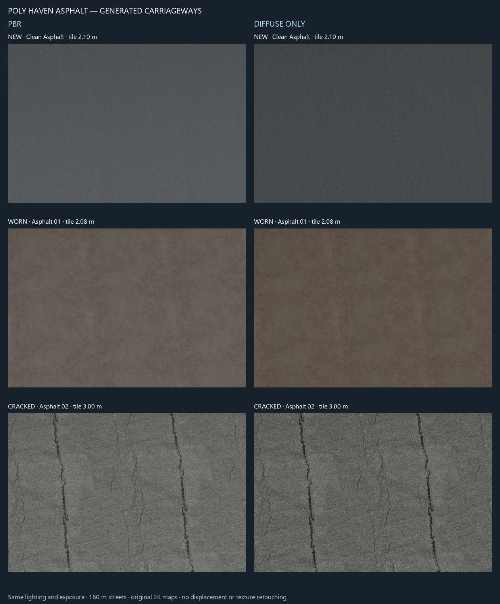
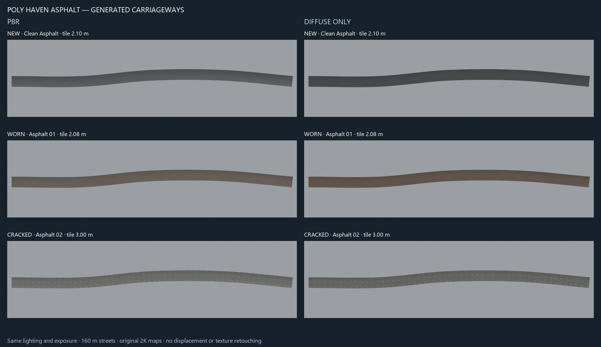

# Poly Haven asphalt materials

Six asphalt materials share `assets/prochitecture_street_materials.blend`,
revision 2.0, alongside the original four color/diagnostic materials. Nine
source images are packed. There are no objects, meshes or GN groups.

| Wear | PBR name suffix | Diffuse-only name suffix | Tile coverage |
| --- | --- | --- | --- |
| New | `New / PBR` | `New / Diffuse` | 2.10 m square |
| Moderate | `Worn / PBR` | `Worn / Diffuse` | 2.08 m square |
| Heavy/cracked | `Cracked / PBR` | `Cracked / Diffuse` | 3.00 m square |

Names begin with `Prochitecture Streets / Asphalt /`. Sources are
[Clean Asphalt](https://polyhaven.com/a/clean_asphalt),
[Asphalt 01](https://polyhaven.com/a/asphalt_01) and
[Asphalt 02](https://polyhaven.com/a/asphalt_02). PBR uses color, roughness and
OpenGL tangent normals. Diffuse-only uses the same color image with a lit
Diffuse BSDF. Both consume [metre UVs](STREETS_UV.md); no displacement is enabled.

## Use in Blosm

These controls and UV mapping are available in `buildings_gn` in
`C:/dev/workspace/blosm`.

1. In Blosm's import panel, enable **Import roads and paths**.
2. Leave **Street materials** empty for the bundled library, or choose a
   compatible external library. This field selects a file, not a material.
3. Press **Load asphalt materials** to append/reuse the six named materials.
4. In **Carriageway material**, choose e.g.
   `Prochitecture Streets / Asphalt / Worn / PBR`, then import. Empty retains
   the library's original plain pavement default.
5. Use Material Preview or Rendered shading to see textures.

For an existing network, select its controller, source centerline or generated
mesh. In **Streets → Python streets**, choose **Carriageway material** and press
**Update**. Empty uses that network's saved original material. The override
applies to carriageways, paved junctions and composites; grass keeps its material.

Material-only Update changes the managed material slot without rebuilding
objects, geometry or UVs. Source edits retain the choice; pointers and packed
images survive save/reopen. Import settings affect new networks; each existing
network retains its own choice. No material GN modifier or live observer is used.

Role-to-material resolution lives in `python_backend/materials.py`; roles such
as `pavement` are independent of Blender slot indices. Additional roles,
per-Section policies and PADL can extend that layer without changing texture
recipes or mesh builders. This version selects one pavement per network;
per-Section assignment is a future extension.

## Long-street comparison

Open
[asphalt_long_streets.blend](../../artifacts/streets/asphalt_materials/comparison/asphalt_long_streets.blend).
It contains six gently bending, **160 m long, 7 m wide** Python carriageways,
one for each material. Native textures can be inspected without scripts.
The addon is required for Update.





These are native Cycles CPU renders, 32 samples, with identical lighting/exposure
and unchanged source maps. Sheets resize and label the renders only.

Visual findings:

- New asphalt is quiet and dark gray. Aggregate is subtle at ordinary street
  viewing distances.
- Worn asphalt has warmer coloration and uneven wear. Repeated broad patches
  can be seen, but are less conspicuous than the cracked variant.
- Cracked asphalt has the clearest deterioration. Repeating crack motifs every
  3 m are plainly visible along the full street. Larger variation layers or
  coherent stochastic mapping are potential later improvements.
- PBR adds normal/roughness response. Diffuse-only retains color/crack imagery
  but lacks that reflection and surface-relief response. Texture cracks do not
  make physical holes.

These are three separate scans, not calibrated aging states of one mix. No
crack-removal or anti-repetition shader is included.

## Regeneration and checks

Recipes, source credits, pinned hashes and offline build instructions are in
[the material source guide](../../prochitecture_gn/materials/streets/README.md).
Runtime assets may remain in addon assets; source caches, receipts, scenes,
renders and JSON reports stay under artifacts.

```powershell
& 'C:/Program Files/Blender Foundation/Blender 5.2/blender.exe' `
  --background --factory-startup --disable-autoexec --python-exit-code 1 `
  --python C:/dev/workspace/blosm/tests/check_street_asphalt.py -- `
  --library C:/dev/workspace/blosm/assets/prochitecture_street_materials.blend `
  --output C:/dev/workspace/artifacts/streets/asphalt_materials/comparison
```

Repeat in a fresh process with `--reopen`. For images repeat with `--render N
--samples 32`, where N is 0–5 (PBR then Diffuse for each table row). Each worker
renders a full-length view and a 6 m-wide close-up. Run workers serially. The
source guide describes the bounded runner for limited-memory systems.

With host Python and Pillow, generate the labeled sheets:

```powershell
& 'C:/Users/vladi/AppData/Local/Programs/Python/Python310/python.exe' `
  C:/dev/workspace/blosm/tests/compose_street_asphalt.py `
  --output C:/dev/workspace/artifacts/streets/asphalt_materials/comparison
```

The native check covers exact library contents, image sharing/packing/color
spaces, shaders, physical tile scales, every generated UV, import overrides,
material-only Update with exact object/mesh/geometry/UV preservation, and source
edit retention. Fresh-process reopening checks native data and material-only
Update after cache recovery. `--regression materials` and `--regression
registration` run existing shared-library and addon/UI suites against the
explicit worktree, avoiding accidental imports of sibling Blosm.

This does not claim the whole historical street suite was rerun or that cracked
texture repetition is solved.
