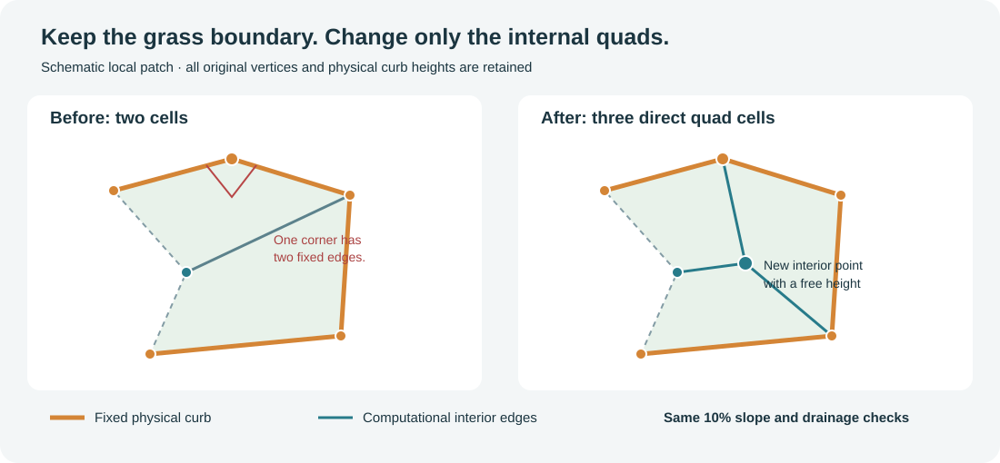

# Fixed grass boundary and direct-quad topology

The physical pavement/grass boundary stays authoritative. Grass keeps its
10% physical and stored slope limit, its elevation bounds and drainage checks.
A local topology change is available when an otherwise valid quad forces an
unnecessarily large gradient through three fixed boundary vertices.

## Why a valid outline can need another quad arrangement

At a quad corner, the two incident edge height differences determine its
bilinear surface gradient. If both edges end at fixed boundary vertices,
changing the fourth vertex's height cannot change that corner gradient.
Individual boundary-edge slopes below 10% do not guarantee that this single
two-dimensional gradient is below 10%.

The implementation computes the unavoidable component of each corner gradient
using the same free-height matrix and rank convention as slope projection.
`PublicationSlopeGuard.fixed_gradient_floors()` exposes those per-corner bounds;
the existing scalar `fixed_gradient_floor()` still returns their maximum with
the same arithmetic.

An ear can place two physical boundary edges in one quad. Retiling its local
two-cell patch gives each edge another interior direction. Three direct quads
and one new interior point can achieve this without changing any original
vertex, boundary edge or shared pavement height. The resulting grass mesh is
piecewise smooth; this is not a global C1 surface certificate.

## Bounded admission

`gapped_grass_recovery.recover()` retains an already accepted mesh and keys
unchanged. Its established height-only correction also remains the first path
when the fixed gradient is feasible. Only an actual fixed-gradient refusal
selects constrained faces for `positive_patches()`.

The existing direct-quad patch templates try two rotated quads, or three quads
with one certified interior point. They create no triangles. The optional
`constrained_faces` tuple identifies at most four distinct existing faces;
the existing two-cell and four-candidate allocations remain unchanged. Every
candidate must retain the exact original vertices, complete boundary-edge set,
manifold incidence and positive double/stored geometry. Authored UVs cannot be
silently discarded. The caller's cell budget remains binding.

New interior heights start from the original physical grass query. The normal
fixed-boundary reconciliation then independently qualifies elevation, physical
and float32 slope, stored edge ratio and drainage. A topology seed alone is
never an accepted solution. A genuinely excessive physical boundary-edge slope
still fails.

## Evidence and scope

The original gapped-Bundle witness had 529 grass quads. One ear imposed a
minimum gradient of 0.1118554, although its physical boundary edges stayed below
0.0523619. A direct three-quad replacement changes 529 cells to 530 while keeping
all 615 original XY positions and the entire physical boundary exact. Its
unavoidable gradient falls to 0.0905126; the unchanged height/publication checks
then give maximum physical/stored slopes 0.0999516/0.0999637, stored edge ratio
7.81244 and no drainage fill.

That initial witness is a local diagnostic. A declared numerical source variant
over the complete runtime-27 copy then passes 42 normal constructor tests,
including the original gapped source in both directions and after rigid
transformation, portable ear cases and existing publication/height behavior.
Source hashes remain unchanged. This qualifies the narrow repair's numerical
path; the next complete runtime copy and whole native imports have independent
gates.
Portable tests cover a synthetic fixed-height ear, rigid transformation, exact
boundary preservation, cell-budget refusal and an intrinsically excessive
boundary. Existing successful and height-only cases must retain their earlier
behavior.

### Exact merged-entrance grass caps

The same bounded recovery is also used by `bundle_merged_runs` when its existing
grass-cap reconciliation detects an excessive *unavoidable* fixed-face gradient.
Successful caps keep their original path. The ordinary eight-round height and
drainage reconciliation still runs after a topology patch, and the complete run's
combined cell budget remains enforced. Original cap rim vertices and heights
must stay byte-exact; a new interior point does not become a physical boundary.

The portable Exact merged-Bundle fixture exposes the same 0.1118554 fixed-face
gradient in a 136-quad cap. Existing direct-quad recovery adds one quad, producing
137 cells with the exact rim. Independent local quality, stored quality, slopes,
drainage and overlap checks pass. The normal full Exact and smooth merged-Bundle
tests then pass, including original coverage, matching pavement/grass interfaces,
update/full-restore parity and released-query behavior. A scoped numerical
candidate with the paired source-jet correction passes all 43 selected tests.
It is not a fresh combined whole-city/native qualification.

Relevant implementation:

- [Grass recovery](../way/street_network/python_backend/gapped_grass_recovery.py)
- [Direct-quad patch templates](../way/street_network/python_backend/positive_quad_patches.py)
- [Unavoidable gradients and publication checks](../way/street_network/python_backend/publication_slopes.py)
- [Portable regression tests](../tests/test_python_street_gapped_grass_recovery.py)
