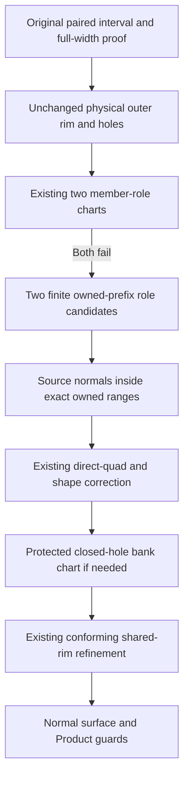

# Quad charts for owned paired terminal prefixes

The paired-prefix atlas is a failed-only computational chart alternative.
It does not change road ownership, create junctions or pair nearby roads.
The existing ordinary physical-hole and two member-role chart attempts remain
first. A new attempt is available only for one already certified paired
terminal interval with two nonempty original Bundle member claims.

The actual Beijing five-owner normal chart and explicit Product constructor
pass at the immutable `117a` source point, without supplying a prepared mesh,
cuts or boundary-condition patches. This is separate from whole-city or normal
coordinator-Task qualification. Runtime source-height Tasks still keep their
disabled default.

## Physical inputs and computational coordinates

[`partial_bundle_claims.py`](../way/street_network/python_backend/partial_bundle_claims.py)
retains the actual Bundle, original member visits, HEAD/TAIL ownership and
complete surviving half-profile incidences. The existing preparation is run
again before the chart is considered.

[`OwnedPairedPrefixScope`](../way/street_network/python_backend/paired_interval_atlas.py)
uses the fresh complete-width proof from `certify_layout()`. It records every
owned original Section interval, including surviving source prefixes. A
returning Section's separated intervals remain separated: the chart cannot
replace them by their hull or sample the unowned middle. No station is
invented from an XY search.

Both original member roles are finite candidate choices. For a selected role,
its actual owned member prefixes supply source-normal axes alongside the
remaining consumed-source axes. The normal is intersected with the actual
physical outer-minus-hole domain. Selected member axes retain all pavement
intervals along that normal, even when a pavement interval does not contain the
selected centerline. This is a computational selection rule; it does not
declare that interval a new lateral Bundle member.

Unpaired-source computational spans can be omitted when their actual endpoint
distance exceeds eight original source widths. Omitting a computational cut
does not omit the source road, alter a physical curb or change its ownership.
Every emitted `JunctionCut` retains `section_id=None` and addresses the actual
physical boundary through `BoundaryRef`.



The optional cadence multiplier is one or two. The new atlas uses two, giving
source bands a nominal length of

$$
\max\left(\frac{3w}{2},4s\right),
$$

where $w$ is original source width and $s$ is the requested mesh spacing. The
existing 64-band allowance is shared across all disjoint ranges of one Section.
The 128-cut bound, partition visibility/clearance limits, 20,000-point source
scope and combined 50,000-cell ceiling remain in force. The new branch has at
most two role attempts, after the old attempts have failed.

The established generated-phase normalization remains a separate admission:
it requires its original circular-contact witness, unchanged analytical
primitives and profiles, exact holes, at most 1 micrometre additional sampled
polyline error, and fresh width proofs. The new atlas does not normalize an
arbitrary failed shape or increase that allowance.

## A continuous chart between protected grass banks

The new atlas enables one additional closed-hole fibre alternative through the
protected `_fibre_hole()` builder hook. Other chart classes use the exact
existing implementation. Even for the new atlas, a successful existing fibre
chart returns unchanged before the new alternative is considered.

[`RuledHoleBanks`](../way/street_network/python_backend/hole_fibre_chart.py)
requires two finite, monotonically ordered chains of the actual prescribed hole
polygon. Each chain must retain the same two physical tips and its actual
adjacent tip edges. Interior row pairing can add chord samples; it cannot
replace those four adjacent original vertices. The tip metadata contains
original polygon coordinates and intrinsic angles, never a logical source End.

For matched Cartesian banks $A(x)$ and $B(x)$, the chart uses

$$
P(x,v)=(1-v)A(\hat{x})+vB(\hat{x}),\qquad 0\le v\le1,
$$

where $\hat{x}$ is the existing bounded computational shear coordinate. The
shear vanishes at the two banks; exact physical tip coordinates are restored.
Both bank coordinates are interpolated continuously. Reconstructing an
interior mean-X point and replacing only the final bank points would create a
discontinuous bank limit when paired vertices have different X positions.

Two existing half-strip templates meet at $v=1/2$ so that no quad straddles the
shear map's midpoint cusp. Protected tip-adjacent rows are kept intact. Total
column counts are `2 mod 4`, giving each half compatible odd boundary counts,
within the existing 128-column ceiling. Row count remains bounded by 8,192.

The original adjoining tip edges determine the intrinsic sine. Existing
bounded quad correction derives its minimum and target angles from that value;
there is no fixture-specific sine constant. Grass still requires positive
corners and physical/stored edge ratio at most eight. The pavement's separate
minimum sine of 0.03 is unchanged.

Additional grass-bank samples are fed to the existing
[`conforming_boundary_refinement`](../way/street_network/python_backend/conforming_boundary_refinement.py)
hook. It creates direct quads and the exact matching whole pavement edges,
preserving original physical vertices and incoming profiles. Every final hole
must have one manifold boundary cycle, unchanged area/order, and samples lying
only on its original boundary chords.

## Dependencies, output and verification

The projected signature includes the chart policy token, exact current owned
ranges, original interval/cut identities, and both role candidates' actual
inputs. All original Path/Profile records of the Bundle members participate,
including remote unowned visits, as do all Paths/Profiles represented by the
owned-range proof. Existing ownership, coupling and material/height dependency
scopes remain intact. No fixture-specific Bundle, role or Section number is
used by the runtime policy.

Returned metadata records actual role choice, exact ranges, fresh width proofs,
dependencies, omitted computational spans, previous failures, finite attempt
counts and unchanged cell budgets. The normal surface constructor then applies
its configured source-height policy and existing slope, drainage, publication,
query and shared-rim checks. A planar chart alone is not a qualified street
surface or progressive-import result.

Run the focused source fixtures with the chat's isolated resource-guarded
Python environment:

```text
python -m unittest discover -s tests -p test_python_street_owned_paired_prefix_charts.py -v
```

The tests cover both roles and original traversal reversals, owned surviving
prefixes, disjoint range sampling and shared band budgets, off-center pavement
intervals, metre-based computational span filtering, remote unowned Path edits,
continuous unequal-X bank limits, protected adjacent tip vertices, and exact
retention of a previously successful fibre chart. Existing paired-interval,
hole-fibre and conforming-refinement regressions run alongside them.

Generated source snapshots, normal-chart qualification captures and reports
belong under `artifacts/streets`; they are evidence, not implementation or
recovery dependencies.

The `117a` run constructs 19,046 pavement and 2,572 grass quads through normal
`CompoundQuadChart` dispatch. After both previous role attempts fail, the new
finite candidate for original member role zero succeeds. Its 7,721 certified
body targets have zero height error; physical query error is below
$1.4\times10^{-17}$ m. The independent audit finds no isolated minima, maximum
incoming longitudinal slope of 0.8895 percent, valid physical/stored mesh
quality, conforming pavement/grass boundaries, no quad overlap, finite UV maps
and stable queries after releasing mesh buffers. Original source inputs and
all 1,504 snapshot-file hashes remain unchanged.

The constructor takes 339.65 seconds in this controlled numerical diagnostic;
the complete audit takes 367.22 seconds. Peak resident memory is 378.7 MB.
These are correctness and memory observations, not a claim of satisfactory
progressive UI responsiveness. The run still requires a genuine current-epoch
coordinator-Task witness and complete original-network/native progressive
qualification.
