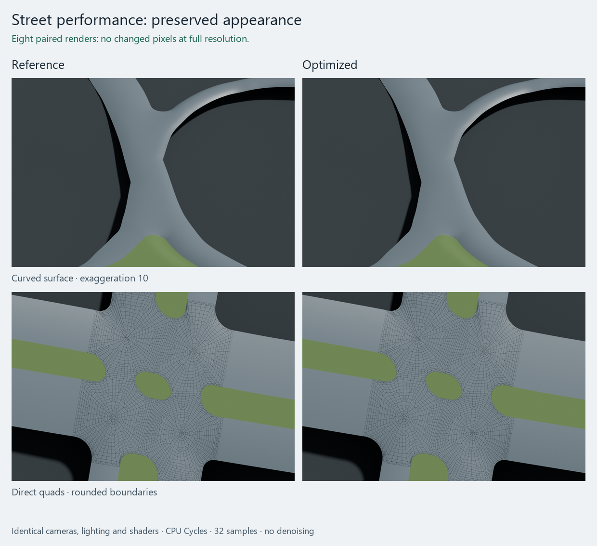

# Python street performance implementation

Work started on 11 November 2026; measurements below were completed on 12 November.
This document records the implemented optimizations and the remaining research
from [STREETS_PERFORMANCE_PLAN.md](STREETS_PERFORMANCE_PLAN.md).
The approximately 10× target is **not achieved**. Preserving appearance and
robustness remains mandatory; no resolution, interpolation tolerance, curvature
check, terrain safety sample or mesh-quality limit has been reduced.

The conservative measured result is **70.278 → 41.768 seconds** for street
generation in fresh-process, alternating reference/candidate controls: **1.68×
faster, or 40.6% less time**. An earlier five-run candidate batch had a 37.418 s
median; both batches are retained below rather than selecting the fastest one.

Development checkout: `C:/dev/workspace/blosm_streets_dev`, branch
`streets_development`. Reference `buildings_gn` and the development parent were
both `b9517de05889a3a7f0d7bc8107d923f7af871f41` at the start. The user's main
checkout has not been modified. Current runtime: `0.1.0.dev81`. Five ordinary
imports, all 983 numerical regressions, the native lifecycle/Update checks and
the controlled-render comparisons pass. No changes have been staged, committed
or transferred back to the reference branch as part of this task.

## Measured increments

These are complete streets-only, 3D-realistic imports of the saved terrain
configuration, with the same settings, isolated Blender profile and scoped
Import performance preference as the baseline. They exclude startup and saving.

| Candidate | Street generation | Whole Import | Qualification |
| --- | ---: | ---: | --- |
| dev78 baseline | 72.133 s median | 72.663 s median | Three fresh processes; 70.926–73.616 s generation |
| Priority queue and visibility clipping | 57.214 s | 57.706 s | One run; exact saved geometry, UVs, materials and construction metadata |
| Above plus frame/slope reuse and terrain-ray deduplication | 49.639 s | 50.114 s | One run; same exact comparison passed |
| Above plus overlap filtering and eligible paired-rim strategy | 42.685 s | 43.147 s | One run; all 328 meshes and 350,571 quads exactly preserved; only `separator:14` strategy metadata changed |
| dev79, including bounded Update constraints | **42.006 s median** | **42.448 s median** | Three fresh processes; 41.915–42.101 s generation; exact saved positions, quads, corner normals, smooth shading, UVs and material assignments |
| dev80, contiguous gradient streams and velocity-only path evaluation | 39.215 s median | 39.679 s median | Three fresh processes; 39.078–39.360 s; exact saved-output comparison |
| dev81, two-coordinate energy stream and lazy/batched BVH dispatch | **37.418 s median** | **37.869 s median** | Five fresh processes; 37.086–37.716 s; exact saved-output comparison |

The final row is **48.1% less generation time**, or **1.93× faster**, than the
baseline median. Peak resident memory was 605 MiB and sampled private memory
679 MiB, against approximately 601/673 MiB in the baseline. This remains below
the existing 3 GiB process cap; the 1 GiB system reserve stayed enforced.
No additional memory allocation is required from the user.

Single-run intermediate rows are diagnostic observations; the last row provides
the repeated candidate measurement. Its runtime source digest is
`c6cc49fd129e3e6b08f2cbc9b67b5640b2d2ebac4658b571ef7bfcf93e55309d`.
All 328 output meshes and 350,571 quads remain. The comparison covers exact
prepared/final float32 positions, connectivity, corner normals, smooth-shading
flags, UV maps and material assignments. Only construction diagnostics change.

The final five generation times were 37.281, 37.086, 37.418, 37.544 and 37.716 s.
They are separate fresh processes with the same settings as the baseline; OS
file caches were not flushed. This is an observed range, not a latency guarantee.

A later fresh control using the committed dev78 code took **64.714 s**. That
is faster than the original 72.133-second median despite unchanged inputs and
settings. The historical 1.93× ratio must therefore not be interpreted as a
precisely controlled causal estimate. A final ABBA sequence ran each version in
a separate factory process, with the same settings and performance preference:

| Order | Runtime | Street generation | Whole Import |
| --- | --- | ---: | ---: |
| A1 | dev78 reference | 68.100 s | 68.585 s |
| B1 | dev81 optimized | 41.593 s | 42.097 s |
| B2 | dev81 optimized | 41.944 s | 42.460 s |
| A2 | dev78 reference | 72.456 s | 72.975 s |

The medians are **70.278 versus 41.768 seconds** for generation and **70.780
versus 42.278 seconds** for the whole Import. Use this observed **1.68×** gain
as the conservative headline. The cause of timing drift has not been isolated;
the measurements do not prove a hardware/scheduling explanation. Two controls
per version also do not establish statistical latency bounds. All code/input
hashes and settings remained fixed, and all runs produced the complete scene.

Native dev79 Update qualification and 960 numerical regressions passed before
the final workspaces were added. The new workspaces/rules also pass 40 targeted
tests, and speed-only path queries pass 26 path/local-smoothing tests. The final
full suite passes **983 tests**, zero failures/errors, in 1028.986 seconds. Its
complete Python-source digest is unchanged before/after:
`94363c668be8c53516a0766d627cee3d8d8b265ac5ad2407ff5b44411986e1ad`.
This digest includes test tools; the separate runtime-only digest above identifies
the code timed by the ordinary Import runs.

### Other real OSM networks

The same ordinary Import harness ran the committed dev78 runtime and candidates on
two additional inputs. Both used the saved import settings with terrain cleared
because the Berlin terrain does not cover these geographical extracts.

| Input | dev78 generation | dev80 generation | Final dev81 | Unchanged output |
| --- | ---: | ---: | ---: | --- |
| `streets/canal_street.osm` | 8.356 s | 5.916 s | 5.588 s | 21 meshes, 21,838 quads; exact geometry, normals, UVs and materials |
| `streets/nashville_wyoming_ave.osm` | 19.315 s | 16.711 s | 14.513 s | 185 meshes, 254,547 quads; same exact comparison |

These are single-run generalization checks, not repeated timing claims. The
reference is an explicit `git archive` of `b9517de`, with required runtime assets
copied read-only and hashed. It does not import the user's main checkout, whose
active branch may differ. `--addon-root` together with `--addon-revision` in the
benchmark host tool reproduces this separate-runtime comparison.

## Implemented computation changes

### Repair layout, polynomial rules and immutable payloads (dev80)

The quad gradient now uses contiguous X/Y streams and reusable temporary
arrays. It keeps the original operation order and corner/contribution/face
scatter sequence. On 156 captured real chart seeds, complete descents (including
energy, line search and fixed boundaries) improved from 8.334 to 6.309 seconds
in a paired ABBA replay, with bit-identical coordinates and identical accepted
steps/energy reports. This is a 1.32× repair-work improvement, not a full-Import
speedup. The buffers belong to one active chart and are released afterward.
The final energy workspace also sums the two squared-coordinate terms with one
NumPy addition instead of a length-two reduction at every corner. It retains
the same arithmetic and final energy reduction. Replaying all 156 complete
descents against both frozen workspaces gave 8.530 versus 5.931 seconds (1.44×),
again with bit-identical coordinates, energies and accepted steps.

Arc-length quadrature and Newton inversion now evaluate only the required
velocity. They keep the same interval search, cubic derivative arithmetic,
quadrature nodes and four Newton steps. Position and acceleration are still
computed for full-jet callers and all existing curvature certification remains.
An overridden `Path.jet` in a subclass retains its existing extension behavior.

Known plateau and quintic curb rules supply their analytical polynomial
coefficients. Each still passes the original residual and slope samples; an
unsuitable supplied rule falls back to the existing degree 5/10/20 fit. General
profile rules continue using that fitted path. The first complete candidate
kept all published mesh positions, normals and UVs bit-identical to the baseline.

UV arrays now have immutable backing storage and are shared through position-only
placement. Constructors and externally replaced maps keep defensive copies;
merely marking an external view read-only does not make it trusted. This avoids
repeated whole-network UV copies without changing UV values, seams or materials.
The first full candidate measured 605 MiB resident / 673 MiB private, versus
650 / 723 MiB for the dev79 batch. The final combined run remains near that
smaller footprint. The table above measures the combined time improvement;
it does not infer individual savings by subtracting unrelated single runs.

### Deterministic pattern priority queue

`patterns.py` maintains one longest-edge heap per side instead of rescoring
every boundary edge for each split. A sequence ticket reproduces the previous
dictionary insertion order for equal lengths; removed edges are invalidated
lazily. Each new edge uses the same norm calculation once. Unit-parameter
coordinates, direct quad connectivity and boundary order remain unchanged.

Tests include equal/unequal side counts, parity transitions, dense boundaries,
cache eviction and disabled caching. Replaying 155 captured pattern requests
against the frozen dev78 implementation gave identical arrays and a 2.64×
primitive speedup in a paired ABBA measurement.

### Visibility clipping without tiny NumPy allocations

`quad_charts.visibility_center` retains the original edge and clipping order,
tolerances, centroid and final clearance check. Its small clipped polygon is
represented by Python double pairs while processing each half-plane. This avoids
constructing many two-element arrays. An initial vectorized experiment was slower
and was discarded.

All 1,440 captured real kernel calls, including rejection outcomes, matched the
frozen implementation. The paired ABBA primitive measurement improved about
6.04×. Synthetic tests additionally cover invalid/nonvisible polygons, thin
kernels, both supported tolerances and translated coordinates. These primitive
speedups must not be multiplied or advertised as whole-Import speedups.

### Bounded path and slope workspaces

`Approach.frame` retains its scalar cache and adds a separate cache for small
station arrays. Keys include dtype, shape and exact bytes; values are copied
on storage and retrieval. The array cache holds at most eight entries and
32 KiB per Approach. Large mesh queries are not retained. An Approach belongs
to one prepared path/orientation, so newly prepared source geometry gets a new
cache rather than reusing an obsolete path.

`SlopeProjection.solve` pre-gathers invariant color/corner coefficients outside
its iteration loop. The original projection/update order, root budget, stopping
criteria, fixed values and final checks remain. If the extra workspace would
exceed the configured memory budget, it uses the previous gather-on-demand path.
Both paths are tested against the original solver with exact resulting arrays
and reports.

### Exact terrain-query deduplication

`TerrainSampler` deduplicates only bit-identical BVH ray origins within batches
of at most 16,384 queries. Blender's `mathutils.Vector` already stores these
coordinates as float32. The packed keys preserve those exact bits, including
signed zero; no additional physical-coordinate rounding is introduced.
First-occurrence ordering preserves the first missing-terrain diagnostic.

The native test replayed all 3,541,148 baseline queries. The candidate needed
1,883,488 actual rays, returned identical heights and reduced the measured query
work from 4.517 to 2.647 seconds. A subsequent dispatch change converts bounded
query batches to Python pairs once and binds the ray operation once per call,
avoiding a tiny ndarray allocation/indexing operation for every ray. Its exact
native replay measured 4.446 versus 1.453 seconds (3.06× query-work speedup).
The BVH is now built only on the first nonempty query, after the evaluated
geometry/transform signature is available. Fully cached fits and no-ops avoid
building it. The report distinguishes requested samples from actual rays;
coverage, float32 ray origins, hit selection and missing-hit diagnostics remain.

### Overlap validation

The CSR grid, cell ownership and independent stored-float32 validation remain.
Candidate arrays are compacted after each inexpensive rejection instead of
doing later gathers for already rejected pairs. For large SAT batches, two of
the original axes first provide exact rejection witnesses. Unresolved pairs
still receive the complete eight-axis test in the same local coordinate frame.

Random/adversarial tests compare against independent all-pairs SAT and the
frozen batched validator. A saved-network ABBA replay produced identical pair
counts and reports and improved 4.36 seconds to 3.08 seconds, about 1.42×.
No acceptance relies on local quad orientation alone.

## First construction strategy: long flat separators

`chart_strategies.FlatPairedRimStrategy` provides separate `classify`, `construct`
and `validate` steps. Eligibility requires:

- At least 64 prescribed rim vertices.
- Rim heights already at the common plateau, within floating-point roundoff
  capped at 10⁻¹² m. Nonconstant end transitions keep the established search.
- A principal-axis length at least twelve times its transverse span.
- A strict visibility kernel.

Eligible regions are cut between visible opposite rim vertices into short
ribbon blocks. The original direct-quad block constructors and quality checks
then operate on those blocks. End curves and all rim samples remain fixed.
The selected chart additionally checks boundary incidence, the cell/edge-ratio
budgets and global self-overlap. A rejected candidate returns to the existing
layered/four-sided/partitioned/angular search, with its rejection recorded.
Dispatch uses geometry and heights, never OSM IDs or fixture names.

The initial four-sided-first experiment was not selected: it increased mesh
counts and made some cases slower. Keeping the established layered-first block
order and restricting eligibility reproduced the original longest separator's
vertices and faces exactly while reducing its standalone construction from
approximately 6.4 seconds to 1.0 second. In the complete Import, the selected
separator retained exact geometry, UVs and final terrain positions. The
diagnostic `selected_chart` now explains the new dispatch.

The four captured separators remain available as local replay cases. This is
the first restricted construction family; it is not a claim that general
compound intersections or all separators have a new fast solver. Wider
eligibility must pass the plan's surface/normal/UV and visual comparison gates.

### Broader four-sided intersection experiment: not selected

`tests/street_compound_chart_experiment.py` exports/reuses actual normalized
network inputs and intercepts complete compound builds. It tries a four-sided
chart before the existing layered chart, keeping the physical rim, height
provider, slope projection and all quality guards. The accepted reference
continues through the normal backend; the experiment cannot publish its result.

Ten compound builds taking at least 0.25 seconds were compared. Four-sided-first
reproduced five meshes exactly, but changed the other five. Symmetric surface
queries at vertices and cell centres found maximum height differences ranging
from 0.844 to **12.421 mm**. It also made two unchanged cases slower. Some large
unchanged cases saved more than one second, but this does not establish a general
eligibility rule that preserves the interior surface on other inputs or edits.

Consequently the ordering is **not enabled**. The samples are rejection evidence,
not a proof that the maximum between them is smaller. They also do not replace
the controlled appearance gates. No fixture IDs are used for runtime dispatch.

## Terrain constraints for Update

`terrain.cache.TerrainConstraintCache` retains local elevation-control floors
and terrain heights at source vertices. It does **not** retain another copy of
each generated mesh or fitted output positions. Each engine has an 8 MiB,
512-entry LRU limit; entries exceeding the budget simply use the uncached path.

Keys include evaluated terrain revision, component identity/reference, exact
prepared coordinates/connectivity/stations, reference controls, datum, clearance
and safety-sample spacing. An arbitrary terrain callable without a revision
token cannot reuse cached data. Blender supplies its evaluated geometry,
triangulation and transformed coordinate signature. File load/engine disposal
clears the cache with the existing runtime state.

Every fit still rebuilds contacts and the complete reference graph, propagates
all constraints, constructs elevation curves and validates grade and maximum
lift. Reuse does not freeze previous fitted heights: lowering terrain or
removing a constraint can lower the entire affected connected reference.
Cached values are immutable copies of independently calculated constraints,
so a later failed publication cannot make them stale accepted output.

Numerical tests compare cached/uncached results against the frozen dev78 fit,
including geometry, control/sampling changes, terrain lowering, changed contacts
and grade/lift limits, missing terrain, zero budget, eviction and mutation
isolation. Native vertex/width Update comparisons now also pass exact geometry,
normal, UV and material checks in both edited and restored states.

Before this cache, a 5 cm terminal-vertex edit took 5.418 seconds on the saved
network, including 4.431 seconds of whole-network terrain work. Warm no-op
Updates took approximately 0.481 seconds. The first Update after reopening took
24.878 seconds to reconstruct derived state; it is distinct from a warm no-op.

The final dev79 same-process ABBA comparison first raised the original terrain
by 1 cm and restored it, warming the constraint cache through real invalidation.
Vertex Updates measured 5.38 / 5.29 s without the cache and 2.37 / 2.27 s with it;
width Updates measured 5.59 / 5.50 s without and 2.49 / 2.43 s with it. The first
cached edit still traced the changed component's rays; the repeated identical
edit reused those too. Warm no-ops took 0.49–0.50 s. Reopening still takes
24.5–24.9 s to reconstruct numerical state; the cache is not persisted in the
scene. Terrain raise/restore took 8.1–8.2 s, since those edits invalidate all
terrain keys and republish the affected surfaces.

The benchmark scene disables Terrain with `hide_viewport`. Blender does not
evaluate its object transform while it is disabled. The disposable native test
therefore enables terrain evaluation during raise/restore and then restores its
visibility setting. The earlier warmup attempts stopped on this assertion and
are retained as diagnostics; they do not count as successful timing runs.

The same native checks on final dev81 pass. Warm vertex edits take 2.21–2.26 s
with the cache versus 4.19–4.22 s without it; width edits take 2.39–2.41 s versus
4.39–4.40 s. Both paths include the newer faster sampler, so this isolates the
cache benefit in the final implementation. Warm no-ops take 0.48–0.52 s, first
reopened Updates take 21.07–21.31 s, and terrain raise/restore takes 6.92–7.07 s.
The edited and restored geometry, normals, UVs and materials match exactly.

Native global undo/redo, material-only Update retaining the same mesh datablocks,
cache disposal on file-load/deleted-owner events, and an injected late publication
failure all pass with terrain enabled. Failed publication retains the last good
scene/engine state; retry and restoration reproduce the original output. The
ten-fixture UV gallery additionally checks all six junction families, a bent
network, extra named corner maps, metre/centimetre units, direct/profile terrain
modes and save/reopen behavior.

## Evidence and reproduction

### Controlled visual comparison

All eight pairs of 1200 × 800 renders are **pixel-identical**. The set covers the
whole network, an oblique junction, exaggerated curvature and side silhouette,
the long separator, direct-quad wireframe, and the Worn diffuse/PBR asphalt
materials (including the tangent normal map). CPU Cycles uses identical cameras,
lighting, color management, seed 1701 and 32 samples, with denoising/adaptive
sampling disabled. The original terrain is shown identically on both sides.
The unchanged saved meshes provide the stronger full-network geometry evidence;
the images complement that check rather than replacing it.

The documentation sheet is resized for display. Pixel comparisons use the
unmodified full-resolution images, not this sheet. Inspection exaggeration and
shader substitutions affect temporary copies only; no saved input or material
library is edited. `tests/render_street_performance.py` creates the paired views;
`tests/compare_street_performance_renders.py` checks render settings and all
original pixels and creates this illustration.

### Generated evidence

Generated evidence root:
`C:/dev/workspace/artifacts/streets/performance/optimization_implementation_20261111/`.
All scenes, reports, captures, logs and numerical replay data stay there.
Documentation and its illustrations remain in this repository. None of the
generated scenes or JSON reports should be staged.

| Directory / file | Purpose |
| --- | --- |
| `pattern_kernel_candidate/run_01/` | First exact-output full Import |
| `reuse_candidate/run_01/` | Combined work/terrain-query reuse Import |
| `paired_candidate/run_01/` | Overlap/paired-rim candidate, complete saved scene |
| `equivalence_01..03/` | Independent baseline/candidate saved-output comparisons |
| `replay_highqos.json` | Paired primitive timings, with the production scheduling preference |
| `terrain_queries/` | All sampled BVH query comparisons and missing-point checks |
| `validation_01/` | Frozen/current overlap-validation ABBA replay |
| `reuse_diagnostic/run_01/` | Optional nested attempt ledger, profiles, kernel and separator captures |
| `paired_rim_01/`, `paired_rim_02/` | Four-sided-first and layered-first experiments, including unsuccessful tradeoffs |
| `update_vertex/`, `update_width/` | Update measurements before constraint caching |
| `milestone_01/` | Three dev79 imports and the complete final saved scene |
| `milestone_equality/` | Exact baseline/candidate positions, connectivity, normals, shading and UV comparison; only separator strategy metadata differs |
| `cached_update_vertex/`, `cached_update_width/` | Initial native cache comparison, including an explicitly cold first cache fill |
| `cached_update_vertex_03/`, `cached_update_width_03/` | Qualified warm-cache ABBA edits, terrain raise/restore and exact output comparisons |
| `numerical_suite_01/` | All 960 dev79 regression tests passed, with unchanged source hashes |
| `quality_replay_02.json` | All 156 real complete descents; old/current energy and gradient, exact coordinates and decisions |
| `terrain_queries_02/` | Final lazy/batched BVH dispatch, exact 3.54-million-query replay and empty/missing-hit checks |
| `milestone_02/`, `milestone_02_equality/` | Repeated dev80 timing and exact saved-output comparison |
| `canal_reference/`, `canal_candidate/`, `canal_equality/` | Additional real-network qualification without Berlin terrain |
| `nashville_reference/`, `nashville_candidate/`, `nashville_equality/` | Additional larger-network qualification |
| `reference_snapshot.json`, `reference_b9517de/` | Disposable committed-runtime baseline and recorded asset hashes |
| `source_export/`, `compound_four_side_experiment/` | Normalized contracts and unselected whole-surface experiment, including changed-height evidence |
| `final_candidate/` | Five final dev81 imports; `run_05/street_benchmark.blend` is the latest complete scene |
| `final_equality/` | Exact final prepared/terrain positions, quads, normals, UVs and material assignments against dev78 |
| `final_update_vertex/`, `final_update_width/` | Final native cached/uncached ABBA edits, terrain changes and exact restoration |
| `final_lifecycle/` | Native undo/redo, transactional rollback, material-only and cache lifetime checks |
| `final_uv/` | Ten native fixtures, UV/terrain/units/editing and save/reopen checks |
| `visual_reference/`, `visual_candidate/`, `visual_comparison/` | Eight controlled pairs, identical settings and full-size pixel comparison |
| `final_canal/`, `final_nashville/` and their `_equality/` directories | Final dev81 real-network imports and exact comparisons against the committed reference |
| `reference_control/`, `reference_control_equality/` | Later dev78 timing control; output still exactly matches the original baseline |
| `final_numerical_suite/` | All 983 regressions pass; complete Python-source digest unchanged throughout |
| `paired_controls/` | Final fresh-process ABBA controls, complete receipts and observed 1.68× speedup |

Use `tools/benchmark_streets.py` as documented in the plan, with a fresh output
folder. Current receipts include a runtime source SHA-256 as well as the Git
parent, so uncommitted candidates are distinguishable. They reject source edits
during an Import. Optional `--construction-diagnostics` records parent/child
attempts and bounded replay inputs; its timings include instrumentation overhead.

`tests/replay_street_construction.py` and
`tests/street_paired_rim_experiment.py` run under Blender's standalone Python.
Native inspectors must use factory startup, disabled auto-execution and the
chat's isolated profile. `check_python_street_update_profile.py` now explicitly
loads this checkout, rather than accidentally resolving the sibling main Blosm
checkout, and supports separate `--edit-kind vertex` / `--edit-kind width` tests.

For the final ordinary measurement, use the plan's command with `--runs 5` and
a fresh `--output` folder. For a committed reference runtime, additionally pass
`--addon-root <read-only-extracted-commit>` and `--addon-revision <full-commit>`;
both arguments are required together. Copy the required distributable material
and terrain assets into that extracted tree and record their hashes. Never
substitute an unrelated active branch from the user's main checkout.

The final native checks are reproducible with these script arguments, through
the isolated `bounded_blender.py` launcher and its inherited profile environment:

| Script | Arguments after Blender's `--` |
| --- | --- |
| `check_street_timing_equivalence.py` | `--input <reference.blend> --input <candidate.blend> --output <report.json> --allow-construction-metadata` |
| `check_street_performance_lifecycle.py` | `--output <fresh-folder>` |
| `check_street_uv.py` | `--output <fresh-folder>` |
| `check_python_street_update_profile.py` | `--scene <candidate.blend> --output <fresh-folder> --edit-kind vertex --skip-profile --compare-terrain-cache`; repeat with `width` |
| `render_street_performance.py` | `--scene <saved.blend> --output <fresh-folder> --material-library <checkout>/assets/prochitecture_street_materials.blend`; run separately for reference/candidate |

Keep the 3 GiB process cap, 1 GiB reserve, 16 Blender threads and one numerical
thread. Run measurements serially. `check_python_street_suite.py --output
<fresh-folder>` runs with bundled standalone Python/NumPy and no Blender process;
do not edit Python files while it runs, because it verifies the complete source
digest before and after. The host render comparator takes `--reference`,
`--candidate`, `--output` and optionally `--illustration`; it requires NumPy/Pillow
in the host environment, not an installation into Blender's bundled Python.

## Plan status and remaining limits

| Plan stage | Result of this implementation |
| --- | --- |
| A: diagnostics and reproducible baseline | Implemented: version/source/input receipts, separate nested attempt ledgers, bounded captures and same-process replay tools |
| B: unchanged-work reductions | Implemented and qualified: pattern priority queue, exact visibility clipping, path/repair reuse, analytical rule evaluation and immutable UV payloads |
| C: faster construction families | Eligible flat paired-rim separator selected with the generic fallback retained. Broader four-sided compound dispatch tested and rejected; general corner/mouth families remain research |
| D: terrain and validation | Exact ray deduplication, bounded dispatch, lazy BVH and overlap filtering selected. An alternative barycentric terrain provider and reusable global non-overlap certificates are not enabled |
| E: adaptive density/new height basis | Not enabled: these optional changes need a separate visual-error contract and would change the accepted output |
| F: Update and integration | Bounded terrain constraints, invalidation, unchanged-output ownership and transactional behavior qualified. Five final full imports measured; the 7-second target is unmet |

The final median-duration run partitions as follows (one actual run; rows do
not add unrelated medians):

| Work | Time |
| --- | ---: |
| Junction surfaces | 17.098 s |
| Separators | 4.998 s |
| Other numerical preparation and validation | 6.610 s |
| Terrain preparation and fitting | 3.376 s |
| Other publication, including stored-precision validation | 3.106 s |
| Adaptation, materials and other renderer work | 2.231 s |
| **Street generation** | **37.418 s** |

Reaching 7 seconds still requires a substantial change to intersection and
separator construction. Accelerating mesh datablock publication alone cannot
close this gap. The next useful research is a geometry-based eligibility rule
that bypasses failed repair attempts **and** preserves the final physical
surface, including edited cases. The four-sided experiment gives both successful
exact-output examples and counterexamples; it must not become an ID-based lookup.

An alternative terrain-height provider has a smaller remaining opportunity:
the final exact ray workload is already about 1.45 seconds in replay, and the
rest of terrain fitting must still enforce shared minima, grades and lift.
Skipping the independent stored-float32 overlap check or weakening sampling is
not an acceptable shortcut. Neither reduced resolution nor extra packages in
Blender's bundled Python are part of this implementation.

### Further experiments and acceptance contract

The recorded visibility calls contain 1,301 distinct exact polygons among
1,440 calls. The 139 repeated calls account for only 0.235 seconds of the
instrumented time and retain about 5.1 MiB of distinct input coordinates.
An additional whole-build visibility cache is therefore not selected. This
does not affect the splitter's existing local memoization.

The boundary-polynomial experiment declared its comparison limits before
qualification: unchanged topology and UVs, maximum physical prepared or
published displacement 0.00001 m, and maximum corner-normal change 0.0001 rad.
The analytical rule must still pass the original residual and boundary-slope
sample checks; an unqualified rule uses the existing polynomial-fit path.
These limits govern floating-point evaluation of the same polynomial, not
permission to substitute a different intersection shape or relax geometric
validation. Native Berlin, Canal Street and Nashville comparisons were stronger:
their saved geometry, normals and UVs matched bit for bit.
