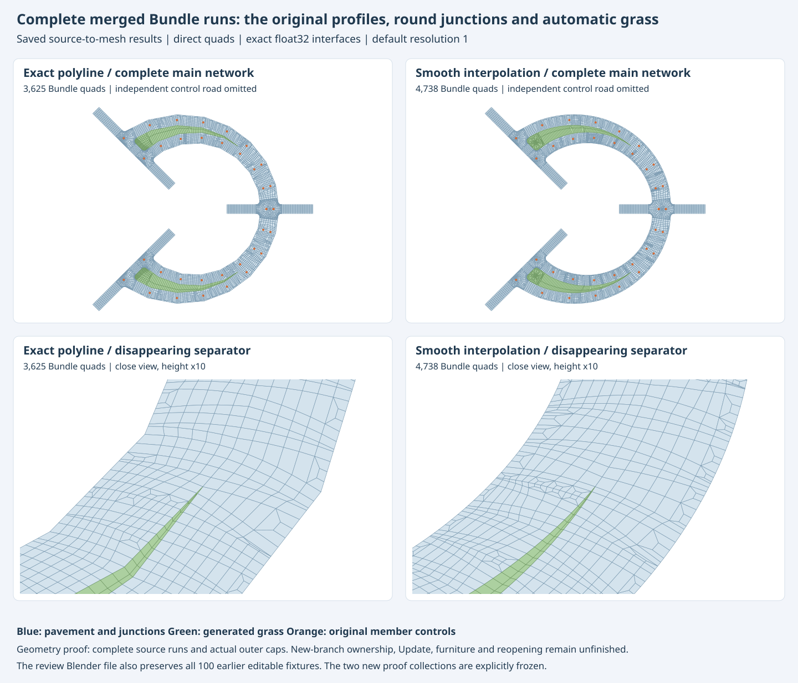
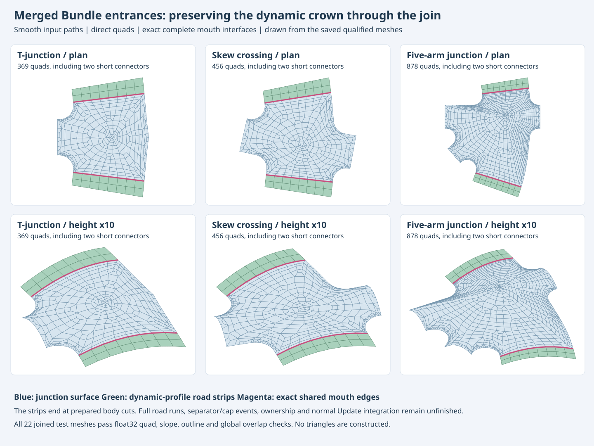

# Python street generation — implementation goal

Current source: `C:/dev/workspace/blosm`, branch `buildings_gn`.
The dev75 [local smoothing increment](STREETS_PYTHON_LOCAL_SMOOTHING.md)
corrects sparse centerline bows and their shared Section corners, with current scene links and
validation scope. The original goal, dev72 qualification and development
history below remain the earlier checkpoint.

Original worktree: `C:/dev/workspace/streets_dev/blosm`, branch `streets_python`.
The buildings checkout remains `C:/dev/workspace/blosm`, branch `buildings_gn`.
Target: Blender 5.2. NumPy is a supported runtime dependency supplied by Blender.

For opening the combined scene, importing OSM and using the Update panel, start
with the [Python streets quickstart](STREETS_PYTHON_QUICKSTART.md).
The [deliverable and verification record](STREETS_PYTHON_ACCEPTANCE.md) maps
the requirements to current evidence, performance, packaging and explicit limits.
Older versioned experiments below are retained as historical evidence.

## Current development: sharp mixed-join height reconciliation (dev72)

Runtime `0.1.0.dev72`, Python fingerprint
`1066f7fbcd448e7e77e358acc99ab2d7cd3a8caaa7b0653bfe7c8610856fca5d`.
The four previously rejected 30 m, signed 110-degree equal-profile mixed joins
now have a bounded height fallback. The primary polynomial construction runs
first. Its accepted outputs remain unchanged. The fallback keeps both source
curves, XY/topology, complete mouth and neighboring rows, curbs and the whole
crest fixed, and redistributes only interior heights. It requires the existing
physical slope and entrance bounds, transverse monotonicity and no drainage
basin. [Construction and formulas](STREETS_PYTHON_GEOMETRY.md#interior-height-reconciliation-at-sharp-mixed-section-joins-dev72)
describe the immutable residual and bounded NumPy feasibility projection.

The [complete current regression](../../streets_dev/experiments/streets/python_v1/suite_dev72_audit_01.json)
passes **982 tests in 114 modules** in one uninterrupted run, with no failures,
errors or skips and unchanged source. It includes both signed turns/mode orders
at R1/R2/R4, transformed/reversed sources, fixed geometry, drainage, local/full
edits, furniture/query-buffer release, restoration and failure rollback. The
earlier [93 focused checks](../../streets_dev/experiments/streets/python_v1/mixed_height_focused_dev72_01/focused_checks.json)
precede the final two catalogue additions and retain their original scope.

The [new 112-fixture scene](../../streets_dev/experiments/streets/python_v1/gallery_generated_dev72_01/python_streets_gallery.blend)
adds `sharp_uniform_mixed_0_3` and `sharp_uniform_mixed_3_0`, with R1/E10 defaults.
Each new join uses 768 quads; each complete fixture uses 3,872 including its
unrelated control road. The full scene contains 726,698 direct quads. An
[independent capture](../../streets_dev/experiments/streets/python_v1/gallery_capture_dev72_01/catalogue_checks.json)
proves all 110 previous source/mesh/furniture/layout sets exact. Saved
[mesh quality](../../streets_dev/experiments/streets/python_v1/gallery_quality_dev72_01/import_quality_checks.json)
and [complete bilinear gradient checks](../../streets_dev/experiments/streets/python_v1/slopes_gallery_dev72_01/slope_checks.json)
pass; the latter retains explicit float32 uncertainty.

Both [native editing cases](../../streets_dev/experiments/streets/python_v1/mixed_height_native_dev72_01/native_checks.json)
pass real Edit Mode vertex/width changes, actual Update, mode removal/restoration,
local/full meshes and furniture, remote identity, exact restoration, R2/E0 and
R4/E10. The physical baseline correction is at most 3.527 mm. A separate
[published-mesh check](../../streets_dev/experiments/streets/python_v1/mixed_height_published_dev72_02/published_checks.json)
verifies both actual float32 joins below the ordinary incoming-profile slope
limit without subtracting an uncertainty allowance, exact zero curbs,
transverse monotonicity and no basin. The fixed crest is retained within its
native half-ULP height rounding (2.981 nanometres at E10). The first verifier
incorrectly demanded identical floats along that crest and is retained as a
failed verification attempt; no runtime or physical limit changed to pass it.

All [112 fresh-file Updates](../../streets_dev/experiments/streets/python_v1/gallery_cold_dev72_01/cold_update_checks.json)
preserve saved sources, outputs, furniture, layout and object/data identities.
The [seven-job gallery audit](../../streets_dev/experiments/streets/python_v1/gallery_dev72_audit_01.json)
reconciles generation, capture, quality, gradients, cold reconstruction, native
edits and strict new-join publication checks. Full generation peaks at
574,017,536 resident / 634,310,656 sampled private bytes under 0.75 GiB;
native editing peaks at 337,690,624 sampled private bytes under 0.5 GiB.
The one-thread policy and fixed 1 GiB reserve remain unchanged. The complete
regression takes 1,072.52 seconds and peaks at 182,800,384 resident / 189,472,768
sampled private bytes under 0.25 GiB. Ordered test events, current module
inventory, script/source hashes and terminal resources are independently
reconciled in its audit. These are qualification timings, not a controlled
performance comparison or a bound on every Update.

The [current real-input audit](../../streets_dev/experiments/streets/python_v1/dev72_real_receipt_audit_01.json)
now passes all nine fresh import/quality/reopen-edit jobs for Berlin, Canal
Street and Nashville. All three preserve prepared identities/parameters and
the earlier qualified mesh geometry exactly. Local Updates take 1.66 / 7.63 /
0.94 seconds in these individual runs; they agree with forced full builds and
restore exactly. Peak sampled private usage is 715,980,800 bytes under 0.75 GiB.
These are scoped measurements, not a universal responsiveness guarantee.

All [31 native asset tests](../../streets_dev/experiments/streets/python_v1/native_assets_dev72_01/native_asset_checks.json)
pass Base/Pro/external loading, multiple datablock kinds and exact-revision saved
library recovery on current source. The [five native interaction jobs](../../streets_dev/experiments/streets/python_v1/native_closure_dev72_checks_01.json)
pass the saved editing bootstrap, injected late-publication rollback, Undo/Redo,
cache lifecycle/no observer and grouping-independent semantic identity.

The [24 MB dev72 ZIP](../../streets_dev/experiments/streets/python_v1/packages/dev72_01/blosm_streets_python_dev72.zip)
now passes [isolated installed-copy qualification](../../streets_dev/experiments/streets/python_v1/package_dev72_qualification_01.json):
13 serial native jobs, 43 installed fixture checks, actual ZIP installation,
full registration/unregistration, both backend choices, external materials,
normal OSM import, mesh quality and reopening/edit/full/restoration. The audit
verifies all archive and installed payloads, all 1,245 Python files and runtime
origins; no development modules are used and original preferences are not saved.
Archive SHA256:
`25a7b4891bc119b285191e5eafa67bab5e97f4fc4d4c61b344d4a710b6ca0aa6`.

An additional [actual registered Import-operator check](../../streets_dev/experiments/streets/python_v1/installed_ui_import_dev72_01/operator_import_checks.json)
uses experimental/3D-realistic/file/Python street settings with no external
building assets. Its [published mesh check](../../streets_dev/experiments/streets/python_v1/installed_ui_quality_dev72_01/import_quality_checks.json)
and [native reopening/edit check](../../streets_dev/experiments/streets/python_v1/installed_ui_reopen_dev72_01/import_reopen_checks.json)
pass. This distinct UI-input run has 21,838 quads: UI float-property precision
differs slightly from the direct-pipeline settings, which produce 21,818. Both
are checked against their own actual inputs; no exact predecessor comparison
is claimed between those different settings.

Initial delivery qualification is complete. The six-stage acceptance review is
recorded in the verification document; broader unsupported construction cases
and later features remain explicit limits below. This is an experimental
flat-ground backend, not a claim to have completed the broader street project.

## Equal-profile mixed-seam checkpoint (dev71)

Runtime `0.1.0.dev71`, Python fingerprint
`0aa98c264e079a3c8829b7ecb8fcabb98e050c89cd9a6cc4d87b22e949a823bc`.
Matching widths and profiles do not guarantee a matching cross-section where
one Section is Exact and its neighbor is Smooth. The Exact path keeps its
source segment direction; the Smooth path uses the common endpoint tangent.
The source-only task-graph predicate now detects that frame mismatch and
dispatches the existing certified mixed polynomial construction. Collinear
mixed seams and same-mode dispatch retain their previous behavior.

[Eight new tests](../../streets_dev/experiments/streets/python_v1/uniform_focused_dev71_03/focused_checks.json)
pass 28 signed-turn/length/order variants, complete mouth profiles, source
polynomial loci, constant crown height, source reversal/rotation/datum,
R1/R2/R4, mode changes that remove and restore owned joins, vertex/width edits,
local/full anchors, remote identity, neighboring-junction clearance and both
separated/overlapping Bundle branches. The
[focused audit](../../streets_dev/experiments/streets/python_v1/uniform_focus_dev71_audit_01.json)
reconciles 76 distinct passing test IDs using these checks and the preceding
regression on byte-identical production code. It is combined evidence, not one
green 76-test run; earlier verifier errors remain recorded.

The [fresh 110-fixture scene](../../streets_dev/experiments/streets/python_v1/gallery_generated_dev71_01/python_streets_gallery.blend)
adds `uniform_mixed_dimensional_0_3`, `uniform_mixed_dimensional_3_0`,
`uniform_mixed_bundle` and `uniform_mixed_bundle_overlap`. It contains 718,954
quads across the complete scene, generated from authored inputs with no saved
output meshes imported. The new Bundle examples distinguish separate
pavements and grass from a single physical pavement where carriageways overlap.
All [four native editing examples](../../streets_dev/experiments/streets/python_v1/uniform_native_dev71_01/native_checks.json)
pass actual Edit Mode vertex/width changes, Update, interpolation changes that
remove and restore the join, local/full mesh and furniture equality, remote
identity, exact restoration, R2/E0 and R4/E10. Peak sampled private memory is
356,368,384 bytes under 0.5 GiB, one numerical thread and the same 1 GiB reserve.
The [complete gallery audit](../../streets_dev/experiments/streets/python_v1/gallery_dev71_audit_01.json)
verifies authored generation, strict preservation of all 106 prior
source/mesh/furniture/layout sets, actual saved mesh quality, independent
bilinear slopes with float32 uncertainty, all 110 real cold Updates with
retained object/data identities, and the four new native editing cases.
The separated Bundle itself uses 4,392 quads including grass; the overlapping
Bundle uses 3,712 pavement quads. Those counts exclude each fixture's unrelated
1,856-quad control road. They are not whole-scene or universal Bundle limits.

The [initial primitive probe](../../streets_dev/experiments/streets/python_v1/uniform_mixed_probe_dev70_01/probe_checks.json)
retains four failed short/sharp cases (30 m legs, signed 110-degree source
turns, both mode orders). Their slope/quad-grading limits are unchanged. This
increment does not establish arbitrary-angle or route-spanning support.
Increasing the finite trim search alone still passes only 28/32 cases and
preserves the accepted buffers. Internal-handle variants and a coupled
handle/reach/metric-row probe also fail the retained short/sharp cases under
the same physical guards. They remain external diagnostics and were not
integrated. Row balancing can remove a quad-ratio failure, but the slope limit
still fails; further work must address the frame/surface construction rather
than treating all these rejections as sampling errors.

## Metric furniture-station checkpoint (dev70)

Runtime `0.1.0.dev70`, Python fingerprint
`19707c80d571f298841cb2e27518ccf0715c68442213c7a7fd71501f4802c94c`.
Mixed transition curbs retain the source polynomial parameter inside each
piece. Furniture stations are metric distances and must first be converted
through the source path's arc-length inverse. Mapping their distance linearly
into the transition interval misplaced Smooth-leg anchors by up to 53.3 mm
in the [independent diagnostic](../../streets_dev/experiments/streets/python_v1/mixed_anchor_station_dev69_01/anchor_station_checks.json).
The corrected conversion now follows the stored source piece and orientation;
carriageway construction and the existing physical guards are unchanged.

The new permanent regression fails before the runtime fix. The
[64 focused checks](../../streets_dev/experiments/streets/python_v1/anchor_focused_dev70_01/focused_checks.json)
now pass mixed/Exact/fitted transitions, core dependencies and dimensional
Bundles. The regression covers both interpolation orders, reversed source
storage, both sides, endpoint/interior stations, unchanged meshes, local/full
anchors and queries after numerical buffers are released. Repeating the
[unchanged independent diagnostic](../../streets_dev/experiments/streets/python_v1/mixed_anchor_station_dev70_01/anchor_station_checks.json)
now gives zero XY error in its six interior Smooth-leg cases.

The [native saved-file upgrade and editing check](../../streets_dev/experiments/streets/python_v1/anchor_native_dev70_03/native_checks.json)
passes all three mixed examples, including nonzero offsets and unequal rises.
Every mesh and authored source remains exact during the version upgrade; only
the Smooth-source `placement:85` changes. The check measures anchor XY against
the actual source parameter, with maximum native error 0.000000111 m. Real Edit
Mode/width edits, the Update button, local/full meshes and furniture, restoration,
remote-road identity, R2/E0 and R4/E10 all pass. Current-version cold Updates
retain Blender object/data identities. An implementation version change
invalidates task fingerprints and can rebuild those objects while retaining
their semantic keys. The source scene is not saved or modified.
Peak sampled private memory is 346,828,800 bytes under 0.5 GiB, one numerical
thread and the same 1 GiB system reserve.

The [fresh dev70 gallery](../../streets_dev/experiments/streets/python_v1/gallery_generated_dev70_01/python_streets_gallery.blend)
contains all 106 authored fixtures and 699,522 quads across the complete scene.
The [saved capture](../../streets_dev/experiments/streets/python_v1/gallery_capture_dev70_01/catalogue_checks.json)
verifies every source, mesh buffer and gallery matrix against dev69, with only
`mixed_dimensional_3_0 / placement:85` corrected. All source/mesh/furniture sets
from the earlier 103-fixture checkpoint remain exact. The
[saved quality comparison](../../streets_dev/experiments/streets/python_v1/gallery_quality_dev70_01/import_quality_checks.json)
passes all convex direct quads, ratio 8, crown envelope and overlap guards.
The [independent saved-gradient audit](../../streets_dev/experiments/streets/python_v1/slopes_gallery_dev70_01/slope_checks.json)
passes the complete bilinear bounds with explicit float32 uncertainty; this
does not assert a strict measured global 10% bound without that allowance.
All [106 actual cold Updates](../../streets_dev/experiments/streets/python_v1/gallery_cold_dev70_01/cold_update_checks.json)
now pass with exact saved source/mesh/furniture/layout and retained Blender
object/data identities. The [complete gallery audit](../../streets_dev/experiments/streets/python_v1/gallery_dev70_audit_01.json)
reconciles authored generation, independent saved captures, mesh quality,
gradient checks and cold reconstruction against the same source and scene.

The [preceding complete regression audit](../../streets_dev/experiments/streets/python_v1/suite_dev69_audit_01.json)
verifies all 968 tests in 112 modules in one uninterrupted green run on dev69,
with unchanged source, no failures/errors/skips, one numerical thread, a
0.25 GiB process cap and the unchanged 1 GiB reserve. This is dev69 evidence;
Dev70 still needs complete current-source regression, real-input and installation
qualification. The dev68 ZIP remains the installation-qualified preview.

## Mixed dimensional-seam checkpoint (dev69)

Runtime `0.1.0.dev69`, Python fingerprint
`ae0d7fef71288fbafc64b992b1296b30e255e14ecec337c886effbc090616b16`.
The [mixed transition fitter](../way/street_network/python_backend/mixed_transitions.py)
replaces the previous unconditional rejection of a bent dimensional seam joining
one Exact and one Smooth Section. Each source centerline retains its actual
polynomial pieces. A shared miter frame connects the two transverse fields;
quintic width/offset blending produces polynomial curbs. Bernstein orientation
and curve-error proofs, direct quads, complete mouth copies, the crown ceiling,
physical slopes and the 3% entrance guard remain mandatory.

The [37 focused tests](../../streets_dev/experiments/streets/python_v1/mixed_transitions_focused_dev69_04/focused_checks.json)
pass both interpolation orders, signed turns, exact centerline loci, whole mouth
profiles, independent dense curve sampling, reversed source storage, rotation,
translated datum, resolutions 1/2/4, E0, offsets/unequal rises and actual numerical
dependency edits. A complete-edge source-velocity cone bound is mandatory at
both mouths in addition to the existing chart-direction corner checks.
Local/full meshes and furniture agree, restoration is exact,
and a remote road retains identity. The original Smooth offset-curvature guard
still rejects unsafe source curves before constructing a seam.

This is a bounded construction increment, not full mixed-mode support. Short
sharp layouts can still fail physical slope or grading limits. Compatible
same-profile bent seams and route-spanning mixed transitions remain open.
The complete gallery now has 106 authored inputs: the previous 102, the formerly
separate translated corner regression and three mixed dimensional examples.
The [fresh 106-fixture scene](../../streets_dev/experiments/streets/python_v1/gallery_generated_dev69_02/python_streets_gallery.blend)
has now generated on this source. Its
[saved quality check](../../streets_dev/experiments/streets/python_v1/gallery_quality_dev69_02/import_quality_checks.json)
passes all 699,522 quads and preserves every position and quad of all 634 previous
mesh parts exactly. Only the three named mixed networks are added. The
[fresh native edit check](../../streets_dev/experiments/streets/python_v1/mixed_native_dev69_01/native_checks.json)
passes all three cases: cold object/data identity, real Edit Mode vertex/width
edits, the Update button, moving furniture, local/full equality, restoration,
R2/E0 and R4/E10. The saved scene is unchanged. Peak sampled private usage is
360,062,976 bytes under 0.5 GiB for the edit checks; full-gallery jobs use
0.75 GiB with the same one thread and 1 GiB system reserve.
The [968-test broad regression](../../streets_dev/experiments/streets/python_v1/suite_dev69_audit_01.json)
is now terminal PASS, with every ordered test ID reconciled. Real-input,
complete cold-gallery and installed-copy checks on this source remain separate.
The install-qualified
**dev68 ZIP below remains the qualified preview** while this increment is tested.

The first 106-fixture saved comparison caught a fixture-authoring error: rounding
before translation changed four control points from the accepted translated
native fixture. Its source and six derived mesh parts differed. The factory now
translates authored doubles and rounds once, matching the original native
construction; four captured source coordinates prevent regression. The failed
comparison is retained, with no changed parts allowed. Corrected fresh gallery
generation and comparison now pass in the linked attempt 02 results.

## Qualified corner-chart checkpoint (dev68)

Checkpoint runtime is `0.1.0.dev68`, Python fingerprint
`376c108b156007d8688652a21ee28ff058fe760688e71bd8082210b961a176c4`.
The new fallback addresses the valid translated Exact outer junction that
failed dev67's grading check. When an ordinary single-junction chart exhausts
its existing planar correction, staged direct-quad corner bands supply an
alternative planar seed. The compound boundary-jet solver then constructs
physical heights, with the normal crown, slope, drainage and float32 publication
guards. This does not publish the old band height field or change source
controls, corner radii, mouth profiles or physical boundary samples.

[`CornerBandSeed`](../way/street_network/python_backend/corner_seed.py) uses a
bounded cached three-stage strip pattern with extra interior subdivisions.
The actual rim remains fixed while internal guides may move. The fallback is
selected by a typed grading failure and geometry eligibility, never fixture
names or IDs. It is restricted to one compatible ordinary exterior; it does
not replace the other accepted intersection/Bundle providers.

The [45 focused tests](../../streets_dev/experiments/streets/python_v1/corner_seed_focused_dev68_02/focused_checks.json)
pass on this source, including physical, E0 and E10 views, complete float32
interfaces, crown/slope limits, independent whole-edge entrance bounds,
drainage, width editing, local/full equality, exact restoration and unrelated
output identity. Existing junction, condition, surface and core tests also pass.
The preceding isolated numerical proof has 3,044 quads in the repaired junction,
maximum ratio about 7.747, full-quad physical gradient below 9%, maximum entrance
bound 2.205%, and zero graph drainage fill after reconciliation. That proof is
not an installer qualification of dev68.

The [22-case normal-backend matrix](../../streets_dev/experiments/streets/python_v1/normal_merged_matrix_dev68_01/matrix_checks.json)
now passes **22/22**, including R2/R4, both modes, translated datum, reversed
storage, unequal widths/crowns, T/skew/five-arm inputs and both exact baseline
restorations. This matrix belongs to the immediately preceding dev68 source
`a994942897021d7e4829b70b96222d022d31aab47da4756e82dc0df538effb61`,
before the subsequent publication-coordinate fix and its three focused tests.

`SceneWriter` now compares rebuilt and retained meshes at the same actual
float32 storage precision, including scene units and broad-phase bounds. A
translated width edit previously compared new double coordinates against old
rounded coordinates and could invent a seam overlap. Both sides now use
`publication_coordinates`; the 20 micrometre publication overlap tolerance is
unchanged. Rebuilt stored meshes must also pass convexity and ratio 8 before
publication. This changes validation, not generated vertex coordinates.

Open the [combined 103-fixture Blender scene](../../streets_dev/experiments/streets/python_v1/corner_seed_native_dev68_04/python_streets_corner_seed.blend).
`Regression / translated Exact corner seed` is appended below the previous
102 fixtures. Junction 210 is selected; the case saves R1/E10 and includes
Arrow 905 anchored to original Section 117. The
[native check](../../streets_dev/experiments/streets/python_v1/corner_seed_native_dev68_04/native_corner_seed_checks.json)
passes actual Update, width editing, moving furniture, local/full equality and
restoration. Its parent gallery freshly regenerated all 102 original fixtures
on dev68; appending the new fixture preserves those source/mesh/furniture/object
sets exactly. The
[independent saved-mesh check](../../streets_dev/experiments/streets/python_v1/corner_seed_quality_dev68_02/import_quality_checks.json)
passes all **688,258 quads in 103 networks**, no overlaps, ratio 8 and the crown
envelope; all 618 old mesh parts remain exact. The
[fresh-file reopening check](../../streets_dev/experiments/streets/python_v1/corner_seed_reopen_dev68_02/reopen_checks.json)
passes cold object identity, the same width/furniture edit, local/full equality
and exact restoration without changing the scene file or other 102 fixtures.

The [complete current regression audit](../../streets_dev/experiments/streets/python_v1/suite_dev68_reconciled_audit_01.json)
now accounts for passing evidence for **all 960 test IDs in 111 modules**.
The full run has 950 passes and ten asset statuses caused by WinError 5 when
the sandbox's default temporary directory rejects atomic renames. The
[isolated diagnostic](../../streets_dev/experiments/streets/python_v1/asset_test_temp_dev68_01/asset_temp_checks.json)
reproduces that filesystem error and passes all 21 asset-module tests with the
standard workspace temporary directory. Original failures remain recorded.
This is complete combined coverage, not one uninterrupted green run; no asset
implementation was changed to accommodate the test environment.

All **102 authored fixtures** have now regenerated on current dev68, with exact
source records, mesh buffers and furniture against the independent capture.
The [saved-gallery audit](../../streets_dev/experiments/streets/python_v1/gallery_dev68_saved_audit_01.json)
also verifies all 618 mesh parts / 677,596 quads, independent actual float32
quality, all102 fresh cold Updates, object/data identity and optional-panel
behavior. The [current combined 103-fixture scene](../../streets_dev/experiments/streets/python_v1/corner_seed_native_dev68_04/python_streets_corner_seed.blend)
uses this regenerated gallery as its parent and appends the repaired case.
Its [saved quality](../../streets_dev/experiments/streets/python_v1/corner_seed_quality_dev68_02/import_quality_checks.json)
and [fresh reopening](../../streets_dev/experiments/streets/python_v1/corner_seed_reopen_dev68_02/reopen_checks.json)
pass without changing source data, accepted geometry or furniture.

The [nine fresh real-input jobs](../../streets_dev/experiments/streets/python_v1/dev68_real_receipt_audit_01.json)
also pass on this source. All prepared data and saved geometry remain exact
against the qualified reference, excluding newly assigned network UUIDs.
Both components are READY for each input; coverage is COMPLETE and GN modifiers
are absent. Seam edits pass local/full equality, restoration and unrelated
identity. Observed local Updates are 1.64 / 7.51 / 0.92 seconds for Berlin,
Canal Street and Nashville. The largest private peak is 712,732,672 bytes under
0.75 GiB, one numerical thread and the unchanged 1 GiB reserve. Individual
timings are not a controlled speedup comparison or a universal network promise.

[Five native interaction checks](../../streets_dev/experiments/streets/python_v1/native_closure_dev68_checks_01.json)
pass optional-panel behavior, publication-failure rollback, Undo/Redo, cache
lifetime and grouped/per-Street/mixed inputs. History/publication tests load
their one target fixture rather than copying all102 into Undo history; every
test assertion is retained. The [31 native asset tests](../../streets_dev/experiments/streets/python_v1/native_assets_dev68_01/native_asset_checks.json)
pass multiple datablock kinds, Base/Pro access, external libraries and actual
saved-scene exact-revision recovery.

The [installed-copy audit](../../streets_dev/experiments/streets/python_v1/package_dev68_qualification_01.json)
now passes all twelve serial native jobs using the actual
[dev68 addon ZIP](../../streets_dev/experiments/streets/python_v1/packages/dev68_01/blosm_streets_python_dev68.zip).
The addon installs and registers in an isolated Blender profile; both backend
choices, shared/external materials and the actual Update button pass. All 34
selected compound/angular/multi-Section/merged/translated fixtures pass using
only installed runtime code, including their retained R2/R4 and editing checks.
The installed normal Canal import, exact saved-mesh comparison, cold seam/width
editing, local/full equality and restoration pass. Every archive and installed
payload is verified; source Python is unchanged. Maximum sampled private usage
is 701,452,288 bytes under 0.75 GiB, one numerical thread and the same 1 GiB
reserve. No original preferences are saved and nothing is publicly published.

The first combined installed check reached its cap before finishing fixtures.
It remains recorded as a memory-limit failure. The successful qualification
uses fresh processes for fixture families and retains the original verifier
assertions; it does not raise the limit or count the incomplete run as a pass.
The ZIP's immutable build manifest still says installation was unqualified at
build time; this separate post-build audit records completed qualification.
Documentation edits after packaging do not change that archive's payloads.

The [independent physical-slope audit](../../streets_dev/experiments/streets/python_v1/slopes_gallery_dev68_01/slope_checks.json)
now checks all **103 networks / 634 mesh parts / 688,258 quads** in the current
combined scene. It independently evaluates four-corner gradients and the
complete bilinear bound, with explicit float32 uncertainty. All recorded policy
and pre-publication maximum comparisons pass within that uncertainty. This is
not a claim that every measured stored gradient is strictly below 10% without
quantization allowance; the incoming-profile-dependent policy also permits
higher crossfalls for narrow, high-crown approaches.

The [current Canal profiling run](../../streets_dev/experiments/streets/python_v1/canal_seam_profile_dev68_01/profile_checks.json)
observes 7.414 and 7.251 seconds for the same seam edit, with exact repeated
buffers, local/full equality, restoration and unrelated component identity.
Its profiled run takes 8.219 seconds. Fixed-rim shape improvement accounts for
5.116 seconds; quad-gradient evaluation accounts for 2.154 seconds, while both
overlap checks together take about 0.194 seconds. These cumulative categories
overlap and must not be added. The
[reusable-gradient experiment](../../streets_dev/experiments/streets/python_v1/gradient_benchmark_dev68_01/benchmark_checks.json)
preserves exact gradients and published meshes, but ABBA timing shows no speed
benefit: original mean 7.237 seconds, candidate mean 7.352 seconds. It remains an
external experiment and is not integrated into the addon. The current Python
source fingerprint and qualified package are unchanged.
The older dev67 results below retain their original source scope.

The [source and receipt audit](../../streets_dev/experiments/streets/python_v1/corner_seed_integration_dev68_audit_01.json)
verifies all 21 previously passing matrix array payloads remain exact, and
reconstructs the preceding matrix source from the current source plus the
explicit publication-only delta. The other 1,229 dev67 Python files are exact.
The [verified recovery checkpoint](../../streets_dev/experiments/streets/python_v1/checkpoints/dev68_01/checkpoint_checks.json)
preserves all 1,239 current Python files, documentation, assets, the review scene
and scoped evidence. Its 32,520,587-byte archive has SHA256
`08dd72957213857a666d726721e619576ed06aaf6aa7bdf05855bba3cc6547e4`.
It is recovery data, not an installer or a completed-goal claim.

## Work remaining for the initial Python deliverable

The backend, persistent input/dependency model, explicit Update, reusable quad
patterns, source-relative furniture demonstration and Python/GN choice already
exist. The dev68 checkpoint has audited combined passing evidence for its 960
regression IDs, exact authored-fixture regeneration, three complete real-input
pipelines and installed-copy checks. Those results remain dev68 evidence.
Dev69's complete 968-test run remains evidence for that checkpoint. Dev70 fixes
metric anchor transport; dev71 adds equal-profile mixed joins and a freshly
generated 110-fixture gallery. Current saved quality, independent gradients,
all 110 cold Updates and the four new native editing cases pass. Complete
current-source regression, real inputs and installation remain separate gates;
older receipts do not automatically qualify a newer source.
This is not yet the completed addon release. The next work is:

1. Complete current-source regression, real-input and installed-copy
   qualification for the mixed dimensional/equal-profile and metric-anchor
   increments. Current gallery/cold/gradient/native checks pass. The complete
   106-fixture predecessor's source/mesh/furniture/layout remains exact.
2. Complete the remaining initial-release construction
   families: more general internal crossing graphs, nonmonotone overlapping
   members, profile-changing or multiply claimed seams, mixed interpolation
   seams beyond the new local branches, and near-contact/terminal grading.
   Ordinary pavement overlap must be constructed; it is not an
   invalid-centerline error. Keep actual support and construction failures
   explicit while these branches are developed.
3. Measure and reduce expensive real-network Update work while retaining the
   mesh, outline, profile, slope and memory limits. Current fixture timings
   do not establish responsiveness on every imported network.
4. Qualify the final source on the complete gallery and independent real OSM
   networks, then verify installation, assets, backend selection, persistence,
   lifecycle and editing in the distributed addon. Publish the documented
   supported scope and a reproducible Blender demonstration.

Full terrain alignment, additional transport features and finished furniture
assets remain later work in the broader street project.

## Normal merged-entrance integration (dev67)

Current Python fingerprint:
`30fac1a321c1defbe838d5889083cc7d31b1fa66ccef59005c02b8ebc0adfdd6`.

The new provider prepares shared physical entrances before per-site footprints.
Both original logical sites remain in the ownership plan. Each merged mouth
retains two explicit original Section/end/station aliases, while the short
transverse Section remains part of its original Street and is fully covered
by the shared junction. Parallel members are never represented as a Route.

`MergedBundlePlan` now constructs the complete source-owned runs, disappearing
grass islands and actual rounded external caps using the normal prepared
junction products. It does not rebuild an isolated outside network. The same
physical rims are retained independently of inspection exaggeration, including
zero exaggeration. Furniture keeps its original station/side/offset; actual
footprint containment resolves near-mouth height ownership.

The first [normal-backend checks](../../streets_dev/experiments/streets/python_v1/merged_backend_dev67_01/preparation_checks.json)
pass both interpolation modes, whole float32 interfaces, connected topology,
source preservation, combined edits, local/full mesh and furniture equality,
exact restoration, unrelated identity and E0. They belong to source
`58d5ea01db56b18d3c3215974b30e6781576e36306301c38a7f1f38a5f16f2d8`.
The [native Update proof](../../streets_dev/experiments/streets/python_v1/merged_native_dev67_01/native_merged_entrance_checks.json)
on that source also passes both cases and retains all previous 100 fixture
source/mesh/furniture sets exactly. Updates take 4.15 / 7.46 s (Exact / Smooth)
in this bounded worker; those are fixture measurements, not a general-network
responsiveness claim. Peak sampled private usage is 498,216,960 bytes under
0.75 GiB, one numerical thread and the unchanged 1 GiB system reserve.

Open the [freshly authored 102-fixture editable gallery](../../streets_dev/experiments/streets/python_v1/gallery_generated_dev67_01/python_streets_gallery.blend).
Its four-column layout keeps fixture bounds separate. The final collections
`attached_angular_overlap_0_internal` and
`attached_angular_overlap_3_internal` support
**Streets → Update**; the older dev66 frozen previews below remain historical.
The authored catalogue now includes these two cases for fresh generation.
Further source hardening adds certified member-centerline disjointness and
order-independent port ownership/signatures. The original consumed centreline
must also stay inside the actual physical exterior. The
[37-test regression](../../streets_dev/experiments/streets/python_v1/merged_regression_dev67_01/preparation_checks.json)
passes source order/aliases, normal merged dispatch, existing conditions/ports,
internal unions and the six-family uncached-reference comparison on source
`8abf8a098fb5921642d20dc0c4d5e14f05000c04b85d65f6859cc1cc896fc9eb`.
The final source adds the two-line consumed-support guard.

The [final normal-dispatch matrix](../../streets_dev/experiments/streets/python_v1/normal_merged_matrix_dev67_01/matrix_checks.json)
passes 21/22 with both baseline restorations exact. It includes R2/R4, reversed
storage, unequal widths/crowns and T/skew/five-arm layouts. Its only failure is
the same ordinary outer junction 210 after Exact translated controls are
rounded to float32; quad correction exhausts its finite budget. The matrix
terminates with exit 1 for that retained defect. E1 baseline Bundle counts are
3,625 / 4,738 quads, with 7,720 / 8,801 in the complete networks including the
separate 1,600-quad control road. Peak sampled private usage is 147,873,792 bytes
under 0.5 GiB with the same reserve/thread limits.

The [fresh-file native reopening](../../streets_dev/experiments/streets/python_v1/merged_reopen_dev67_01/native_merged_entrance_checks.json)
also passes on the final source: it selectively loads the two new collections
from the 102-fixture scene, cold-updates without changing saved buffers or
identities, repeats edits/local/full/furniture/restoration and leaves the scene
file unchanged. This is a selective two-case reopening proof; the complete
authored regeneration and saved-mesh checks are recorded separately below.
Broader reopening, real-input/performance and installer gates remain required.

The [authored-regeneration audit](../../streets_dev/experiments/streets/python_v1/gallery_dev67_regeneration_audit_01.json)
now verifies all **102** cases, with no saved output mesh imported: source
records, coordinates, connectivity and furniture equal the independent saved
capture exactly, including the original 100 reference cases. The gallery has
**677,596 quads across all 102 fixtures**, not one Bundle. Its saved file SHA256
is `76d46f773e677ab5495e580f8f4c01aa24c143d06d3be296a636e0cd1b02e32f`.
Generation peaks at 560,672,768 resident / 636,633,088 private bytes under
0.75 GiB, one numerical thread and the unchanged 1 GiB reserve. Runtime caches
are released between fixtures.

The [independent saved-mesh audit](../../streets_dev/experiments/streets/python_v1/gallery_quality_dev67_01/import_quality_checks.json)
reads the actual float32 Blender buffers and checks every published part.
All cells are convex quads, no cells exceed edge ratio 8 (maximum 7.99635),
all heights stay within the global incoming crown envelope, and no self- or
inter-part overlaps occur. Every reference part retains exact positions and
connectivity. This audit is a mesh-quality check, not a full independent
physical-gradient or fresh editing qualification.

The [independent source/receipt audit](../../streets_dev/experiments/streets/python_v1/merged_integration_dev67_audit_01.json)
verifies ten added and nine changed Python files against the dev66 checkpoint;
the other 1,217 Python files remain exact. It also checks the terminal workers,
scene hash, separate branches and empty index. The
[verified dev67 recovery](../../streets_dev/experiments/streets/python_v1/checkpoints/dev67_01/checkpoint_checks.json)
contains the complete source, documentation, review scene and scoped evidence.
It is a continuation archive, not an installer or completed release.

The [complete regression coverage audit](../../streets_dev/experiments/streets/python_v1/suite_dev67_resumed_audit_01.json)
now verifies passing evidence for **all 953 ordered test IDs in 109 modules**
on the final source, without missing/duplicate evidence IDs, failures, errors
or skips. The first worker stopped at the system-memory reserve after
545 observed passes; the terminal resumed suffix passes the remaining 408.
The [partial evidence](../../streets_dev/experiments/streets/python_v1/suite_dev67_01/partial_evidence.json)
and per-test suffix events remain separate. This is complete combined coverage,
not one uninterrupted full-suite run. The largest private peak is 190,189,568
bytes; the resumed worker uses a 0.25 GiB cap. Both retain one numerical thread
and the unchanged 1 GiB system reserve. The
[gallery capture plan](../../streets_dev/experiments/streets/python_v1/gallery_dev67_capture_plan_01.json)
pins all 102 saved fixtures, retaining the independent prior 100-case reference.
The [real-input check plan](../../streets_dev/experiments/streets/python_v1/real_dev67_check_plan_01.json)
pins three unchanged independent OSM samples and nine serial import/quality/
reopening checks. All nine have now completed, with the
[independent receipt/source audit](../../streets_dev/experiments/streets/python_v1/dev67_real_receipt_audit_01.json)
checking terminal resources, actual saved-mesh quality, exact prior geometry,
and complete prepared source identities/parameters (excluding each fresh
import's new network UUID).

| Real input | Complete-network quads | Local seam Update | Retained output objects |
| --- | ---: | ---: | ---: |
| Berlin / Karl-Marx-Allee | 398,972 | 1.51 s | 319 / 327 |
| Canal Street | 21,818 | 7.44 s | 14 / 20 |
| Nashville / Wyoming Avenue | 263,213 | 0.90 s | 173 / 178 |

Each import has both components READY, COMPLETE coverage and zero GN modifiers.
All actual published meshes pass convexity, ratio 8, crown-envelope and
non-overlap checks and retain the previous dev53 coordinates/connectivity
exactly. Fresh reopening, coordinated seam/width edits, incremental/full
equality, exact restoration and unrelated-component identity pass in all three.
The largest sampled resident/private peaks are 655,794,176 / 707,268,608 bytes
under a 0.75 GiB cap, one numerical thread and the unchanged 1 GiB reserve.
These timings are individual observations, not a controlled speedup comparison
or a responsiveness guarantee for arbitrary networks. Installer qualification,
broader gallery reopening/editing and the stated construction work remain open.

## Complete merged-run geometry proof (dev66, historical prototype)

The new construction joins the shared profiled intersection, both complete
curved Bundle runs, dynamic grass islands, actual rounded external caps,
outer junctions and ordinary roads. The
[complete-network matrix](../../streets_dev/experiments/streets/python_v1/merged_network_matrix_final_dev66_01/matrix_checks.json)
passes **21 of 22** captured variants, including both interpolation modes,
width/control edits, unequal crowns, reversed storage, T/skew/five-arm layouts
and the finer resolutions. Both baseline restorations are exact. The one
failure is an ordinary outer junction in Exact mode after translated controls
are rounded to float32: its quad grading exhausts the finite correction
budget. It remains a robustness defect, not an invalid-centerline error.

Baseline Bundle paving, grass and merged strips contain 3,625 / 4,738 quads
(Exact / Smooth); whole networks contain 7,782 / 8,777, including a separate
1,600-quad control road. Complete float32 interfaces, connected topology,
global non-overlap, direct quads, crown ceilings and physical slope guards
pass in those baselines. Local separator tiles resolve the finer-resolution
chart failures. The R4 Exact grass cap needs bounded interior height correction
with its entire XYZ rim fixed. The matrix terminates with test failure for the
one retained case; it is not an all-pass receipt. Peak sampled private usage is
159,428,608 bytes under 0.5 GiB, one numerical thread and a 1 GiB reserve.

The [Blender review scene](../../streets_dev/experiments/streets/python_v1/merged_network_review_dev66_02/python_streets_merged_runs_geometry_review.blend)
retains all 100 existing editable fixtures unchanged and adds two **frozen
geometry proofs**, Exact and Smooth, with exaggeration 10. Their source
references are locked because normal addon Update is not connected to this
new construction yet. The
[native review check](../../streets_dev/experiments/streets/python_v1/merged_network_review_dev66_02/review_checks.json)
verifies the old source attributes, mesh buffers and furniture poses exactly.
The [integration continuation notes](../../streets_dev/experiments/streets/python_v1/MERGED_RUN_INTEGRATION_NEXT.md)
describe the pending early preparation, ownership aliases, dependency and
furniture mappings. The helpers are external prototypes, not normal dispatch.



## Physical profile gradients (dev66 checkpoint)

Gradient checkpoint source: `0.1.0.dev66`, fingerprint
`91b1fa8e0dca0de47318a4f94403898256ed6360237cde82e52a20fbd8868a39`,
with 1,226 Python files. The dev65 full-regression and 100-fixture proofs below
remain preserved under their original fingerprints. They are not a full dev66
qualification.

The production approach API now exposes
[`Approach.physical_gradient`](../way/street_network/python_backend/intersections.py).
Compound profile rules and their authoritative boundary vertices both consume
that method. Ordinary Sections retain the previous arithmetic exactly. A
derived entrance can instead supply its changing physical field. The
[`AngularCrown.gradient`](../way/street_network/python_backend/bundle_angular_curves.py)
implementation analytically differentiates the actual Cartesian curb chords,
overlap blend and moving crown in world XY. It retains the incoming one-sided
curb derivative rather than differentiating the clipped zero exterior. Peaks
and plateaus have zero gradient. Existing crown values and curve sampling are
unchanged.

The [22 focused checks](../../streets_dev/experiments/streets/python_v1/profile_gradients_dev66_02/gradient_checks.json)
pass eight new differential/API tests and fourteen existing condition/work-reuse
tests. They include independent height differences, Exact/Smooth, unequal
widths, moving peaks/plateaus, rigid transforms, reversed source storage, exact
legacy arithmetic, singular-frame diagnostics and the six-family comparison
with the uncached reference. Peak resident/private usage is 59,674,624/
75,669,504 bytes under 0.25 GiB, one numerical thread and a 1 GiB reserve.

The [new 22-case surface matrix](../../streets_dev/experiments/streets/python_v1/combined_dynamic_matrix_dev66_02/dynamic_matrix_checks.json)
passes the same combined-entrance variants with the actual dynamic gradient
forwarded through the production compound boundary API. Every recorded
boundary-gradient error is zero. The original 2 m round corners, zero exposed
curbs, crown ceiling, direct quads, float32 ratio/slope checks and exact baseline
restorations remain valid. Counts remain 337–3,197 quads per intersection patch.
The terminal worker takes 60.74 s and peaks at 80,486,400 resident / 98,410,496
sampled private bytes under 0.25 GiB. This proves gradient consumption by the
surface kernel; it does not select the combined-entrance provider in the addon.

A separate [22-case connector experiment](../../streets_dev/experiments/streets/python_v1/combined_bridges_dev66_01/bridge_checks.json)
now attaches two whole-profile road strips to those saved junction meshes.
Every mouth vertex and complete shared edge is retained exactly. The strips
use the same changing crown field up to prepared body cuts; they do not sweep
a constant mouth profile through changing widths. Each joined surface remains
a disk of direct quads, with 369–3,293 cells including the higher resolutions.
Connector float32 quality and complete bilinear slopes pass; the maximum
angular longitudinal bound is 0.348%, and the checked entrance bound is 0.048%,
both below 3%. The worker peaks at 44,212,224 resident / 65,961,984 sampled
private bytes under 0.25 GiB and the same reserve/thread policy.

An [independent saved-buffer check](../../streets_dev/experiments/streets/python_v1/combined_joined_publication_dev66_01/publication_checks.json)
also passes all 22 joined meshes: full float32 quad/slope checks, global
non-overlap and the actual merged connector curbs. The largest measured Smooth
connector outline error is 3.573 mm, within the existing 5 mm budget. It
regenerates no mesh. The drawing uses these saved buffers, including the short
connectors; the green strips end at the prepared cuts, not the complete runs.



The complete run and external-cap geometry is now prototyped above. **Still
required:** map both logical owners and all original endpoint/anchor records,
publish the new geometry through the normal providers and integrate early
entrance preparation into the dependency graph. The new connector proof is
not an actual Update or furniture proof for merged entrances. The
[formulas and scope](STREETS_PYTHON_GEOMETRY.md#physical-profile-gradients-and-merged-mouth-strips-dev66)
identify what is implemented and what remains.

The [fresh Blender 5.2 regression](../../streets_dev/experiments/streets/python_v1/profile_gradient_native_dev66_01/generation_checks.json)
also passes nine existing fixtures through the actual Update operator: all six
core families, the compound divided crossing and both previously supported
internal-overlap modes. Every authored source record, published mesh buffer
and furniture pose matches the independent dev65 capture exactly. The worker
peaks at 271,523,840 resident / 336,453,632 sampled private bytes under 0.75 GiB,
retaining one numerical thread and the 1 GiB reserve. Its nine-fixture saved
scene is a selective regression artifact; the complete inspection gallery
remains the preserved 100-fixture file below. It does not demonstrate normal
Update for the new combined-entrance branch.

The [source/scope audit](../../streets_dev/experiments/streets/python_v1/profile_gradients_dev66_audit_01.json)
verifies the four terminal construction/native jobs, their source/script and
resource fingerprints, the empty Git index and separate branches. Relative to
the dev65 recovery source, only four Python files changed and two test modules
were added; all other 1,220 Python files are exact. The subsequent independent
saved-buffer and drawing checks have their own receipts. The
[dev66 recovery checkpoint](../../streets_dev/experiments/streets/python_v1/checkpoints/dev66_01/checkpoint_checks.json)
preserves the source, external prototype consumers, saved arrays and scoped
evidence for continuation. It is not an installer or a completed goal.

## Preserved dev65 checkpoint: overlapping internal runs

Qualified geometry/regression checkpoint: `0.1.0.dev65`, fingerprint
`f8c603afe359f877d40d102de6d597b64a909c0b995a93ad1834061e7ca3b3fb`.
The maintained-gallery tooling checkpoint fingerprint is
`d4535b48695b0f4d594c2720229e7fc80175fe50bf91e47ca6769eca2a3a9546`:
it adds only the complete fixture catalogue and its generator. All 1,222
previous Python files, including the runtime and regression definitions, are
byte-exact. The [promotion record](../../streets_dev/experiments/streets/python_v1/gallery_tooling_promotion_dev65_01.json)
distinguishes this tooling addition from the completed numerical run. The
maintained generator's native reproduction proof is recorded separately below.
The addon now partitions an overlapping curved Bundle at its declared interior
crossings, retains each original Section traversal, and connects the resulting
runs to the actual physical junction mouths. Explicit domain, pattern-sampling
and cap policies replace the disposable probe's method substitutions. Existing
separated construction remains selected when the run interiors do not overlap.

The [25 focused runtime tests](../../streets_dev/experiments/streets/python_v1/internal_unions_dev65_03/remaining_suite_checks.json)
pass Exact and Smooth construction, source-ribbon Boolean-union footprint/area
checks, full float32 bilinear slope bounds, exact whole separator interfaces,
four grass components and one connected filled network without cracks. They
also pass combined control/width edits, exact local/full/restoration, all
source-relative anchors, unrelated output identity, reversed source storage,
translated-datum E0 and the existing internal/incidence/dependency cases.
The Bundle replacements stay below 8,000 quads. Source and Street 800 identities
are unchanged. Peak resident usage is 134,504,448 bytes under a 0.25 GiB cap
and the 1 GiB reserve.

Open the [100-fixture Blender scene](../../streets_dev/experiments/streets/python_v1/internal_unions_native_dev65_01/python_streets_internal_unions.blend).
`attached_angular_multiple_0_internal` and `_3_internal` sit below the previous
98 without overlapping; all previous saved source/mesh/furniture sets remain
exact. The [actual Update checks](../../streets_dev/experiments/streets/python_v1/internal_unions_native_dev65_01/native_internal_union_checks.json)
and [fresh selective reopening](../../streets_dev/experiments/streets/python_v1/internal_unions_reopen_dev65_01/native_internal_union_checks.json)
pass combined edits, unchanged meshes before Update, exact local/full/furniture,
restoration, unrelated object identity, the consumed-interior anchor and cold
reconstruction. The two earlier separated internal fixtures also retain their
exact buffers after current-source cold reconstruction. The new Bundle
paving/grass replacements contain 4,450/5,475 quads, of which 850/981 are grass.
Whole new-fixture totals are 8,864/9,717, including their 1,600-quad control roads.
Observed combined edits take 3.54/6.25 s, not a universal latency guarantee.
Native private usage peaks at 505,831,424 bytes under 0.75 GiB; selective
reopening peaks at 330,760,192 under 0.5 GiB. Both retain the 1 GiB reserve.

The [independent saved-buffer audit](../../streets_dev/experiments/streets/python_v1/internal_unions_published_dev65_01/published_mesh_checks.json)
finds one connected pavement with four holes, four grass disks closing those
holes exactly, and one filled disk without cracks. All 504/574 grass edges are
identical whole float32 paving edges. Original visible-ribbon union contours
and areas agree; full physical bilinear slopes stay below 9.059%, with the
incoming crown ceiling retained. A separate
[longitudinal cone bound](../../streets_dev/experiments/streets/python_v1/internal_unions_longitudinal_dev65_01/longitudinal_checks.json)
on the actual saved Bundle paving is at most 2.882%, below 3%. Neither audit
regenerates a mesh. The
[drawing](../../streets_dev/experiments/streets/python_v1/internal_unions_drawing_dev65_01/drawing_checks.json)
uses those saved buffers; [formulas](STREETS_PYTHON_GEOMETRY.md#overlapping-curved-runs-around-an-interior-crossing)
remain editable text. Full current-gallery/real-network/installer gates remain
separate; the goal is incomplete.


The [source/receipt audit](../../streets_dev/experiments/streets/python_v1/dev65_internal_audit_01.json)
verifies all six scoped successes, exact native/reopened buffers, script and
resource fingerprints, local document links, branch separation and an empty
Git index. Against the dev64 recovery source, 1,212 Python files are exact, six
changed and four were added, giving 1,222 in total. The existing angular body,
curve certificates, profiles and intersection builders remain byte-exact.

The [verified recovery archive](../../streets_dev/experiments/streets/python_v1/checkpoints/dev65_01/checkpoint_checks.json)
preserves all 1,222 Python files, the 100-fixture preview, documents, drawings,
resume tools and scoped evidence. All 1,309 payloads and the reconstructed
source fingerprint pass verification. Archive size is 32,101,634 bytes,
SHA-256 `6df8ef2fb0309f6761ccbdd7f76ff793fa0c771085910733c543ee013bb411fc`.
This is a recovery checkpoint, not an installer; later document edits do not
alter it. The separate
[938-test/105-module regression](../../streets_dev/experiments/streets/python_v1/suite_dev65_01/suite_checks.json)
has completed successfully in one process: 938 passes, no failures, errors or
skips, and unchanged source before/after. The
[independent coverage audit](../../streets_dev/experiments/streets/python_v1/suite_dev65_audit_01.json)
verifies every recorded test exactly once in the declared order, the current
module catalogue, all 1,222 Python sources and terminal resource receipts.
The run took 3,271.73 s, peaking at 175,550,464 bytes resident and 191,934,464
sampled private bytes under a 0.25 GiB cap, one numerical thread and the
unchanged 1 GiB reserve. Native/gallery/real-input qualification is separate.
The dev64 933-test proof below remains historical.

### Release preparation and complete fixture reproduction

The [metadata-only preflight](../../streets_dev/experiments/streets/python_v1/qualification_inputs_dev65_01.json)
checks the 100 unique gallery IDs (including all six requested families), saved
scene fingerprints, parser flags, fresh output paths and the three real OSM
input hashes. It prepares 21 selective gallery jobs at 0.5 GiB and nine
fresh-import/quality/reopened-edit jobs at 0.75 GiB. The 660,979 expected gallery
quads are the total across 100 fixtures, not a per-Bundle count. The preflight
runs no qualification job and is not a substitute for their terminal receipts.

A [catalogue inspection](../../streets_dev/experiments/streets/python_v1/catalogue_gap_dev65_01.json)
found that the original `tests/check_python_street_scene.py` creates 86 named
fixtures while the published preview contains 100. The new
[authored catalogue](../tests/_python_street_catalogue.py) includes the later
island/attached/internal cases and the canonical saved chain widths. The
original 86-fixture check remains unchanged for its existing regression work.
The candidate's
[parameter-only check](../../streets_dev/experiments/streets/python_v1/catalogue_candidate_dev65_01.json)
preserves all 86 raw legacy definitions exactly and isolates the twelve saved
chain-width variants. The separate
[native candidate run](../../streets_dev/experiments/streets/python_v1/gallery_generate_candidate_dev65_01/generation_checks.json)
has now regenerated all 100 through the actual Update operator, matching every
captured source record, mesh buffer and furniture pose exactly. It constructs
660,979 direct quads across the whole gallery, imports no saved output mesh,
releases caches between fixtures and lays out their actual bounds without
overlap. The
[maintained generator](../tests/generate_python_street_gallery.py) now passes
its own [fresh native run](../../streets_dev/experiments/streets/python_v1/gallery_generated_dev65_01/generation_checks.json):
all 100 captured source records, mesh buffers and furniture poses remain exact.
Open its [reproduced gallery](../../streets_dev/experiments/streets/python_v1/gallery_generated_dev65_01/python_streets_gallery.blend).
It supplies pavement/grass preview materials, an optional editing-panel script
and a layout without overlaps. This closes the catalogue/generation portion
of the reproducibility gap. Its
[fresh saved-panel check](../../streets_dev/experiments/streets/python_v1/gallery_bootstrap_dev65_01/bootstrap_checks.json)
passes optional registration, repeated execution, respect for an already
registered addon panel, cold Update and exact source/mesh/furniture/object
identity preservation for a T-junction and the Smooth overlapping internal
crossing. The original file remains byte-exact. Generation peaks at
624,881,664 sampled private bytes under a 0.75 GiB cap; reopening peaks at
318,083,072 under 0.5 GiB. Both keep one numerical thread and the 1 GiB reserve.

The [reproduction/source audit](../../streets_dev/experiments/streets/python_v1/gallery_reproduction_dev65_audit_01.json)
verifies both terminal jobs, all 100 exact reference comparisons, the two
added tools and all 1,222 unchanged qualified Python files. The 938-test run
belongs to the preserved geometry fingerprint; the two tooling additions have
their own native proof. This closes gallery reproduction, not complete current
gallery-quality/real-network/installer or broader construction qualification.

The [source capture](../../streets_dev/experiments/streets/python_v1/catalogue_capture_dev65_01/catalogue_checks.json)
has completed for all 100 fixtures, one at a time, after the numerical run.
It reads existing source records and saved-buffer fingerprints without Update
or backend preparation, and retains the original scene's hash. It peaks at
252,862,464 bytes resident under a 0.5 GiB cap and the same reserve. The capture
supplies independent references for regeneration. The original geometry
fingerprint and scoped dev65 successes remain preserved; the two tooling
additions have the separate current fingerprint recorded above.

The next construction direction is recorded with the
[original tight-entrance failure references](../../streets_dev/experiments/streets/python_v1/next_bundle_entrance_dev65_notes.json).
Independent physical footprints are currently requested before the shared
ownership plan. A short internal Section can therefore fail an individual
corner solve before a merged exterior is available. The next prototype must
prepare the actual combined Bundle entrance profile early, retain the original
half-profile semantics and identities, and preserve strict radii on exposed
corners. This is a design direction requiring validation, not a solved case.
The [fresh current-source probe](../../streets_dev/experiments/streets/python_v1/combined_entrance_probe_dev65_01/entrance_probe.json)
reproduces the contact failure in both Exact and Smooth: the requested 2 m
corner reaches a 4 m internal approach at physical junction 500. It also
partitions the six original exterior ends into two paired Bundle entrances and
two independent cross-street entrances using incidence alone. This verifies
the input inventory, not the combined profile's geometry or a new surface.

The [reproduction recovery checkpoint](../../streets_dev/experiments/streets/python_v1/checkpoints/dev65_02/checkpoint_checks.json)
preserves the current 1,224 Python files, reproduced 100-fixture scene, guides,
drawings, regression/reproduction receipts and resume helpers. All 1,342
payloads and the reconstructed source fingerprint pass verification. Archive
size is 32,137,818 bytes, SHA-256
`bf4fa50275318425435214a10009b55416a4f7daba6d1ebe9578d2cb4696ef14`.
This is a recovery archive, not an installer. Later documentation and the fresh
entrance probe are separate evidence; they do not alter that immutable archive.

### Combined Bundle entrances: standalone construction proof (24 October)

The [22-case compound-kernel experiment](../../streets_dev/experiments/streets/python_v1/combined_compound_matrix_dev65_01/compound_matrix_checks.json)
now passes all eleven variants in Exact and Smooth modes: the base crossing,
control/width edit, unequal widths, unequal crowns, translated datum, reversed
source storage, resolutions 2 and 4, T-junction, skew crossing and five-arm
junction. It derives each paired entrance from the original members' outer
curbs and dynamic half-profile union; it creates no replacement centreline or
persistent Section ID. All exposed corners retain their requested 2 m radii.
The maintained compound-surface kernel constructs quads directly. Its curve
adapter budgets approximation error instead of preserving artificial Smooth
sampling knots as physical features; the resulting outline is checked against
the actual curves within the existing 5 mm tolerance.

All 22 surfaces are connected disks with zero-height exposed curbs, complete
prescribed mouth profiles, no height above the incoming crown ceiling, and
positive float32 quads with edge ratio below 8. The full published bilinear
gradient stays within 10%; the maximum checked entrance longitudinal bound is
1.147%, below 3%. Surface counts range from 337 to 3,197 quads, including the
higher-resolution variants; these are intersection patches, not whole Bundles.
Both baseline regenerations restore the exact XYZ and connectivity. The
terminal worker took 65.39 s for the matrix and restoration checks, with
80,498,688 bytes peak resident and 103,317,504 sampled private bytes, under a
0.25 GiB cap, one numerical thread and the unchanged 1 GiB system reserve.
This is a qualification run, not a controlled Update-performance benchmark.

**Integration is still pending.** This experiment does not replace the addon
provider, connect the paired mouths to Bundle bodies, preserve both logical
owners through publication, or exercise Update/furniture/persistence. The
compound kernel also needs an explicit dynamic-profile gradient hook: its
current regular-profile rule assumes zero longitudinal change at fixed profile
parameter. Finite mesh slope checks do not establish that continuous join.
The [construction and formulas](STREETS_PYTHON_GEOMETRY.md#combined-entrances-for-overlapping-members-prototype)
distinguish these remaining tasks from the passing standalone proof.

The first integration attempt's
[32-test receipt](../../streets_dev/experiments/streets/python_v1/internal_unions_dev65_02/remaining_suite_checks.json)
caught two existing free-ended separator cases: a missing attached port was
incorrectly treated as a construction error. The explicit eligibility check
now delegates those inputs to the existing separator provider, retaining their
exact meshes. The passing result above includes both captured regressions.

<a id="current-development-internal-angular-crossings-dev64"></a>

## Verified checkpoint: internal angular crossings (dev64)

Working source: `0.1.0.dev64`, fingerprint
`c228544813f2492e490cf6e2619cc18b4d2147b791ee4f3ad7eaa55a4131caef`.
A transverse Street may retain its identity through both Bundle junctions.
Its interior inventory declares every Section between those physical ports;
Sections continuing outside them do not have to be declared inside the Bundle.
The complete-Street requirement for crossing-to-free continuations is unchanged.
Missing interior Sections, exterior branches and ambiguous incidences remain
rejected. Exact source-endpoint restoration now handles partition roundoff,
without nearest-point matching or new boundary samples. A bounded quality
continuation runs only after ordinary block charts fail. The new angular chart
tries longitudinal blocks first for long thin regions and validates the mapped
physical quads at the unchanged limit eight.

The [25 focused tests](../../streets_dev/experiments/streets/python_v1/internal_angular_core_dev64_01/island_chain_checks.json)
pass both Exact and Smooth separated internal crossings: complete float32
interfaces, combined control/width edits, exact local/full/restoration,
source-relative furniture, unrelated outputs and translated-datum E0.
The earlier inventory-only and failed chart probes remain historical evidence;
the integrated construction now passes their separated family.

Open the [98-fixture Blender scene](../../streets_dev/experiments/streets/python_v1/internal_angular_native_dev64_02/python_streets_internal_crossings.blend).
The two new examples, `attached_angular_separated_0_internal` and
`attached_angular_separated_3_internal`, sit below the previous 96 without
overlap. All previous source/mesh/furniture sets are exact. Resolution is 1 and
Exaggeration 10. [Actual Update operations](../../streets_dev/experiments/streets/python_v1/internal_angular_native_dev64_02/native_internal_checks.json)
and [fresh selective reopening](../../streets_dev/experiments/streets/python_v1/internal_angular_reopen_dev64_01/native_internal_checks.json)
pass combined edits, full equality/restoration, furniture (including an anchor
on the consumed interior Section 301), unrelated object identity and cold
reconstruction. The first native harness attempt incorrectly passed flat
buffers to the slope checker; the corrected test reshapes the same buffers.
That failure remains recorded and required no addon change.

The [independent published-buffer audit](../../streets_dev/experiments/streets/python_v1/internal_published_dev64_01/published_mesh_checks.json)
finds one connected pavement with two holes, two separator disks closing those
holes exactly, and one connected filled surface without cracks. It checks
556/652 identical whole float32 grass edges and full bilinear slope bounds,
whose maximum is 8.995%, below 10%. No geometry is regenerated by this audit.
The two separator meshes have 1,878/4,086 quads; complete example totals are
9,386/12,404 including their 1,600-quad unrelated control roads.
Native resident/private peaks are 392,044,544/459,718,656 bytes under a 0.75 GiB
cap; fresh reopening uses a 0.5 GiB cap and peaks at 330,985,472 private bytes.
Both use the unchanged 1 GiB system-reserve configuration.


See the [construction and formulas](STREETS_PYTHON_GEOMETRY.md#angular-separator-charts-at-internal-physical-junctions).
The 933-test/104-module run at `suite_dev64_01` stopped at the configured system
reserve after **517 passing tests**, with no test failures. Its
[partial evidence](../../streets_dev/experiments/streets/python_v1/suite_dev64_01/partial_evidence.json)
retains those exact test IDs and the interrupted case. The
[bounded continuation](../../streets_dev/experiments/streets/python_v1/suite_dev64_resume_01/resume_checks.json)
runs only the remaining 416 cases, in batches of 16 under a 192 MiB process cap
and the same 1 GiB system reserve. All 26 batches are now terminal and pass.
The [independent coverage audit](../../streets_dev/experiments/streets/python_v1/suite_dev64_audit_01.json)
matches current test discovery to the original list and verifies that all 933
tests passed exactly once across the prefix and batches, with zero failures,
errors or skips and an unchanged dev64 source. It rechecks script and resource
hashes, caps and the reserve. This is passing resumed coverage, not a complete
single-process run. The following dev65 source changes require their own checks.
Broader overlapping-member internal junctions still need pavement-union
construction; the tight central overlap's requested-radius contact solve also
remains open. Current full-gallery, real-import, installer and performance
gates remain separate. The goal is incomplete.
The [current source/receipt audit](../../streets_dev/experiments/streets/python_v1/dev64_internal_audit_01.json)
checks all five terminal successes, exact scripts/source, branch separation,
resource caps and document links. Against the verified dev63 checkpoint, 1,210
Python files are exact, six changed and two were added. The existing angular
pavement bridges, profiles and intersection builders remain byte-exact.
The [dev64 recovery archive](../../streets_dev/experiments/streets/python_v1/checkpoints/dev64_01/streets_python_dev64_recovery.zip)
and [verification](../../streets_dev/experiments/streets/python_v1/checkpoints/dev64_01/checkpoint_checks.json)
preserve all 1,218 repository Python files, the 98-fixture preview, diagrams and
selected resume/evidence files. All 1,294 payloads and the reconstructed source
fingerprint are verified. The archive is 30,959,232 bytes, SHA-256
`7b6aae45c2a284d4ce317f95688c0e137d2f1c1a875c1263a9b7ec97ac1bb962`.
It is a source/preview recovery checkpoint, not an installer or goal completion.
The live regression is separate; later document edits do not change the archive.

### Next construction: overlapping runs at internal crossings

The next numerical experiment partitions only at the Bundle's declared interior
Street crossings. It retains each original Section traversal and resolves the
resulting entrances through the existing visible-port index. Both logical
junctions may belong to one physical compound; that shared owner supplies the
actual profile samples, stations and uninterrupted separator curb. Replacing
these by the two unmerged junction layouts would create a different boundary.

The [incidence checks](../../streets_dev/experiments/streets/python_v1/visible_runs_dev64_02/run_inventory_checks.json)
cover both interpolation modes, reversed storage, a compatible multi-Section
run and invalid adjacency/order. The
[parameter checks](../../streets_dev/experiments/streets/python_v1/visible_parameters_dev64_01/profile_parameter_checks.json)
retain all original nonuniform transverse samples and leave the shared pattern
cache immutable. The
[compound API checks](../../streets_dev/experiments/streets/python_v1/visible_compound_metadata_dev64_02/compound_metadata_checks.json)
exercise the actual `CompoundProduct` methods on small prescribed arrays:
distinct logical sites resolve to one physical owner, profile heights decode
correctly at exaggerations 1, 10 and 0, and a cap cannot cross another mouth.
Consumed mouths are rejected. These are metadata/parameter checks, **not a
generated overlap surface or Update qualification**. The compound check peaks
at 36,831,232 resident bytes under a 0.125 GiB cap and the 1 GiB reserve.

The [separated control](../../streets_dev/experiments/streets/python_v1/compound_runs_dev64_01/compound_run_checks.json)
and [overlapping Exact/Smooth probe](../../streets_dev/experiments/streets/python_v1/compound_runs_dev64_02/compound_run_checks.json)
subsequently pass on the exact dev64 source. The latter replaces the four
member road meshes with 4,450/5,475 paving-and-grass quads. Original compound
mouths, complete float32 grass interfaces, full physical slope/crown bounds,
positive quads, no overlap and two filled disks (the connected street network
plus unrelated control road 99) are checked. Peak resident usage is 61,702,144
bytes under a 0.25 GiB cap and the same reserve. This is a disposable numerical
experiment, not Update or furniture qualification. The explicit policy-based
production integration starts in dev65 above.

<a id="current-development-separator-states-and-source-preserving-entrances-dev63"></a>

## Verified checkpoint: separator states and source-preserving entrances (dev63)

Verified source: `0.1.0.dev63`, fingerprint
`d113fbe8d2456c4f5def95dee803a8d17419394fec4525e6858cfafaa5590aaa`.
Attached angular Bundles now support a continuous median and several ordered
grass islands. The component count comes from the source-derived gap regions.
Actual rounded-cap boundary samples determine entrance-row parity before
pavement construction; a shared road-span metadata method supplies crossroad
samples without building temporary road meshes. Junction/port dependencies
make that information available without a road/Bundle dependency cycle.

`SourcePreservingAngularBridge` measures both directions of the curb
approximation. Existing passing entrance strips retain their geometry. When
needed, it retains mandatory Exact curb corners or more accurate Smooth samples
using the existing direct-quad patterns. A captured 20 m-radius example had
48.0 mm Exact / 6.23 mm Smooth rim errors. The bounded prototype corrected those
to numerical precision / 3.27 mm and retained both older 40 m examples' buffers
[exactly](../../streets_dev/experiments/streets/python_v1/angular_source_bridge_preservation_dev63_01.json).
The integrated tighter-bend regression is part of the current qualification.

The [13 focused tests](../../streets_dev/experiments/streets/python_v1/angular_attached_core_dev63_02/island_chain_checks.json)
pass whole published-precision interfaces and mouths, one/three/two-island
Updates, incremental/full equality, restoration, reversed source direction,
resolution 2, translated zero-exaggeration queries and tighter source curbs.
They also fix the unnecessary opposite-member anchor rebuild found by the
complete dev62 regression: a placement consumes the separator digest only when
its plan requires the completed separator height query.

The [combined Blender scene](../../streets_dev/experiments/streets/python_v1/angular_states_native_dev63_02/python_streets_separator_states.blend)
contains **96 fixtures**, preserving the previous 90 saved source/mesh/furniture
sets. Its six new examples are the Exact/Smooth `attached_angular_separated`,
`attached_angular_multiple` and `attached_angular_270_*_radius_20` cases.
They sit below the older fixtures without overlapping. All use Resolution 1
and Exaggeration 10; Bundle pavement-plus-grass counts are:

| Input family | Exact | Smooth |
| --- | ---: | ---: |
| One continuous separator | 6,672 | 7,843 |
| Three separator islands | 4,465 | 5,396 |
| Tighter, 20 m inner control radius | 2,292 | 3,580 |

Junctions, crossroad Sections and unrelated control roads are excluded.


[Native Update checks](../../streets_dev/experiments/streets/python_v1/angular_states_native_dev63_02/native_states_checks.json)
and [fresh-process selective reopening](../../streets_dev/experiments/streets/python_v1/angular_states_reopen_dev63_01/native_states_checks.json)
pass all six examples, including combined width/control edits and actual
one/three/two-region button-driven updates, full equality and restoration,
furniture, remote identity on each incremental edit, and cold reconstruction.
A deliberately requested force-full rebuild recreates output objects; the
initial harness incorrectly compared remote pointers across that operation.
Its failed receipt is retained as `angular_states_native_dev63_01`; the corrected
check compares identity immediately before/after every incremental edit.
No geometry or quality limit was relaxed. Native resident/private peaks are
394,932,224/447,352,832 bytes under a 0.75 GiB cap and unchanged 1 GiB reserve.
Fresh selective reopening uses a 0.5 GiB cap.

The [independent saved-buffer audit](../../streets_dev/experiments/streets/python_v1/angular_states_physical_dev63_01/published_states_checks.json)
passes physical and longitudinal slopes, the crown ceiling, whole grass edges,
and two-way footprint/area/topology checks against the Boolean union of original
visible carriageway ribbons. It never regenerates meshes. Exact published-rim
errors are at most 2.56 micrometres; Smooth errors at most 3.83 mm. A 20-micrometre
publication allowance is separate from the original 5 mm Smooth curve budget.
The highest longitudinal bound is 2.99684%, within the existing 3% limit.
The [illustration](../../streets_dev/experiments/streets/python_v1/angular_states_drawing_dev63_03/drawing_checks.json)
also reads the actual saved float32 buffers.

The complete [926-test/103-module regression](../../streets_dev/experiments/streets/python_v1/suite_dev63_01/suite_checks.json)
now passes with zero failures/errors/skips and unchanged source before/after.
It peaks at 176,381,952 resident and 191,303,680 private bytes under a 0.25 GiB
process cap and the unchanged 1 GiB reserve. This includes the separated-member
anchor-dependency regression that failed the older dev62 run.
The [serial 96-fixture Blender queue](../../streets_dev/experiments/streets/python_v1/gallery_dev63_qualification_01.json)
has now completed successfully. The [independent receipt audit](../../streets_dev/experiments/streets/python_v1/dev63_gallery_receipt_audit_01.json)
checks all 20 terminal jobs and all 96 cold/forced-full reconstructions against
saved source, mesh and furniture buffers. Published convexity, crown bounds,
overlap and ratio checks pass for 620,608 quads across the complete gallery;
the 22 closed angular interfaces share whole float32 edges. Peak resident/private
usage is 284,299,264/341,659,648 bytes under a 0.5 GiB process cap and the 1 GiB
reserve. All 90 earlier saved fixtures remain exact. The source and both scene
files stay unchanged. This is R1 qualification. Higher-resolution native checks,
current independent real-import and installer gates, broader internal/attached/contact
topologies, profile changes, mixed bent joins and costly Updates remain open.

See [construction and formulas](STREETS_PYTHON_GEOMETRY.md#source-preserving-entrance-samples-and-cap-parity).
The [increment audit](../../streets_dev/experiments/streets/python_v1/dev63_increment_audit_01.json)
verifies all six terminal jobs and exact scripts/source, resource
limits, document links, branch separation and the empty index. Against dev62,
1,206 Python files are exact, eight changed and two were added, all within the
backend/tests. The older angular surface and island builders remain byte-exact.
The [verified recovery checkpoint](../../streets_dev/experiments/streets/python_v1/checkpoints/dev63_03/checkpoint_checks.json)
preserves 1,342 payloads, all 1,216 repository Python files, documentation,
corrected UTF-8 drawings, the 96-fixture preview, full-regression/gallery
receipts and resume tools. It is 29,326,260 bytes, SHA-256
`d2118b455ff4738e806a326c106e0815381edccf36ac7de9b5cf7390ac6d3111`.
Every payload and the reconstructed Python fingerprint is verified. This is a
local recovery archive, not an installer; later document edits do not change it.

## Previous checkpoint: curved Bundles connected to rounded junctions (dev62)

That source is `0.1.0.dev62`, fingerprint
`2bf4a8fd1425ed0929177822e9a0c845e1d1fe70cb2718a8d6d9ec74cea49a84`.
`AttachedAngularPlan` is a fallback after the established attached axial/finite
branches. It joins actual full-width half-crown mouth profiles to a curved
Bundle body, merges overlapping pavement and fills the separated ends with
grass adjoining the original rounded junction/crossroad boundaries. Source
controls, radii, widths and persistent entity IDs remain authoritative.

The [90-fixture Blender scene](../../streets_dev/experiments/streets/python_v1/angular_attached_native_dev62_01/python_streets_attached_angular.blend)
adds `attached_angular_270_0` (Exact) and `attached_angular_270_3` (Smooth) below
the previous 88 fixtures, preserving all their saved source, mesh and furniture
data. The new Bundle pavement plus grass uses **3,884/4,867 quads**, excluding
junctions, crossroad Sections and the unrelated control road. Each example
has four actual three-arm junctions with strict 2 m rounded corners, two grass
islands, Resolution 1 and Exaggeration 10.


The [six focused tests](../../streets_dev/experiments/streets/python_v1/angular_attached_core_dev62_01/attached_core_checks.json)
pass both modes, all whole float32 separator and entrance edges, reversed
source direction, resolution 2, vertex/width incremental-full equality and
restoration, remote identity/furniture preservation, and zero exaggeration on
a translated datum. Furniture tasks now declare their Bundle separator as a
dependency so cap height queries are ready before placement evaluation.

The [actual Blender Update checks](../../streets_dev/experiments/streets/python_v1/angular_attached_native_dev62_01/native_attached_checks.json)
and [fresh-process selective reopening](../../streets_dev/experiments/streets/python_v1/angular_attached_reopen_dev62_01/native_attached_checks.json)
pass combined vertex/width edits, exact full rebuilding, restoration and cold
reconstruction. Measured native edits take 0.901/1.279 seconds; reopening edits
take 0.931/1.177 seconds. These are scoped observations, not a universal latency
claim. Peak native resident/private usage is 374,603,776/450,011,136 bytes under
a 0.5 GiB process cap and unchanged 1 GiB system reserve.

The [independent saved-buffer audit](../../streets_dev/experiments/streets/python_v1/angular_attached_slopes_dev62_01/published_slope_checks.json)
passes the physical slope/crown limits, 2.946%/2.578% angular longitudinal
bounds and 328/380 exact whole grass/pavement edges without regenerating any
mesh. The [drawing](../../streets_dev/experiments/streets/python_v1/angular_attached_drawing_dev62_01/drawing_checks.json)
likewise reads the actual saved float32 buffers.
The [increment audit](../../streets_dev/experiments/streets/python_v1/dev62_increment_audit_01.json)
verifies all five terminal jobs, exact source/script fingerprints, resource
limits, document links, preserved branches and an empty staging index. Against
the dev61 checkpoint, 1,205 Python files are exact; four changes and five
additions are confined to backend/tests. The old angular surface/island builders
remain byte-exact.

The complete [dev62 regression](../../streets_dev/experiments/streets/python_v1/suite_dev62_01/suite_checks.json)
is terminal: 923 tests, one failure, zero errors, on unchanged source. It exposed
the unnecessary opposite-member anchor rebuild corrected in dev63 above.
That run is not a passing release gate. The previous
dev61 partial run remains evidence only for its own source. The earlier 88
fixtures are preserved in this scene, not claimed as fully regenerated and
qualified on dev62. Fresh independent real imports and installer qualification
also remain open.

This initial attached-angular branch covers two complete single-Section members
with a common datum/rise, inward half crowns, actual multi-arm mouths at all
four ends, separated entrance profiles and two open-ended grass islands around
an overlap. Internal junctions, compound-consumed mouths, broader island/contact
topologies, profile changes and mixed bent joins remain construction work.
See the [construction and formulas](STREETS_PYTHON_GEOMETRY.md#curved-bundles-attached-to-real-junctions).

The [verified recovery archive](../../streets_dev/experiments/streets/python_v1/checkpoints/dev62_01/checkpoint_checks.json)
preserves the exact source, documentation/drawings, 90-fixture preview, resume
helpers and selected receipts. It is 27,031,945 bytes with SHA-256
`189db5ff4b22ba2975d7e78b3df20647811dd13a0c922243fe7d1491d444ebf3`.
All 1,286 payload hashes and the reconstructed Python fingerprint are checked.
It is a local recovery checkpoint, not an installer or completed release.
Later documentation edits do not alter that immutable archive.

## Previous checkpoint: several angular separator islands (dev61)

That source is `0.1.0.dev61`, fingerprint
`5341dcbd5018646a68a50908806cbccab232fe7e2a3726170df3d40bc579244e`.
`AngularIslandChain` now constructs several ordered separator islands and the
shared crown ridges between them. Both pavement halves consume those same
interfaces. Each island has its own generated seam-key namespace, while the
authored Section/Street/Bundle and furniture identities remain unchanged.

Small genuine concave steps where free-end cuts meet use bounded radial quad
layers when one four-sided atlas cannot fit. A failed local body tile can use
the same construction instead of forcing an unnecessarily dense whole body.
No triangle mesh, source reshaping, relaxed quality limit or increased memory
budget is involved. Existing zero/single-island inputs retain their old builder.

The [19 focused tests](../../streets_dev/experiments/streets/python_v1/angular_island_core_dev61_01/island_chain_checks.json)
pass on unchanged source, with zero failures/errors and 84,320,256 peak resident
bytes. They cover Exact/Smooth float32 publication, complete physical grass
interfaces, one connected pavement and separate islands, two/three/four islands,
reversed source storage, vertex and width edits, incremental/full equality,
exact restoration and unchanged remote meshes/anchors, plus the union/index
regressions. The four-island Smooth Bundle now uses
[8,383 quads](../../streets_dev/experiments/streets/python_v1/angular_four_islands_dev61_02/multi_island_checks.json),
versus the earlier 13,669 on the identical source layout. Both numerical runs
retain the original quality/crown/slope/overlap checks; this is a density
improvement, not a controlled execution-time benchmark.

The [combined Blender preview](../../streets_dev/experiments/streets/python_v1/angular_island_native_dev61_03/python_streets_island_chains.blend)
now contains **88 fixtures**: the previous 86 retain exact saved source,
meshes and furniture; the two new three-island examples use Exact/Smooth and
default R1/E10. Their Bundle surfaces contain 7,886/8,386 quads respectively,
excluding each unrelated 1,600-quad control road. Actual Update-button edits,
full rebuilding, restoration, remote identity and cold reconstruction
[pass](../../streets_dev/experiments/streets/python_v1/angular_island_native_dev61_03/native_island_checks.json),
as does [fresh-process reopening](../../streets_dev/experiments/streets/python_v1/angular_island_reopen_dev61_01/native_island_checks.json).
The largest native worker uses 359,743,488 resident / 411,897,856 private bytes,
below the unchanged cap/reserve. The previous 86 are preserved, not claimed as
a new complete dev61 regeneration audit.

The [independent saved-float32 slope audit](../../streets_dev/experiments/streets/python_v1/angular_island_published_slopes_dev61_01/published_slope_checks.json)
also passes: longitudinal bounds are 2.983%/2.754%, physical slopes stay under
their 10% limit, the crown ceiling is retained and all 510/474 grass boundary
edges are exact whole pavement edges. It does not regenerate the meshes.
The [density boundary audit](../../streets_dev/experiments/streets/python_v1/angular_island_density_boundaries_dev61_01/density_boundary_checks.json)
proves both directions of complete physical polygon coverage for the four-island
comparison, with identical grass buffers. These are separate from final whole
suite, fresh real-import and installer gates. Higher resolutions of the new
long island-chain examples are not qualified by these R1 checks.
The remaining construction work
includes attached Street ports and internal junctions, broader island topology,
further junction profile changes, mixed bent interpolation and costly Updates.
The [increment audit](../../streets_dev/experiments/streets/python_v1/dev61_increment_audit_01.json)
checks exact source fingerprints, six successful bounded jobs, the unchanged
legacy single-island surface builder, local document links and preserved Git
branches. The complete current regression is a separate run; no whole-goal or
installer completion is claimed by this increment.
The [verified recovery checkpoint](../../streets_dev/experiments/streets/python_v1/checkpoints/dev61_01/checkpoint_checks.json)
preserves the current Python source, combined preview, resume helpers and
selected receipts. It remains separate from an installer or completed release.

The current complete regression attempt stopped at the system-wide memory
reserve after [687 of 917 tests](../../streets_dev/experiments/streets/python_v1/suite_dev61_01/partial_evidence.json)
completed without recorded failures. The worker used 172,810,240 resident
bytes; 230 tests remain, including the interrupted case. A subsequent
remaining-tests attempt was rejected by memory preflight before any child
started. No worker from either attempt remains active. This is partial evidence,
not a full-suite pass. The preserved remaining-test plan and external
`run_remaining_suite_dev61.py` allow bounded continuation without repeating the
completed prefix, recording each finished test separately.

### Next construction: curved Bundles attached to actual junctions

The authored Exact/Smooth example has two curved, overlapping Bundle members
and four real three-arm endpoint junctions. Original paths pass continuous
separation and regularity checks, and [actual mouth preparation](../../streets_dev/experiments/streets/python_v1/attached_angular_ports_dev61_01/attached_port_checks.json)
passes. The [production baseline](../../streets_dev/experiments/streets/python_v1/attached_angular_baseline_dev61_01/attached_angular_checks.json)
still rejects the complete separator construction. This is a valid input that
needs a construction branch, not a reason to weaken input or mesh checks.

Outside the addon, [four entrance connectors per mode](../../streets_dev/experiments/streets/python_v1/angular_bridge_candidate_dev61_01/angular_bridge_checks.json)
now retain exact mouths, full profiles, direct quads and accepted slope bounds.
The [two open-ended grass body pieces per mode](../../streets_dev/experiments/streets/python_v1/angular_open_candidate_dev61_01/open_island_checks.json)
also pass source-curb, quad-quality and overlap checks, at 42,536,960 peak
resident bytes with the unchanged system reserve. The pavement body and actual
rounded junction caps still need to be assembled with those pieces, integrated
into the provider/dependency system and checked as a complete network in
Blender. The numerical parts alone do not establish production support.

## Previous checkpoint: bounded boundary preparation (dev60)

The dev60 source is `0.1.0.dev60`, fingerprint
`f92ac0f8c040c0de571fe68dc9dd4cb41c7ccc1c033ac9ae48c613409ab639e8`.
`RegionUnion` keeps the exhaustive path for previously accepted arrangements.
For arrangements whose exhaustive estimate exceeds the existing 8,000,000-test
limit, a conservative spatial index selects candidate edge pairs before the
same intersection arithmetic. Queries, repeated bucket entries and candidate
comparisons remain bounded; curves, epsilon and segment limits are unchanged.

The [14 focused tests](../../streets_dev/experiments/streets/python_v1/region_pair_core_dev60_02/region_pair_checks.json)
pass, including exact buffer/provenance comparisons, self-contact diagnostics,
candidate completeness and work-budget checks. The
[Smooth multi-island diagnostic](../../streets_dev/experiments/streets/python_v1/angular_multi_spatial_dev60_02/multi_island_checks.json)
now prepares 4,128 boundary samples into one outer loop and three holes. It
still fails at the explicit missing multi-island surface decomposition; this
is preparation progress, not support for that Bundle's final mesh. The worker
peaks at 47,910,912 resident bytes under the unchanged 1 GiB cap/reserve.

At that checkpoint, the next task was to join several directly meshed separator
islands and the intervening pavement ridges into one consistent quad surface.
Attached Street ports/internal junctions, further profile changes, mixed bent
interpolation joins and costly Updates remain open, followed by final complete
qualification and packaging. Dev59 below remains the last qualified 86-fixture
gallery checkpoint; its results do not qualify the new source automatically.

## Previous checkpoint: refined separator shape (dev59)

The dev59 source is `0.1.0.dev59`, fingerprint
`c04f837fc5a81a841a6d421cdcd66cdcc9bd1f08fc3f4e51bde510a61b162f9c`.
The dev58 numerical suite below passed, but its next Blender resolution gate
captured an [Exact180 R4 separator failure](../../streets_dev/experiments/streets/python_v1/angular_selective_resolution_01_dev58_01/failure.txt).
Uniform subdivision of a tapered valid parent quad can make its smaller cells
less uniform: four separator cells exceed ratio eight, with a maximum 9.53067.

The [native fixed-boundary experiment](../../streets_dev/experiments/streets/python_v1/refined_separator_native_01/refinement_checks.json)
reduces the maximum to 7.58145 in float64 / 7.58178 after float32 conversion.
It keeps all boundary XYZ and face indices, leaves the separator exactly flat,
and adds no vertices or faces. Dev59 applies the existing bounded
`ProfiledQuadCorrection` only to a refined separator that fails the original
ratio limit, before constructing queries and auditing pavement interfaces.
The [12-test focused regression](../../streets_dev/experiments/streets/python_v1/separator_refinement_core_dev59_01/refinement_core_checks.json)
now passes on unchanged source, including both selected R4 islands, shared
interfaces, publication float32 quality, profile correction and subdivision
contracts. Peak resident usage is 141,787,136 bytes. The
[actual Blender resolution retry](../../streets_dev/experiments/streets/python_v1/angular_selective_resolution_01_dev59_01/case_checks.json)
now passes R2/E0 and R4/E10, exact full-build comparison, source/mesh/furniture
restoration, baseline version-upgrade equivalence and the unchanged remote
network. The delivery scene stays untouched. Peak resident/private usage is
409,124,864/474,464,256 bytes. The
[Smooth225 resolution sequence](../../streets_dev/experiments/streets/python_v1/angular_selective_resolution_02_dev59_01/case_checks.json)
also passes, with 430,051,328/483,631,104 peak resident/private bytes.

The [complete selective gallery check](../../streets_dev/experiments/streets/python_v1/gallery_selective_dev59_qualification_02.json)
now passes all 86 saved fixtures on this source. Workers load one reference
and one delivery fixture in turn, then release their datablocks. All 74
unmodified fixtures retain their exact reference source/mesh/furniture; the
twelve dimensional inputs differ only by the intended 7 m middle widths.
Every current saved mesh/furniture pose survives version upgrade, cold
reconstruction and forced rebuilding exactly. The independent float32 auditor
passes all 535,485 quads across the entire gallery, including control roads,
and all twelve closed angular islands share exact whole float32 boundary edges
with paving. The twelve changing-width Bundle surfaces use 2,155–6,541 quads
each at the saved default resolution, counting paving and grass but excluding
their separate control roads. Maximum edge ratio is 7.99635. Peak gallery resident/private
usage is 281,169,920/341,639,168 bytes. The first trial stopped on a test-helper
tuple/list comparison mismatch; canonicalizing snapshots fixed the comparison
without changing source values or geometry guards. That failed receipt is kept.
The [receipt audit](../../streets_dev/experiments/streets/python_v1/dev59_gallery_receipt_audit_01.json)
checks all eighteen completed worker receipts, both selected resolution
sequences, script hashes, source fingerprint and the unchanged scene hashes.
The full current 905-test suite, fresh real imports, installer and broader
construction/performance work remain separate unfinished gates.

## Previous development: physical slope repair (dev58)

The dev58 source is `0.1.0.dev58`, fingerprint
`ac25fe4cf0007fc847715d339028d354f3e7b2b8b2888e0274f7fd4b5e6f6391`.
It repairs interpolation amplification from nearly collinear direct quads.
`ProfiledSlopeCorrection` is used only in the extended angular construction:
a mesh already within the physical/longitudinal limits is returned unchanged.
For a failing mesh, two bounded stronger angle targets adjust interior XY;
all physical/cut boundary XYZ and connectivity remain exact, and moved heights
are evaluated from the same profile field. Original ratio, crown and slope
limits still apply. No extra faces or relaxed limits are introduced.

The [native diagnostic](../../streets_dev/experiments/streets/python_v1/angular_edit_slopes_native_01/diagnostic_checks.json)
reproduces the captured +0.1 m Exact270 edit in a fresh build, ruling out the
initial incremental-cache suspicion. One local quad reaches 12.2625% despite
an underlying field of about 2.8%. The
[scoped repair](../../streets_dev/experiments/streets/python_v1/angular_edit_shape_native_01/diagnostic_checks.json)
reduces that quad to 4.5688% with exact boundary XYZ and unchanged connectivity.
The [integrated native edit/recovery](../../streets_dev/experiments/streets/python_v1/angular_selective_edit_10_dev58_02/case_checks.json)
now passes the captured case, including actual vertex and width Update,
exact local/full buffers and furniture, restoration, cold reconstruction and
remote-output preservation. The saved target and unrelated fixture also retain
their exact source/mesh/furniture during version upgrade. Peak resident/private
usage is 292,651,008/361,639,936 bytes. The separate
[Smooth270 edit sequence](../../streets_dev/experiments/streets/python_v1/angular_selective_edit_11_dev58_01/case_checks.json)
also passes all those contracts, with 295,870,464/364,388,352 peak
resident/private bytes. The first dev58 trial reached publication
but its test assumed the old version manifest would not invalidate remote
outputs. The corrected helper upgrades first and independently proves saved
buffer equivalence before measuring incremental edits; the failed receipt is
retained. The [source-pinned serial queue](../../streets_dev/experiments/streets/python_v1/profile_shape_dev58_qualification_01.json)
now passes [all 904 numerical regressions](../../streets_dev/experiments/streets/python_v1/suite_dev58_01/suite_checks.json)
in 100 modules, zero failures/errors, on unchanged source. Peak resident/private
usage is 165,425,152/187,260,928 bytes under the 1 GiB cap/reserve. Ten other
native edits and three selected R2/R4 checks continue. Saved quality/reopening and final release gates remain
separate.

The [dev58 recovery checkpoint](../../streets_dev/experiments/streets/python_v1/checkpoints/dev58_01/streets_python_dev58_source_checkpoint.zip)
preserves this exact Python source, runtime assets, guides and nine validation/
resume helpers. Its [verification record](../../streets_dev/experiments/streets/python_v1/checkpoints/dev58_01/checkpoint_checks.json)
checks all 1,264 payloads, including 1,204 repository Python files, and
reconstructs the source fingerprint above from the archive. The ZIP is
18,773,123 bytes, SHA-256
`a8b5a90e3e04577c9edcf6e455a54deb4beeda9db29ba9d6cc74d9192df0a7bb`.
Its build-time manifest correctly records qualification still in progress;
this is development recovery data, not a qualified installer.

The [dev58 source-delta audit](../../streets_dev/experiments/streets/python_v1/dev58_source_delta_01.json)
compares its exact Python source with the installer-qualified dev53 archive.
It finds 1,183 unchanged Python files; ten changed and four new runtime modules
are confined to the street backend. Both supplied GN assets remain byte exact.
This is code provenance, not substituted native or release qualification.

## Previous development: local physical quad tiles (dev57)

The dev57 worktree source was
`444a153c8d4eeff1cf3ae5e62f7db711a71e6aabeca6a6164ac2f57b45c2a569`.
It integrates the local island and pavement construction into separate reusable
classes. The established whole-feature construction is attempted first. Only
after failure does the pavement builder use graded physical crosscuts, local
body patches and fixed-boundary world-space correction. The island fallback
uses direct quads, explicit semantic seam keys and an independently reserved
curve-error budget. No triangle mesh, source refit or looser geometry guard
is introduced.

The [prototype physical checks](../../streets_dev/experiments/streets/python_v1/angular_physical_grading_01/physical_checks.json)
retain the initial success for the 180-degree Exact island, the actual float32
R4 failure and the 180-degree Smooth first-member width edit; the two other
Exact islands still fail in that earlier experiment. The
[coupled local road-body check](../../streets_dev/experiments/streets/python_v1/angular_local_road_body_01/physical_checks.json)
then constructs those 225/270-degree Exact inputs with 4,634/6,607 quads total,
respectively, without changing shared grass edges or the physical slope limit.
Those are external prototype receipts, not dev57 acceptance.

The integrated [40-test run](../../streets_dev/experiments/streets/python_v1/angular_tiles_core_dev57_01/tile_checks.json)
now passes on unchanged source, zero failures/errors. It adds all three Exact islands in float64/float32, an
independent shared-edge and boundary-error audit, the native first-member
width regression with local/full/restoration checks, and the float32 R4 case.
Peak resident/private usage is 143,855,616/143,355,904 bytes under the same
1 GiB cap/reserve. The [new combined dev57 scene](../../streets_dev/experiments/streets/python_v1/angular_width_gallery_dev57_01/python_streets_width_changes.blend)
has now saved all 86 fixtures with all twelve changing-width inputs generated
through the actual Update operator. Its
[initial generation record](../../streets_dev/experiments/streets/python_v1/angular_width_gallery_dev57_01/generation_checks.json)
is passing; the [original serial qualification](../../streets_dev/experiments/streets/python_v1/angular_tiles_dev57_qualification_01.json)
stopped at the memory reserve after seven completed edit sequences. The
[selective continuation](../../streets_dev/experiments/streets/python_v1/angular_native_resume_dev57_01.json)
retains those results, completes three more, and captures the Exact270 vertex
edit failure addressed above. Saved quality, fresh reopening, resolution and
the broad suite remain separate gates. The scene is an R1 generation preview until those
checks finish. Dev53 remains the installer-qualified preview.

The separate [local-first work diagnostic](../../streets_dev/experiments/streets/python_v1/angular_local_first_work_01/local_first_checks.json)
retains exact meshes on one float32 Exact270 input while reducing atlas maps
769 to 318 and shape evaluations 3,285 to 990. It is a test-only configuration
branch, not integrated runtime or a qualified native speed claim; its observed
timings were collected concurrently with the native batch. Further numerical
and native comparisons are needed before changing the dispatch order. The
expanded 16-input matrix produces different mesh buffers on several inputs;
the shortcut has not been integrated.

## Previous development: source-anchored angular sampling (dev56)

The dev56 source is `59f32c84ff695bf173f6f612181d8843d5b85da665b42c0c5a9b2f49b2abb622`.
Dimensional angular routes sample each retained Section on its original
whole-source phase, then add the actual trim endpoints. Moving a trim no longer
redistributes the other source rows. Exact controls remain compulsory, Smooth
offsets keep their curvature error bound, and the optional `Path.samples`
allocation budget is checked before sample arrays are made. Existing callers
keep their previous arithmetic when no budget is supplied.

The [focused regression](../../streets_dev/experiments/streets/python_v1/angular_sampling_core_dev56_01/sampling_checks.json)
passes **37 tests**, including all three changing-width Smooth islands with
float32 source coordinates, six constant-overlap cases, unchanged remote
sampling, physical source points, ownership, local/full restoration and older
angular/axial regressions. Peak resident usage is 109,756,416 bytes. The runtime
now generates nine of the twelve authored width-change inputs; the three Exact
islands still lack a complete accepted pavement/separator construction.

The [R1 inspection scene](../../streets_dev/experiments/streets/python_v1/angular_width_gallery_dev56_01/python_streets_width_changes.blend)
contains all 86 fixtures in their existing positions. Nine `angular_chain_*`
examples use 7 m middle Sections 117/229 with 6 m other Sections: six complete
overlaps and three Smooth islands. Its
[generation record](../../streets_dev/experiments/streets/python_v1/angular_width_gallery_dev56_01/generation_checks.json)
records all nine actual Update operations before the initial save. The broader
native edit job subsequently fails when the first Smooth island's first member
is widened by 0.1 m. The six complete-overlap edit sequences pass; the file is
an inspection preview, not an edit- or release-qualified scene. The earlier
R4 island failure also remains open. The
[independent saved quality audit](../../streets_dev/experiments/streets/python_v1/angular_width_gallery_quality_dev56_01/import_quality_checks.json)
passes all 86 networks and **529,023 quads**, zero cells above ratio 8, with
maximum measured ratio 7.9963482749. Peak resident usage is 393,900,032 bytes.
This proves the saved R1 meshes, separately from the incomplete editing and
resolution gates.

Local Cartesian island tiles, adaptive shared-cut counts and world-space
profiled correction are external experiments, not adopted runtime branches.
The broader source-hashed regression, native editing and release checks must
be repeated after the remaining construction work. Dev53 remains the fully
qualified installable preview; the dev55 existing-gallery checks below remain
preserved evidence of that exact earlier source.

## Previous increment: curved dimensional Section routes (dev55)

The preceding `0.1.0.dev55` increment reuses original
Section paths and their finite quintic width/offset transitions in the angular
Bundle provider. Explicit incidence, direction and source transition ownership
remain authoritative. Whole-polynomial angular progress is proved with
Bernstein bounds before the physical curbs enter a union. No replacement
centerline is fitted and no radius, height or quad-shape limit is weakened.

The [dev54 input diagnostic](../../streets_dev/experiments/streets/python_v1/angular_dimensions_before_01/dimension_probe.json)
records twelve unsupported curved width-change networks (180/225/270 degrees,
Exact/Smooth, constant overlap/island). The current
[twelve-case check](../../streets_dev/experiments/streets/python_v1/angular_dimensions_coverage_01/dimension_checks.json)
generates **7/12**: all six constant-overlap cases and the 225-degree Smooth
island. The other five island cases fail the unchanged quad guards. Protected
corner sampling is retained. The wider
width-aware/adaptive-tip experiment did not improve complete construction and
was removed from the runtime; its source and failed receipts are preserved.
The [focused 33-test check](../../streets_dev/experiments/streets/python_v1/angular_dimensions_core_01/dimension_core_checks.json)
passes the new constant-overlap, ownership, editing and attachment contracts
alongside previous angular/axial regressions on source `b2e91ad20ccd...`.
The separate [float32 before test](../../streets_dev/experiments/streets/python_v1/angular_dimensional_float32_before_01/float32_checks.json)
catches two Exact seam rejections. The
[after test](../../streets_dev/experiments/streets/python_v1/angular_dimensional_float32_after_01/float32_checks.json)
passes all six sweeps/modes after applying the existing bounded ten-micrometre
curb-join contract and including the measured discrepancy in the error budget.
The [nine current new-contract tests](../../streets_dev/experiments/streets/python_v1/angular_dimensions_new_01/dimension_core_checks.json)
also pass on frozen source `a92f0427585a...`, including all six float32 inputs
and switching back to compatible widths before exact restoration. Peak
resident/private usage is 65,507,328/83,791,872 bytes. The
[serial core checks](../../streets_dev/experiments/streets/python_v1/angular_dimensions_dev55_partial_qualification_01.json)
are terminal success for their declared scope, with construction explicitly
incomplete. The [complete regression](../../streets_dev/experiments/streets/python_v1/suite_dev55_01/suite_checks.json)
now passes **894 tests in 98 modules**, zero failures/errors, on the same frozen
source. Peak resident/private usage is 162,877,440/188,792,832 bytes. The separate
twelve-case construction remains a failing diagnostic. The existing
[86-fixture scene upgrade](../../streets_dev/experiments/streets/python_v1/angular_dimensions_old_gallery_dev55_01/upgrade_checks.json),
[independent quality audit](../../streets_dev/experiments/streets/python_v1/angular_dimensions_old_quality_dev55_01/import_quality_checks.json)
and [fresh reopening](../../streets_dev/experiments/streets/python_v1/angular_dimensions_old_reopen_dev55_01/reopen_checks.json)
all pass on the same source, preserving 525,028 quads, source records and
furniture. Peak native resident/private usage is 519,278,592/592,629,760 bytes.
The [new native edit sequences](../../streets_dev/experiments/streets/python_v1/angular_dimensions_native_demo_02/cases_partial.json)
also pass all seven generated R1 width-change cases, but their broader
resolution job fails at R4; this is retained failure evidence, not a qualified
width-change scene or installer. Separate source-anchored sampling and local
tile experiments remain outside the runtime while their geometry is tested.
This is not a qualified new release or completed geometry branch. All twelve
constructions, native publication and broader regression remain required.
The qualified dev54 native scene and installed dev53 preview remain preserved.

## Qualified native increment: exact invalid-corner rejection (dev54)

The preceding `0.1.0.dev54` source is
`5e22994068286de9d4b5e76b263499d5534e134832dae783dcca64165921e61c`.
`QuadEnergy` remembers the face/corner index of an invalid line-search trial.
Before a later full evaluation it recomputes that corner from the current
coordinates and connectivity. A nonpositive corner proves that the proposal
already fails the existing guard; otherwise the original complete energy
evaluation runs. No accepted energy, gradient, line-search rule, mesh pattern,
boundary, profile or publication check is replaced. The cache is call-local.
The [formula and safety argument](STREETS_PYTHON_GEOMETRY.md#exact-invalid-corner-rejection-dev54)
describe the construction.

The [integrated focused check](../../streets_dev/experiments/streets/python_v1/integrated_quad_witness_dev54_01/integrated_witness_checks.json)
passes 600 exact energy comparisons against immutable dev53, all six captured
actual Canal descents bit-for-bit, and nine workspace tests, including threshold,
coordinate and connectivity changes. The preceding
[balanced native candidate comparison](../../streets_dev/experiments/streets/python_v1/canal_quad_witness_dev53_01/witness_update_comparison.json)
reduces the whole Canal seam Update median from 8.5096 s to 7.3316 s (13.84%)
on four interleaved measurements per method. Edited/local-full/restored meshes,
source records and unaffected output identities stay exact. This
comparison covers the test-only candidate; the integrated runtime timing and
publication evidence are recorded separately below. The
[complete integrated regression](../../streets_dev/experiments/streets/python_v1/suite_dev54_01/suite_checks.json)
now passes **885 tests in 96 modules**, zero failures/errors, with unchanged
source and 163,074,048 peak resident bytes. Complex Updates still
take seconds, and the broader geometry/performance goal remains active.
The [integrated native comparison](../../streets_dev/experiments/streets/python_v1/canal_quad_witness_dev54_01/witness_update_comparison.json)
now also passes all eight interleaved measurements. Production dev54 lowers
the median whole Update from **8.5162 s to 7.4205 s (12.87%)**, with CPU medians
8.3672/7.3047 s. Edited, local/full and restored meshes stay bit-for-bit exact;
14/20 outputs remain, the other component is untouched and original inputs
restore exactly. Peak resident/private usage is 287,305,728/355,299,328 bytes.
This is a paired improvement on one costly edit, not a general latency bound.
The [86-fixture dev54 scene](../../streets_dev/experiments/streets/python_v1/quad_witness_native_dev54_01/python_street_import_upgraded.blend)
now rebuilds every source, semantic mesh key and furniture pose exactly. Its
[independent saved quality check](../../streets_dev/experiments/streets/python_v1/quad_witness_quality_dev54_01/import_quality_checks.json)
passes all **525,028 direct quads**, no overlaps, the crown envelope, ratio
limits and bit-for-bit dev53 positions/connectivity. The native worker peaks
at 468,660,224 resident / 530,558,976 private bytes.
[Fresh reopening](../../streets_dev/experiments/streets/python_v1/quad_witness_reopen_dev54_01/reopen_checks.json)
also passes all 86 controllers, actual vertex/width Update operations, local/full
mesh/furniture agreement, restoration and R2/R4 checks for both angular families.
The [serial qualification](../../streets_dev/experiments/streets/python_v1/quad_witness_dev54_qualification_01.json)
has four terminal passing jobs plus the focused and complete regression checks.
The [independent audit](../../streets_dev/experiments/streets/python_v1/dev54_witness_receipt_audit_01.json)
verifies all six terminal receipts, script hashes, source and unchanged single-
thread 1 GiB cap/reserve. Maximum resident/private usage is
521,256,960/585,773,056 bytes. It also verifies that only the energy workspace,
its nine-test module and version differ among the 1,196 Python files in dev53.
This qualifies the optimization and gallery; a dev54 installer and fresh
three-network import qualification are not implied by these checks.
The installable, fully qualified preview remains dev53 below.

## Qualified preview: angular Section routes (dev53)

The worktree now extends curved overlapping Bundle unions to compatible
multi-Section members. `AngularMemberRoute` reuses each prepared source path,
explicit connection and traversal direction; it never fits a replacement
centerline. A member can have three Sections while its neighbor has four, with
independently reversed storage. All source IDs and local furniture stations are
retained. The existing crown, curb, separator, direct-quad and quality rules
remain authoritative. See the
[route formulas and contracts](STREETS_PYTHON_GEOMETRY.md#source-preserving-angular-section-routes-dev53).

The [before check](../../streets_dev/experiments/streets/python_v1/angular_chains_before_01/angular_chain_checks.json)
records a valid curved chain rejected by dev52. The initial
[focused checks](../../streets_dev/experiments/streets/python_v1/angular_chains_core_01/angular_chain_checks.json)
pass twelve test methods, including the previous single-Section cases. The
first full Blender check exposed a dispatch regression for an existing Bundle
with an internal multi-arm junction. That incidence now declines the angular
route and retains its established provider. Full native/quality/reopening and
regression qualification of the combined implementation now pass on source
`841424fe0c2fcfe93ca9f7da80f345ddbdba201b30e8ccf65b1599e2251df856`.
The [combined 86-fixture scene](../../streets_dev/experiments/streets/python_v1/angular_chains_native_04/python_streets_checkpoint.blend)
now passes the ordinary native generator and all twelve chain edit sequences.
The [independent saved-mesh audit](../../streets_dev/experiments/streets/python_v1/angular_chains_quality_04/import_quality_checks.json)
passes all 525,028 quads, zero overlaps and exact old74 reference positions and
connectivity. [Fresh reopening](../../streets_dev/experiments/streets/python_v1/angular_chains_reopen_04/reopen_checks.json)
passes all 86 controllers and both angular fixture families. The
[complete numerical suite](../../streets_dev/experiments/streets/python_v1/angular_chains_suite_04/suite_checks.json)
passes **882 tests in 96 modules**, zero failures/errors. The
[detached four-job audit](../../streets_dev/experiments/streets/python_v1/dev53_angular_receipt_audit_01.json)
verifies terminal exits, actual script hashes, source fingerprint, single-thread
settings and the same memory cap/reserve. The current native/quality worker peaks are
556,879,872/437,100,544 resident bytes, below the unchanged 1 GiB cap/reserve.
The [focused native qualification](../../streets_dev/experiments/streets/python_v1/angular_chains_focused_native_02/angular_chain_native_checks.json)
now passes all twelve new actual Update-button sequences, exact local/full
mesh/furniture agreement, restoration, unrelated-output reuse, cold recovery
and R2/E0 plus R4/E10. Its source is `841424fe0c2f...`, and peak resident/private
usage is below the unchanged 1 GiB cap. Native tests also exposed a float32
collinear-join discrepancy and island-tip/short-fragment sampling cases; the
bounded reconciliation and complete curve-error accounting are described in
the geometry document. The
[actual-data drawing](images/python_angular_section_routes.svg) shows the
seven original Sections and the shared surface of one saved example. Its
[export audit](../../streets_dev/experiments/streets/python_v1/angular_chains_drawing_02/drawing_checks.json)
confirms that source records and saved meshes stay unchanged.

The [nine fresh real-input jobs](../../streets_dev/experiments/streets/python_v1/dev53_real_import_checks_01.json)
also pass on the same source: Berlin (398,972 quads), Canal (21,818) and Nashville
(263,213), with both components complete in each import. Saved buffers match
dev52 exactly. Fresh coordinated seam/width edits agree with full regeneration,
restore exactly and retain unrelated outputs. The
[detached real-input audit](../../streets_dev/experiments/streets/python_v1/dev53_real_receipt_audit_01.json)
verifies all actual job exits, input/script/source hashes and unchanged memory
limits. Maximum resident/private usage is 656,871,424/709,816,320 bytes.
The measured local Updates are 1.53/8.40/0.87 seconds respectively. These
individual timings vary with the machine state and establish no new speedup.

The [qualified dev53 addon ZIP](../../streets_dev/experiments/streets/python_v1/packages/dev53_v1/blosm_streets_python_dev53.zip)
now passes [all four installed-copy checks](../../streets_dev/experiments/streets/python_v1/package_dev53_checks_01.json):
actual installation/full registration, both backends and external materials,
31 selected fixtures including all twelve new Section chains, normal Canal
import, exact saved-mesh comparison and fresh seam/width edits. All imported
runtime modules originate in the installed package. Its
[detached package audit](../../streets_dev/experiments/streets/python_v1/package_dev53_qualification_01.json)
verifies all archive/installed payloads, source and terminal resources. The ZIP
is 18,715,490 bytes, SHA-256
`e6043689ff8bbafc5305519b4e77035caa81428cfaeb42483581a0d874d1b8d1`.
Maximum installed-copy resident/private usage is 833,974,272/899,420,160 bytes.
Original preferences are not saved and no package is publicly published.

Angular dimensional seams, bent Exact Section joins, external junction
attachments and more general islands remain construction work; expensive
complex Updates also remain a performance task.

The [dev53 source recovery archive](../../streets_dev/experiments/streets/python_v1/checkpoints/dev53_01/streets_python_dev53_source_checkpoint.zip)
preserves the exact qualified Python sources, current documents/vector drawings,
required street libraries, the 86-fixture scene and selected qualification
evidence. Its [checkpoint audit](../../streets_dev/experiments/streets/python_v1/checkpoints/dev53_01/checkpoint_checks.json)
verifies all 1,268 payloads and reconstructs the exact source fingerprint above,
including 1,196 Python files. This recovery archive is not an addon installation
package; installed-copy qualification applies to the separate dev53 ZIP above.

## Qualified preview: angular Bundle providers (dev52)

The runtime now includes `AngularCoordinates`, `RayCurb`, `AngularCrown`,
`AngularIslandBuilder`, `AngularSurfaceBuilder` and `AngularBundlePlan`.
The free-end union planner tries this branch after the established axial/finite
branches fail. It reads actual Section/Street/Bundle IDs, authored traversal,
widths, offsets, a compatible shared crown and the generation settings. No
experiment file, fixed fixture ID or saved numerical mesh is loaded by the addon.
The initial angular branch supports two complete single-Section members with
genuine free ends; multi-Section routes and attached junction ports remain open.

The [focused provider tests](../../streets_dev/experiments/streets/python_v1/angular_runtime_core_07/angular_runtime_checks.json)
pass all 11 methods, including the full 12-case matrix, nondefault dimensions,
offsets, crown rise/datum, reversed source storage and rigid transforms. Actual
vertex/width Updates match fresh full builds, restore exactly, retain unrelated
outputs and rebuild source-relative furniture. Physical quad queries survive
published mesh release. Resolution 2/4 refines a qualified cap layout with
cached direct grids; bounded fixed-boundary/crown grading corrects thin child
cells without moving physical rims. Zero display exaggeration is supported.
The numerical worker peaks at 95,178,752 resident bytes.

The [actual Blender gallery check](../../streets_dev/experiments/streets/python_v1/angular_native_01/angular_native_checks.json)
preserves all 62 previous fixtures' source records and mesh buffers exactly,
then adds and edits the 12 angular fixtures. All 74 share one
[Blender scene](../../streets_dev/experiments/streets/python_v1/angular_native_reopen_01/python_streets_dev52.blend).
Every new fixture passes actual source vertex/width edits, exact local/full
output, restoration, unrelated-object reuse, furniture rebuilding and runtime
reconstruction. Peak resident memory is 476,282,880 bytes under the 1 GiB cap
and reserve. The source is pinned to
`f34bbc9972b356adcd04551974a231dd3258ce53227aaa5d9714e3d093ec3f40`.

[Fresh-file reopening](../../streets_dev/experiments/streets/python_v1/angular_native_reopen_01/angular_reopen_checks.json)
passes all 12 new cases and the actual Update operator. The
[published-buffer audit](../../streets_dev/experiments/streets/python_v1/angular_gallery_quality_01/import_quality_checks.json)
passes all 74 fixtures and 447,444 quads: positive quads, no published overlaps,
the crown envelopes, ratio-8 and exact preservation of all 62 old fixtures.
The [full regression](../../streets_dev/experiments/streets/python_v1/angular_suite_dev52_01/suite_checks.json)
passes **874 tests in 95 modules**, with no errors/failures or source changes.
The [detached receipt audit](../../streets_dev/experiments/streets/python_v1/dev52_angular_receipt_audit.json)
verifies all five actual terminal jobs, source/script hashes and unchanged
memory/thread policies. Peak resident/private values are
476,282,880/540,127,232 bytes. The saved scene opens with the Smooth island
example `angular_180_1_3` selected in top view.

Dev52 now also has reproducible native fixture generation, fresh real-network
qualification and a separately installed-copy-qualified package below. Broader
valid construction/performance work remains. This milestone does not complete
the goal or establish a public release.

The [verified source recovery checkpoint](../../streets_dev/experiments/streets/python_v1/checkpoints/dev52_01/checkpoint_checks.json)
preserves this milestone, including the 74-fixture scene and current evidence.
It is separate from the installable package.

The subsequent standard-fixture tooling revision has source fingerprint
`d8d9f2c4b2f6339935a9200c76e4fa01a2a473ba619a84005e33a36532e1addf`.
The [source audit](../../streets_dev/experiments/streets/python_v1/dev52_tooling_source_audit_02.json)
proves all 1,052 runtime modules remain exact against f34; only the fixture
helper and related test entry points change. The affected seven numerical tests
and exact fixture-record comparison pass. Standard Blender generation, saved
quality and fresh reopening now pass. The f34 receipts above
describe the preserved milestone, not a new complete-suite run for this tooling.
The first standard native run passed all twelve angular button edits and the
higher-resolution checks, then exposed a warm/cold-cache test-order issue in
the earlier furniture-only check. The corrected order finishes the unchanged
older dependency tests before angular reconstruction clears the cache. The
original strict furniture-only assertion and all geometry guards stay intact.
The [standard native result](../../streets_dev/experiments/streets/python_v1/angular_standard_native_02/scene_checks.json)
passes all 74 fixtures, twelve angular button-edit sequences and actual R2/E0
and R4/E10 publication/restoration. The
[independent saved-buffer comparison](../../streets_dev/experiments/streets/python_v1/angular_standard_quality_02/import_quality_checks.json)
passes all 447,444 quads with no changed reference mesh position or connectivity.
The ordinary generator's
[combined scene](../../streets_dev/experiments/streets/python_v1/angular_standard_native_02/python_streets_checkpoint.blend)
is reproducible from repository sources. Native peak resident/private usage is
523,468,800/594,665,472 bytes under the unchanged 1 GiB cap/reserve.
The [standard fresh-process check](../../streets_dev/experiments/streets/python_v1/angular_standard_reopen_02/reopen_checks.json)
also passes all 74 fixtures, including the twelve angular button sequences,
furniture poses and R2/R4 checks. The
[three-job qualification](../../streets_dev/experiments/streets/python_v1/angular_fixture_tool_qualification_02.json)
is terminal and passed on the same d8d9 source. All
[nine fresh real-OSM checks](../../streets_dev/experiments/streets/python_v1/dev52_real_import_checks_01.json)
also pass: Berlin/Canal/Nashville complete imports, independent exact quality
comparisons against dev51, and fresh seam edits with local/full equality,
restoration and unchanged other components. Quads are 398,972/21,818/263,213.
The maximum resident/private usage is 657,723,392/703,758,336 bytes, below 1 GiB.
Measured local Updates are 1.62/29.04/3.23 seconds in this run. Canal remains
an explicit performance target; these individual measurements establish no
speedup claim.

The [dev52 preview ZIP](../../streets_dev/experiments/streets/python_v1/packages/dev52_v1/blosm_streets_python_dev52.zip)
now passes [all four installed-copy jobs](../../streets_dev/experiments/streets/python_v1/package_dev52_checks_01.json).
Actual installation/registration, both backends, external materials, nineteen
current fixtures, normal Canal import, saved quality and fresh seam edits pass
using only installed code. The [detached archive/payload audit](../../streets_dev/experiments/streets/python_v1/package_dev52_qualification_01.json)
verifies every payload, source/script hashes, terminal exits and unchanged
cap/reserve/threads1. The ZIP is 18,633,993 bytes, SHA-256
`b6b1644f42246072ce8c6ab597d3cf5900796d894a50487f9ca0ed278f3b2345`.
Peak resident/private usage is 799,191,040/864,784,384 bytes. The installed Canal
edit takes 8.64 s; the separate working-copy run takes 29.04 s with identical
geometry, so these are variable timings, not a measured new speedup. The
archive and its build-time documents remain immutable; detached receipts
record completed qualification. The older dev49 ZIP is preserved.

## Current development increment: shared road sampling (dev51)

The [dev50 core qualification](../../streets_dev/experiments/streets/python_v1/dev50_checks_v3.json)
now passes all six jobs, including **862 tests in 93 modules** on source
`d5c7e97932080033c6cd903a84b3b0da4610a6f7dafe358428b8b7dc97d950a9`.
An additional downstream contract check then finds a separate integration gap:
the Bundle boundary helper reconstructs 215/377 samples where the new pavement
uses 149/207. The retained source endpoints agree, but the intervening edges do not.

Dev51 adds immutable `RoadSampling`, shared by pavement generation and downstream
rim reconstruction. Only roads using the new Smooth fallback store its local
curvature flag; older metadata/layouts stay unchanged. The
[shared-rim check](../../streets_dev/experiments/streets/python_v1/smooth_rim_contract_after_01/rim_contract_checks.json)
now matches all four new road sides exactly. The
[30 focused tests](../../streets_dev/experiments/streets/python_v1/smooth_rim_core_after_01/smooth_core_checks.json)
also cover reversed Sections and reconstruction after published mesh buffers
are released. This verifies the common helper; it does not establish every
Bundle configuration with a sharp Smooth seam.

The worktree is source-pinned at
`8ca473ba7dd1453b01c8043849475f2f1201f42a9c76ad12da022c1c810d2615`.
The gallery regenerates all 62 fixtures exactly, saved quality and fresh
reopening pass, and the
[complete regression](../../streets_dev/experiments/streets/python_v1/suite_57/suite_checks.json)
passes all **863 tests in 93 modules**, with no failures/errors or source changes.
All three exact real-network regenerations now pass on this source: Berlin
398,972 quads, Canal 21,818 and Nashville 263,213. Source records, all mesh
buffers and semantic keys stay exact. The
[nine-job receipt audit](../../streets_dev/experiments/streets/python_v1/dev51_receipt_audit.json)
verifies terminal exits, actual script/source hashes and the unchanged 1 GiB
process cap/reserve. Peak resident/private values are 609,128,448/674,975,744 bytes.
The [new actual-mesh drawing](STREETS_PYTHON_GEOMETRY.md#local-curvature-certificate-for-smooth-seams-dev50)
illustrates the same curb, tighter proof and shared rows.
The corresponding installed-copy checkpoint was dev49 below; dev52 above is
the current qualified preview.

### Next construction gate: curved overlapping Bundles without one global axis

The [source-pinned diagnostic](../../streets_dev/experiments/streets/python_v1/nonmonotone_bundle_probe_01/nonmonotone_probe.json)
tests two nested curved members through 180, 225 and 270 degrees, in Exact and
Smooth modes. Their centerline separation is either 4 m throughout or varies
from 4 to 8 and back to 4 m; both carriageways are 6 m wide. Every individual
offset path is valid, and continuous centerline separation is certified.
At dev51, all 12 inputs fail separator construction after the union planner
falls back to its separated branch. The constant-gap cases require merged
pavement without a median; the varying-gap cases require a median island that
appears and disappears along the bend. These are valid construction gaps,
not invalid crossing/touching centerlines.

The experiment therefore uses local or curvilinear fibres instead of assuming
one globally monotone world axis. Retain actual source ends and exterior curbs,
dynamic profiles, direct quads, bounded memory and ordinary Update dependencies.
The qualified dev51 runtime is unchanged during this diagnostic.

The [angular-coordinate preparation](../../streets_dev/experiments/streets/python_v1/polar_bundle_frame_01/polar_frame_checks.json)
now passes all 12 inputs. It certifies continuous angular progress, retains the
actual physical source end cuts, and finds one pavement union with zero/one
separator hole as appropriate. The estimated centre is a coordinate choice;
no street is fitted to a circle or moved. World/chart round trips stay below
2.1e-14 m in these examples.

The [constant-overlap planar fill](../../streets_dev/experiments/streets/python_v1/polar_bundle_quads_03/polar_quad_checks.json)
passes all six Exact/Smooth cases with **863–2,098 direct quads**, no overlaps,
and maximum world edge ratio below 6. Every successful chart uses its initial
direct pattern, with no numerical shape descent. Smooth front approximation
uses 3 mm of the 5 mm curve budget, while retaining all four original outer
end corners. The initial tighter sampler and increased-candidate attempt are
retained; more corner candidates alone did not fix the two long Smooth cases.

The next [height experiment](../../streets_dev/experiments/streets/python_v1/polar_bundle_profiles_03/polar_profile_checks.json)
applies the dynamic shared crown to those planar meshes. Only two of six pass
the physical slope and drainage checks: a valid planar pattern alone is not
enough to qualify its profiled surface. The
[crown-aligned patch experiment](../../streets_dev/experiments/streets/python_v1/polar_crown_patches_01/polar_crown_patch_checks.json)
then carries actual source curb/cap provenance and uses a shared crown ridge.
The 180-degree Exact and 270-degree Smooth constant-overlap cases pass the
tested height, slope, drainage and world-quality checks with 1,865 and 3,472
direct quads. Other inputs still need compatible terminal or island-tip charts.
This worker peaks at 59,957,248 resident bytes. These two passes do not qualify
all boundary/Update/publication contracts or establish support for the branch.

The later [finite-cap construction](../../streets_dev/experiments/streets/python_v1/polar_crown_patches_06/polar_crown_patch_checks.json)
now passes **all 12 profiled examples**, including six separator islands.
It retains the physical end cuts and source curb ownership, uses whole-edge
shared crown/island boundaries, and constructs **1,985–3,772 direct quads per
Bundle including grass**. Both overall physical slopes and the separate
angular longitudinal bound pass the unchanged targets; the largest observed
values are 6.573% and 1.544%. Outer curbs stay exactly zero and no height exceeds
the common 8 cm crown. Peak resident/private usage is 62,840,832/81,473,536 bytes.
This is a bounded construction test, not a stable Update timing measurement.

The [island boundary audit](../../streets_dev/experiments/streets/python_v1/polar_island_boundary_audit_01/island_boundary_audit.json)
checks complete curve correspondence, exact interface edges, disk topology,
area and world quality for all six fills. The
[surface audit](../../streets_dev/experiments/streets/python_v1/polar_crown_surface_audit_02/crown_surface_audit.json)
passes every source outer curb, all four original cap corners, the 5 mm
approximation contract and float32-buffer quality at exaggerations 1/10.
The [actual-mesh drawing](images/python_streets_polar_crown_surfaces.svg) includes
close views of the one-quad island tips. Earlier failed experiments remain
above as the reasons for finite caps and coordinated sampling.

These files record the external experiments that preceded dev52. The current
increment above integrates the initial free-end construction into providers,
Blender publication and Update/source/furniture dependencies. Actual attached
Street ports and multi-Section angular routes remain open. See the
[coordinate formulas and drawing](STREETS_PYTHON_GEOMETRY.md#angular-charts-for-curved-bundle-unions-experimental).

## Current development increment: sharp Smooth curvature proof (dev50)

The worktree now includes a bounded local curvature certificate for a Smooth
dimensional seam whose original whole-curve bound is too conservative. This is
a proof refinement of the same quintic curb, not a radius reduction or a new
source interpolation. The established candidate scan stays first; only if
every ordinary Smooth candidate fails does the solver retry with local proofs.
Previously accepted primary candidates retain their geometry and selection.

The [source-pinned experiment](../../streets_dev/experiments/streets/python_v1/smooth_curvature_probe_01/smooth_fitting_probe.json)
resolves both mirrored 60 m / 150-degree failures with 960 transition quads.
The 30 m example still fails its earlier source offset certificate; mixed
Exact/Smooth joins and other sharp configurations remain unfinished. New tests
fail on the previous implementation. The
[focused production regression](../../streets_dev/experiments/streets/python_v1/smooth_core_after_04/smooth_core_checks.json)
passes 29 tests, including complete profiles, certified radius, transform and
resolution cases, cache release, furniture, incremental/full equality and restoration.

The first 62-fixture native scene passes generation/editing, but its saved
quality audit catches one new `road:2` cell at edge ratio 8.055. All 342 parts
from the earlier gallery stay exactly unchanged. The correction retains the
8:1 limit and 5 mm curve tolerance: only roads beside this new Smooth fallback
use a Bernstein curvature bound for their actual visible interval, excluding
the high-curvature portion now owned by the seam. The independent experimental
mesh drops that ratio to 4.396 and uses fewer rows, without changing the source
curve or profiles. The final focused test checks both visible curbs densely.

`sharp_smooth_seam_60` is appended to the single combined inspection scene;
the earlier 61 fixture positions stay unchanged. The
[corrected combined scene](../../streets_dev/experiments/streets/python_v1/native_57/python_streets_checkpoint.blend)
passes native generation, manual edits and exact restoration with 369,835 quads.
The new complete fixture has 7,552 quads, including its control road. The
[saved quality comparison](../../streets_dev/experiments/streets/python_v1/gallery_quality_56/import_quality_checks.json)
passes all 62 networks and keeps every one of the preceding 342 parts exact.
[Fresh editing/reopening](../../streets_dev/experiments/streets/python_v1/reopen_55/reopen_checks.json)
passes all 62 controllers. The independent saved-buffer audit passes all six
close-junction profile/slope checks and all 62 world boxes, with at least 10 m
separation. The 862-test regression passes on that frozen dev50 source; the
shared-rim integration increment above has separate qualification. At that
point, the corresponding installed-copy checkpoint was the immutable dev49 ZIP
below. Dev52 above is now
qualified separately. See the
[curvature formulas](STREETS_PYTHON_GEOMETRY.md#local-curvature-certificate-for-smooth-seams-dev50).

## Current development increment: quad construction work (dev49, qualified core)

Dev49 integrates ordered coordinate-wise gradient accumulation and bounded
batched four-sided corner enumeration. The shape energy, derivative arithmetic,
corner-angle formula, candidate set, rounded scores, line search and geometric
acceptance guards stay unchanged. The [33 focused production tests](../../streets_dev/experiments/streets/python_v1/quad_hotspot_production_01/production_checks.json)
pass on source `d4ed8df50b4d699aa3a1147ef4391efae799d91be3ca7cafafe026f2d7c3729a`.
The publication guard now also respects `project_heights=False`: it rejects a
required correction instead of silently enabling that numerical provider.

Before integration, the [paired whole-Update experiment](../../streets_dev/experiments/streets/python_v1/canal_quad_hotspots_01/comparison_checks.json)
keeps all edited mesh buffers and local/full results exact while reducing the
median from 11.68 s to 9.07 s on the same Canal inputs. These measurements do not
compare with the older 33.87 s qualification under different conditions.
The [production qualification](../../streets_dev/experiments/streets/python_v1/dev49_checks.json)
now checks exact upgrades of the 61-fixture gallery and Canal scene, a paired
comparison using archived dev48 hotspot functions, reopening and the full suite.
Exact upgrades now pass for all 61 fixtures and both Canal components. The
[actual production comparison](../../streets_dev/experiments/streets/python_v1/canal_quad_hotspot_production_01/comparison_checks.json)
also passes: 22.24 s / 17.80 s paired medians, approximately 20% less Update
time, exact meshes and incremental/full agreement. Absolute timings vary
substantially within this run; the acceptance record retains every measurement.
[Fresh reopening](../../streets_dev/experiments/streets/python_v1/reopen_54/reopen_checks.json)
passes all 61 fixtures too. The
[full suite](../../streets_dev/experiments/streets/python_v1/suite_55/suite_checks.json) passes
855 tests in 92 modules. All five core qualification jobs and all seven
[real-network/saved-gallery jobs](../../streets_dev/experiments/streets/python_v1/dev49_real_checks_v2.json)
pass on the same source. The current
[61-fixture inspection scene](../../streets_dev/experiments/streets/python_v1/gallery_upgrade_dev49_01/python_street_import_upgraded.blend)
uses this code without changing its saved geometry. Berlin and Nashville
receive only independently qualified interior height precision corrections,
at most 0.147/0.101 mm, with exact XY, topology, complete boundaries and source
identities. Their whole-scene quality and fresh Update/reopen checks pass under
the 1 GiB worker cap. See the acceptance record for attribution and independent
audits. The [dev49 installer](../../streets_dev/experiments/streets/python_v1/packages/dev49_v1/blosm_streets_python_dev49.zip)
now passes [all four installed-copy checks](../../streets_dev/experiments/streets/python_v1/package_dev49_checks_01.json).
Its [detached package audit](../../streets_dev/experiments/streets/python_v1/packages/dev49_v1/package_checks.json)
checks every ZIP/installed payload, unchanged source, terminal/script hashes and
the 1 GiB worker cap. The original Blender preferences are untouched.

## Geometry core checkpoint: internal Section routes (dev48)

The current worktree supports internal multi-Section routes between close
junctions, including a high internal crown and a short prefix wholly owned by
one junction. Original Sections, Connections and furniture stations survive.
Exact coincident partition cuts retain all source IDs and generate direct quads.
The [geometry explanation and actual-mesh drawing](STREETS_PYTHON_GEOMETRY.md#internal-section-routes-in-close-junctions-dev48)
gives the interval coverage, provisional reserve and partition rules.

The [61-fixture development scene](../../streets_dev/experiments/streets/python_v1/native_55/python_streets_checkpoint.blend)
passes its actual Update/edit/restore checks with 362,283 quads and zero GN
modifiers. The [26 focused tests](../../streets_dev/experiments/streets/python_v1/compound_routes_production_03/focused_checks.json)
and [independent saved-mesh audit](../../streets_dev/experiments/streets/python_v1/compound_routes_saved_dev48_03/compound_saved_mesh_checks.json)
pass, as do [whole-gallery mesh quality](../../streets_dev/experiments/streets/python_v1/gallery_quality_53/import_quality_checks.json)
and [fresh reopening/editing of all 61 fixtures](../../streets_dev/experiments/streets/python_v1/reopen_53/reopen_checks.json).
Its three new complete fixtures use 4,362, 4,401 and 4,234 quads.
The [delta audit](../../streets_dev/experiments/streets/python_v1/publication_delta_dev48_01/publication_delta_checks.json)
keeps 323 previous parts exact; one old surface receives only a 0.5484-micrometre
interior height correction to keep its physical slope bound after float32
publication. Its boundary, XY, topology, source data and furniture remain exact.

Source fingerprint: `a0543f7d8a81433136a7223a2dc668b06efb91092cfe214b178cc075c01122e1`.
[Core qualification](../../streets_dev/experiments/streets/python_v1/dev48_checks_v2.json)
passes all five jobs. This geometry increment alone does not establish an Update speedup;
the costly complex-intersection Update remains a goal requirement. Dev47 below
is retained as historical installation evidence. See the
[current acceptance record](STREETS_PYTHON_ACCEPTANCE.md) for the dev49 installer and remaining gates.

## Qualified checkpoint: exposed profile height limits (dev47)

Dev47 resolves two boundary-data cases: a fully consumed internal crown must not
raise a compound above its exposed incoming crowns, and unrelated entries in a
layout dictionary must not alter its datum or ceiling. The existing common-
minimum input requirement still applies to all related source approaches.
Source fingerprint: `fece0164b12c6391131d8fcd3b9c55f4983127bed6d43ba3ca88e1e449424049`.
The [nine focused boundary checks](../../streets_dev/experiments/streets/python_v1/boundary_scope_after_02/scope_checks.json)
pass. New regressions fail on the previous implementation, including an
internal 18/50 cm crown incorrectly setting the ceiling and a remote datum
causing a false rejection.

The new `compound_internal_crown` fixture retains an authored 18 cm connecting
Section inside a compound whose four exposed crowns are 8 cm. Its geometry and
furniture stay unchanged when the internal rise is edited; exterior profiles
remain authoritative. Native tests require exact geometry/pose restoration,
stable semantic identities and retained exterior road objects. Related
compound/furniture tasks may be rebuilt even when their geometry is unchanged.
The [58-fixture scene](../../streets_dev/experiments/streets/python_v1/native_53/python_streets_checkpoint.blend)
passes generation and actual Update checks with 349,286 convex quads and zero
GN modifiers. The [saved-buffer comparison](../../streets_dev/experiments/streets/python_v1/gallery_quality_51/import_quality_checks.json)
keeps all 318 preceding parts exactly unchanged, adding only the 4,362-quad
internal-crown fixture. [Fresh reopening/editing](../../streets_dev/experiments/streets/python_v1/reopen_52/reopen_checks.json)
passes all 58. Berlin, Canal Street and Nashville source/mesh/semantic-key
upgrades also pass. The saved editing scripts and
[independent surface/spacing audit](../../streets_dev/experiments/streets/python_v1/compound_ports_saved_dev47_01/compound_saved_mesh_checks.json)
pass on the same source. The [complete numerical suite](../../streets_dev/experiments/streets/python_v1/suite_53/suite_checks.json)
passes 843 tests in 91 modules, zero failures/errors. The
[nine-job queue](../../streets_dev/experiments/streets/python_v1/dev47_checks_v2.json)
and [receipt audit](../../streets_dev/experiments/streets/python_v1/dev47_audit_checks.json)
verify unchanged source, terminal exits, script hashes and the 1 GiB process
limit. The largest core worker peaks at 600,018,944 bytes resident and
674,336,768 bytes sampled private memory. The
[dev47 archive](../../streets_dev/experiments/streets/python_v1/packages/dev47_v1/blosm_streets_python_dev47.zip)
passes [all four installed-copy checks](../../streets_dev/experiments/streets/python_v1/package_dev47_checks.json):
actual installation/full registration, both backends, external material assets,
all three new compound fixtures, normal Canal import and fresh Update/full/
restoration. Installed source/runtime origins remain exact. The
[package record](../../streets_dev/experiments/streets/python_v1/packages/dev47_v1/package_checks.json)
verifies the unchanged 17,228,589-byte ZIP and all 1,181 Python files. Registration
peaks at 693,796,864 bytes resident; all private/resident values remain under
1 GiB. The installed complex edit takes 33.87 s, retaining 14/20 outputs and
the other component; its forced full rebuild takes 35.17 s. This is separate
qualification evidence, not a controlled speed comparison. Responsiveness and
broader construction branches remain goal work. The [new drawing](STREETS_PYTHON_GEOMETRY.md#exposed-profiles-determine-the-height-ceiling-dev47)
shows the actual bounded surface and source parameter. The earlier checkpoints
and installed package are below.

## Previous development increment: complete compound exterior ports (dev46)

Dev46 retains the logical junctions, Sections and shared dimensional Connection
while replacing incomplete clipped internal profiles with complete physical
exterior entrances. Existing valid unions retain their construction. Corner
radii/modes remain attached to original incidences; consumed centerlines must
stay inside the new exterior with certified clearance. Local seam/layout
signatures avoid rebuilding an unrelated compound after the global plan changes.
Source fingerprint: `3e3485bd61dded8fd92b3d1ae9db55325be7722f5c331cbd43827f78f443c66d`.

The [20 focused tests](../../streets_dev/experiments/streets/python_v1/compound_ports_unit_02/unit_checks.json)
pass both modes, width/rise changes, source reversals, heterogeneous strict
radii, transformed datums/resolutions, whole-edge profile joins, zero curbs,
furniture, released-buffer Update/full/restoration and unrelated-compound
locality. Negative checks reject a centerline crossing an unsampled concave
gap and a support request exceeding its sample budget. That run precedes only
the added inspection README text. The
[complete current-source rerun](../../streets_dev/experiments/streets/python_v1/suite_52/suite_checks.json)
passes all 840 tests in 91 modules, with zero failures/errors and unchanged source.

The [combined development scene](../../streets_dev/experiments/streets/python_v1/native_51/python_streets_checkpoint.blend)
passes generation and actual button/parameter/centerline edits with 57 fixtures,
344,924 quads and zero GN modifiers. Each new fixture has 4,401 total quads,
including 721 intersection quads. The
[independent published-buffer audit](../../streets_dev/experiments/streets/python_v1/gallery_quality_50/import_quality_checks.json)
proves all 306 previous parts exact in coordinates and topology, with no
overlaps and no cells above the unchanged edge-ratio limit.
[Fresh reopening/editing](../../streets_dev/experiments/streets/python_v1/reopen_51/reopen_checks.json)
passes all 57. The [serial queue](../../streets_dev/experiments/streets/python_v1/dev46_checks.json)
verifies terminal exit, script hashes and the unchanged source for all three jobs.
The [independent new-surface audit](../../streets_dev/experiments/streets/python_v1/compound_ports_saved_03/compound_saved_mesh_checks.json)
imports no runtime geometry: both new saved intersections have 64 exact shared
profile edges, zero curbs, a 0.08 m ceiling, no graph depressions, complete-quad
slopes below 9.362% and entrance slopes below 0.169%. Each complete curb chord
is within 4.937 mm of the independently constructed 2 m circles/tangents,
including the conservative dense-reference margin, under the 5 mm tolerance.
Generation peaks at 400,310,272 bytes resident; reopening peaks at 406,745,088.
Dev46 was an intermediate native/numerical checkpoint. Its construction is
included in the real-network and installed-copy-qualified dev47 package above.
See [construction and limits](STREETS_PYTHON_GEOMETRY.md#production-complete-port-planning-dev46).
The installed-copy-qualified package remains dev45 below; dev46 is a worktree
development preview until its remaining release qualification finishes.

## Qualified checkpoint: junction-owned crown-rise seams (dev45)

Dev45 extends junction ownership across a fully consumed crown-rise change.
The continuing Section supplies the complete external profile; source Sections
and the Connection survive, with no duplicate taper inside the junction. Datum,
profile family, Street and interpolation compatibility remain mandatory.
Source fingerprint: `4cb19348505fd1f104e897a6cb65484ce0d6d6b59790dc4e8355c3f195a14e93`.
[Three focused tests](../../streets_dev/experiments/streets/python_v1/absorbed_profile_unit_02/unit_checks.json)
pass lower/higher/flat crowns, pure-rise and width/rise changes, Exact/Smooth,
source reversals, transformed datums, resolutions, zero curbs, round corners,
full mouths, locality, ownership reversal and released-cache restoration.
[Five preceding ownership tests](../../streets_dev/experiments/streets/python_v1/absorbed_legacy_unit_dev45_01/unit_checks.json)
also pass. The [two native fixtures](../../streets_dev/experiments/streets/python_v1/absorbed_profile_native_01/profile_native_checks.json)
pass actual rise Update, furniture, incremental/full equality, exact restoration
and cold reconstruction. The [combined 55-fixture scene](../../streets_dev/experiments/streets/python_v1/native_50/python_streets_checkpoint.blend)
now passes generation/Update, saved-buffer quality and fresh reopening. All
296 previous mesh parts remain exact; the scene contains 336,122 convex quads
and zero GN modifiers. All three real-network upgrades and saved-demo checks
also pass. The [full numerical rerun](../../streets_dev/experiments/streets/python_v1/suite_51/suite_checks.json)
passes 835 tests in 90 modules, with zero failures/errors and unchanged source.
The [eight-job receipt audit](../../streets_dev/experiments/streets/python_v1/dev45_audit_checks.json)
verifies terminal success, entry-script hashes and memory limits. Independent
[complete-quad slopes](../../streets_dev/experiments/streets/python_v1/slopes_gallery_dev45_01/slope_checks.json)
and [whole-edge interfaces/fixture spacing](../../streets_dev/experiments/streets/python_v1/gallery_interfaces_11/interface_checks.json)
also pass for this scene. An earlier complete run found
one obsolete test expecting an absorbed rise change to fail. It now checks an
incompatible datum, and [all four route checks](../../streets_dev/experiments/streets/python_v1/dev45_routes_unit_01/unit_checks.json)
pass. A [source-preimage proof](../../streets_dev/experiments/streets/python_v1/dev45_route_test_source_proof.json)
verifies that only that test file changed after the focused native/numerical
checks; runtime code and every other test remain byte-identical. The
[published-buffer drawing and audit](STREETS_PYTHON_GEOMETRY.md#crown-rise-changes-owned-by-the-junction-dev45)
show the new surfaces, exact shared edges, zero curbs and rounded-corner sampling.
See the
[construction](STREETS_PYTHON_GEOMETRY.md#crown-rise-changes-owned-by-the-junction-dev45).

The matching [dev45 addon ZIP](../../streets_dev/experiments/streets/python_v1/packages/dev45_v2/blosm_streets_python_dev45.zip)
passes [all four installed-copy checks](../../streets_dev/experiments/streets/python_v1/package_dev45_checks.json),
including normal Canal import and fresh local/full Update. Its 1,179 Python
files have the same qualified fingerprint, all runtime imports originate in
the isolated installed copy, and no original preferences are saved. The
[package record](../../streets_dev/experiments/streets/python_v1/packages/dev45_v2/package_checks.json)
verifies the archive and retains the original build receipt.

The next construction experiment remains outside addon runtime. Its
[complete compound exterior ports](../../streets_dev/experiments/streets/python_v1/compound_exterior_ports_03/compound_exterior_ports_checks.json)
pass the eight synthetic width/rise/mode cases that currently fail compound
clipping, seven reversal/transformed-resolution cases and incremental/full
agreement after releasing cached meshes. It preserves source IDs, four complete
incoming profiles and zero curbs, with 721/725 compound quads at default
resolution. Production source and the qualified dev45 ZIP are unchanged.
The [review and remaining limits](STREETS_PYTHON_GEOMETRY.md#next-review-complete-ports-for-a-compound-dimensional-seam)
distinguish this narrow numerical prototype from supported Blender output.

## Qualified development increment: quad-quality workspaces (dev44)

Dev44 integrates call-local NumPy buffers and ordered gradient accumulation in
`FixedRimQuality`. It preserves the objectives, fixed rims, iteration and
backtracking limits, step cap, positivity tests and floating-point accumulation
order. The current Python-source fingerprint is
`1ace9e03256f06763f5adb7cc243ac2d48d06cace1a870c1564fa379f6a097e2`.
[Five focused tests](../../streets_dev/experiments/streets/python_v1/quad_workspace_unit_02/unit_checks.json)
pass independent directional derivatives, rejected-trial isolation, fixed
exterior/hole rims, unchanged heights/topology/materials, iteration limits and
nonpositive-input rejection. The
[integrated native replay](../../streets_dev/experiments/streets/python_v1/quad_workspace_integrated_01/integrated_workspace_checks.json)
matches all six captured Canal optimizer calls exactly, including positions,
connectivity, step counts and energies. The
[controlled Canal Update comparison](../../streets_dev/experiments/streets/python_v1/canal_workspace_update_01/update_comparison_checks.json)
passes two alternating old/new pairs. Median local Update takes 11.860 s with
the previous optimizer and 10.583 s with dev44, a 10.8% time reduction in that
same-process experiment. Edited meshes, incremental/full output and restoration
are exact, 14/20 output identities are retained and the other component stays
unchanged. The worker peaks at 288,763,904 bytes resident. The earlier 37.51 s
installed run is not a controlled baseline for this experiment. The
[full numerical suite](../../streets_dev/experiments/streets/python_v1/suite_49/suite_checks.json)
passes 832 tests in 89 modules on unchanged source. The
[new combined scene](../../streets_dev/experiments/streets/python_v1/native_49/python_streets_checkpoint.blend)
passes generation/Update and fresh reopening/editing of all 53 controllers.
The [saved-buffer audit](../../streets_dev/experiments/streets/python_v1/gallery_quality_48/import_quality_checks.json)
finds all 296 parts exact against dev43, with the same 326,458 convex,
nonoverlapping quads and maximum edge ratio 7.97745. The
[completed seven-job queue](../../streets_dev/experiments/streets/python_v1/dev44_checks.json)
also passes exact source/mesh/key upgrades of Berlin, Canal Street and Nashville.
The [independent receipt audit](../../streets_dev/experiments/streets/python_v1/dev44_audit_checks.json)
verifies terminal success, script hashes, unchanged source and the 1 GiB limits.
The [saved bootstrap/demo check](../../streets_dev/experiments/streets/python_v1/scene_demo_dev44_01/demo_checks.json)
passes actual execution and exact restoration. The
[dev44 ZIP](../../streets_dev/experiments/streets/python_v1/packages/dev44_v1/blosm_streets_python_dev44.zip)
also passes [all four installed-copy jobs](../../streets_dev/experiments/streets/python_v1/package_dev44_checks.json):
installation/full registration, both backends, external materials, normal Canal
import, saved-buffer quality and fresh incremental/full Update. Every runtime
module originates in the installed copy; its source remains unchanged. The
[package record](../../streets_dev/experiments/streets/python_v1/packages/dev44_v1/package_checks.json)
verifies the payloads and completed installation qualification.

## Qualified development increment: bounded sharp Exact seams (dev43)

Dev43 resolves the four recorded 150-degree Exact seam failures with certified
curve sampling and bounded use of free source ends. Its qualified source hash is
`709ff27409ac4e4be9bb3c0cf860f1d33b4b24de597f76a743f8fb2025c8f4dd`.
The [focused native checks](../../streets_dev/experiments/streets/python_v1/fitted_exact_native_01/fitted_native_checks.json)
pass both new fixtures: 768 transition quads each, complete profile joins, at
most 3.760 mm curb error, vertex/width Update, furniture and exact restoration.
The [full numerical suite](../../streets_dev/experiments/streets/python_v1/suite_48/suite_checks.json)
passes 827 tests in 88 modules, at 137,564,160 bytes peak resident memory.
The [combined 53-fixture scene](../../streets_dev/experiments/streets/python_v1/native_48/python_streets_checkpoint.blend)
passes generation/Update, published-buffer quality, fresh reopening, slopes,
whole-edge interfaces, authored-circle/Bundle topology and saved-script execution.
All 288 previous mesh parts remain exact. It contains 326,458 quads and zero
GN modifiers. The quickstart points to this scene. The
[eleven-job queue](../../streets_dev/experiments/streets/python_v1/dev43_checks.json) also
passes exact upgrades of Berlin, Canal Street and Nashville and exports the
actual meshes for the new drawing. All jobs retain the same source fingerprint.
The [installable experimental ZIP](../../streets_dev/experiments/streets/python_v1/packages/dev43_v1/blosm_streets_python_dev43.zip)
also passes full addon registration, both backend choices, external materials,
the Update button, a normal installed-copy Canal import and fresh real-network
editing. All 21 Canal mesh parts match the reference exactly. Its observed local
Update still takes 37.51 s, close to the 38.92 s full rebuild. These are observed
runs, not controlled comparisons with earlier
versions. The [acceptance record](STREETS_PYTHON_ACCEPTANCE.md#installable-experimental-checkpoint)
contains the receipts and memory limits. The goal remains active.

This fallback preserves all old accepted branches and the existing geometry
guards. It expands only explicitly free, unbundled ends. The two new sharp
examples deliberately use Exact mode; sharp Smooth construction remains open.
The [acceptance record](STREETS_PYTHON_ACCEPTANCE.md#dev43-development-increment-bounded-sharp-exact-seam-fitting)
and [formulas](STREETS_PYTHON_GEOMETRY.md#bounded-sharp-exact-seam-fitting)
record the evidence and limits.

## Qualified development increment: Exact bent dimensional seams (dev42)

The qualified dev42 Python-source fingerprint is
`5701c49b6aa6aba03a5fa70a25e97b7e7b9a2fa99ff9957d8c5cdddca979b6f0`.
`SectionTransition` now constructs piecewise common-miter curbs when two Exact
source paths meet at a bent width/offset seam. Authored controls inside the
trim remain compulsory; the centerline and complete outer profiles are kept.
Bundle boundary consumers certify and sample each polynomial piece.

[Seven maintained tests](../../streets_dev/experiments/streets/python_v1/exact_transitions_unit_02/unit_checks.json)
and [focused Blender checks](../../streets_dev/experiments/streets/python_v1/exact_native_focus_01/exact_native_checks.json)
pass for ordinary seams and the original two-ended Bundle failure. Native
checks verify Update/full equality, exact restoration, cold-cache identity and
whole published profile edges. The measured float32 centerline error is
`4.88e-8` m; worker peak resident memory is 245,669,888 bytes. The
[complete numerical regression](../../streets_dev/experiments/streets/python_v1/suite_47/suite_checks.json)
passes **818 tests in 87 modules**, with zero errors/failures and identical
before/after source hashes, at 139,694,080 bytes peak resident memory. The
[source preimage proof](../../streets_dev/experiments/streets/python_v1/dev42_scene_instructions_proof.json)
ties that tested `9038014b…` source to the intermediate `29036626…` fingerprint: only a generated
README string in the native scene script changed; all Python logic, production
files and numerical tests remain identical. The combined gallery now passes all
six native checks: **51 fixtures / 321,626 quads**, generation/Update,
saved-buffer comparison, fresh reopening, physical slopes, whole-edge
interfaces and the independent higher-valence/annular Bundle audit. All 281
prior mesh parts remain exact. The [nine-job queue](../../streets_dev/experiments/streets/python_v1/dev42_checks.json)
also passes exact upgrades of Berlin, Canal Street and Nashville to dev42.
The quickstart points to the corrected dev42 inspection scene and explains
its Exact/Smooth demonstration text. A final
[startup-text source proof](../../streets_dev/experiments/streets/python_v1/dev42_bootstrap_source_proof.json)
records the explicit `bpy` import missing from the optional bootstrap. Only
that generated string changed after the nine-job qualification; production
and test logic remain identical. The
[new saved scene](../../streets_dev/experiments/streets/python_v1/native_47/scene_text_checks.json)
retains all geometry/source/manifests/transforms exactly, and
[actual execution of both saved texts](../../streets_dev/experiments/streets/python_v1/dev42_scene_demo_02/demo_checks.json)
now passes Exact/Smooth switching and exact restoration for both new fixtures.

The [wider angle sweep](../../streets_dev/experiments/streets/python_v1/exact_angles_01/angle_checks.json)
passes both signs of 5, 35, 65 and 110 degrees for 30/60 m source spans. Four
150-degree cases fail the positive-chart or ratio-8 guards. These valid-input
failures remain construction work; mixed Exact/Smooth bent seams also remain
unfinished. See the [piecewise construction and formulas](STREETS_PYTHON_GEOMETRY.md#exact-bent-dimensional-seams-piecewise-common-miter-construction).

An [isolated 24-candidate pattern trial](../../streets_dev/experiments/streets/python_v1/exact_atlas_probe_01/atlas_probe_checks.json)
does not solve those sharper inputs. Adding 1:3 transverse refinement at the
miter alone fails ratio 8 or the physical-slope limit. None of that prototype
is integrated into the qualified runtime. The next investigation must reconcile
finite-span clearance and longitudinal sampling with the unchanged curve,
profile and quad-quality contracts.

## Qualified fixture checkpoint: 49 combined examples (dev41)

The qualified dev41 all-Python source fingerprint is
`689cd567c9ba6d7c8475d3425974fa1abf17863f33b243bd7abae7a32796ff90`.
The [source proof](../../streets_dev/experiments/streets/python_v1/extended_fixture_source_proof.json)
shows that this increment changes only tests/fixture definitions; production
code is byte-identical to the dev41 core below. The old 808-test numerical
baseline is supplemented by three passing maintained tests, rather than
described as an unexecuted combined 811-test run.

`six_way`, `seven_way` and `two_merged_terminals` now join the original 46
fixtures in one scene. All 263 old mesh parts remain exact. The
[six-job native qualification](../../streets_dev/experiments/streets/python_v1/extended_gallery_checks.json)
passes generation/Update, saved-buffer quality, fresh reopening, physical
slopes, whole-edge interfaces and independent authored-circle/profile checks.
The gallery has 313,576 quads. The new cases retain ordinary position/width
editing, local/full equality, exact restoration, source-relative cap anchors
and cold-cache identity. The quickstart points to this current scene; the
geometry document includes a drawing from its actual saved buffers.

This saved scene predates the dev42 integration above. Its two-end fixture
keeps the internal seams straight and does not demonstrate the captured bent
Exact seam. The dev42 native gallery adds that input as a separate fixture;
it is not yet the broadly qualified inspection checkpoint.

## Production checkpoint: stable small terminal edits (dev41)

Dev40's nonparallel merged terminal branch passes the 5 cm edit but rejects a
valid 1 mm edit. A wider development sweep also exposes a 10 mm opposite move:
the direct cap atlas folds at its short reflex edge, and the final generic
separator diagnostic obscures that earlier failure. This is a construction
gap, not an invalid centerline.

Dev41 keeps the accepted source-curve accuracy contract. A sub-budget terminal
step may be approximated within the remaining 4 mm of the default 5 mm budget;
the outer terminal corners and complete body profile stay exact. Retained
short edges receive locally growing boundary cells. If a graded Coons map is
initially concave, a bounded interior half-plane initialization is tried before
the unchanged shape correction. No boundary, crown, slope or overlap guard is
weakened. All faces are constructed directly as quads.

The [32-move development sweep](../../streets_dev/experiments/streets/python_v1/terminal_move_matrix_03/move_checks.json)
passes both signs of 0.1 mm through 1 m in Exact and Smooth modes. The final
source's [eight permanent tests](../../streets_dev/experiments/streets/python_v1/terminal_unions_unit_03/unit_checks.json)
and [focused Blender Update check](../../streets_dev/experiments/streets/python_v1/terminal_update_native_02/terminal_update_checks.json)
also pass. The latter covers float32 coordinates, local/full equality, remote
identity, branch switching, restoration and cold-cache reconstruction in both
modes. See the [formulas and construction](STREETS_PYTHON_GEOMETRY.md#stable-small-edits-bounded-boundary-sampling-and-local-grading).

The completed core-qualification all-Python source fingerprint is
`f101d652a40f5ac08bfc3646ef7a1ac8b0d75fe9273c8bc85e0ac4d0de64b14f`.
The complete numerical regression now passes **808 tests in 85 modules** on
that frozen source. The dev41 combined scene now passes generation/Update,
saved-buffer comparison, fresh reopening, physical slopes and whole-edge
interfaces. All 263 dev40 mesh parts remain exact. The quickstart points to
that audited scene. The three real-network version upgrades also pass with
exact source data, mesh buffers and semantic keys. The separate fresh-process
current-version real-edit queue also passes all three networks: local/full
equality, exact restoration, retained unrelated outputs and unchanged other
components. These are qualification measurements, not a controlled speedup
comparison. The acceptance record retains the current timings and memory.
The [acceptance record](STREETS_PYTHON_ACCEPTANCE.md) retains the precise scope
and outstanding work; the overall goal remains active.

## Goal

Implement the initial Python street backend over the existing Blosm prepared
Street/Section/intersection/Bundle data. Generate connected carriageways,
rounded profiled intersections and dynamic separators with reusable quad
patterns and bounded caches. Users edit source geometry or attributes and press
**Update**; only affected dependencies are rebuilt. Persist furniture anchors
and demonstrate their relocation. Preserve Python/GN backend selection and the
universal Base/Pro/external asset service.

This implementation starts from the GN geometry/input contracts and numerical
references. The GN checkpoint is documented in the sibling repository at
`prochitecture_gn/docs/streets/blosm_integration/GN_HANDOVER_2026_10_19.md`.
Porting a construction does not establish that its unresolved cases are solved.

## Development stages and acceptance

1. **Shared contracts and classes.** Keep semantic identity independent of
   source-object grouping. Separate numerical geometry, patterns, feature
   providers, dependency planning and Blender publication. No continuous change
   observer is required for this Python milestone.
2. **Reusable patterns.** Cache immutable connectivity, parameter coordinates
   and explicit seam keys, rather than dimensional surface meshes. Deform or
   select compatible patterns from actual widths, angles, radii and profiles.
   Enforce cache and per-part allocation budgets.
3. **Connected surfaces.** Cover the six case families: T, general three-arm,
   oblique, five-plus arms, unequal widths, and divided roads with separators.
   Preserve rounded zero curbs, incoming profiles, highest-crown ceiling,
   controlled slopes, directly constructed quads and compatible seams.
4. **Manual Update.** Compare authored inputs with the last successful build;
   rebuild their dependency closure. Consider old/new spatial extents to detect
   introduced or removed interactions. Validate replacement parts before
   publication. Incremental output must agree with a clean rebuild.
5. **Furniture anchors.** Persist source-relative station, side and boundary
   offset. Demonstrate movement and width updates, save/reopen and invalid-anchor
   diagnostics. Full furniture assets, collision placement and planting systems
   remain later providers.
6. **Integration and qualification.** Normal Blosm imports independent of sample
   names, a combined fixture scene, real OSM examples, persistence and update
   evidence. Record cold/warm timings, rebuilt entities, cache hits, quad counts
   and process memory. Full terrain and later transport features remain in the
   overall plan; unsupported cases must be reported explicitly.

## Implementation ownership

The pure numerical package is `way/street_network/python_backend`. It imports
neither `bpy` nor the GN graph builders at package initialization. Small feature
providers declare tasks and dependencies. Numerical source records are distinct
from generated mesh parts and source-relative furniture definitions. The Blender
adapter stores source/manifest data in the blend file and owns publication.

Ordinary position/parameter edits retain IDs. Managed topology operations must
remap dependent references; arbitrary index changes are never interpreted as
persistent identity. Widths and positions remain authoritative in authored input.

## Current implementation status

**Dev40 increment:** the nonparallel merged terminal-cap construction now
generates the captured 5 cm Bundle edit in both interpolation modes and matches
full rebuilding. Five focused tests pass both move signs, path reversal,
resolutions 1–4, rigid transforms, zero display height, restoration and cache
release. The new fixture is `nonparallel_merged_terminal`. The
[broad suite](../../streets_dev/experiments/streets/python_v1/suite_45/suite_checks.json)
passes **805 tests across 85 modules** on unchanged source
`cd96f6009a7efba9f0f02232eae180bd283f5b4b2e1e17ef0661f80f86c4dbd1`.
The current native-qualification snapshot is
`cf6ec7323707da1f019e1583062b9db8a39723660ddcfdb9126717a603675ade`.
Only a native verification script changed after that suite: its remote-object
identity must be compared across each local Update rather than across an
explicit forced full rebuild. The
[preimage proof](../../streets_dev/experiments/streets/python_v1/dev40_native_check_fix.json)
establishes byte-identical production and numerical-test sources. The corrected
focused native check passes. The
[combined native queue](../../streets_dev/experiments/streets/python_v1/dev40_checks.json)
then passes all seven jobs on the current source. The gallery has **46 fixtures
and 295,216 quads**; all **260 previous mesh parts** remain exact. Native
generation/Update takes **247.98 s** at **381,145,088 bytes peak resident**;
fresh reopening/edit checks pass all 46 controllers in **195.39 s**, peaking at
**382,947,328 bytes**. These are separate observations under the 1 GiB process
cap and reserve, not controlled speed comparisons. The new Bundle has **4,150
paving + 262 grass quads**, including a **118-quad terminal patch**. Its unrelated
road brings the fixture total to **6,268**. The native cap audit confirms 32
whole internal body edges, exact zero outer curbs, **0.190 mm** maximum sampled
curb error and a **0.103%** body-join longitudinal bound.
The [method and formulas](STREETS_PYTHON_GEOMETRY.md#nonparallel-merged-free-terminal-cuts)
explain the original union boundary, direct quad atlas, fixed body seam and
physical slope checks. Following dev39 results retain their recorded versions.

**Goal active; initial checkpoint, not a completed release.** Stage 1 is
implemented. Stages 2/4/5 have working numerical and Blender demonstrations;
stage 3 now demonstrates all six junction families, including a separated
divided-road Bundle. Free, aligned common-axis Bundles now merge overlapping
pavements and generate disappearing/reopening separator islands. Aligned
members attached to rounded junction mouths are integrated too; dev34 extends
these to compatible Section chains and junction-consumed end Sections.
Dev35 adds finite quad strips for skew mouths and fixes radius offsets on
Exact-polyline miter curbs. Its 773-test broad suite passes; current native
publication and reopening qualification is recorded below.
Dev36 adds a conservative whole-edge 3% entrance-longitudinal slope guard.
Its five focused guard tests, six existing skew-Bundle tests and 778-test broad
suite pass. The 40-fixture Blender build, saved-buffer comparison and fresh
reopening also pass. Berlin regenerates under dev36 with exact source, mesh
buffers and semantic keys. Dev37 adds monotone width-changing Bundle unions;
its 788-test broad suite, combined gallery and fresh reopening all pass.
Remaining input branches and release gates are below.
Dev38 adds one-sided finite strips opposite an aligned merged free end. The
seven focused numerical cases pass, including constant-width members. The
[source-hashed broad suite](../../streets_dev/experiments/streets/python_v1/suite_41/suite_checks.json)
passes **795 tests across 83 modules** on unchanged Python sources:
`0a0fa2d45a6ec65e2144401de881410ae22c0ae16986692542f2e202319b0e88`.
Final native qualification is recorded with the checkpoint below.
Dev39 adds explicit junction ownership of nearby dimensional seams. The
previously rejected Canal Connection-12 edit now passes native Blender Update,
forced-full comparison and exact restoration. It does not require a looser
radius policy or altered source dimensions. The current gallery has 45 fixtures;
version-specific evidence and remaining limits are recorded below.
The geometry-qualified dev39 Python source snapshot is
`0b27e00c8ad2b9fe1e1ea19b11a8a9fb6a36db1bcdbd50713d55548781a2d981`.
The current snapshot, including runtime cache-lifetime handling and its native
test, is `ff6bd7b2dd09ba6ed99b8e164f2cb36b2f6882353a2e6360c6e2d1102c1cb33a`.
The [final broad rerun](../../streets_dev/experiments/streets/python_v1/suite_44/suite_checks.json)
passes **800 tests across 84 modules**, with zero errors/failures and equal
before/after fingerprints. Its worker takes **255.35 s**, peaking at
**137,256,960 bytes resident** and **150,421,504 bytes sampled private memory**.
All [ten final native/numerical jobs](../../streets_dev/experiments/streets/python_v1/final_dev39_checks.json)
complete on that unchanged snapshot. Preceding geometry evidence below retains
its exact source version.
Its 29 focused checks pass. A wider-reach certificate now leaves cached source
sampling metadata unchanged. The final checkpoint-41 fresh reopen passes all
45 controllers. The [preceding broad run](../../streets_dev/experiments/streets/python_v1/suite_43/suite_checks.json)
passes **800 tests across 84 modules**, with the same source hash before and
after execution. Its worker takes **706.72 s**, peaking at **137,936,896 bytes
resident**, under the 1 GiB process cap and 1 GiB system reserve. These suite
resources are not interactive Update timings.
The earlier 799-test run found one obsolete terminal-mouth expectation, now
replaced with a complete junction-owned-incidence check rather than a stop at
the former dimensional seam.
Current native asset/backend checks also pass: the
[shared-library suite](../../streets_dev/experiments/streets/python_v1/assets_dev39_01/asset_checks.json)
runs 31 tests for Base/Pro availability, bundled/external identity, different
datablock kinds, storage policy and exact-revision recovery in Blender. The
[backend selection check](../../streets_dev/experiments/streets/python_v1/backend_dev39_03/backend_checks.json)
uses the real registered import setting and renderer facade on one shared
prepared T-junction. Both choices generate 2,304 quads. Python produces ordinary
meshes, shares the default material with GN, and updates without changing the
existing GN output. A material-only external library, containing no GN trees,
also supplies the actual Python pavement material. The worker peaks at
**615,657,472 bytes resident**, under the same 1 GiB cap/reserve. This is a
backend-preservation check; it does not extend the paused GN coverage milestone.
Stage 6 has complete Berlin, Canal Street and Nashville normal-import examples,
with source-version-specific receipts below. Current dev39 normal-import,
saved-buffer and Section-seam Update checks pass for all three files. Independent
published-surface slope audits pass on those three files, the edited Canal copy
and the combined gallery. Compound ownership is connected to the default
backend, including external separator runs and furniture queries. General interior
Street islands and the unsupported chart configurations below remain open.

### Runtime lifetime and final native verification

The [lifetime check](../../streets_dev/experiments/streets/python_v1/lifecycle_dev39_02/lifecycle_checks.json)
verifies garbage collection of a deleted controller's engine on the next Update,
cache reuse for retained controllers, and release of prior-file engines on
Blender's file-load event. Unregistering also clears the engines. Registration is
idempotent. There is no drawing, timer or depsgraph observer; editing still waits
for the explicit Update button. Live controller count bounds engine lifetime;
each engine separately applies its pattern LRU and geometry-release policy.

The [registered extension check](../../streets_dev/experiments/streets/python_v1/extension_dev39_01/extension_checks.json)
also passes: a custom mesh provider and material participate in Update,
incremental/full comparison, save/reopen, exact restoration and missing-provider
recovery without discarding previous output. The final-source
[gallery reopen](../../streets_dev/experiments/streets/python_v1/reopen_42/reopen_checks.json),
[source grouping](../../streets_dev/experiments/streets/python_v1/grouping_dev39_02/grouping_checks.json),
[late publication rollback](../../streets_dev/experiments/streets/python_v1/publication_dev39_02/publication_checks.json)
and [Undo/Redo](../../streets_dev/experiments/streets/python_v1/undo_dev39_02/undo_checks.json)
all pass, as does the separate final broad suite recorded above.

Implemented:

- Persistent Section/Street/intersection/Bundle identity, explicit endpoint
  incidences and separate Section-seam records. Bundle data retains ordered,
  oriented multi-Section members and interior Sections; a geometry limitation
  does not truncate these records to one Section.
- Intersection approaches cross compatible two-ended Section seams. Physical
  mouth trims map back to each original Section/directed end; consumed input
  Sections remain editable but publish no duplicate pavement. Continuation
  edits rebuild the junction and attached furniture through saved dependencies.
  Actual multi-arm junctions stop an approach and require coordinated ownership
  when their footprints overlap.
- Compound planning groups overlapping source claims, combines the
  sampled physical footprints and retains exterior/hole boundary provenance.
  All three detected groups in the retained real input have outlines, including
  the divided crossing's separator hole. A canonical source owner publishes one
  qualified pavement and its hole grass. Consumed connecting Sections publish
  no duplicate pavement. Other members retain their original semantic IDs.
- Separate compound boundary conditions retain complete external profiles and
  their tangent planes, zero low curbs and plateau separator rims. The actual
  continuing Section/end owns a mouth beyond a Section seam. Consumed internal
  mouths impose no phantom height constraints.
- A direct layered planar chart uses the cached eight-vertex/four-quad 3:1
  transition with geometry-aware placement. Fine rim samples terminate inside
  the mesh. A bounded local quality pass retains positive cells and exactly
  fixed rim coordinates. Source-owned cuts now decompose compound regions into
  conforming quad blocks, preserving separator holes. Analytical curb resampling
  removes incidental tiny clipping edges without changing incoming profile
  vertices. A separate compound surface builder now applies bounded boundary
  jets and local quad refinement. Its seven earlier construction-level cases
  pass. The default provider now selects this construction for compounds and
  standalone junctions whose original band layout fails or exceeds its slope
  guard. A qualified boundary alone never bypasses the surface checks.
- Nearly straight unequal-width curbs use a tangent-preserving quintic transition
  with a certified minimum curvature radius. Turning corners retain their
  prescribed circular fillets. All 75 physical footprints solve in the retained
  real input; this is separate from profiled surface qualification.
- NumPy Exact/Smooth paths, metric arc-length inversion, continuous offset
  curvature guards and a curvature-bounded final sampler. The fine lookup table
  is not copied into the output mesh. This avoids accidental tiny rows beside
  moving mouth positions.
- Immutable quad-grid connectivity/parameters with a bounded LRU cache. The
  corner constructor selects compatible internal guide variants, retaining
  physical circular curbs and full entrance profiles. Corner bands and cyclic
  Coons blocks produce quads directly, without creating triangles first.
- Direct 1:3 quad transitions retain independently sampled boundary rims.
  Three quad blocks cover a collapsed parameter domain without creating any
  triangular faces. Compatible profile partitions are multiples of four;
  longitudinal partitions are even. No triangle-merging stage is used.
- A bounded all-quad edge-rotation repair handles moderate planar grading
  defects after fixed-rim relaxation. Two existing cells are replaced by two
  better cells over the same six-point boundary. NumPy evaluates the alternatives
  in batches; face/vertex counts, physical rims, seam IDs and materials stay
  unchanged. The best measured result is retained. Large defects still require
  another chart family and are rejected by the existing guard.
- An elongated block that still fails grading can use a four-sided quad atlas.
  Existing rim vertices define its atlas corners and independent side counts.
  Alternative local shape energies favor either overall shape or the worst
  corners. The selected result must still pass the edge-ratio, corner-angle,
  topology, overlap and subsequent profiled-height checks. This dev13 branch
  extends geometry-based dispatch and contains no sample-specific conditions.
- Full and half crown profiles, with explicit traversal orientation and shared
  Bundle rise. Separated curved members can contain multiple Sections. The
  separator takes its outline from the actual member/junction/crossroad rims,
  including rounded end caps; no independent grass polygon is authored.
  Continuous cubic-hull checks reject centerline crossing/contact independently
  of visual mesh resolution. A physical-distance height extension preserves rim
  heights, reaches the exact plateau, and bounds the continuous field slope.
- A shared Bundle planning task selects either that separated boundary branch
  or the common-fibre union branch. The latter owns one pavement mesh; member
  road tasks retain source spans for attachments and furniture but publish no
  duplicate pavement. It covers curved overlaps, containment, edge contact,
  several separator islands, unequal widths and reversed authored members.
  A fully submillimetre gap uses merged pavement instead of a long grass sliver.
  Width/position edits can switch branches and retire/recreate the appropriate
  owned objects without changing source identities.
- Normal Blosm backend dispatch and a **Python (experimental)** choice. Shared
  preparation and the existing universal asset service load pavement/grass
  materials; Python surface construction does not evaluate a GN modifier.
- Source object grouping by Street or grouped inputs, saved schema/controller
  records, real Edit Mode reads, Section property editing and **Update**.
  Generated output ownership is independent of object names. Source geometry
  does not update the result until Update is pressed.
- Dependency fingerprints, affected-output reconstruction, last-good output
  preservation on failure, explicit stale-output messages, removal of obsolete
  owned objects, and independent overlap validation of changed/new footprints.
  Profile tasks fingerprint their consumed profile values, so moving one Bundle
  control does not unnecessarily invalidate the opposite member's profile.
- Source-relative furniture arrows, stored by stable ID, metre station, side
  and boundary offset. They move when their host geometry/dimensions change,
  including stations on Sections consumed by a compound junction. Those anchors
  query the owning compound surface instead of a removed carriageway mesh.
- When an analytical intersection exceeds its slope limit, bounded NumPy
  height projection can adjust interior heights on the same quad chart.
  Boundary heights, rounded XY curbs, source profiles, mesh connectivity and
  the crown ceiling remain fixed. A compact quad-height query supplies the
  adjusted surface to attachments after temporary mesh buffers are released.
  Join/depression checks guard this branch; full native qualification is ongoing.
- A refined compound chart that fails its final shape guard can correct internal
  XY without adding cells, reevaluate its heights, and reconcile slope constraints
  with bounded boundary-drainage floors. The complete native Nashville import,
  saved-buffer audit and fresh seam-edit/local-full comparison pass this branch.
  Exact physical boundary XYZ and all original elevation limits remain fixed.
- Attached Bundle members are split into visible runs around compound-owned
  intervals. Their external separator runs use the actual compound curb caps;
  the compound owns its central hole once. A shared declared merge endpoint is
  allowed inside the junction: the continuous centerline-separation proof applies
  to the remaining visible runs. Visible crossings or contacts still fail.
- Global ownership planning uses projected dependency signatures. An edit that
  refreshes the plan does not by itself rebuild unrelated compound surfaces.
  Merge/unmerge transitions retire obsolete outputs and preserve source IDs.
- Published numerical mesh buffers are released; Blender owns the output.
  Small saved output metadata permits unchanged meshes to retain object identity
  when runtime path/layout data is reconstructed after reopening.

The source API supports registered feature providers. Addons call
`register_feature(stable_name, factory)`; saved controllers retain only provider
names. A missing provider produces a diagnostic instead of importing executable
code named by a blend file. Bump the implementation `VERSION` or task version
when changing geometry rules so saved task fingerprints cannot reuse stale
outputs. Builders, input conversion and Blender publication remain separate.
See [geometry and separator construction](STREETS_PYTHON_GEOMETRY.md) for the
formulas, direct quad patterns, height extension and current capability limits.

### Junction-owned width seams: dev39

`JunctionTransitions` handles a dimensional seam that lies inside a rounded
intersection. It follows explicit same-Street incidence, retains the original
Sections and paths, and places the external mouth on the continuing Section's
complete profile. The intersection owns the short inner Section and dimensional
seam; no duplicate isolated taper is generated. Compatible isolated transitions
retain their previous branch. Width/offset changes are supported; profile/datum,
Street and interpolation changes are not silently absorbed by this policy.

The new `junction_owned_width_seam` fixture has a 2 m inner Section and a 6.05 m
continuation, three source-relative arrows and an unrelated control road.
Changing the continuation's width updates the junction and affected anchors.
Moving the seam to X = 12 m restores an isolated dimensional transition;
restoring X = 2 m returns ownership to the junction. Native generation and fresh
reopening verify local/full equality, exact restoration, released-buffer
reconstruction and unchanged remote output identity. The source inputs are not
rewritten. The fixture uses **4,832 quads**, including its unrelated control road.

The [dev39 Canal upgrade](../../streets_dev/experiments/streets/python_v1/canal_dev39_upgrade_01/upgrade_checks.json)
preserves all baseline source records, mesh buffers and semantic output keys.
The [same-version Connection-12 edit](../../streets_dev/experiments/streets/python_v1/canal_dev39_reopen_01/import_reopen_checks.json)
moves both endpoint copies and increases both adjacent Section widths by 5 cm.
It now passes: cold reconstruction **33.90 s**, local Update **38.03 s**,
forced full **39.46 s**, restoration **35.09 s**. **14 of 20** output objects
retain identity, the other network component is unchanged, and incremental/full
meshes and restoration match exactly. Peak resident is **282,308,608 bytes**,
under a 1 GiB process cap with a 1 GiB system reserve. These observed timings are
not a controlled comparison or a low-latency claim; this complex edit still
needs performance work.

The two new seams are Connection 5 (Sections 20/10) and Connection 8 (21/29).
Their terminal source pieces are consumed by junctions 35 and 61. An earlier
test-only extension of the style-radius candidate list passed contact fitting
but still failed transition clearance, confirming that smaller radii alone
were insufficient. No production radius-policy change was made.
The wider cases of profile-changing absorbed seams, multiple junctions claiming
one dimensional seam, and internal physical junctions inside a merged Bundle
remain construction work.

The [edited Canal inspection scene](../../streets_dev/experiments/streets/python_v1/canal_dev39_edited_01/python_streets_canal_width_edit.blend)
uses the final source snapshot and exactly the previously captured edited input.
Its [construction/reopen checks](../../streets_dev/experiments/streets/python_v1/canal_dev39_edited_01/edited_scene_checks.json)
verify that the Section-29/26 corner retains its requested **10 m radius**, both
new dimensional seams have explicit junction owners, and a fresh reopen/Update
retains every mesh and output object. The
[independent saved-buffer audit](../../streets_dev/experiments/streets/python_v1/canal_dev39_edited_quality_01/import_quality_checks.json)
passes all **21,852 quads**, with maximum edge ratio **7.7401**, no overlaps and
the unchanged crown envelope. That inspection-copy worker peaks at
**280,117,248 bytes resident**. Its optional text enables the manual Update
panel from this worktree. The unedited import remains separately available.

See [method, formulas and actual-mesh drawing](STREETS_PYTHON_GEOMETRY.md#width-changes-owned-by-a-physical-intersection).

### One-sided merged free ends: dev38

`MergedFreeCapPlan` resolves the captured 5 cm control edit. It selects an
already aligned, overlapping free end as the shared chart direction and creates
two finite profile strips only at the opposite separated end. The source
polylines, widths and complete incoming profiles remain unchanged; the shared
Bundle body reaches the merged end without publishing overlapping strip pairs.

The existing four-strip branch stays first. The new branch checks explicit free
incidence, actual terminal tangents/corner-plane alignment, consistent member
order and overlap at that terminal. It inherits curve, crown, quad quality,
allocation and whole-edge 3% entrance guards. The separated-end grass cap joins
the existing island body; no grass cap is generated at the merged terminal.
The example uses **3,904 pavement + 240 separator quads**, excluding road 99.

Its coordinated-row sampling splits intervals at measured exterior/crest error
instead of forcing microscopic rows at every small Exact kink. Search, row and
cell budgets remain bounded. The established fixed-corner partition remains in
use for previously qualified dimensional-junction charts. The broad suite caught
three regressions while integrating that choice; the final source snapshot passes
those Exact cases as well as the new branch.

Seven focused tests cover both common directions, reversed authored Sections,
Exact/Smooth modes, displaced controls, constant and changing widths, resolutions
1–4, shifted datum, zero exaggeration, rigid transforms, original end profiles,
manifold joins, local/full equality, remote-output locality, exact restoration
and preserved height queries after buffer release. They are included in the
795-test broad suite. The new combined fixture is `one_sided_free_cap`.

The [independent native-buffer audit](../../streets_dev/experiments/streets/python_v1/one_sided_cap_native_01/native_cap_checks.json)
checks manifold incidence, disk Euler count, no exposed internal cut edges,
complete mouth profiles and both directions of curb approximation. Maximum
sampled curb error is **2.749 mm**, plus the retained 1 mm source-collection
reserve inside the full 5 mm budget. Maximum complete-profile XYZ error is
**1.85 micrometres**. These meshes are unchanged in the dev39 gallery.
See [method, formulas and geometry](STREETS_PYTHON_GEOMETRY.md#one-sided-strips-opposite-an-aligned-merged-free-end).
General merged ends with nonparallel terminal directions, two skew merged ends
and nonmonotone member charts remain separate construction work. This specific
captured edit is resolved; the broader Python goal remains active.

### Width-changing Bundle unions: dev37

`MemberBoundary` now composes original offset paths with their certified
Section-transition curbs. The common-fibre union consumes this continuous
boundary instead of refusing all dimensional seams. Coordinated axial quad rows
retain the outer curves and crest partitions, avoiding inverted cells near
sharp Exact bends. Fine resolutions can use cached width-adaptive strip
patterns to stay within the 50,000-cell pavement budget.

Transitions owned by a Bundle publish no separate duplicate pavement. Their
queries remain available for furniture: anchors keep their original Section
IDs/stations and use the transition mapping with the merged height field.
Changing ownership after mesh-buffer release reconstructs a separate transition
from its certified plan without mutating committed caches. Output signatures
consume only the transition digest and ownership flag.

Ten focused checks pass: straight, bent and rounded attached geometry in both
modes; independently dense analytical transition-curb samples; reversed Sections,
resolutions 1–4, shifted datums/zero exaggeration, rotated coordinates, one-sided
and staggered width changes, offsets, incremental/full/restoration equality,
remote-output locality, cache release, ownership changes and crossing rejection.
Skew-strip checks also verify that opposite terminals use their own dimensions.
The [source-hashed broad suite](../../streets_dev/experiments/streets/python_v1/suite_39/suite_checks.json)
passes **788 tests across 82 modules** in 164.74 s worker wall time, with
132,976,640 bytes peak resident. Its before/after Python-source SHA-256 is
`8b3cd35e1f987cf4d88b8139fb050f50ca2beb5ed6c26572dbf69a797f535151`.
The focused cases are included in that frozen-source run.

The combined gallery and fresh reopening qualify all three new examples.
The [native curb audit](../../streets_dev/experiments/streets/python_v1/dimensional_curbs_01/curb_checks.json)
measures at most **2.86 mm** polygonal outline error against the physical lookup
curves; reserving another 1 mm for source-curve collection keeps the full
5 mm budget. It checks nine samples per exterior edge and the inverse direction.
The [interface audit](../../streets_dev/experiments/streets/python_v1/gallery_interfaces_03/interface_checks.json)
verifies all 64 float32 whole mouth edges of the new attached example, the prior
four attached cases, and disjoint world bounds for all 43 fixtures.
See [construction formulas and saved-mesh drawing](STREETS_PYTHON_GEOMETRY.md#width-changing-sections-inside-an-overlapping-bundle).
This extends the monotone chart. Skew free ends that already overlap,
junction-consumed dimensional transitions, general internal junctions and
nonmonotone charts remain open; their pavement overlap still needs an explicit
construction branch.

### Historical Berlin import and Update: dev37

A fresh normal Blosm import completes both components with **398,972 quads**.
All **328 saved mesh parts** remain exactly equal to the dev36 regeneration,
including XY, heights and connectivity. The current saved-buffer quality audit
passes every quad. The worker completes in **73.53 s**, peaking at
**514,473,984 bytes resident**, under a 1 GiB process cap and 1 GiB system reserve.

The fresh-process edit check moves Connection 50's endpoint copies (Sections
359/431, Street 595), changes both widths by 5 cm, moves the member seam in
Bundle 11 (Connection 42, Sections 148/149), and a control in Bundle 12
(Section 228). Cold reconstruction takes **37.15 s**; the combined local Update
**5.13 s**, forced full rebuild **66.39 s**, and restoration **5.51 s**. Incremental
and full meshes agree exactly; restoration is exact; the other component stays
unchanged and **305 of 327** output objects in the edited component retain
identity. The worker peaks at **647,200,768 bytes resident**, under the same
1 GiB process cap/reserve. These timings describe this exact edit and current
system load, not a controlled speedup over the older dev35 22.78 s measurement.

The new framed inspection copy retains all source and output buffers, verifies
the manual Update operator and optional panel bootstrap, and leaves the original
normal-import file unchanged. Current Canal Street/Nashville qualification is recorded separately below;
their historical receipts remain explicitly versioned.

### Historical additional input: Canal Street, dev37

The fresh normal import completes both components with **21,818 quads** in
15.30 s, peaking at **285,081,600 bytes resident**. The saved-buffer audit passes
all cells with maximum edge ratio **7.4963**. The previously qualified terminal
edit also passes on dev37: Section 1, Street 95, selection-cut end 0. Cold
reconstruction takes **11.52 s**; local Update **8.62 s**, forced full **9.71 s**
and restoration **10.00 s**, with **16 of 20** output objects retained and the
other component untouched. Peak resident is **276,226,048 bytes**, under a
1 GiB process cap and 1 GiB reserve.

An additional seam edit **was not qualified under dev37**. Moving Connection 12 (Sections
21/20) and widening both by 5 cm changes downstream approach reach near
junction 61. Its preferred 10 m corner between Sections 29/26 cannot fit the
full-profile entrance using the current candidates down to 2.5 m. This is an
historical construction/fitting limit, not a completed dev37 edit test. The native
capture verifies that failure preserves the previous meshes and manifest and
that restoring the sources restores the exact geometry. The dev39 implementation
and passing native qualification of this exact edit are recorded above.

- [Historical Canal normal import](../../streets_dev/experiments/streets/python_v1/canal_dev37_01/python_street_import.blend)
- [Saved-buffer audit](../../streets_dev/experiments/streets/python_v1/canal_dev37_quality_01/import_quality_checks.json)
- [Passing terminal Update/reopen check](../../streets_dev/experiments/streets/python_v1/canal_dev37_reopen_02/import_reopen_checks.json)
- [Exact rejected seam input and last-good preservation](../../streets_dev/experiments/streets/python_v1/canal_seam_gap_01/construction_gap.json)

### Historical additional input: Nashville, dev37

The fresh normal import completes both components with **263,213 quads** in
**26.06 s**, peaking at **395,034,624 bytes resident**. Its saved-buffer audit
passes all cells with maximum edge ratio **7.8649**, and all **185 mesh parts**
remain exactly equal to dev33 in position, height and connectivity.

The same-version fresh-process seam edit uses Connection 3, Sections 75/15,
Street 164. Cold reconstruction takes **11.89 s**; local Update **0.86 s**,
forced full rebuilding **15.33 s**, and restoration **2.48 s**. Incremental/full
meshes and restoration agree exactly; **173 of 178** component output objects
retain identity and the other component is untouched. Peak resident is
**480,514,048 bytes**, under a 1 GiB process cap and 1 GiB system reserve.
As for the other timings, this qualifies the specified edit, not every source
configuration or a universal latency target.

- [Historical Nashville normal import](../../streets_dev/experiments/streets/python_v1/nashville_dev37_01/python_street_import.blend)
- [Saved-buffer audit and strict geometry comparison](../../streets_dev/experiments/streets/python_v1/nashville_dev37_quality_01/import_quality_checks.json)
- [Fresh seam Update/reopen qualification](../../streets_dev/experiments/streets/python_v1/nashville_dev37_reopen_01/import_reopen_checks.json)

### Concrete next construction cases

The [21 October completion audit](STREETS_PYTHON_ACCEPTANCE.md#historical-construction-gap-and-dev40-increment-merged-free-terminal-directions)
adds an exact current-source input: moving Section 2's penultimate control by
5 cm in `one_sided_free_cap` makes the merged free terminal directions differ.
Both centerlines remain certified disjoint, but dev39 rejects the fallback
separator boundary in both interpolation modes and retains previous output.
Dev40 now generates that edit with a finite union cap and passes the focused
numerical checks above. Its full native/suite qualification remains separate;
the goal remains active.

The two captured limitations are now resolved for their actual inputs: dev38
handles the [5 cm skew-cap edit](../../streets_dev/experiments/streets/python_v1/dimensional_free_cap_gap_01/construction_gap.json),
and dev39 handles the Canal Connection-12 width edit. Their old rejection
captures remain historical evidence, not the current capability claim.

Next construction work includes merged free ends whose terminal directions
are not parallel, configurations requiring merged patches at both skew ends,
profile-changing seams consumed by junctions, multiple physical junctions
claiming a dimensional seam, and internal physical junctions inside overlapping
Bundle members. These need explicit physical owners, full profile entrances and
nonoverlapping pavement/grass publication. A diagnostic alone is not a solution.
Real-network Update cost, additional independent OSM inputs and the wider asset
and release-qualification gates below remain open.

### Evidence and inspection files

The latest qualified combined scene contains **45 networks**, covering all six
junction families, free Bundle regressions, seamed/bent streets, compounds,
finite skew strips and dimensional transitions. Dev37 adds three Bundle union
examples whose widths change between Sections: straight, bent and attached to
four rounded junctions. Their pavement and separator together use **3,782**,
**3,782** and **9,156** quads respectively; neighboring junctions, external roads
and the unrelated control road are additional.
Dev38 adds the one-sided finite cap; dev39 adds a dimensional seam owned by a
rounded junction. Checkpoint 41 uses the geometry-qualified dev39 source snapshot, with
**288,948 quads** in the complete scene and no GN modifiers. Its bounded Blender
generation/Update check takes **221.40 s**, peaking at **373,854,208 bytes resident**.
The [strict comparison with checkpoint 40](../../streets_dev/experiments/streets/python_v1/gallery_quality_41/import_quality_checks.json)
retains all **260** mesh parts exactly after the read-only certificate fix.
The current-source checkpoint-41 fresh reopen passes all 45 controllers in
**168.41 s**, at **392,318,976 bytes peak resident**. Workers use a 1 GiB process cap with a 1 GiB
system reserve. These are observations,
not a controlled timing comparison with earlier system loads.
The saved-buffer audit passes convexity, ratio 8, nonoverlap and the crown
envelope for every quad, while retaining all **255 prior mesh parts exactly**
from the 44-fixture dev38 gallery.
All gallery sources use Smooth interpolation; the numerical suite also covers
the retained Exact cases. Source edits rebuild related surfaces and furniture,
while unrelated outputs retain their object identities.

- [Combined scene, checkpoint 41](../../streets_dev/experiments/streets/python_v1/native_41/python_streets_checkpoint.blend)
- [Generation/update checks and per-surface measurements](../../streets_dev/experiments/streets/python_v1/native_41/scene_checks.json)
- [Current-source fresh reopening and Edit Mode checks](../../streets_dev/experiments/streets/python_v1/reopen_42/reopen_checks.json)
- [Final-source saved-buffer audit; all 260 checkpoint-40 parts exact](../../streets_dev/experiments/streets/python_v1/gallery_quality_41/import_quality_checks.json)
- [Checkpoint 40 versus dev38; all 255 previous parts exact](../../streets_dev/experiments/streets/python_v1/gallery_quality_40/import_quality_checks.json)
- [Curb accuracy, whole mouth edges and exact per-network comparison with dev34](../../streets_dev/experiments/streets/python_v1/finite_boundaries_02/boundary_checks.json)
- [Current whole mouth edges, zero curbs and gallery spacing](../../streets_dev/experiments/streets/python_v1/gallery_interfaces_05/interface_checks.json)
- [Historical Berlin normal import, dev37](../../streets_dev/experiments/streets/python_v1/berlin_dev37_01/python_street_import.blend)
- [Dev37 Berlin saved-buffer audit; all 328 parts exact](../../streets_dev/experiments/streets/python_v1/berlin_dev37_quality_01/import_quality_checks.json)
- [Dev37 combined seam/Bundle Update qualification](../../streets_dev/experiments/streets/python_v1/berlin_dev37_reopen_01/import_reopen_checks.json)
- [Framed Berlin inspection copy, dev37](../../streets_dev/experiments/streets/python_v1/berlin_dev37_inspection_01/python_streets_berlin_inspection.blend)
- [Earlier Berlin normal import, dev35](../../streets_dev/experiments/streets/python_v1/berlin_dev35_01/python_street_import.blend)
- [Berlin regenerated with dev36; exact source/meshes/semantic keys](../../streets_dev/experiments/streets/python_v1/berlin_dev36_upgrade_01/upgrade_checks.json)
- [Dev36 Berlin saved-buffer quality and exact comparison](../../streets_dev/experiments/streets/python_v1/berlin_dev36_quality_01/import_quality_checks.json)
- [Current framed Berlin inspection copy, dev36](../../streets_dev/experiments/streets/python_v1/berlin_dev36_inspection_01/python_streets_berlin_inspection.blend)
- [Framed Berlin inspection copy with optional manual-edit panel](../../streets_dev/experiments/streets/python_v1/berlin_dev35_inspection_01/python_streets_berlin_inspection.blend)
- [Inspection copy: exact source/mesh buffers and verified UI operator](../../streets_dev/experiments/streets/python_v1/berlin_dev35_inspection_01/inspection_checks.json)
- [Berlin saved-buffer quality and unchanged parts](../../streets_dev/experiments/streets/python_v1/berlin_dev35_quality_02/import_quality_checks.json)
- [Berlin finite-Bundle curbs, mouth seams and independent slopes](../../streets_dev/experiments/streets/python_v1/berlin_dev35_boundaries_02/finite_import_checks.json)
- [Berlin cold reconstruction, combined seam/Bundle edits and full-build equivalence](../../streets_dev/experiments/streets/python_v1/berlin_dev35_reopen_01/import_reopen_checks.json)
- [Historical dev34 scene with 38 fixtures](../../streets_dev/experiments/streets/python_v1/native_31/python_streets_checkpoint.blend)
- [Addition of the attached overlap: all 179 previous mesh buffers unchanged](../../streets_dev/experiments/streets/python_v1/gallery_quality_29/import_quality_checks.json)
- [Complete Nashville import, dev33, physical profile heights](../../streets_dev/experiments/streets/python_v1/nashville_dev33_01/python_street_import.blend)
- [Nashville saved-buffer quality audit](../../streets_dev/experiments/streets/python_v1/nashville_dev33_quality_01/import_quality_checks.json)
- [Nashville fresh reopening and seam-edit equivalence](../../streets_dev/experiments/streets/python_v1/nashville_dev33_reopen_01/import_reopen_checks.json)
- [Independent Bundle reference qualification](../../streets_dev/experiments/streets/python_v1/bundle_reference_04/bundle_reference_checks.json)
- [Native Undo/Redo checkpoints](../../streets_dev/experiments/streets/python_v1/undo_03/undo_checks.json)
- [Grouped/per-Street/mixed inputs](../../streets_dev/experiments/streets/python_v1/grouping_01/grouping_checks.json)
- [Failed-publication rollback and retry](../../streets_dev/experiments/streets/python_v1/publication_02/publication_checks.json)
- [Complete Berlin ground-carriageway import, dev28](../../streets_dev/experiments/streets/python_v1/berlin_23/python_street_import.blend)
- [Berlin scene upgraded to dev30 with exact source and mesh buffers](../../streets_dev/experiments/streets/python_v1/berlin_upgrade_01/python_street_import_upgraded.blend)
- [Explicit dev28-to-dev30 upgrade checks](../../streets_dev/experiments/streets/python_v1/berlin_upgrade_01/upgrade_checks.json)
- [Dev30 Berlin seam edit, fresh reconstruction, local/full equality and restoration](../../streets_dev/experiments/streets/python_v1/berlin_seam_02/import_reopen_checks.json)
- [Earlier dev24 real-scene reopening, local/full comparison and restoration](../../streets_dev/experiments/streets/python_v1/import_reopen_20/import_reopen_checks.json)
- [Dev28 published-buffer audit and unchanged-part comparison](../../streets_dev/experiments/streets/python_v1/import_quality_25/import_quality_checks.json)
- [Sub-cell mouth alignment drawing](../../streets_dev/experiments/streets/python_v1/mouth_alignment_01/mouth_alignment.svg)
- [Complete-profile and continuing-road equality checks](../../streets_dev/experiments/streets/python_v1/mouth_alignment_01/mouth_checks.json)
- [Physical footprint and independent-guide diagnostic](../../streets_dev/experiments/streets/python_v1/footprints_02/footprint_checks.json)
- [Combined compound outlines and preserved hole](../../streets_dev/experiments/streets/python_v1/footprints_02/compound_boundaries.svg)
- [Compound boundary/profile conditions](../../streets_dev/experiments/streets/python_v1/footprints_03/footprint_checks.json)
- [Direct planar quad layout drawings](../../streets_dev/experiments/streets/python_v1/quad_charts_01/quad_charts.svg)
- [Planar chart quality qualification](../../streets_dev/experiments/streets/python_v1/quad_charts_01/quad_chart_checks.json)
- [Latest footprint diagnostic](../../streets_dev/experiments/streets/python_v1/footprints_04/footprint_checks.json)
- [Conforming compound quad drawings](../../streets_dev/experiments/streets/python_v1/compound_charts_03/compound_quad_charts.svg)
- [Compound planar mesh and curve qualification](../../streets_dev/experiments/streets/python_v1/compound_charts_03/compound_chart_checks.json)
- [Compound profiled surface drawings](../../streets_dev/experiments/streets/python_v1/compound_surfaces_03/compound_surfaces.svg)
- [Compound surface primitive qualification](../../streets_dev/experiments/streets/python_v1/compound_surfaces_03/compound_surface_checks.json)
- [Current profiled chart qualification](../../streets_dev/experiments/streets/python_v1/profiled_charts_02/compound_surface_checks.json)
- [Current profiled chart drawings](../../streets_dev/experiments/streets/python_v1/profiled_charts_02/compound_surfaces.svg)

Successful generation/Update tests do not imply that every quality target
passes. The separate checkpoint-26 saved-buffer audit now verifies all
**175,230 quads**: positive corners, maximum edge ratio **7.87448**, zero cells
above 8, the global crown envelope and no overlaps. Compared with checkpoint
25, **173 mesh buffers are exactly unchanged**; only the intended Bundle
pavement and separator parts change. The comparison uses persistent network
UUIDs because gallery fixtures intentionally reuse local Section IDs. Fresh
imports continue to compare by their semantic Section sets.

For historical context, the [checkpoint-25 audit](../../streets_dev/experiments/streets/python_v1/gallery_quality_25/import_quality_checks.json)
failed the ratio-8 target for the following 99 cells; these five outputs now pass:

| Fixture | Part | Cells above 8 | Maximum ratio |
| --- | --- | ---: | ---: |
| `Bundle / isolated_contact_probe` | `separator:7` | 44 | 15.36007 |
| `Bundle / reversed_member` | `bundle_pavement:7` | 9 | 9.33623 |
| `Bundle / smooth_islands` | `bundle_pavement:7` | 9 | 9.33623 |
| `Bundle / three_islands` | `bundle_pavement:7` | 9 | 9.33623 |
| `Bundle / unequal_widths` | `bundle_pavement:7` | 28 | 10.25573 |

The captured NPZs and part metadata are retained beside the strict audit.
A [bounded planar repair experiment](../../streets_dev/experiments/streets/python_v1/bundle_quad_quality_01/planar_checks.json)
uses the same production correction utilities without publishing a surface.
It brings all four pavement outputs below 8, retaining fixed physical rims and
face/vertex counts. The separator remains at 11.69123, so more fixed-rim
relaxation alone does not close it. This experiment does **not** qualify the
profiled pavements: their corrected interior XY must receive the authoritative
dynamic Bundle height field, preserve profile/peak guides where required, and
pass slope, seam, full-network and Update checks. The narrow separator needs
improved sampling or topology with coordinated pavement boundaries. Do not
enable a weaker guard or accept this strict audit as passing.

Dev29 adds two production corrections for these five captured failures. The
four pavement layouts retain all boundary and crown-guide XYZ coordinates and
quad connectivity while their interior XY is graded. Heights are then evaluated
again from the authoritative Bundle profile field, followed by the normal
elevation and physical-slope checks. Three layouts reach maximum edge ratio
7.7497 and the unequal-width layout reaches 7.8719 in the focused numerical
qualification. Incremental/full equality, restoration, unaffected output and
source-relative anchor checks pass in the new surface-quality tests.

For the isolated-contact separator, direct width-aware strips replace the
cap template that propagated dense longitudinal sampling across a narrow gap.
This reduces its grass mesh from **3,212 to 494 quads**, with maximum edge ratio
**7.7966**. The physical outline and plateau height remain unchanged. Any added
curb samples are supplied to both pavement and grass so they form whole shared
edges. Its physical tip angle is about **0.53 degrees**; this unavoidable cusp
is reported separately from ordinary interior corner quality. The regression
fixture's ordinary corner sine remains above 0.03. Four focused separator tests
pass, including resolutions 1–4, both interpolation modes, datum translation,
zero exaggeration, budget rejection and exact reconstruction after releasing
temporary mesh data. The combined native Blender build, strict saved-buffer
audit and fresh reopening also pass. These results close the captured five
grading failures, not arbitrary future near-contact configurations.

Checkpoint 22 generated **172,932 quads across all thirty-three networks**, with zero GN
modifiers. Native checks cover explicit Update, exact edit restoration, failed
update preservation, runtime reconstruction, fresh reopening, Edit Mode input,
width changes, unchanged object identity on fresh reconstruction, and
both-junction dependency updates. A divided-member edit regenerates its road,
junction and separator while retaining the remote external road. Native global
Undo/Redo checkpoints restore source, output and manifest; Update remains
deterministic afterward. Grouped, per-Street and mixed objects produce identical
buffers, and regrouping retains semantic identity without a rebuild.
A deliberately invalid extension metadata value also verifies rollback after
Blender object allocation: no orphan object/mesh, changed engine revision or
altered prior output remains, and a corrected retry succeeds.
The new `seamed_approach` case consumes the short Section 1, places its junction
mouth on continuing Section 4, and retains all source IDs. Editing Section 4's
interior control updates the junction, road and furniture while leaving remote
road 5 unchanged. Exact restoration and fresh-process reconstruction pass.

The new compound pair uses **2,986 quads**, the divided compound crossing
**9,787**, and the merging Bundle **3,591**. In the divided crossing, moving an
interior control of Section 8 updates the shared pavement, central grass, both
external separators and furniture. Four consumed middle Sections publish no
duplicate roads. Restoring the control restores the exact output buffers. The
same checks pass after reopening in a fresh Blender process.

The original divided T fixture totals **6,692 quads**: its two member carriageways plus the
separator account for **3,860**; its two complete junctions add **1,200**. The
separator itself has **2,004 quads**, with maximum edge ratio below 4.
The eleven free Bundle examples use **2,436–6,464 quads each** in the inspection
scene. Native construction was roughly **0.1–1.4 s per free Bundle** locally.
The thirty-three-network worker peaked at **320,839,680 bytes resident** (about
306 MiB). Checkpoint 22's fresh reopening peaked at **309,276,672 bytes** and
verified union width updates, the seamed approach, compound ownership, adjusted
quad-height queries and furniture-pose restoration. The new corridor fixture
uses 11,151 quads for six junctions and two Bundles. Moving only its furniture
station rebuilds only that placement; moving a source control matches a forced
full rebuild and restores exactly. Both checks pass after fresh reopening.
The three dimensional-seam networks use **2,048**, **6,144** and **2,432**
quads respectively. The divided example includes both complete carriageway
chains, their transitions and the shared separator. A Section 2 width edit
reconciles the road, transition and separator; the result matches a forced
full rebuild and restores exactly. Changing only its furniture station leaves
all mesh objects intact. The same checks pass after fresh reopening. The
180 m fixture grid keeps the added networks separate from existing examples.
The clearance fixture uses **3,936 quads**. Editing only its incoming Section 3
width updates the neighboring transition and furniture, retains the unrelated
road object and preserves a 0.25 m complete-profile strip. The outside-turnoff
and crossing fixtures use **6,277** and **7,064 quads** respectively for their
entire networks. The former keeps one continuous median; the latter retains
two grass components with the crossing carriageway clear. Turnoff width edits
preserve the opposite road object and match a full rebuild. These checks also
pass after fresh reopening.
The new **7,333-quad** `bundle_remote_mouth_locality` network extends an
outside-turnoff approach through a compatible seam to a distant junction.
Editing that distant branch width keeps `road:4`, `separator:7` and
`placement:84` as the same objects, while the distant junction rebuilds.
The edited geometry matches a full rebuild and restores exactly. These checks
also pass after fresh reopening. A separate numerical test verifies that a
nearby mouth change still invalidates the separator, and another verifies
that merged-pavement furniture elevation responds to the other member's width.
The **1,728-quad** `terminal_profiled_stub` fixture has a full profiled endpoint
only 18 mm beyond its normal junction mouth. That remnant is junction-owned.
Extending its free input control by 0.2 m restores a regular road span; the
unrelated road object remains intact, the inset anchor follows the crown, and
incremental/full/restored buffers agree. The analytical seam variant additionally
preserves the next Section's entire mesh and all circular curb parameters.
Earlier isolated
Undo/Redo and grouping checks peaked below 241 MB. These are local measurements,
not whole-map performance claims.

The independent GN-era numerical oracle passes all **twelve** retained cases:
ten valid geometry cases and two expected centerline rejections. It checks
source pavement coverage, corridor coverage, convex direct quads, height bounds,
duplicate overlap, seam topology and separator island counts. The oracle welds
interfaces only within the declared Bundle for its topology audit; production
keeps separately owned pavement and grass objects. Smooth footprints use a
5 mm approximation contract, not exact equality to a previous polygon. The
receipt records producer/oracle hashes and independent sampled boundary error.
The smooth island case's maximum sampled exterior-outline deviation is about
**0.55 mm**, within the 5 mm target. An additional analytical regression checks
physical carriageway reordering caused by the offset parameter: 12 m of pavement
and an 8 m grass gap remain separate instead of becoming 20 m of asphalt.
These tests do not prove every possible tangential contact or chart transition.

Earlier shape-quality issues included an unequal-width smooth union at edge
ratio **10.3** and an isolated-contact grass tip at **15.4**. Dev29's corrections
and checkpoint-26 native audit close these captured failures. The latter also
previously produced a spurious thin strip when an
authored contact extremum was lost from the planning samples; retaining that
control eliminates the strip. More general near contacts still need independent
qualification before claiming uniform quality for arbitrary input.

Independent 3×3 bilinear-quad samples remove exaggeration before measuring
slopes. Junction maxima in these fixtures are below **8.6%**; the divided
separator is below **7.2%**. Preferring a broader curved internal guide reduced
the oblique fixture's measured maximum from about **21.5% to 8.6%**. A physical
distance extension reduced the separator's maximum from about **22.7% to 7.2%**.
These are diagnostics and regression limits, not a universal slope certificate
or proof that every required drainage condition has been satisfied.

The normal Berlin trial now generates **both connected components** in the
declared ground-carriageway scope: **396,707 quads** in the 253-Section network
and **2,752 quads** in the separate one-Section network, **399,459 total**.
`berlin_22`, implementation dev25, reports **COMPLETE** with no construction
failures. It preserves original identities and requested geometry, including
Bundle 13's interior crossing/unequal ends and Bundle 15's visible port across
a consumed Section seam. Global pavement/grass overlap checks pass before
publication. The latest bounded import peaks at **507,809,792 bytes** resident.

The earlier dev24 fresh-process real-scene check preserves every output on unchanged Update.
Moving the free vertex of Section 325 by 5 cm and increasing its width by 5 cm
then changes **four of 332 main-network outputs**, retaining 328 object
identities. Incremental geometry equals a forced full rebuild exactly; restoring
both inputs restores every original buffer. The other component is unchanged.
Measured local Update is **9.95 s**, forced full Update **350.82 s** and
restoration **9.79 s** in this run. Cold main-network reconstruction is
**184.67 s**; unchanged Update retains every published object. These timings
establish functional locality and exact full/incremental equivalence, not a
real-time editing claim. The check peaks at **635,551,744 bytes resident**,
about 606 MiB. The controlled validator comparison below is the appropriate
evidence for the batching speed-up; separate sessions have different load.

### NumPy validation and precise consumer dependencies

The October 20 optimization retains the same separating-axis kernel,
tolerances and spatial candidate pairs. A NumPy CSR grid indexes changed
faces; all supplied faces query it in bounded batches. Canonical shared cells
deduplicate pairs without an unbounded Python pair set. Dense cells stream
their candidates. Geometry and publication checks remain separate, including
the float32 publication tolerance. The numerical backend does not import SciPy.

Carriageway signatures now retain potential route dependencies but fingerprint
only the actual mouth records, ownership mode and source/profile data they
consume. The real Section 325 edit previously recreated `separator:14` and
`road:127` despite identical output buffers. It now republishes only the four
changed surfaces: `junction_mesh:648`, `road:320`, `road:324` and `road:325`.
A fixture checks both remote-mouth locality and nearby-mouth invalidation.
Furniture also retains a complete Bundle-plan dependency when its elevation
comes from merged pavement, even when its own member road is unchanged.
The road and placement task signatures have version 2; an older saved manifest
can therefore require a one-time rebuild when first updated by this version.

The dev24 [same-process comparison](../../streets_dev/experiments/streets/python_v1/update_profile_04/profile_checks.json)
applies the same edit in reference/batched/batched/reference order. With the
precise dependencies active in **both** variants, unprofiled manual Update is
**30.52 s** for each reference run and **10.24–10.31 s** for the batched runs,
about **2.97 times faster**. Process CPU times are **29.70–29.83 s** versus
**9.95–10.17 s**. Both variants check **62,159** numerical and **62,169**
publication candidate pairs, change the same four meshes and restore exactly.
The worker peaks at **488,919,040 bytes resident**, about 466 MiB.
These controlled measurements qualify the validator change; timings from
separate sessions, including the earlier `import_reopen_19` 17.88 s result, have different system
load and should not be treated as a controlled comparison.

The final [batched cProfile report](../../streets_dev/experiments/streets/python_v1/update_profile_04/profile.txt)
shows **5.48 million calls**. Its instrumented **14.26 s** Update includes
**3.19 s** in the two overlap checks, **3.34 s** constructing the changed
junction surface, and repeated route-frame queries plus dependency planning.
These are the next profiling targets; the manual Update is improved but is
not a real-time operation. Cold reconstruction in this loaded session is
**257.19 s** and remains separate from warm Update.

The earlier published-buffer audit verifies that the optimized `berlin_20`
import has **exactly the same stored positions and quad indices** as
`berlin_19`, matched by source Section sets rather than generated UUIDs.
It found **32** elongated cells on the 18 mm remnant of road 339 before its
compatible seam with Section 334, with maximum edge ratio **34.72**.

Dev25 closes that grading exception. It aligns the mouth to the compatible
seam while retaining the full profile, source IDs and prescribed circles.
Road 339 remains an editable Section; its complete pavement is now owned by
junction 681. The current float32-buffer audit verifies **399,459 convex
quads**, **zero cells above ratio 8**, maximum ratio **7.9654**, and the same
datum/highest-crown envelope. Only `junction_mesh:681` and the former separate
`road:339` mesh change. The other **331** mesh buffers are exact. All **17**
stored vertices of the original complete seam profile match the new junction
mouth with **zero** position/height error. This is source-boundary alignment,
not deletion of a narrow piece of road or a change of corner radius.
See the [formula and illustrated construction](STREETS_PYTHON_GEOMETRY.md#absorbing-a-sub-cell-remnant-at-a-compatible-seam).
The numerical inputs, reports and Blender scene are retained for reproduction.
Complete construction of this input does not qualify every OSM configuration.

The previous dev27 host suite passed **726 tests in 72 modules**; existing
preparation/asset tests are included. Four native
addon-startup/restricted-context tests also pass. The host log and bounded
worker receipts are in `C:/dev/workspace/tmp/streets_python_v1`. Its
[source-hashed suite receipt](../../streets_dev/experiments/streets/python_v1/suite_30/suite_checks.json)
and [full log](../../streets_dev/experiments/streets/python_v1/suite_30/tests.log) record
that dev27 source snapshot and 117,084,160 bytes peak resident. Both source hashes agree:
`fc392d73f06f3bce30e6240af8780d25dd20d1d556105706b6c6e170f880b567`.
This includes clearance-aware transitions, curb-only continuations, mirrored and
curved median cases, parity coordination, complete interior crossings,
crossing-to-free continuations, multi-Section dependency closure and the
Coons quad-grading guard and visible-port indexing/local signatures. A local
signature visits only the requested Section ends; it retains the same canonical
values without sorting/scanning every remote port for each Bundle. The dev23
suite passed 678 tests; dev22 passed 677; dev21 passed 668. The preceding
dev24 snapshots passed 684 and 696 tests. This snapshot retains independent batched-overlap
oracles, dense-cell workspace limits, actual-mouth dependency locality and
composite-height furniture invalidation. It adds compatible-seam/free-cap
alignment, occupied-end dependency invalidation, unchanged far-radius locality,
complete-profile preservation, restored road spans and inset-anchor heights.
The dev26 increment adds preferred-radius provenance/roundtripping, strict
per-incidence overrides, bounded style fitting, independent circular-sector and
contact checks, unchanged feasible-radius meshes and complete fitted-surface
profile/curb/update/restoration checks. The previous dev25 suite passed 703 tests.
Dev27 adds fourteen source-support tests: both authored directions and straight
Exact/Smooth recovery, curved Smooth support, strict radius retention, preserved
controls/dimensions/IDs, directed furniture-station mapping, selection-cut
persistence, true endpoint restoration, extension budgets, provenance errors,
finite context trims, atomic failure records and metric-parameter inversion.
The dev26 suite passed 712 tests.
Dev28 adds targeted fixed-rim quad correction, entrance-aware preferred-radius
fitting and a clipped-style-support
regression. The seven correction tests check independent gradient differences,
feasible and infeasible rims, exact boundary/connectivity retention, unchanged
qualified inputs, planar/cell budgets and finite iteration/line-search limits.
The hole-rim test preserves the inner physical boundary, area, material and
seam identity. A separate positive-chart failure test retains its candidate
for assembled repair without repeating construction.
The source-support module's fifteen tests pass, including a nearby unconnected
road and rejection of the corresponding infeasible strict-radius request.
Current-source broad and native qualification is recorded separately below.
The latest [dev36 broad suite](../../streets_dev/experiments/streets/python_v1/suite_38/suite_checks.json)
passes **778 tests in 81 modules**, with zero failures/errors and unchanged
before/after Python-source SHA-256
`4d4013583babf88d5ba414ed8fb88bc5b7dfe9a4017d0fbdb77a4a7f25a9fbff`.
The bounded host-Python worker takes **518.69 s** and peaks at **132,022,272
bytes resident**. It includes the five whole-edge entrance-slope regressions
and all earlier physical-input, geometry, update and asset checks.
The historical [dev35 broad suite](../../streets_dev/experiments/streets/python_v1/suite_37/suite_checks.json)
passes **773 tests in 80 modules**, with zero failures/errors and unchanged
before/after Python-source SHA-256
`9204816d4851814ce8cc59257e764f2beb36525a63e0f606f7f22bec345b2fea`.
The bounded host-Python worker takes **531.84 s** and peaks at **133,644,288
bytes resident**. This includes the six skew-mouth tests, physical circle
contacts on Exact miters and explicit compound-ownership dependency/locality.
The historical [dev34 broad suite](../../streets_dev/experiments/streets/python_v1/suite_36/suite_checks.json)
passes **766 tests in 79 modules**, with zero failures/errors and unchanged
before/after Python-source SHA-256
`2adab60692c9b1f9287009e77a8d24eff940875ae1c32f4cbb9b6f9c89aec44a`.
The bounded host-Python worker takes 425.74 s and peaks at **130,560,000 bytes
resident**. It includes the Section-chain, consumed-end, orientation,
resolution, source-incidence and furniture-endpoint regressions.
The historical [dev33 broad suite](../../streets_dev/experiments/streets/python_v1/suite_35/suite_checks.json)
passes **761 tests in 78 modules**, with zero failures/errors and unchanged
before/after Python-source SHA-256
`fc9a1493cf3cb8e5af4922751ce8f1a380f9f596428090af3bbb573fc7870636`.
Its bounded host-Python worker takes 337.66 s and peaks at **129,175,552 bytes
resident**. It includes the refined grading, drainage-floor, field-query and
publication-release regressions. These are suite resources, not Update timings.
The historical [dev32 broad suite](../../streets_dev/experiments/streets/python_v1/suite_34/suite_checks.json)
passes **755 tests in 77 modules**, with zero failures/errors and unchanged
before/after Python-source SHA-256
`b867d688fef2d1b6d50914f541d3c42d28b61d266f1653e0843eebb12cd2aee4`.
The bounded host-Python worker peaks at **128,626,688 bytes resident** and takes
339.10 s. This is a regression-suite duration, not an individual Update time.
It includes the attached-union edits, branch switching, translated-height
roundoff and the 16 interpolation/resolution/direction combinations.
The historical [dev30 broad suite](../../streets_dev/experiments/streets/python_v1/suite_33/suite_checks.json)
passes **749 tests in 76 modules**, with no failures/errors, unchanged before/after
source hashes and 125,489,152 bytes peak resident. Its Python-source SHA-256 is
`a642b183d63a517ab44d873ce1a21308f18e1e7f1a1212c85d1c859fdd05a278`.
This includes fixed-guide profiled grading, capped fibre strips and bounded
work-reuse/reference tests. The [dev29 suite](../../streets_dev/experiments/streets/python_v1/suite_32/suite_checks.json)
passed 744 tests in 75 modules before the work-reuse changes.
The [previous dev28 suite](../../streets_dev/experiments/streets/python_v1/suite_31/suite_checks.json)
passed 736 tests in 73 modules before those corrections.
The previous dev13 suite passed 635 tests; dev12 passed 630 tests
and the earlier dev11 suite passed 626 tests.
An additional common-datum translation check passes in the surface test module.

Checkpoint 26 uses implementation `0.1.0.dev29`, with fixed-guide profiled
pavement grading and direct width-aware capped separator strips. Its 35-fixture
generation/Update, strict saved-buffer quality and fresh-reopening checks pass.

The newer dev30 work-reuse build is saved as
[checkpoint 27](../../streets_dev/experiments/streets/python_v1/native_27/python_streets_checkpoint.blend).
It passes generation/Update for all 35 fixtures and a
[strict comparison](../../streets_dev/experiments/streets/python_v1/gallery_quality_28/import_quality_checks.json):
all 175,230 quad positions/connectivity are exactly unchanged from checkpoint
26, with the same quality and overlap results. Its build/check worker takes
74.92 s and peaks at 340,598,784 bytes resident. The previous 178.13 s run is
not a controlled A/B timing comparison. Current fresh reopening passes all 35
controllers, including Edit Mode, width changes, furniture, restoration and
the retained dependency-locality cases. The new full suite also passes.
Controlled work-reuse profiling is recorded separately below.

The [controlled Canal Street work-reuse comparison](../../streets_dev/experiments/streets/python_v1/canal_work_profile_01/profile_checks.json)
now passes on the same Section-1 edit. Unprofiled reference/reused/reused/reference
wall times are **32.00 / 28.52 / 22.71 / 30.43 s**; CPU times are
**31.06 / 27.47 / 22.19 / 30.02 s**. The reused pair's mean wall time is about
18% lower; the spread remains significant and this does not establish a universal
speedup. All edited buffers match across methods, every restoration is exact,
and overlap candidate counts agree. Peak resident memory is **283,615,232 bytes**.
The profiled reused run takes 29.39 s; about **19.15 s** is in local quad shape
smoothing. Thus more tangent-frame reuse cannot by itself close the remaining
cost. Publication-bounds reuse is enabled in both comparison modes.

Read-only experiments under `quality_work_01` preserve every captured smoothing
result with vectorized gradient accumulation, but the speed gain is small and
inconsistent, including a slowdown on the largest captured mesh. It is not
enabled in production. Direct edge-ratio correction from the unrelaxed assembled
seed also fails its unchanged ratio guard. A smaller corner-candidate experiment
under `corner_work_01` preserves every candidate/score and saves roughly 25–44%
of that lookup in three captured rims, but its absolute contribution is small.
It is also not enabled; the main smoothing/construction issue remains.

Dev30 retains up to sixteen scalar tangent frames per derived Approach,
keyed by scalar dtype and exact value bytes. Array sampling stays on its prior
path. Returned arrays are copies, so consumers cannot mutate cached geometry.
Rebuilt source paths create fresh Approach caches. The existing Exact miter
finite differences and all physical predicates are unchanged. A repeated
24-sample boundary query now evaluates its underlying path frame four times
(initial origin plus three mouth stations), instead of 97 including the
initial origin. The test measures both call counts. Focused tests establish bit-exact frames/gradients for both modes and
directions, a route across a Section seam, bounded storage, mutation isolation,
fresh-source invalidation and identical six-family meshes/dependencies.
Dependency ordering now uses a minimum heap with the same ready-key order;
publication calculates each changed mesh's bounds once for neighborhood lookup.
These avoid repeated work without changing geometry, task order or invalidation.

The explicit Berlin dev28-to-dev30 upgrade also passes: **399,459 quads**,
authored source fingerprints and semantic output keys remain exact in both
components. It saves a current-version scene for separate same-version reopening
and seam-edit qualification. The bounded upgrade worker peaks at **596,402,176
bytes resident**. Its main reconstruction takes 254.99 s in this loaded session;
that is a version/cold operation, not an ordinary warm Update time.

The separate [dev30 real-seam check](../../streets_dev/experiments/streets/python_v1/berlin_seam_02/import_reopen_checks.json)
now passes in a fresh Blender process. It moves both authored vertex copies
of Connection **50**, between Sections **359 and 431** of Street **595**, by
5 cm and widens both Sections by 5 cm. Same-version cold reconstruction retains
output identities. The local Update retains **323/331 outputs**, agrees exactly
with a forced full rebuild, and restores all original buffers exactly when the
edit is undone. The independent component's mesh and object identities stay
unchanged. This run measures **146.11 s cold**, **5.16 s local**, **197.21 s full**
and **1.71 s restoration**, with **644,788,224 bytes peak resident**. These are
specific-workload observations, not a controlled comparison with the earlier
terminal edit or proof that all edits are fast. Cold reconstruction remains
materially slower than a warm local Update.

Checkpoint 25 used implementation `0.1.0.dev28`, with original-source fitting
that avoids unnecessary outside tails, entrance-aware style contacts and the
assembled-chart correction. It retains all 35 fixtures and passes their
native Update/restoration/fresh-reopen checks. Its separate strict audit identified
the five Bundle grading cases subsequently closed in checkpoint 26.
Checkpoint 24 used implementation `0.1.0.dev27`, adding bounded original-source
support, persistent selection-cut roles, furniture-station remapping and finite
straight context trims. It verifies the new curved support fixture's explicit
Update, unrelated-object retention, exact full/incremental equality, restoration
and fresh reopening. Initial source recovery is separate from surface acceptance.
Checkpoint 23 used implementation `0.1.0.dev26`, adding preferred style radius
fitting with persistent per-incidence provenance, strict explicit overrides and
reported actual radii. Its short T-junction checks full profiles, zero curbs,
incremental/full equality, exact restoration, unrelated-object locality and
last-good preservation on an infeasible strict override. A successful contact
fit does not bypass later surface or overlap checks.
Checkpoint 22 used implementation `0.1.0.dev25`, adding seam/free-cap alignment
and accurate inset-anchor profile heights. Older inspection files can need a
one-time regeneration as implementation/task fingerprints change.
Checkpoint 21 used `0.1.0.dev24`, including complete interior
crossings, crossing-to-free continuations, quality-selected separator charts,
indexed visible pavement ports, NumPy overlap batching and version-2 road/anchor
signatures. Checkpoint 20 used the same geometry construction before the
validation/signature optimization. Checkpoint 17 used `0.1.0.dev21`, with
clearance-aware transitions, half-rim parity and junction curb continuations.
Checkpoint 16 used `0.1.0.dev15`;
checkpoint 15 used `0.1.0.dev14`.
Checkpoint 14 used `0.1.0.dev13`; checkpoint 13 used `0.1.0.dev11`.
The normal import now qualifies this real input's dev25 geometry. The earlier
dev24 real-scene manual Update/persistence check and current combined-fixture
checks are separate evidence; repeat the real seam edit/full-build comparison
on the current source snapshot. Broader real-network and remaining branch
qualification is still required.
The independent Bundle oracle and isolated Undo/publication/grouping receipts
precede the route increment; the new native combined/reopening checks cover
that increment. The latest import also establishes complete mesh construction
for its declared scope. Remaining construction families, real-network update
qualification and update cost are listed below.

### Additional real input: preferred radii and short clipped approaches

The normal [Canal Street trial](../../streets_dev/experiments/streets/python_v1/canal_01/import_checks.json)
is **PARTIAL**, not a second successful full-network qualification: one small
component generates 576 quads, while the main component stops at physical
junction 35. Its six incoming Streets include two curved, nearly parallel
5.4 m carriageways, Sections 6 and 16, initially about 23.77 degrees apart.
The requested 4 m corner has no converged contact in the current branch on
their retained 64.47/59.51 m approaches. Both chains end at rectangle cuts;
the original outside-source context is retained in the preparation report.

The [independent contact oracle](../../streets_dev/experiments/streets/python_v1/canal_oracle_02/contact_checks.json)
finds no 4 m contact even after adding the first authentic outside-source
segments. It finds valid circular contacts at 2.5 m and 2 m; the 2.5 m case also
has a second root with the wrong sector, which remains rejected. This bounded
multistart experiment is not a mathematical nonexistence proof. Its original
source-support drawing is retained alongside the receipt.

The user approved treating **style defaults as preferred maxima and explicit
overrides as strict**. Dev26 implements persistent per-incidence `radius_modes`,
a bounded 20% contact-radius backoff with a positive floor, strict-by-default
override API, and actual/requested radius metadata. Existing feasible radii keep
their exact mesh coordinates. No runtime SciPy dependency is introduced.
See the [radius contract and equations](STREETS_PYTHON_GEOMETRY.md#preferred-style-radii-and-strict-overrides).

The dev26 [normal import](../../streets_dev/experiments/streets/python_v1/canal_02/import_checks.json)
passes the original six-arm contact failure but remains **PARTIAL**. It now
stops at junction 97: Sections 4 and 49 provide only 7.488/2.961 m of retained
support. Both end at rectangle cuts, with authentic continuation geometry in
`clipped_source_context`. The attempted default 10 m corner, including its
bounded fitting range down to 2.5 m, has no accepted contact on those short
approaches. This is separate from the already implemented restoration of
authentic outside junction nodes.

Dev27 adds `ClippedApproachSupport`. It matches each cut to its exact original
way/segment/parameter, preserves the existing active controls and dimensions,
and adds at most 40 m along the known original segment plus one unambiguous
same-way onward segment. It records all added intervals and stops at unknown
or competing topology. `Section.selection_ends` preserves the difference between
a selection cut and a genuine dead end. Explicit straight context trims from
outside-junction recovery are honored. Prepending source controls remaps the
metric station of furniture anchors; source IDs and source-relative ownership
survive. This preparation runs during initial import, not on every manual Update.
See the [source-support equations and contracts](STREETS_PYTHON_GEOMETRY.md#junction-support-near-a-selection-boundary).

The [dev27 normal import](../../streets_dev/experiments/streets/python_v1/canal_03/import_checks.json)
passes junction 97's contact gate. It adds **23.822 m** to Section 4 and
**26.059 m** to Section 49 from their authentic source intervals; all original
controls and requested radii remain. The component's source preparation reports
`CONTACTS_READY`. The [independent footprint diagnostic](../../streets_dev/experiments/streets/python_v1/canal_footprints_01/footprint_checks.json)
solves all **four physical junction footprints**, with no overlapping source
claims. It is still **PARTIAL** at profiled surface construction: junction 35
has no accepted quad chart under the existing edge-ratio limit. Junction 61
also needs its boundary-chart branch because its original band guides fail.

The [captured planar chart](../../streets_dev/experiments/streets/python_v1/canal_chart_02/chart_checks.json)
and [diagnostic drawing](../../streets_dev/experiments/streets/python_v1/canal_chart_02/chart_failure.svg)
isolate two visible blocks separated by a computational cut. The existing
strip-cut policy and stronger 15/25/35-degree cut constraints do not yield a
qualified alternative. Ordinary weighted shape relaxation and quad-edge
rotations improve the two captured blocks to approximately **9.46/9.10** maximum
edge ratio, still above **8**. These experiments do not qualify pavement and
do not weaken the production guard. Further topology or local-quality work is
was required before continuing surface-height and complete-network validation.

Dev28 closes this chart gate with an assembled correction. Physical rims stay
fixed; computational cut vertices become ordinary interior degrees of freedom.
Bounded quad rotations and a direct edge-ratio/angle violation objective improve
the captured chart from **41.45 to 7.76**, without adding any faces. The
[planar receipt](../../streets_dev/experiments/streets/python_v1/canal_targeted_quality_02/targeted_checks.json)
and [formulas](STREETS_PYTHON_GEOMETRY.md#correcting-the-assembled-chart-without-freezing-computational-cuts)
separate that evidence from the later profiled/native checks. Failed corner-strip,
core-collar and longer proxy-relaxation experiments are not runtime branches.

The subsequent full numerical test passed the six-arm profile and slope guards
but exposed a genuine **2.6464 m²** overlap between the unnecessarily extended
Section 4 approach and unrelated Section 1. The
[captured diagnosis](../../streets_dev/experiments/streets/python_v1/canal_rejection_01/overlap_detail.svg)
uses independent convex-polygon clipping; it was not a tolerance adjustment.
Original-source support now estimates reach using the permitted minimum of a
style radius's fitting range. The ordinary solver still starts from the stored
preferred maximum. Strict overrides retain their complete requested reach and
remain diagnostic if their resulting pavement overlaps another road.

The [dev28 normal import](../../streets_dev/experiments/streets/python_v1/canal_04/import_checks.json)
is **COMPLETE: 2/2 components, 24,069 quads**, with no preparation issues or
construction failures. The main 26-Section component has 23,493 quads; the
independent component has 576. Original-source recovery adds only **6.442 m**
to Section 4 and **11.400 m** to Section 49. Junction 97 fits its preferred
10 m corner to **2.62144 m**; the requested value and all source identities
remain. Junction 35 retains its fitted 2.56 m corner.

The [saved Blender buffer audit](../../streets_dev/experiments/streets/python_v1/canal_quality_04/import_quality_checks.json)
passes actual float32 publication: all convex quads, maximum edge ratio
**7.57387**, no cells above 8, no inter-part or self-overlaps, and the global
datum/highest-crown elevation envelope. The import worker peaks at
**289,378,304 bytes resident** (about 276 MiB); the independent audit peaks at
245,538,816 bytes. These are scoped measurements, not a general memory bound.
Native real-network Update and fresh-reopen qualification follow separately;
an initial successful import does not establish them. The first reopen trial
retained the original geometry during cold reconstruction, but a 5 cm width
edit exposed a valid circle too close to the approach end for its entrance.
The style fitter now checks entrance reach before accepting each candidate;
the strict-radius path remains unchanged. A focused 5.1 m T-arm regression
accepts two 1.6 m style corners after rejecting 2 m for insufficient entrance
space, while the same explicit 2 m request remains diagnostic. The subsequent
31-test radius/source/terminal group passes; full native Update qualification
is still recorded separately.

The [Canal native Update receipt](../../streets_dev/experiments/streets/python_v1/canal_reopen_05/import_reopen_checks.json)
passes fresh reconstruction, explicit vertex/width Update, exact incremental/full
equality, exact restoration and unchanged independent components. It retains
16 of 20 main-component output objects for the edit, with a 279,363,584-byte
worker peak resident. Its local Update is **44.01 s**, forced full build
50.55 s and restoration 92.98 s; this complex surface still needs performance
work. That receipt precedes the chart-reuse optimization below.

The [subsequent normal import](../../streets_dev/experiments/streets/python_v1/canal_05/import_checks.json)
retains a leaf's already qualified four-sided atlas and the first positive
candidate from a failed leaf. It repairs their assembled chart without
rebuilding both leaves. This preserves a useful atlas that the original retry
discarded. The six-arm intersection now has **4,921 quads** and the whole input
**21,818 quads**; the worker records 50.64 s and 281,759,744 bytes peak resident.
These separate runs have different interior meshes and are not a controlled
same-geometry timing benchmark.

The [independent saved-buffer comparison](../../streets_dev/experiments/streets/python_v1/canal_quality_06/import_quality_checks.json)
verifies the changed intersection's complete **XYZ boundary segments exactly**
and all **20 other mesh buffers exactly**. Source controls, preferred/actual
radii and recovery intervals are unchanged. Every published quad remains
convex, with maximum edge ratio **7.49628**, zero cells above 8, no overlaps
and the same elevation envelope. The six-arm physical mesh's independently
measured slope maximum is 7.2581%, below its 10% limit. The fresh Blender
scene is
[`canal_05/python_street_import.blend`](../../streets_dev/experiments/streets/python_v1/canal_05/python_street_import.blend).
The [actual quad/height drawing](../../streets_dev/experiments/streets/python_v1/canal_05/quad_layout.svg)
uses those saved float32 mesh buffers, with physical heights shown in millimetres.
Its generator is retained outside the addon source at
`experiments/streets/python_v1/draw_canal_python.py`.
The [optimized-scene native Update check](../../streets_dev/experiments/streets/python_v1/canal_reopen_06/import_reopen_checks.json)
also passes: two controllers, cold reconstruction without replacing existing
objects, dormant edits until explicit Update, vertex/width editing at a
persistent selection cut, exact incremental/full equality, exact restoration
and unchanged independent components. It retains **16 of 20** output objects.
Recorded times are **40.84 s cold**, **32.13 s local Update**, **38.47 s forced
full**, and **36.51 s restoration**; peak resident is **284,418,048 bytes**.
The local edit changes the neighboring Section compatibility and rebuilds the
six-arm surface; it is not a real-time result. All generated surfaces use the
Python backend, with zero GN modifiers.

Failed imports can retain source templates from before Blender float32 transport.
The current normal-import check exports effective `SourceObjects.read()` inputs
to `numerical_inputs.json` and keeps templates separately in
`prepared_input_templates.json`. For existing saved scenes,
`check_python_street_input_snapshot.py` exports both without changing geometry.
The [Canal effective-input snapshot](../../streets_dev/experiments/streets/python_v1/canal_effective_inputs_01/input_checks.json)
retains the actual authored data and persisted original-source provenance.
Use that snapshot for exact chart diagnosis; older failed-import numerical
captures can describe their initial templates instead of effective attributes.

The combined fixture `preferred_radius_short_T` demonstrates successful complete
surface construction under the new policy. It retains preferred 10 m inputs,
fits two circular corners to 5.12 m, preserves complete profiles and zero curbs,
and checks incremental/full equality, exact restoration, unrelated output
locality and last-good output preservation when a strict override fails.

### Inspect and reproduce

Open the combined blend file. With this worktree's addon enabled, select an
input wire and use **3D View → Streets → Python streets → Update**. The optional
Text block `OPTIONAL - Python street editing.py` registers just the Python panel
from this worktree when testing without installing the branch. Arrow empties
are furniture placeholders. Generated mesh edits are replaceable; intended
changes belong to the authored controls/attributes.

To inspect the real import while the installed addon still uses the buildings
checkout, run that optional bootstrap in the combined gallery once, then open
the real import in the same Blender session. The registered Python panel
remains available. The inspection files retain exaggeration 10; set the
controller's **Exaggeration** to **1** and press **Update** for physical heights.

Pure numerical tests (from this Blosm worktree):

```powershell
& 'C:/Users/vladi/AppData/Local/Programs/Python/Python310/python.exe' -B -m unittest discover -s tests -p 'test_python_street_*.py' -v
```

For the combined backend, existing preparation and asset suite, run
`tests/check_python_street_suite.py --output DIR` with ordinary Python/NumPy.
It records module names, the full test log and before/after Python-source hashes;
an unchanged source snapshot is required for a passing receipt.

The real-scene native checks are
`tests/check_python_street_import_reopen.py --scene FILE --output DIR` and
`tests/check_python_street_import_quality.py --scene FILE --output DIR`.
Run them through the bounded Blender runner with arguments after `--`, as
with the combined-scene checks. The first compares cold/local/full/restored
results; the second audits actual published buffers without regenerating them.
The quality check also accepts `--reference-scene PREVIOUS_FILE` to compare
every published position and quad index exactly across independent imports.
Components are matched by their Section sets, independent of import UUIDs.
For fixture galleries with repeated local Section IDs, pass
`--reference-key network-uuid` to match the persistent network identity and
Section set together instead. Duplicate identities are an audit failure.
An intentional geometry change must enumerate its permitted keys through
`--allow-changed-part KEY`; all other stored buffers must remain exact.
`--capture-elongated` or repeated `--capture-part KEY` captures small numerical
mesh payloads for diagnosis. The resulting JSON/NPZ remains outside the repo.
`tests/check_python_street_mouth_illustration.py --output DIR` runs with ordinary
Python, NumPy and Matplotlib. It draws the seam example and verifies the full
profile and unchanged continuing roads. Optional `--reference-road NPZ
--result-junction NPZ` additionally compares the captured real seam profile.

`tests/check_python_street_update_profile.py --scene FILE --output DIR
--section ID --compare-validation` warms a real imported scene, applies the
same free-end/width edit and compares the previous and batched validators in
reference/batched/batched/reference order in one process. Each measurement is
followed by exact input and buffer restoration. It records wall and process
CPU time, affected geometry, overlap candidate counts and the update timings;
the final batched run additionally writes a cProfile report. Compare the
unprofiled measurements for timing claims: cProfile materially changes the
cost of many small Python/NumPy calls. The reference validator is test-only
and is never loaded by the addon. A cold reconstruction is measured separately
from the warm manual Update. `tests/_python_street_edit.py` supplies the shared,
repeatable physical-distance/width edit used by this and the reopening check.
The reopening check's optional `--edit-kind seam` uses an explicit Connection
instead of an unattached terminal end. It moves all authored endpoint copies
together and changes both incident Section widths by the same 5 cm. Optional
`--connection ID` selects that persistent seam; otherwise the longest available
unbundled endpoint controls determine a repeatable candidate. The receipt records
the Connection ID, both Section IDs and the number of authored vertex copies.
This test is separate from a terminal edit and does not infer a junction from
coordinate proximity or change source topology.

Same-version reopening requires the saved manifest's implementation to equal
the running backend. A version change legitimately invalidates task fingerprints
and can replace output objects even when their mesh buffers remain exact. The
initial dev29 Berlin-seam attempt stopped at that identity check after matching
the old published geometry; it is not seam-edit qualification. The explicit
`tests/check_python_street_version_upgrade.py --scene FILE --output DIR`
check handles a geometry-preserving version transition first. It requires
exact authored source, semantic output keys and mesh positions/connectivity,
saves a new file and records both versions. It does not permit arbitrary
geometry changes. Run the reopening/seam check on that file in a fresh Blender
process; the same-version object-identity checks remain strict.

`tests/check_python_street_update_profile.py --scene FILE --output DIR
--compare-work` compares the former uncached scalar approach frames and
sorted-list dependency queue with the new reuse paths. It uses
reference/reused/reused/reference order plus one profiled reused measurement,
retaining the same batched overlap validator and publication-bounds reuse in
both modes. Thus its timings isolate those two work paths, not the entire
history of performance changes. The old arithmetic exists only in the shared
test oracle `_python_work_reference.py`, never in addon imports. Every measured
edited mesh must match the other methods exactly, and every restoration must
match the original. Do not use the profiled measurement as a normal Update time.

Native scripts in `tests/` are standalone background-Blender entry points:
`check_python_street_scene.py --output DIR`,
`check_python_street_reopen.py --scene FILE --output DIR`, and
`check_python_street_import.py --osm FILE --output DIR`.
Additional native checks are `check_python_street_undo.py --scene FILE --output
DIR`, `check_python_street_grouping.py --output DIR`, and
`check_python_street_publication.py --scene FILE --output DIR`.
The optional independent oracle check is `check_python_bundle_reference.py
--reference-root PATH_TO_GN_STAGE5 --output DIR`, run with ordinary Python and
NumPy. Its oracle directory is a qualification input, not an addon dependency.
`check_python_street_footprints.py --input NUMERICAL_INPUTS --output DIR` uses
ordinary Python/NumPy to inspect physical extents, guide failures, overlapping
source claims and combined compound boundaries. Its illustrated SVG is a
preparation result, not a surface-coverage assertion.
`check_python_street_quad_charts.py --input NUMERICAL_INPUTS --output DIR`
qualifies the planar chart separately: fixed rims, positive quad disks, cell
quality, overlap checks and bounded resources. Its optional input adds normal
import data to the shared fixture families. Flat chart geometry is not a
replacement for the profiled intersection surfaces.
Run them through the existing
`prochitecture_gn/experiments/streets/blosm_integration/bounded_blender.py`
wrapper with one Blender/numerical thread. Current qualification uses a
1 GiB resident/private process cap and 1 GiB system reserve; earlier receipts
retain their original budgets.
Only one native worker runs at a time. Generated blend/JSON artifacts remain
outside the Blosm repository and are not staged.

### Next implementation work

Dev36 adds `EntranceSlopeGuard` to every finite entrance strip. It combines
the two corner gradients with the cone of source offset-tangent directions,
bounding the complete entrance edge. Physical profile heights are checked
before inspection scaling, including exaggeration zero. The guard returns
metadata and rejects invalid construction without changing the accepted mesh.
The [formula and proof](STREETS_PYTHON_GEOMETRY.md#whole-edge-entrance-longitudinal-slope-guard)
also explain why per-corner direction checks alone are insufficient.

Five focused tests pass: pure transverse grades, a held-profile ramp below the
overall gradient/crown limits, an interior directional maximum, zero inspection
height, and dense independent sampling on 32 convex bilinear quads. The six
existing skew-Bundle tests also pass across both interpolation modes,
resolutions 1–4, translated datum, zero exaggeration, cache release and
incremental/full edits. The focused Bundle worker takes 92.14 s and peaks at
105,734,144 bytes resident. The current source-hashed broad run also passes
all **778 tests in 81 modules**. Native checkpoint 35 generation and fresh
reopening pass on all 40 fixtures, including the new guard metadata and local/full
edit checks. All **233 mesh parts** preserve exact XYZ and connectivity from
dev35. Maximum edge ratio remains **7.91169**, with no overlaps or crown-envelope
violations. No additional geometry sampling is introduced.

The explicit dev35-to-dev36 Berlin regeneration also passes on both components:
all **398,972 quads**, authored records and semantic output keys remain exact.
Main-component regeneration takes **132.18 s**. The worker takes **136.19 s** in
total and peaks at **591,699,968 bytes resident** and **650,543,104 bytes sampled
private allocation**, under a **1 GiB process cap** and **1 GiB system reserve**.
The saved-buffer audit passes all earlier quality checks. A framed dev36 copy
preserves these exact meshes and source records and verifies the optional
panel-registration script and real Update operator on the independent road.
The broader combined Berlin edit measurements below belong to dev35; the
dev36 receipt establishes geometry-preserving regeneration, not a new controlled
Update-performance comparison.

Dev35 is implementing finite end strips for skew Bundle mouths. Small edits to
an otherwise supported overlapping member can rotate its mouth away from the
common axial chart. The new branch keeps the actual mouth, its full profile,
the original lateral curbs and rounded junction caps. Four directly constructed
quad strips connect these boundaries to internal body planes; choosing those
planes does not change source controls or corner radii. The existing ratio-8,
slope, crown and overlap guards remain in force. See the
[construction and limits](STREETS_PYTHON_GEOMETRY.md#finite-strips-for-skew-bundle-mouths).

The dev35 skew-mouth increment is **qualified on the current fixtures**. All five focused numerical tests
pass (`tmp/streets_python_v1/skew_caps_unit_04`): positive/negative control moves,
free ends, junction-consumed Section chains, staggered unequal-width free ends,
released queries, furniture-only updates, incremental/full equality and exact
restoration. Exact and Smooth interpolation pass resolutions 1–4 with datum
translation and zero exaggeration. The worker takes **85.40 s** and peaks at
**105,046,016 bytes resident**. The current broad run passes all
**773 tests in 80 modules**, including the additional compound-cropped-port
regression and dependency-locality checks. Native checkpoint 34 generation and
Update also pass for all 40 fixtures, with 251,540 quads and no GN modifiers.
The saved-buffer audit passes convexity, crown bounds, overlaps and ratio 8.
The four related outputs of `profiled_corridor_crossing` now use the finite
skew-end chart; 215 previous mesh parts remain exact. An independent per-network
comparison confirms the other 37 old fixtures are unchanged. Current-source
rebuilding retains all 233 dev35 mesh parts exactly. Fresh reopening, edits,
furniture updates, local/full equality, restoration and cache reconstruction pass
on all 40 controllers. Gallery world-XY bounds remain disjoint, with minimum box
distance 19.154 m. Sampled curb errors are 0.550/0.552 mm for the new attached/free
examples and 0.522 mm for the changed corridor, within the 5 mm target. That
corridor's previous sampled error was 0.620 mm. Both attached examples share
64 exact float32 whole mouth edges with their junctions. Current-source Berlin
qualification also passes, as recorded below. Other current-source real inputs
and broader unsupported Bundle branches remain release gates.

These tests exposed an existing Exact-polyline corner-contact error. Exact
offset curves use nonunit miter vectors; using the same vectors for the radius
offset can produce a noncircular contact. `CircularCurbContact` instead uses
the actual curb tangent's unit normal when the original Exact contact fails
its radius/tangency check. Already qualified contacts retain the original path.
The requested radius, source controls and tolerances do not change. All ten
corner-radius tests pass (`tmp/streets_python_v1/miter_radius_unit_02`), including
rotated/oblique/reversed Exact inputs, physical radial distances and tangent
contacts, strict overrides and bounded style fitting. The earlier failed and
memory-interrupted runs remain diagnostic evidence, not passing qualifications.

The **dev35 Berlin normal import** generates both components completely:
**398,972 quads**, 487 fewer than dev34, at physical exaggeration 1. All authored
inputs match dev34 except the import UUID. Two existing Bundles now use finite
strips: Bundle 11 retains Sections 148/149/157; Bundle 12 retains 213/219/228.
Their six separate road outputs become two Bundle pavement outputs, and their
two separators change accordingly. All other **324 mesh parts remain exact**.
Saved float32 meshes pass convexity, ratio 8, global crown bounds and overlap
checks. Maximum ratio remains **7.96533**. The import takes **114.23 s**, peaking
at **514,998,272 bytes resident**; this is not a controlled timing comparison
with the older import under different system load.

The independent boundary audit preserves **32/64 complete mouth edges** for
Bundles 11/12. Sampled curb errors are **0.516/0.543 mm** within the 5 mm target;
the previous errors were **0.175/2.349 mm**. Thus the first becomes slightly less
accurate and the second more accurate, while both remain below the prescribed
approximation budget. Nine-point bilinear measurements give maximum physical
surface slopes of **3.102%/3.005%**. These are overall slopes, including the
cross-section. A separate source-offset-tangent measurement on the entrance
rows gives longitudinal slopes of **0.00318%/0.01487%**, below 3%.

Fresh reopening and a combined edit also pass: Connection 50, Sections 359/431,
moves both endpoint copies and widens both Sections; Bundle 11's member seam at
Connection 42 moves both copies on Sections 148/149; Bundle 12 moves interior
control 2 of Section 228. Displacements are 0.05 m, with a 0.05 m width increase
on the first seam only. Source edits leave outputs unchanged until Update.
Cold reconstruction takes **158.24 s**, the combined local Update **22.78 s**,
forced full rebuilding **274.71 s**, and restoration **23.99 s**. Incremental/full
and restored buffers are exact; **305 of 327 main-component output objects**
retain identity, and the independent component remains untouched. This broader
edit set must not be compared directly with the historical 5.17 s seam-only test.
The worker passes a **1 GiB resident/private process cap** and a **1 GiB system
reserve**, peaking at **650,289,152 bytes resident** and **724,602,880 bytes sampled
private allocation**. First reconstruction and full rebuilding remain materially
slower than warm local updates. These are measured backend checks, not a memory
guarantee for arbitrary scenes or external assets.

The framed Berlin inspection copy preserves all authored inputs and generated
mesh arrays exactly, while removing the disposable factory cube/camera/light
and framing every saved 3D viewport over the network. The original import file's
SHA-256 remains unchanged. An embedded optional script registers the manual
Update panel from this worktree; its registration and the actual Update
operator on the independent road component both pass. No depsgraph edit
observer is added. The copy is a presentation artifact, not a separate geometry
algorithm or another import result.

Dev34 extends attached Bundle unions to explicit compatible Section chains.
Junction trim constraints are applied to each original Section; a derived
visible member skips junction-consumed prefix/suffix Sections while retaining
every authored ID and control. Its visible endpoints resolve the original
rounded caps through the existing port index. Body and separator use the same
physical profiles and declared cap seams. Dimensional transitions and internal
physical junctions still select their existing region branches.

Five focused numerical tests pass, covering ordinary/consumed chains, both
interpolation modes, reversed authored middle Sections, resolutions 1–4,
datum translation, zero exaggeration, vertex/width/radius edits, incremental/full
equality, exact restoration and released mesh caches. Missing explicit seam
incidences and out-of-range furniture stations are rejected. The complete
source-hashed suite passes **766 tests in 79 modules**. Native combined gallery
generation/Update, saved-buffer auditing and fresh reopening also pass for all
**38 fixtures and 223,338 quads**. The previous **192 mesh parts across 36
fixtures** retain exact positions/connectivity. Each new chain joins the four
junctions with **64 exact float32 whole mouth edges**. All gallery world-XY
bounding boxes are disjoint, with minimum box distance **19.154 m**.
The build/update worker takes **126.00 s** and peaks at **346,021,888 bytes
resident**; fresh reopening/edit checks take **92.27 s**, peaking at
**344,756,224 bytes**. The two new fixtures each contain **16,036 quads including
their remote comparison road**. Their input Section partition adds no mesh
subdivision relative to the original single-Section fixture. Real-network
qualification of the updated branch remains distinct from these fixture gates.

The [dev34 Berlin normal import](../../streets_dev/experiments/streets/python_v1/berlin_dev34_01/import_checks.json)
completes both components with **399,459 quads**, using physical exaggeration 1.
Its [saved-buffer audit](../../streets_dev/experiments/streets/python_v1/berlin_dev34_quality_01/import_quality_checks.json)
passes convexity, crown-envelope, overlap and ratio-8 checks; maximum ratio is
**7.96533**. The [physical-default comparison](../../streets_dev/experiments/streets/python_v1/berlin_physical_defaults_01/physical_default_checks.json)
also passes: all **332 output parts** preserve exact XY, connectivity and semantic
keys relative to the dev30 scene. Authored input is identical apart from import
UUID and the intended exaggeration setting. Published Z differs only by the
10-to-1 scale, with maximum rounding discrepancy **5.96e-9 m**. The import worker
takes **272.60 s** and peaks at **514,363,392 bytes resident**.
The [dev34 fresh reopening/seam-edit check](../../streets_dev/experiments/streets/python_v1/berlin_dev34_reopen_01/import_reopen_checks.json)
also passes on Connection 50, Sections 359/431 of Street 595: both endpoint copies
move and both widths change together. Cold reconstruction takes **146.54 s**,
local Update **5.17 s**, full rebuilding **248.50 s**, and restoration **6.30 s**.
Incremental/full and restored buffers are exact. **323 of 331 output objects**
retain identity, and the independent component remains untouched. The worker
peaks at **647,118,848 bytes resident**. These timings describe this edit under
the measured load; cold reconstruction and a complete import remain materially
slower than a warm local Update. Historical dev30 receipts below are retained
separately.

The historical dev33 combined gallery also passes generation, explicit Update,
saved-buffer quality auditing and fresh-process reopening for all **36 fixtures**.
All **192 published mesh parts** retain exact positions and topology from dev32.
The 761-test/78-module source-hashed suite passes. This is a qualified checkpoint,
not completion of the remaining construction branches and release gates below.

Dev33 adds fixed-boundary grading and drainage reconciliation for refined
compound surfaces. The independent Nashville Wyoming Avenue normal import
now generates **both components completely: 263,213 quads**, including a
133-Section main component. Its [saved-buffer audit](../../streets_dev/experiments/streets/python_v1/nashville_dev33_quality_01/import_quality_checks.json)
passes convexity, ratio 8, crown-envelope and overlap checks for every quad;
the maximum saved-buffer edge ratio is **7.86491**. New imports use physical
exaggeration 1, and this scene's crown ceiling is **0.08 m**. The import worker
takes 74.29 s and peaks at **397,316,096 bytes resident**.

The [initial failed import](../../streets_dev/experiments/streets/python_v1/nashville_dev32_01/import_checks.json)
is retained as failure evidence: its main component stopped at junction 29.
Planar slope refinement had created a few stretched cells. The new repair keeps
all **1,138 quads** and exact boundary XYZ, improves internal XY, reevaluates the
profile field and reconciles slope/height limits with boundary drainage.
In the saved native result, entrance longitudinal slope is about **0.50%**;
the overall **17.6%** slope limit is inherited from the specified 2 m-wide,
8 cm-rise incoming profiles. This does not establish gentle crossfall for an
arbitrary narrow-road style: existing profiles remain authoritative.
Six focused tests pass, including flat basins, bounded floors, infeasibility,
the real five-Section seam setup, publication-buffer release, furniture queries,
local/full equivalence and restoration. The [fresh native seam check](../../streets_dev/experiments/streets/python_v1/nashville_dev33_reopen_01/import_reopen_checks.json)
also passes on Connection 3, Sections 75/15: both authored copies move and both
widths change together. Cold reconstruction takes **45.99 s**, local Update
**3.26 s**, full reconstruction **58.11 s**, and restoration **8.73 s**.
Incremental/full buffers and restoration are exact, **173 of 178 output objects**
retain identity, and the independent component is untouched. This worker peaks
at **479,703,040 bytes resident**. These timings describe this edit under the
current load, not a universal responsiveness claim. The dev33 full regression
suite also passes all 761 tests in 78 modules on the source hash recorded above;
earlier suite receipts predate this repair.

Current real-input inspection file:
[Nashville, dev33, physical height](../../streets_dev/experiments/streets/python_v1/nashville_dev33_01/python_street_import.blend).

Dev28's normal Canal Street import completes both components and passes
the saved-buffer audit, fresh reopening, explicit Update, forced full equality
and restoration. Dev30's broad 749-test source-hashed suite also passes. The
combined gallery and its fresh-reopen checks pass, with the five historical
grading failures explicitly recorded above. Dev29 closes these failures in
focused numerical tests, combined native generation, saved-buffer quality
auditing and fresh reopening. Dev30's work-reuse build retains exact fixture
buffers and passes an actual Berlin Section-seam edit, fresh reconstruction,
forced-full equality and restoration. Its new broad suite and current gallery
reopening and the controlled work-reuse timing comparison also pass. Continue
with the remaining attached-union branches and qualification below. Dev32
integrates the aligned single-Section attached overlap: all 36 fixture
generation, saved-buffer audit and fresh reopening checks pass. Current-source
complete real-input validation is still required after this integration.
The dev32 source-hashed broad suite also passes all 755 tests in 77 modules.
The subsequent [dev32 Canal Street normal import](../../streets_dev/experiments/streets/python_v1/canal_dev32_01/import_checks.json)
now completes both components. Its [saved-buffer audit](../../streets_dev/experiments/streets/python_v1/canal_dev32_quality_01/import_quality_checks.json)
qualifies all **21,818 quads**, with maximum edge ratio **7.4963**, no overlaps
and exact position/connectivity equality with the previous dev28 result.
The [fresh-process manual Update check](../../streets_dev/experiments/streets/python_v1/canal_dev32_reopen_01/import_reopen_checks.json)
also passes: cold reconstruction **34.05 s**, local edit **28.91 s**, full rebuild
**31.51 s**, restoration **33.65 s**. Sixteen of twenty outputs retain identity;
incremental/full buffers and restored buffers are exact, and the other component
remains untouched. This worker peaks at **284,393,472 bytes resident**.
These are observed timings under the current load, not a controlled comparison.
This receipt uses the former inspection default of 10, saved explicitly in the
scene. The subsequent normal-import default is physical exaggeration 1; saved
settings and fixture defaults are preserved. Broader independent-input
qualification and Update-cost reduction remain required.
The earlier real-network
reopening probe changes an unattached terminal end, not a Section seam; its
receipt must not be used as seam-edit evidence. The dev28 Berlin import and strict saved-buffer comparison
also pass: 399,459 quads, no cells above ratio 8, no overlaps, all previous mesh
buffers exactly unchanged. Import peak resident memory is 508,022,784 bytes.
Prior fixture/update receipts and planar-only prototypes must not be
substituted for current complete-network evidence.

1. Continue from the current controlled Canal Street comparison above and the
   earlier **10.24–10.31 s** real-network local Update measurement.
   NumPy batching and actual-mouth signatures are implemented; four surfaces
   now change. Reduce route-frame, surface-constraint and dependency-planning
   work, retaining bounded caches and exact incremental/full equivalence.
   Do not call the current measurement real-time or confuse cold reconstruction
   with a warm edit.
   The profile identifies repeated fixed-station `ProfileEdge.sample` frame
   queries, repeatedly recomputed changed-mesh bounds during publication and
   sorted-list dependency traversal. Dev30 implements bounded scalar-frame
   reuse, one bounds calculation per changed part and deterministic heap traversal.
   The current profile instead identifies chart smoothing as the main cost.
   Retain the Exact miter finite-difference arithmetic and prove unchanged
   coordinates, gradients, task order and invalidation before enabling each.
2. The dev35 Berlin combined seam/finite-Bundle edit passes a forced full rebuild
   comparison and fresh reconstruction while retaining source identities. Qualify current-source
   Canal Street editing and additional independent real inputs. Dev37 now
   refreshes all three complete imports, Berlin's combined edit, Canal's terminal
   edit and Nashville's seam edit. Dev39 closes the additional Canal
   Connection-12 edit with junction-owned dimensional seams, passing local/full
   equality and exact restoration of its captured input. The road-339
   grading exception is closed: the existing compatible seam absorbs its
   remnant and all 399,459 published quads now meet ratio 8. Investigate the
   complex Canal Street surface's Update cost and qualify additional independent
   OSM inputs. Keep actual corner curves, profiles and semantic ownership;
   do not hide a failure by deleting a Street or weakening a strict radius
   override. Fit style defaults only under their explicit persistent policy,
   retaining the requested value and reporting the actual circle.
3. The dev35 finite-strip branch now covers qualified monotone skew mouths and
   compatible Section chains. Extend ownership to general interior Street islands;
   transverse crossings and crossing-to-free
   continuations now have explicit branches. Dev37 covers monotone dimensional
   transitions using their actual certified curbs. Dev39 adds same-profile
   width/offset seams consumed by a physical junction. Extend this to changing
   profiles, multiply claimed seams and internal physical junctions inside
   overlapping members. Add charts for nonmonotone members and remaining cap configurations,
   improve contact-tip cell grading, and independently qualify general near
   tangencies. Pavement overlap in these remaining configurations needs a
   construction branch, not a permanent input-error policy.
   Retain the crown ceiling, full entrance profiles, zero exterior curbs and
   slope checks as the integrated charts encounter further real inputs.
   The dev36 whole-edge 3% entrance guard is now qualified in the broad suite,
   combined gallery and Berlin geometry-preserving regeneration. Extend the
   remaining input branches and retain independent slope audits. The dev37 varying-width
   union consumes certified Section-transition curbs, retains original source IDs
   and anchor stations, and suppresses duplicate transition pavement through
   declared ownership. Dev38 handles a separated skew end opposite an aligned
   merged free end; nonparallel merged terminal directions and two skew merged
   ends still need their own construction.
4. Extend independent slope/surface/seam/density and arbitrary-edit checks,
   real-asset furniture and backend-selection qualification. Current fixtures
   and two complete real imports do not establish all configurations.
5. Review physical-scale defaults, qualify broader real-network resource budgets and
   final packaging. Keep the GN checkpoint available and the building worktree
   independent. The Python goal must remain active until its required work is
   actually complete.

### Attached curved Bundle overlap: integrated in dev32

The [minimal source case](../../streets_dev/experiments/streets/python_v1/attached_overlap_01/numerical_input.json)
has two curved, noncrossing member centerlines, four ordinary rounded end
T-junctions and a pavement overlap in the middle. The former production branch
rejected its separator boundary as self-intersecting; the historical
[probe receipt](../../streets_dev/experiments/streets/python_v1/attached_overlap_01/attached_overlap_checks.json)
records **supported=false**. `bundle_ends.AttachedAxialPlan` now constructs this
case in production. Checkpoint 29 includes it as `attached_curved_overlap`, with
**16,036 quads including its remote comparison road**. All 179 prior fixture
mesh buffers remain exactly unchanged when this fixture is added.

The read-only prototype restricts each original path to its actual junction-mouth
stations, without reinterpolating controls. Its common-fibre body replaces the
two overlapping road surfaces. Existing junction meshes and curved median caps
are reused, with the body cross-sections using the existing mouth interval count.
The [qualified numerical prototype](../../streets_dev/experiments/streets/python_v1/attached_union_body_03/body_checks.json)
has **7,032 pavement body quads**, **2,860 separator quads** and **13,956 quads in
the complete fixture**. All **64 pavement/junction mouth edges** match as whole
edges. Declared seam keys weld **34 cap/body vertices**, yielding the expected
two grass islands, manifold edge incidence and Euler characteristic 2. All
quads are positive, maximum body/separator edge ratios are **7.18 / 6.12**, the
maximum measured pavement slope is below **5%**, and all inter-part/self-overlap
checks pass. Width-aware fibre strips reduce the separator from 6,664 to 2,860
quads while retaining its curved caps and shared boundary samples.


The drawing shows the numerical prototype from which the integrated branch was
developed; checkpoint 29 contains the production result and a remote road.
Numerical checks cover vertex, width and radius edits, branch switching,
incremental/full equality, exact restoration and furniture height queries.
Native publication and fresh reopening also pass, including an overlap-to-gap
edit, a partner-dependent furniture anchor and unchanged remote output identity.
Sixteen combinations cover Exact/Smooth interpolation, resolutions 1–4,
both member directions, a translated datum and zero/nonzero exaggeration.

Actual mouth-layout dependencies are declared before body construction.
`RoadSpan` retains junction/compound spans so furniture within them queries the
junction field. The body keeps the mouth's transverse interval count, and
end-cap grass welds to declared body cross-section keys. A denser-to-strip
replacement is selected only after both pavement and grass layouts qualify;
failed candidates restore the original coordinated boundary sampling.
Curved members retain this same owner when their central gap becomes positive:
two disjoint pavement components and one continuous separator are then generated.
Straight separated members retain the established cheaper separated branch.

The body chart requires actual mouth profiles aligned with the common fibre
frame and positive end gaps. It does not move mouths or alter corner radii to
force those conditions. Dev34 supports compatible multiple-Section members and
their junction-consumed end Sections. Skew caps, dimensional transitions inside
unions, internal physical junctions and general interior Street regions still
need appropriate construction branches.
The high-resolution checks also exposed two now-corrected issues: endpoint
roundoff at a translated datum is normalized without accepting a real height
conflict, and the first interior row at a collapsed separator tip retains enough
shear to form positive quads. Existing budget and quality limits remain in force.
The original source records, control positions, member identities, full entrance
profiles, rounded curves, crown ceiling and slope guards remain authoritative.

### Historical real-input findings

These retained experiments explain the construction changes. The current
normal-import gate and next actions are recorded above; earlier guide and
height failures below should not be read as the latest status.

The diagnostic's retained normal-import numerical inputs are in
`../../streets_dev/experiments/streets/python_v1/berlin_05/numerical_inputs.json`.
In that retained input, junction 19's 4 m-radius corner previously exceeded
Section 2's **8.226 m** length. The new route follows explicit Connection 0
through Section 8 (same Street 559) and solves every corner contact. Its actual
mouth is **1.206 m into Section 8**; Section 2 is fully consumed. The internal
guides still fail for its four half-profiles. No mesh with inverted cells or
excessive slopes has been accepted as a substitute.

The diagnostic separates physical footprint solving from internal guides.
The dev9 diagnostic solved **73 of 75** physical junction footprints in the
253-Section component; **21** of those failed the local guide family. Dev10
solves **all 75** footprints after adding the certified nearly straight
width-transition curb. Site 503's guides also solve; site 328 still needs a
different surface chart. Six pairs of source trims
overlap between real junctions. Four of them form the group 19/29/235/37 around
a divided crossing, and two further pairs are 63/69 and 517/523. These counts
are diagnostics for this retained input, not mesh coverage.

The new compound planner combines all three groups while retaining original
curb segments and the divided crossing's central hole. This NumPy diagnostic
peaked at **44,314,624 bytes resident**; it generates no pavement mesh. Ten new
targeted tests cover region union and compound preparation, including shared
edges, containment, holes, source provenance, numerical budgets and invalid
self/point contacts. Global radial fill experiments remain isolated because
they do not qualify all required shapes, slopes and boundary tangent behavior.

The boundary-condition increment then validated **8, 6 and 4** complete external
profiles across those groups, preserving the **0.08 m** separator rim and common
**[0, 0.08 m]** envelope. Six targeted tests cover profile values/tangent planes,
consumed seams, continuation IDs, edge continuity and rejected partial mouths.

The dev9 direct layered planar chart qualified **77 of 85** tested footprints,
including all six fixture families. Two further charts need better cell
grading; four footprints have no visibility kernel; two radius contacts still
fail. The 77 qualified charts contain **227–1,161 quads each**, retain the source
rim exactly, have no interior overlaps and pass the edge-ratio limit of 8.
Average local construction plus validation was **0.125 s**, maximum **0.523 s**,
on one numerical thread. The worker peaked at **44,371,968 bytes resident**.
These are planar preparation results, not profiled mesh coverage or proof that
overlapping independent junctions can be published without compound ownership.
Edge-length and quad-area percentiles are recorded separately; passing an
edge-ratio check alone does not establish uniform global mesh density.
The two grading cases are sites **734 and 414** in this retained input. Raising
the local budget to 600/1,500 steps did not make either meet the limit and cost
up to **17.35 s** for one chart. The default remains **300**; the
[focused grading receipt](../../streets_dev/experiments/streets/python_v1/hard_chart_quality_01/results.json)
supports changing the local block decomposition rather than increasing that
iteration budget. None of these planar results advances full-import coverage.

The subsequent compound construction now uses source-owned internal cuts and
redistributes samples on the original analytical curbs. All three real compound
regions have conforming planar meshes, including the crossing's separator hole:
**3,290, 1,718 and 755 total quads**, with maximum edge ratios **7.35, 6.63 and
7.07**. Two preparation fixtures also pass. Independent checks cover positive
cells, manifold topology, pavement/hole area, overlaps, exact external profile
samples and dense curve approximation. The maximum measured curve error is
**4.14 mm** against the **5 mm** target. The worker peaked at **45,899,776 bytes
resident** (about **44 MiB**). These planar checks do not publish a compound
pavement surface or advance the partial normal-import coverage.

The compound surface increment now reconciles those external boundary conditions
with a bounded, batched field. It passes seven construction-level cases, including
the three real regions. They retain **3,290, 1,718 and 783** total quads after
local refinement, and stay between the common minimum and highest incoming
crown. Their entrance midpoint longitudinal slopes remain below **0.6%**.
The final region includes a **2 m** carriageway with an authoritative **16%**
input crossfall; its measured surface maximum is **17.46%**, below the specified
**1.1× incoming slope** allowance. The other six cases remain below **6.33%**.
The constructor's ordinary slope target is 10%; it never flattens an existing
steeper input profile to meet that target. These are sampled diagnostics, not
a global smoothness/drainage certificate. No isolated interior vertex minima
deeper than 1 micrometre were detected; this does not prove the absence of all
possible depressions. A common-datum translation to **12.5 m** also passes.
The worker peaked at **54,239,232 bytes
resident**. These figures describe the dev10 primitive receipt; dev11 integrates
the builder into default ownership and uses revised per-curve sampling.

Compound ownership is now connected to the dependency graph and publisher,
with native edit/reopen evidence in checkpoint 14. The standalone fallback can
split a non-star-shaped outline into visible blocks without inventing Section
IDs. Several resulting real blocks still fail the cell-quality guard; splitting
alone does not establish acceptable grading. Replace those local charts with a
construction that preserves
the physical boundary and complete profiles. Section seams and actual junctions
must remain distinct. Do not extend through a multi-arm site, shrink physical
radii, flatten incoming profiles or publish overlapping independent surfaces.
IDs above belong to the saved numerical input; another import can enumerate
prepared entities differently. The latest normal import receipt is `berlin_10`.

### Local grading experiments

The dev11 diagnostic of four indented standalone regions is retained in
`chart_shapes_01` beside the generated artifacts. Their raw maximum ratios are
9.42, 47.13, 22.10 and 14.24; these are rejected diagnostic meshes, not accepted
street surfaces. Expanding the bounded visibility-cut search did not qualify
them. A four-sided atlas helped some individual blocks but did not qualify all
four regions and incurred substantial candidate-search cost. Neither change was
added to the dispatcher.

Local two-quad edge rotations qualified both planar blocks of site 143 without
adding faces. The production branch restricts this repair to moderate defects,
uses at most four passes, and retains the best measured iterate. Severe defects
remain explicit failures. Four focused regression tests independently check the
same-region boundary, direct quad count, input immutability, translation,
determinism, materials/seams and resource/manifold rejection. The complete normal
Blender import subsequently passes site 143 and reaches site 155. The latter
needed a better geometric decomposition or strip chart; adding iterations was
not the chosen remedy. Dev13 supplies the four-sided fallback, retaining the
original certified curb samples and both local shape-energy choices. Its normal
import subsequently reaches the separate slope-limit failure at site 439.

An interval-curvature sampling prototype also reduces the difficult strip to
about 3,100 quads (roughly 3,400 including its companion block). It is not part
of runtime dispatch: its curve-error and full-surface qualification are still
needed, and it did not suit every indented block. The deployed fallback retains
the previously certified sampling. Sampling strategy and chart topology remain
independent construction choices.

The dev13 independent profiled audit qualifies eleven of twelve construction
cases: the seven existing cases plus four difficult standalone real junctions.
All preserve boundary positions/heights, the common-datum/highest-crown envelope
and source profiles. No isolated interior vertex minima deeper than 1 micrometre
were detected. The real standalone results are:

| Site in retained input | Quads | Maximum physical slope | Maximum entrance longitudinal slope | Maximum curve error |
| --- | ---: | ---: | ---: | ---: |
| 143 | 3,790 | 6.48% | 0.18% | 3.68 mm |
| 155 | 7,305 | 6.26% | 0.32% | 3.60 mm |
| 197 | 3,115 | 6.51% | 0.37% | 3.98 mm |
| 181 | 3,412 | 6.96% | 1.08% | 3.68 mm |

These are construction-level checks; they do not advance published normal-import
coverage. The worker peaked at **76,005,376 bytes resident**. The remaining
site 439 also fails the independent audit, matching the native import.

### Next height-construction gate

Site 439 combines two 5.4 m half-crown approaches, a 2.5 m full crown and a
5 m full crown, all with an 8 cm rise. Its largest incoming crossfall is 12.8%,
so the retained slope limit is 14.08%. The initial 420-quad mesh measures 19.27%;
three refinement passes still leave 17.66% and worsen grading. Changing only
the inverse-distance exponent to 2 or 3 does not qualify it. Those changes were
not added to runtime dispatch.

A necessary boundary-height Lipschitz lower bound is 12%, below the limit.
This does not prove full feasibility with entrance tangent constraints, but
does not justify declaring the geometry impossible. The next focused experiment
should test bounded height adjustment on the fixed quad chart: keep all boundary
heights, preserve the crown ceiling, constrain bilinear-quad gradients and check
entrance slopes and depressions independently. SciPy may serve as a test oracle;
runtime construction must remain within Blender's NumPy dependency. If adjusted
mesh heights are used, furniture queries must use that actual surface rather
than the superseded analytical field, including after save/reopen and release
of temporary geometry buffers.

A SciPy SLSQP test oracle has now demonstrated feasibility on the original
**420 quads**, with all boundary heights fixed: the maximum slope is 14.08%,
height range remains [0, 0.08 m], no isolated interior minima are detected, and
the maximum entrance longitudinal slope is **0.43%**. The largest height change
is **5.62 mm**. Ten optimization iterations took about **6.3 s**; the bounded
worker peaked at **169,312,256 bytes resident**. See the
[test-only oracle receipt](../../streets_dev/experiments/streets/python_v1/height_oracle_01/oracle_checks.json).
This oracle is outside the addon, uses a dense matrix restricted to 1,500 free
heights, and is not the runtime implementation. The next implementation task is
a bounded NumPy projection/height-query construction, with independent
comparison to this oracle, depression/join checks, incremental/full equality
and persistence. The dev14 implementation now supplies that construction and
matches the oracle within 1 nanometre in about 0.14 seconds locally. Eleven focused
tests cover analytical projection, fixed boundaries, budgets, independent slope
measurement, query inversion, common-datum translation, separator holes and
temporary-buffer release. Checkpoint 15 now verifies incremental/full equivalence
and persistence of this new branch in Blender. The eight-case focused chart
audit also passes with the new projected site 439: fixed mouth/curb heights,
no detected interior vertex minima, 14.08% maximum slope and about 0.43% entrance
longitudinal slope, within the 5 mm analytical-curve contract. The normal import
passes this previous slope failure but remains partial at the dimensional seam.
Already qualified
analytical surfaces retain their branch.

### Dimensional Section seams and neighboring junction clearance

The implemented transition provider resolves Connection 6's 5.4 m to 8.1 m
width change. Both Sections retain their authored dimensions. Two complete
profiles meet a finite, directly constructed quad strip with certified quintic
curbs. Heights remain inside their common datum/highest-crown envelope.

The product owns both source trims, actual offset-path endpoint tangents,
sampled inner rims and furniture queries. Compatible seams own no duplicate
area. Transition length, sampling, continuous orientation, quad quality and
physical slopes have explicit bounds and diagnostics when source length is
insufficient. Each transition half now has even boundary parity, coordinating
attached median fills without changing the intended curves.

Separator construction retains centerline-contact checks through transition
spans. Task identities distinguish Connection and intersection ID spaces.
Neighboring physical footprints are declared dependencies: changing an incoming
junction arm's width can move a nearby transition mouth even when the two
transition source paths remain unchanged. Thirteen focused tests cover these
contracts, both authored source directions, continuation beyond a compatible
seam, exhausted-clearance diagnostics and preservation of the last good build.
See the detailed formulas and contracts in
[finite Section transitions](STREETS_PYTHON_GEOMETRY.md#finite-dimensionalprofile-transitions-between-sections).

`TransitionClearance` caps each trim by the remaining opposite-end source span
and retains up to 0.25 m of unchanged carriageway. The existing 40% per-Section
limit remains a construction bound. If the neighboring junction consumes the
whole available interval, the provider explicitly requests shared region
ownership. Additional transition reach across compatible Sections and genuinely
overlapping transition/junction regions still need further construction policies.

The focused `transition_extents_03.json` experiment now measures this conflict:
Section 207 is 30.2910 m long; junction 414's mouth is at station 23.9805 m,
leaving 6.3105 m. Connection 8 initially requests 6.7500 m, an overlap of
0.4395 m. Keeping 0.25 m of unchanged carriageway and using 6.0605 m on that
side produces a **656-quad** transition primitive with positive continuous
orientation, edge ratio 1.77 and maximum physical slope **2.871%**. The source
fingerprint is unchanged. This historical 656-quad prototype predates the final
even-half sampling policy. The clearance construction is now in the default
runtime and passes the real import's former `road:207` failure. Checkpoint 17
contains its editable fixture and verifies incremental/full equality, exact
restoration, preservation of an unrelated road and fresh reopening. The
current-source broad suite also passes.
The small diagnostic script is retained at
`C:/dev/workspace/tmp/streets_python_v1/probe_transition_extents.py`; its evidence
is in `experiments/streets/python_v1/transition_extents_03.json` alongside the
other Python checkpoint results.

### Junction curb continuations and complex separator charts

An outside turnoff on one member can leave the median intact. The run builder
now joins the actual inner curb only when the accepted junction surface supplies
a unique curb-only chain between the two member ports. A mouth entering the
median interrupts that chain and preserves the crossing gap. The tests verify
the complete 848 m² plateau of an analytical corridor, the corresponding two
grass components at a crossroad, mirrored member roles, curved paths and
incremental/full equivalence. Existing compound/central-island regressions pass.

For an inverted Coons separator, the alternative provider retains its complete
XYZ boundary. It reuses direct quad charts, decomposes nonvisible regions and
adds bounded transverse computational cuts in long blocks. Every internal seam
has coordinated samples; all external samples are exact. No triangle mesh is
created. The captured real Bundle 8 separator is locally qualified with 4,081
grass quads and a maximum edge ratio below 7.50. Its carriageways are additional.
The former `berlin_16` trial advanced beyond it. The current `berlin_20` trial
also completes whole-component overlap checks and publication after the
interior-Street and visible-port changes below.
See [separator chart formulas and drawing](STREETS_PYTHON_GEOMETRY.md#alternative-separator-charts-with-a-fixed-physical-boundary).

### Interior Streets and crossing-to-free continuations

Bundle 13 retains interior Section 253, a 5 m-wide, approximately 19 m connector
between junctions 549 and 505. Both ends are explicitly attached to member
junctions. The new `bundle_regions.py` validates the complete interior Street
as a transverse chain, retains its own full crown, and lets the existing
curb/mouth rules split the separator. Independent interior islands, branching
roads and incomplete inventories still require separate construction branches;
they are never silently dropped.

In this real case the member paths are Streets 617 and 597. Street 617's
ordered member is `(233−, 273−, 254−, 269−, 257−)`; Street 597's is
`(222+, 224+, 229+, 234+)`. The right member ends at junction 505, while the
left continues beyond junction 549 to a free end of Section 257. Junction 505
also contains nonmember Section 238 (2.7 m); junction 549 contains nonmember
Section 275 (5 m). Thus the two members' end events do not align with the
simple crossing fixture. The GN checkpoint's crossing-to-free incidence policy
identifies Street 238 as a separate, unowned, complete Street leading to a
genuine free endpoint. It bounds a derived remainder region with Street 617.
Street 238 keeps its full crown and zero physical curb; it is not added to the
Bundle or assigned a half profile. The recorded region provenance makes the
derived relationship explicit.

The scoped 17-Section diagnostic passes geometry and global overlap validation
within that scope: 26,597 total quads, including 5,888 separator quads, with
56,205,312 bytes worker peak resident. It is not a full-network publication
result. The complete normal import `berlin_20` also passes this construction
and publishes both components. The [geometry explanation and actual quad drawing](STREETS_PYTHON_GEOMETRY.md#interior-crossing-streets-and-unequal-member-ends)
describe the distinction. The [scoped receipt](../../streets_dev/experiments/streets/python_v1/interior_region_02/region_checks.json)
retains the exact original input and region metadata.

The earlier dev22 prefix had 8,437 grass quads and a maximum edge ratio of
17.94 despite convex cells. The dev23 provider now rejects Coons cells above
ratio 8 and tries its existing fixed-rim charts. Its long prefix has 3,794
quads with maximum ratio 7.30, retaining all 868 physical boundary vertices
exactly. The continuation stays at 2,094 quads with maximum ratio 7.16. Together
the two regions reduce grass from 10,531 to 5,888 quads. The
[independent fixed-boundary comparison](../../streets_dev/experiments/streets/python_v1/interior_prefix_chart_01/chart_checks.json)
also checks area and measured physical slopes. This qualifies these regions;
general near-contact/tip grading remains a separate qualification task.

The combined gallery adds `bundle_crossing_free_continuation`; the existing
crossing fixture now explicitly declares its interior Street. Host checks cover
both Bundle ends, reversed authored directions, a complete multi-Section
crossing, a later Section in the derived boundary's dependency closure,
translated common datum, zero exaggeration, independent profile rises,
incremental/full equivalence and rejection of ambiguous or competing ownership.
Native generation/Update/reopening qualification is recorded above when complete.

### Resolved real-input gate: visible cap ports across a Section seam

The latest numerical inputs and import report are retained in
`experiments/streets/python_v1/berlin_20`. Bundle 15's apparent partly attached
cap was a lookup error. Its first visible port is Section 71 end 0 at junction
155. Its second is Section 169 end 1, originally at Connection 107, while the
physical junction remains 181 on Section 91 end 1. The junction mouth extends
through Section 91 into Section 169. The original junction, Section and
Connection identities must all remain unchanged.

`SeparatorPortIndex` now records the final `Route.trims()` entry for each
visible pavement port, after surface ownership is ready. It excludes mouths
internal to a compound union. Caps resolve that actual endpoint identity and
approach index; they no longer require the mouth to stay in its original root
Section. The index is prepared once per network, with local per-Section
signatures so an unrelated junction edit does not rebuild every separator.
Ambiguous port ownership remains diagnostic. Fully consumed member Sections
select the visible-run builder instead of requesting an invalid empty rim.

The `bundle_consumed_terminal_cap` fixture covers this with both authored
Section directions, a width update across the seam, furniture relocation,
exact restoration and fresh reopening. A separate host test changes a remote
junction, rebuilds the index and retains the existing separator object.
The [captured original failure](../../streets_dev/experiments/streets/python_v1/partly_attached_cap_01/port_checks.json)
records the exact old mismatch; the normal `berlin_20` import now passes it.

The normal-import `StreetDesign` and Blender GUI now default to physical
exaggeration **1**. Explicit application values, including zero and the saved
inspection value 10, remain authoritative. The combined fixture gallery retains
the requested exaggeration 10 through its own stored numerical settings. This
default change does not modify saved sources or change output algorithms; old
scenes are not silently rescaled on Update.
