# Python street geometry: current construction and continuation points

This describes the construction through the in-progress `0.1.0.dev72`, not a completed general solver.
The dev48 source integration and dev49 arithmetic optimization pass core and
real-network qualification, including 855 tests and 61 saved fixtures. The
dev49 package also passes isolated installation, import and Update/reopening
qualification. Those checks and the remaining geometry
branches are recorded in the acceptance document.
See [status, evidence and remaining gates](STREETS_PYTHON.md). The development
checkout is `C:/dev/workspace/streets_dev/blosm` on `streets_python`.

## Interior height reconciliation at sharp mixed Section joins (dev72)

This fallback concerns a finite join between Exact and Smooth Sections. It does
not replace the rounded multi-street intersection construction. The ordinary
mixed polynomial search runs first; every successful primary mesh is retained.
Only matching oriented full or half crowns are eligible for height correction.
The source centerline curves, analytical curbs, XY samples and direct quad
connectivity are unchanged.

The uncorrected physical height is

$$
H_0(t,q)=D+[1-s(t)]P_a(-q)+s(t)P_b(q),\qquad
s(t)=t^3(10-15t+6t^2).
$$

The corrected construction stores a physical-height residual on the chosen
nonuniform longitudinal grid and uniform transverse grid:

$$
H(t,q)=H_0(t,q)+I_{t,q}(\Delta h),\qquad
\Delta h_{ij}=h_{ij}-H_0(t_i,q_j).
$$

Here $I$ is bilinear interpolation of the residual in the logical grid. The
residual is exactly zero on both complete mouth rows, their adjacent rows,
both curbs and the entire crown/plateau crest. Consequently the analytical
mouth profile is retained for arbitrary $q$, and the first grid interval has
no correction. Published mouth samples are still copied from the source frame.
The immutable residual is part of the transition plan; it is not a temporary
replacement mesh or an edit to the authored Section profile.

For every quad $f$ and each of its four corners $c$, the fixed XY chart supplies
the physical gradient matrix $G_{fc}$. The required constraints are

$$
D\leq h_i\leq D+\max_a r_a,\qquad
\lVert G_{fc}h_f\rVert_2\leq L,
$$

$$
L=\max\left(0.03,\;1.1\max_a
\left[\frac{2}{w_a}\max_{q\in[-1,1]}|P'_a(q)|\right]\right).
$$

The existing NumPy projector works toward $0.995L$ and may stop once the whole
current mesh is at or below $0.999999L$. This is a feasibility stop, rather
than a claim to have converged to the nearest height vector. Default projection
callers retain their previous displacement-convergence requirement. The normal
transition certification then independently checks the actual reconstructed
mesh, the same edge-ratio bound of 8, the ordinary physical slope limit and
both complete source-entrance longitudinal bounds of 3%.

Transverse vertex heights must rise monotonically toward the fixed crest and
fall monotonically away from it. Bilinear patches therefore retain transverse
downhill paths to the appropriate zero-height curb. A separate boundary-spill
check must also find no basin requiring a height increase. A half crown retains
its raised separator-side rim; only its datum-height outside curb is an outlet.
No corner, curb or crest is raised to satisfy these checks.

The fallback retains at most three geometrically valid candidates, projects at
most 8,192 cells using a 24 MiB working estimate and at most 4,000 iterations
per candidate. Exhaustion remains a reported construction failure and preserves
the last committed scene. Furniture and later surface users query the actual
published bilinear quad field, including after temporary mesh buffers are
released; they do not query the superseded uncorrected height formula.

The permanent regressions cover both signs of a 110-degree source turn, both
mode orders, resolutions 1/2/4, transformed/reversed sources, fixed mouths,
curbs and crest, drainage, local/full editing, furniture queries, restoration
and bounded failure. Current Blender and distribution qualification is recorded
separately in the [verification record](STREETS_PYTHON_ACCEPTANCE.md).

Dev64 changes inventory validation: an interior crossing is the complete
unbranched run between two physical member ports. Its source Street may
continue outside either port with the same persistent ID. Every intermediate
Section is still required, and declaring an exterior branch inside the run is
rejected. Crossing-to-free continuations retain their complete-Street rule.
The [25 focused checks](../../experiments/streets/python_v1/internal_angular_core_dev64_01/island_chain_checks.json)
are separate from dev63's full 926-test/96-fixture proof. The angular separator
chart is now integrated for the separated internal-crossing family, including
combined control/width edits, exact local/full/restoration, whole float32 rims,
source-relative furniture, unrelated outputs and translated-datum E0.

## Planar corner seed after a grading failure (dev68)

An ordinary single-junction exterior can retain valid circular curbs and full
incoming profiles while its default internal chart fails the shape guard.
`CornerBandSeed` then offers one bounded alternative; existing accepted charts
keep their original construction. The alternative is selected by a typed
grading failure and geometric eligibility, with no fixture-ID dispatch.

For a band with $n$ longitudinal intervals and $a,b$ intervals on its two
mouth half-profiles, define the interior count and end-block lengths as

$$
m=3\max(a,b),\qquad
r=\max\left(1,\min\left(\lfloor n/2\rfloor-1,\lfloor n/10\rfloor\right)\right).
$$

Three directly constructed quad strips use counts $(r,n-2r,r)$ and successive
profile partitions $(a,m,m,b)$. The shared internal profiles are welded by
parameter identity. The full curb and inner guide still have $n+1$ samples;
the original two mouth partitions stay exact. Collapsed-end bands keep their
existing direct-quad patterns. The combined parameter pattern is immutable and
uses the same bounded LRU as other reusable mesh connectivity.

The bands and cyclic core initially supply **planar topology only**. Fixed-rim
shape correction may move internal guides, while every actual boundary sample
and boundary edge is matched bijectively to its original source rule. The
compound boundary-jet field then supplies physical heights. The established
bounded slope/drainage reconciliation and float32 publication guards apply;
the seed does not carry forward the rejected band's steep height field.

The transformed Exact example has 3,044 intersection quads. Independent checks
cover all complete entrance edges, the incoming-crown envelope and graph
drainage. Physical, zero and tenfold exaggeration are separate regression cases.

Publication and overlap validation must use the same coordinate representation.
For physical coordinates $X$ and scene unit scale $s$, the stored coordinates
and their physical reconstruction are

$$
X_{\mathrm{stored}}=\operatorname{float32}(X/s),\qquad
\widehat X=sX_{\mathrm{stored}}.
$$

Rebuilt meshes and retained Blender meshes are both compared as $\widehat X$.
Bounds undergo the same monotone rounding. This avoids a fictitious overlap
between a new double-precision edge and its unchanged rounded neighbour,
without increasing the overlap tolerance. This increment does not cover
multi-exterior, holed or incompatible-footprint seed construction.

## Shared physical mouths and original source aliases (dev67)

`MergedEntrancePreparation` is upstream of individual physical footprints.
Its dependencies are original paths, profiles, incidence and radius requests;
no completed mesh is an input. The resulting physical exterior keeps both
logical intersection keys and a full ownership claim on the original short
transverse Section. Ordinary junctions retain their established preparation.

One physical incoming profile can represent two parallel members. Its
`SourceMouth` aliases keep original endpoint identities and original centreline
stations; the parallel members are not connected into a synthetic Route.
For each certified angularly monotone source path $P_i(t)$, the original mouth
station is found by bounded bisection of the actual radial-cut condition:

$$
s(P_i(t_i))=s_{\mathrm{mouth}},\qquad 0\leq t_i\leq L_i.
$$

No nearest-centerline search or new source ID is used. Let $u\in[0,1]$ be the
full physical mouth coordinate, $u_o$ its selected outer curb and $u_p$ its
shared peak. Each alias covers only that outer-to-peak half:

$$
v=\frac{u-u_o}{u_p-u_o},\qquad
u_{\mathrm{source,out}}=
\frac{1+e\,\sigma\,\tau(2v-1)}{2},\qquad 0\leq v\leq1.
$$

Here $e=+1$ at original end 0 and $-1$ at end 1; $\sigma=+1$ for member role 0
and $-1$ for role 1; $\tau=+1$ for forward source traversal and $-1$ for reverse.
The existing half-crown rise is preserved, $z=z_0+h(2v-v^2)$, while its physical
width adapts to the merged field. Both source aliases address the same physical
crest vertex. Their outer curb samples remain distinct. A shared `Port` cannot
be queried as one original `source_u` array; callers must select its alias.

`CompoundProduct` retains small physical rim arrays independently of display
exaggeration. The Bundle provider reuses those actual prepared products in a
physical-units view and scales its final output once. This works at E0, where
display heights cannot be divided back to recover physical geometry. Original
member centerlines must still pass the existing disjointness certificate;
ordinary pavement overlap is allowed, touching or crossing member centerlines
is not.

Furniture remains tied to original station, side and offset. A radial physical
mouth is generally not perpendicular to either source path, so a source-station
interval alone cannot determine whether an offset anchor lies inside the shared
junction. Actual footprint containment selects the junction field; otherwise
the Bundle's adjusted quad-height query remains authoritative.

The [native Update proof](../../experiments/streets/python_v1/merged_native_dev67_01/native_merged_entrance_checks.json)
demonstrates both modes, complete runs/caps, source-relative interior furniture,
local/full equality and restoration. Its exact source scope is recorded in the
[acceptance document](STREETS_PYTHON_ACCEPTANCE.md). The drawing below remains a
saved-buffer geometry explanation; normal dispatch is now implemented in
`bundle_merged_entrances.py`, `bundle_merged_plan.py` and their run providers.

## Complete merged runs and round external caps: prototype scope (dev66)

The merged-mouth strips now continue through both complete curved Bundle runs
to the actual outer-junction mouths. Each run uses the same dynamic angular
crown field as its shared entrance. Where the two inner crest curves leave a
positive gap, direct quad tiles fill the grass area between them. Where that
gap closes, both pavement halves share one crest chain and no grass is created.
The original outer curbs and the complete entrance/body cuts remain fixed.

All existing whole-island chart candidates are tried before the local open-run
tile fallback. A finite tip pattern closes a disappearing island without first
generating triangles. At the separated external end, the existing Bundle cap
uses the actual original crossroad surface and rounded curb samples. No grass
cap is invented at a merged inner crest. If an external grass cap exceeds the
physical slope bound, bounded interior height projection and drainage preserve
its entire XYZ rim, datum floor and crown ceiling. Pavement profiles and corner
radii are not changed by that interior grass correction.


This drawing uses saved baseline buffers. The
[complete-network check](../../experiments/streets/python_v1/merged_network_matrix_final_dev66_01/matrix_checks.json)
passes 21/22 captured variants and both baseline restorations. One ordinary
outer junction fails finite quad grading after an Exact-mode translated input
is rounded to float32. The topology audit welds exact published coordinates
only as an independent mesh diagnostic; it is not the persistent source-ID
mapping. Normal provider dispatch, ownership/source-mouth aliases, Update and
furniture for this construction remain pending. See the
[integration notes](../../experiments/streets/python_v1/MERGED_RUN_INTEGRATION_NEXT.md).

## Physical profile gradients and merged-mouth strips (dev66)

`Approach.physical_gradient(station, q)` supplies the incoming world-XY gradient
in physical metres, before inspection exaggeration. `ProfileEdge` and the
compound boundary's authoritative vertex gradients use this same interface.
The ordinary implementation retains the previous fixed-profile arithmetic.
For a changing Bundle field, `AngularCrown.gradient(points)` supplies both
longitudinal and transverse derivatives from the existing physical curb data.

Let $s$ be angular station, $y$ the transverse chart coordinate, $R_0$ its scale,
$\kappa\in\{-1,+1\}$ its direction, and $\mathbf e_r,\mathbf e_\theta$ the
radial and angular unit vectors. For radius $R=R_0-\kappa y$:

$$
\nabla s=\kappa\frac{R_0}{R}\mathbf e_\theta,
\qquad \nabla y=-\kappa\mathbf e_r,
\qquad
\nabla_{xy}z=z_s\nabla s+z_y\nabla y.
$$

Each actual Cartesian curb chord has direction $\mathbf d$. Its ray
intersection supplies the transverse position and the analytic derivative:

$$
\frac{dy_{\rm curb}}{ds}
=\frac{R}{R_0}
\frac{\mathbf d\cdot\mathbf e_r}{\mathbf d\times\mathbf e_r}.
$$

Here the cross product is the signed 2D scalar. At an Exact chord knot this
selects the corresponding one-sided derivative. The existing min/max curb
envelopes and quintic overlap blend are differentiated by their active branches.
If $v$ is the clamped overlap fraction, the blend derivative used is:

$$
B(v)=6v^5-15v^4+10v^3,
\qquad B_s=30v^2(1-v)^2v_s.
$$

On either active crown half let $P(s)$ be its peak and $w(s)>0$ its
outer-curb-to-peak width. With $d=(y-P)/w$ and rise $h$:

$$
z=z_0+h(1-d^2),
\qquad d_s=-\frac{P_s+d\,w_s}{w},
\qquad z_s=-2hd\,d_s,
\qquad z_y=-\frac{2hd}{w}.
$$

The plateau has zero derivatives. The crown derivatives vanish at $d=0$,
including unequal half widths. At an outer curb the incoming polynomial
gradient is used: finite-differencing the clipped zero exterior would halve
that derivative. The method does not change the existing value evaluation or
the sampled curb geometry.

Eight new differential/API tests compare this calculation with independent
height differences and verify transformed/reversed inputs, both interpolation
modes, plateaus and one-sided curbs. Together with fourteen existing condition
and work-reuse checks, all
[22 focused tests](../../experiments/streets/python_v1/profile_gradients_dev66_02/gradient_checks.json)
pass. The separate
[22 surface cases](../../experiments/streets/python_v1/combined_dynamic_matrix_dev66_02/dynamic_matrix_checks.json)
now consume the dynamic gradients through the actual production boundary API.
This closes the gradient-forwarding omission in the dev65 experiment below.
It is not a global smoothness certificate: the established boundary field and
finite mesh still require their independent slope and publication checks.

For a connector from a merged mouth to a prepared body cut, every original
mouth sample is retained. Let $q_j\in[-1,1]$ be its transverse coordinates and
$p_0$ the mouth crown position. Store each sample's signed side fraction:

$$
\eta_j=\begin{cases}
(q_j-p_0)/(1+p_0),&q_j\le p_0,\\
(q_j-p_0)/(1-p_0),&q_j>p_0.
\end{cases}
$$

At every longitudinal row, evaluate the same dynamic field's crown $p(s)$ and
transport those fractions across the actual outer-curb-to-crown intervals:

$$
q(s,j)=p(s)+\eta_j\begin{cases}
1+p(s),&q_j\le p_0,\\
1-p(s),&q_j>p_0.
\end{cases}
\qquad z_j(s)=z_{\rm Bundle}\bigl(\mathbf X(s,q(s,j))\bigr).
$$

The whole mouth row is reapplied exactly, and its declared vertex keys weld
complete edges to the junction. Cached grid patterns construct quads directly.
Exact curb bends are compulsory rows; the finite strip must contain no new
separator event. The [22 connector cases](../../experiments/streets/python_v1/combined_bridges_dev66_01/bridge_checks.json)
pass float32 positive-quad/ratio/slope checks, exact whole interfaces and joined
disk topology. They demonstrate short connectors only. Continuing the rest of
each run, resolving separated/merged events and caps, and integrating ownership,
Update and furniture are still required.

The [independent publication audit](../../experiments/streets/python_v1/combined_joined_publication_dev66_01/publication_checks.json)
checks all 22 saved joined meshes without regenerating them. Full float32
bilinear slopes, positive quads, global non-overlap and the original connector
curbs pass. The maximum measured Smooth connector error is 3.573 mm. The
following plan/isometric views use those saved arrays. Green strips stop at
the prepared body cuts; they do not imply a completed road run or Update path.


## Combined entrances for overlapping members (prototype)

The tight internal-crossing case needs a physical entrance spanning both
overlapping Bundle members before either logical junction requests its own
footprint. Otherwise a strict 2 m corner is solved against a short internal
Section that will eventually be consumed, and construction fails too early.
The prototype retains the original prepared paths, traversals and endpoint
identities. A paired entrance is a derived coordinate chart over two members,
not a new authored centreline, Street or Section.

At each outward station $s$, the existing angular Bundle field supplies the
actual two outer curb positions and its dynamic crown. Parameter $u\in[0,1]$
spans that physical cross-section; $u_p(s)\in(0,1)$ is the crown location. With
shared datum $z_0$ and the original Bundle rise $h$, the overlapping full-width
profile is the same asymmetric two-half quadratic crown used by the body:

$$
z(s,u)=z_0+h\begin{cases}
1-\left(\dfrac{u-u_p(s)}{u_p(s)}\right)^2,
&0\leq u\leq u_p(s),\\[4pt]
1-\left(\dfrac{u-u_p(s)}{1-u_p(s)}\right)^2,
&u_p(s)\leq u\leq1.
\end{cases}
$$

Both curbs have height $z_0$, the crown has height $z_0+h$, and the transverse
derivative vanishes on both sides of the crown. Different side widths do not
require equal half-profile widths or a flattened approach. This initial chart
requires actual pavement overlap and a shared member rise/datum. A separated,
grass-bearing entrance needs its split-profile policy; it is not filled with
this full-width profile.

The original angular field determines $u_p(s)$; it is not freely optimized to
fit the junction. Let $H(s)$ and $L(s)$ be the higher and lower transverse outer
curb coordinates, $P(s)$ its existing merged crown coordinate, and
$\kappa\in\{-1,+1\}$ the outward traversal sign. Then:

$$
y(s,u)=\frac{H(s)+L(s)}{2}
-\kappa\left(u-\frac12\right)\bigl(H(s)-L(s)\bigr),
\qquad
u_p(s)=\frac12\left[1-\kappa\frac{2P(s)-H(s)-L(s)}{H(s)-L(s)}\right].
$$

The world-space map $\mathbf X(s,u)$ comes from these actual curb rays in the
existing shared coordinate frame. This fits a coordinate frame only; it does
not refit the input paths. Corners are tangent circles against the exposed
curbs, with the original strict requested radii. The shared exterior is passed
to the maintained compound-surface kernel, whose cached patterns construct
quads directly. Actual arc/lead joins and Exact curb bends are retained as
features. Smooth sampling knots are approximation data, so resampling uses a
curve-error budget and independently checks the final outline within 5 mm.
Keeping every approximation knot as a mandatory quad row had exceeded the
cell budget without improving the physical construction.

For a continuously matched surface, the incoming gradient must include both
the transverse and longitudinal derivatives of this dynamic profile:

$$
\nabla_{xy}z=
\begin{bmatrix}\mathbf X_s&\mathbf X_u\end{bmatrix}^{-T}
\begin{bmatrix}z_s\\z_u\end{bmatrix}.
$$

The original dev65 fixed-profile boundary rule assumed $z_s=0$. That experiment
verified exact profile heights and finite entrance slopes, but did **not**
forward the dynamic gradient through the normal compound boundary API. Dev66's
interface and separate proof above close that omission. Complete Bundle-body
and addon integration are still unfinished.

The [22-case matrix](../../experiments/streets/python_v1/combined_compound_matrix_dev65_01/compound_matrix_checks.json)
passes Exact and Smooth versions of the base, edit, unequal-width/crown,
translated/reversed, resolution-2/4, T, skew and five-arm layouts. Quads remain
positive after float32 publication, exposed curbs retain datum height, the
incoming crown is the ceiling, complete bilinear slopes stay within 10%, and
checked entrance longitudinal slopes stay below 3%. Every patch is a connected
disk; baseline XYZ and topology restore exactly. Counts range from 337 to 3,197
quads per patch. This is an external prototype, not addon integration.

The drawing below shows an earlier direct-band reference built from the same
paired-entrance construction. It is drawn from saved arrays, with height
exaggerated ten times; it is not a rendering of the later compound-kernel
topology. The physical mouth/profile relationship is shared.

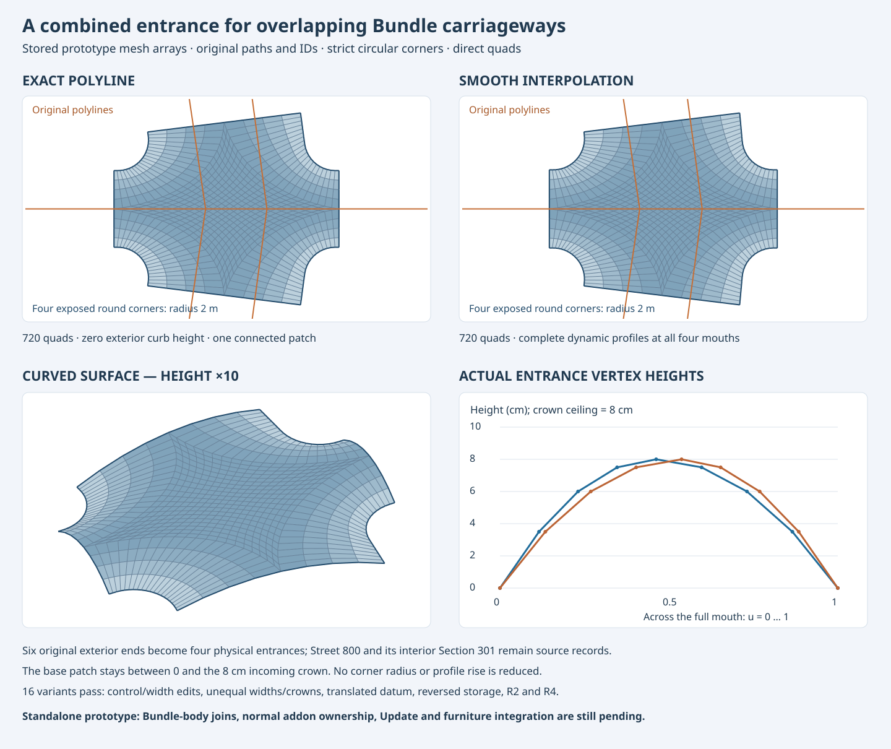

Integration must prepare the combined entrances before individual footprints,
retain both logical junction owners and all original source-end mappings,
split each shared mouth back into the two source-relative member interfaces,
and construct the same-profile Bundle-body seam and merged-cap policy. Actual
Update, furniture, local/full equivalence and fresh reopening then need their
own qualification. The prototype's one-Section-per-side and equal paired
corner-request restrictions also need explicit production policies.

## Overlapping curved runs around an interior crossing

Dev65 adds `InteriorAngularPlan`. The original Bundle's ordered Section
traversals are partitioned only at its declared transverse Street crossings.
These run descriptors are derived incidences; they create no replacement
Street, Section or persistent junction ID. A compatible two-port Section seam
does not become a crossing. An incomplete or differently ordered pairing needs
a broader region graph, not a spatial nearest-neighbour assignment.

The original prepared junctions remain authoritative. Both logical sites may
map to one physical compound. In that case `VisibleMouth` reads the actual
visible endpoint, station and full transverse sample sequence from
`CompoundProduct`. `VisibleCaps` follows that same product's uninterrupted curb
chain between the requested original endpoints. It cannot cross another mouth
or resurrect an entrance consumed by the junction union. Corner radii and
source curves are not changed by this construction.

For an actual outward profile parameter $u\in[0,1]$, let $\epsilon_e$ be $+1$
at original Section end 0 and $-1$ at end 1. Let $\tau$ be $+1$ for a forward
member traversal and $-1$ for reversed storage. The role sign $\sigma$ is $+1$
for the first Bundle member and $-1$ for the second. The original signed
cross-section coordinate and the run's outer-to-inner parameter are:

$$
q_{\rm source}=\epsilon_e(2u-1),
\qquad
v=\frac{1+\sigma\tau q_{\rm source}}{2}.
$$

The actual samples are sorted by $v$, retaining their original XYZ values.
They need not be uniformly spaced. A cached direct-quad pattern retains its
topology and immutable UV arrays. An ephemeral view maps its transverse
parameter through the piecewise-linear function $\psi$ satisfying
$\psi(j/(n-1))=v_j$. The whole mouth uses the actual prescribed samples; its
longitudinal connector and body cut use the same mapped parameter. Changing
only the first row would leave an incompatible cross-section inside the strip.
The unchanged source profile is checked before assigning its exact prepared
sample, with only the existing numerical agreement tolerance.

One shared angular coordinate frame is chosen from the original member controls;
this fits a coordinate system, not a new centreline. Each original path retains
its own polynomial and certified offsets. Visible run mouths bound the local
chart. The existing angular gap events identify intervals of separate
carriageways and pavement overlap. If every run remains separate, the previous
separator provider stays selected. When overlap exists, each run uses the
established angular pavement union, dynamic crown, direct quad body tiles and
rounded separator caps. The composite plan publishes the two replacement
meshes only through the normal transactional Update graph.

`CarriagewayProvider` retains metadata for every original member Section while
the composite plan owns its pavement. The transverse Street keeps its ordinary
profile and original identities. Its middle Section may belong physically to
the compound junction; it does not become a Bundle half profile. Furniture
anchors keep their source Section and station. A member anchor queries the
combined run surface; an anchor inside a junction uses the actual junction
height. The complete Bundle retains the existing combined cell budget, rather
than giving each run an independent unlimited allowance.

The focused runtime Exact/Smooth tests compare the published footprint in both
directions with the Boolean union of the original visible carriageway ribbons.
Area, full bilinear slopes, crown bounds, whole float32 interfaces and filled
topology are checked independently. Combined control/width edits, exact
local/full/restoration, source-relative anchors, unrelated identity, reversed
storage and translated-datum E0 now pass in the numerical backend. Actual
Blender edits, local/full/furniture equality, restoration and fresh selective
reopening also pass for the two new R1 cases. An independent saved-buffer audit
retains the original-ribbon footprint and area, four exactly closed separator
holes, the crown ceiling, full physical slopes below 9.059% and the existing
3% longitudinal bound (measured bound at most 2.882%).


These are actual saved meshes, not a sketch of an unimplemented construction.
The replacement Bundle paving and grass use 4,450/5,475 quads; the unrelated
control road is omitted from the figure. Other interior arrangements still
need qualification. Multi-Section visible
runs, profiles changing inside a consumed seam, overlapping entrance profiles
and general interior islands still require their own construction branches.

## Angular separator charts at internal physical junctions

The two Bundle members are split into their original Sections at the crossing.
Street 800 retains Sections 300, 301 and 302; only 301 is inside the Bundle.
Existing physical-junction ownership and `CompoundBundleBuilder` retain the
actual visible carriageway rims and rounded caps. They produce two separator
regions interrupted by the crossing. No source centreline, width, profile,
radius or persistent ID is changed to make these regions easier to fill.

`FixedRimSeparator` keeps its earlier chart choices first. If these fail,
`AngularSeparatorChart` proposes a coordinate system for the prescribed simple
counterclockwise boundary. Fitting a centre chooses coordinates, not a new
physical curb curve. For boundary samples $\mathbf p_i$, first centre the
linear fit at $\mathbf o=\frac1n\sum_i\mathbf p_i$, with
$\mathbf q_i=\mathbf p_i-\mathbf o$:

$$
\begin{bmatrix}
2q_{1x}&2q_{1y}&1\\
\vdots&\vdots&\vdots\\
2q_{nx}&2q_{ny}&1
\end{bmatrix}
\begin{bmatrix}a\\b\\d\end{bmatrix}
\simeq
\begin{bmatrix}\lVert\mathbf q_1\rVert^2\\\vdots\\\lVert\mathbf q_n\rVert^2\end{bmatrix},
\qquad
\mathbf c=\mathbf o+(a,b),
\qquad
R=\frac1n\sum_i\lVert\mathbf p_i-\mathbf c\rVert.
$$

The largest gap in the boundary angles selects a branch cut outside the sampled
rim; its opposite direction is $\theta_0$. A boundary edge crossing this cut or
a chart reaching its origin is rejected. With
$r=\lVert\mathbf p-\mathbf c\rVert$ and
$\theta=\operatorname{atan2}(p_y-c_y,p_x-c_x)$, the coordinates and inverse are:

$$
s=R\,\operatorname{wrap}_{(-\pi,\pi)}(\theta-\theta_0),
\qquad w=R-r,
$$

$$
\mathbf p=\mathbf c+(R-w)
\begin{bmatrix}
\cos(\theta_0+s/R)\\
\sin(\theta_0+s/R)
\end{bmatrix}.
$$

Both $s$ and $w$ are measured in metres. They are internal chart coordinates;
the normalized carriageway profile parameter remains unchanged. The chart uses
$h_c=h\min(1,R/r_{\max})$ as a spacing proposal. A local bounding-box aspect
ratio above four tries longitudinal partitioning first; compact layered and
four-sided charts remain alternatives. All of them construct quads directly.

Each mapped physical boundary vertex is reassigned its exact source XY. Heights
are extended using `plateau_extension` in physical XY, then exact source XYZ is
reassigned at the complete rim. The final physical mesh must still pass the
same convexity, edge-ratio, crown, overlap and shared-edge checks. A successful
chart-coordinate mesh alone is insufficient.

Partition sampling can retain the right source incidence while changing a
coordinate by arithmetic roundoff. `PartitionedSeparatorChart.source_boundary`
uses the recorded source segment and endpoint fraction, not a nearest-point
search, to recover a complete bijection onto the original boundary. Only exact
segment endpoints are accepted, displacement is bounded by scaled machine
precision, and source coordinates are restored exactly. New samples, omitted
vertices and changed incidence remain errors. The rotated U-shaped permanent
test checks exact rim edges, coverage and quality after this restoration.

Some positive chart blocks exhaust the ordinary quality iteration budget just
above edge ratio eight. After both ordinary block charts fail, at most 25
additional fixed-rim iterations may finish the block. This continuation stops
at the unchanged acceptance limit eight; continued shape-energy descent can
otherwise worsen that maximum ratio. The physical inverse-map pass also stops
when that same limit is satisfied. Successful earlier chart choices retain
their previous construction.

This completes the focused separated internal-crossing construction. Dev65's
paired overlapping internal runs use the pavement-union construction described
above; their self-intersecting separator outlines cannot use this separated
chart. Broader overlapping internal arrangements remain open.
Requested-radius contact failures in the tighter central overlap remain a
separate physical-junction problem. Full current-source release qualification
remains separate from these focused checks.

## Source-preserving entrance samples and cap parity

Dev63 extends the attached angular family to a continuous median and several
ordered grass islands. The expected component count is the number of positive
gap intervals. It is no longer fixed at two. Tests edit the same Section IDs
between one, three, two and one regions; this changes generated topology while
preserving authored identity, unrelated outputs and source-relative anchors.


### Coordinate whole-edge sampling before constructing surfaces

An all-quad disk has an even number of boundary edges, because

$$
4F=2E_{\rm interior}+E_{\rm boundary}.
$$

Let $r_0,r_1$ be the two entrance inner-curb interval counts, $c$ the original
rounded-cap/crossroad rim count and $f$ the computational grass cut count. A
cap requires

$$
r_0+r_1+c+f\equiv0\pmod2.
$$

The current grass cut has a multiple of four intervals. The actual cap's parity
therefore decides whether one entrance needs an extra subdivision. That same
physical curb partition is reused by its pavement and grass patches. Source
corners, the original rounded junction samples and complete mouth partitions
remain fixed; no boundary is secretly split on only one neighbor.

`BundleProvider` makes actual visible ports and junction surface products ready
before eligible single-Section angular plans. `SourceRimSampling` uses the
carriageway's shared `span_metadata` and `RoadSampling` policy to prepare the
connecting crossroad rim without constructing a temporary road mesh. This
avoids a Bundle-plan/road dependency cycle. The plan signature consumes only
the relevant port stamps, preserving unrelated components. Existing axial and
finite branches keep priority.

### Preserve curb corners and curve accuracy in the entrance strip

The original uniform-row entrance is retained when its sampled physical curbs
meet the required accuracy in both directions. Exact uses a numerical
$10^{-7}$ m tolerance; Smooth reserves 10% of its 5 mm budget for initial source
sampling and uses the remaining 90% for the strip's physical curb comparison.
Both retained source vertices and segment-interior samples are measured.

A captured valid 20 m inner-radius input exposed a 48.0 mm Exact shortcut and
a 6.23 mm Smooth discrepancy. `SourcePreservingAngularBridge` resolves this by
retaining Exact curb corners or appropriately sampled/simplified Smooth source
curbs. It uses the existing cached direct-quad pattern with independently
partitioned outer and inner sides. Where parity requires another point, a
coordinated midpoint is inserted on an existing source chord.

For the generalized strip, let $S_o(u),S_i(u)$ be the piecewise-linear angular
station functions on the sampled outer/inner sides, and $(s_m(v),y_m(v))$ the
original mouth. Define

$$
\begin{aligned}
\delta_s(v)&=s_m(v)-\bigl[(1-v)S_o(0)+vS_i(0)\bigr],\\
s(u,v)&=(1-v)S_o(u)+vS_i(u)+(1-u)\delta_s(v),\\
D_s(v)&=(1-v)S_o'(0)+vS_i'(0)-\delta_s(v).
\end{aligned}
$$

Thus the strip retains the actual mouth at $u=0$, the common computational
station at $u=1$, and the prescribed complete side partitions. With
$y_b(s,v)=(1-v)y_o(s)+vy_i(s)$, use

$$
\begin{aligned}
\alpha(v)&=y_m(v)-y_b(s_m(v),v),\\
\beta(v)&=D_s(v)
\left[\left.\frac{dy}{ds}\right|_{\rm source}
-\left.\frac{\partial y_b}{\partial s}\right|_{s_m(v)}\right],\\
y(u,v)&=y_b(s(u,v),v)+(1-3u^2+2u^3)\alpha(v)
 +(u-2u^2+u^3)\beta(v).
\end{aligned}
$$

The lateral corrections vanish on the original curbs. The complete original
mouth and sampled side XYZ are assigned exactly. The height rule remains
$z=z_0+h(2v-v^2)$, independent of $u$. Quad convexity, world edge ratio, crown
envelope, physical slopes and the whole entrance tangent-cone bound are checked
after mapping. An accurate boundary alone does not certify the surface.

### Independent qualification of actual published meshes

The [13 focused tests](../../experiments/streets/python_v1/angular_attached_core_dev63_02/island_chain_checks.json)
and actual [native operations](../../experiments/streets/python_v1/angular_states_native_dev63_02/native_states_checks.json)
and [fresh reopening](../../experiments/streets/python_v1/angular_states_reopen_dev63_01/native_states_checks.json)
pass the source, topology-change, dependency, restoration and profile cases.
The [independent audit](../../experiments/streets/python_v1/angular_states_physical_dev63_01/published_states_checks.json)
reads saved float32 buffers without regenerating meshes. Its footprint reference
is the Boolean union of the original visible carriageway ribbons, not an output
mesh. It checks both directions of the boundary comparison, area, component
counts and Euler characteristic, slopes, crown and whole grass edges.
Published Exact discrepancies are at most 2.56 micrometres within the separate
20-micrometre publication allowance; Smooth discrepancies stay below 3.83 mm
within the unchanged 5 mm curve budget plus that allowance. The greatest
longitudinal bound is 2.99684%, below 3%.

Furniture declares its separator dependency for evaluation order but consumes
that output digest only when its plan needs the completed cap height query.
This closes the unnecessary opposite-member anchor rebuild found by the dev62
full regression while preserving updates when a composite surface actually
changes the anchor height. Broader topology/profile construction and current
full-gallery/real-import/installer qualification remain separate gates.

## Curved Bundles attached to real junctions

Dev62 adds `AttachedAngularPlan` after the existing attached axial and finite
branches. It covers two complete single-Section members with inward-rising
half crowns, a common datum/rise, four actual multi-arm mouths, separated end
profiles and an overlapping body between two open-ended separator islands.
The original paths and junction layouts are inputs throughout. An auxiliary
angular frame chooses coordinates; it does not replace a centerline with a
fitted circle. Continuous visible-centerline separation and angular-progress
certificates remain mandatory.


### Original profiles to internal computational cuts

For chart center $C$, radius scale $R$, direction $\sigma\in\{-1,1\}$ and
reference angle $\theta_0$, the coordinate transform is

$$
s=\sigma R\,\operatorname{wrap}\bigl(\arg(P-C)-\theta_0\bigr),
\qquad y=-\sigma\bigl(\lVert P-C\rVert-R\bigr).
$$

Every physical side curve is still the original sampled Cartesian offset.
`RayCurb` intersects that polyline with each angular ray rather than linearly
interpolating its angular ordinates. Mouth stations are inserted before curb
sampling. Finite computational cuts lie inside the visible Bundle beyond the
whole mouth; selecting a cut does not shorten or rotate an authored Street.

Let $v\in[0,1]$ run across a whole member from its exterior zero edge to its
interior crown edge, and $u\in[0,1]$ run from its actual mouth to a computational
cut. The actual mouth has angular coordinates $(s_m(v),y_m(v))$; the cut station
is $s_c$. The initial strip is

$$
s(u,v)=(1-u)s_m(v)+us_c,
\qquad y_b(s,v)=(1-v)y_o(s)+vy_i(s),
$$

where $y_o,y_i$ are the actual outer/inner curb ray ordinates. A Hermite
correction matches the original mouth position and longitudinal tangent:

$$
\begin{aligned}
\alpha(v)&=y_m(v)-y_b(s_m(v),v),\\
\beta(v)&=(s_c-s_m(v))
\left[\left.\frac{dy}{ds}\right|_{\rm source}
-\left.\frac{\partial y_b}{\partial s}\right|_{s_m(v)}\right],\\
y(u,v)&=y_b(s(u,v),v)
 +(1-3u^2+2u^3)\alpha(v)+(u-2u^2+u^3)\beta(v).
\end{aligned}
$$

Both corrections are zero on $v=0,1$, retaining the original physical side
curbs. The fixed source mouth is assigned exactly after mapping. For these
inward half crowns the complete member profile remains

$$
z(u,v)=z_0+h(2v-v^2).
$$

Its height does not depend on $u$: no entrance flattening or longitudinal bump
is introduced by the connector. This describes a whole Bundle carriageway's
specified half-crown profile, not half its physical width. The opposite member
has the corresponding reversed transverse coordinate. Actual bilinear mesh
slopes and the whole entrance tangent cone are checked after construction;
an analytical position/tangent match alone is not accepted as mesh proof.

### Pavement union, open grass bodies and rounded caps

The existing dynamic peak policy governs the body. In separated intervals,
the two inner peaks bound a grass plateau. In overlap they become a shared
crown ridge, with the established smooth blend toward the exterior envelope
center. Inner-curb segment intersections determine the actual gap events.
Each open grass piece has a computational cut at its junction-facing end and
a finite physical tip where the pavement gap closes.

Bounded direct-quad charts construct the grass pieces first. Their complete
physical rims are reused by the pavement halves; the overlap crest is also
built once and reused. Local pavement charts avoid propagating small tip
intervals through the entire body. The original complete mouth partitions and
the body-cut profile samples are assigned one set of shared keys and XYZ
values. No triangles are constructed or merged.

The separator's junction-facing caps are generated later, when actual junction
surface/port products and connecting crossroad Sections are available. The
existing `BundleProvider.cap/region` follows their original rounded boundary
samples. Short inner-curb rims connect those caps to the open grass-body cuts;
explicit whole cut partitions weld the parts. Separator components, manifold
edges, quad shape, crown envelope, physical slopes and overlaps are checked.
The full float32 interface audit includes junction and crossroad meshes, not
only the Bundle pavement.

Physical cap geometry and height queries are prepared at exaggeration one,
including physical copies of already-published compound boundary rims. The
display exaggeration is applied once afterward. Zero display exaggeration
therefore does not erase the physical cap heights needed for reconstruction.
Furniture placements now depend explicitly on their Bundle separator, ensuring
the completed cap height query exists before source-relative anchors are
evaluated. The plan retains bounded queries and small interfaces, not a
`BuildContext` or the whole network product graph.

The [six focused tests](../../experiments/streets/python_v1/angular_attached_core_dev62_01/attached_core_checks.json),
[native operations](../../experiments/streets/python_v1/angular_attached_native_dev62_01/native_attached_checks.json),
[fresh reopening](../../experiments/streets/python_v1/angular_attached_reopen_dev62_01/native_attached_checks.json)
and [independent saved-buffer audit](../../experiments/streets/python_v1/angular_attached_slopes_dev62_01/published_slope_checks.json)
qualify this family. Internal junctions, compound-consumed mouths, additional
island/contact topologies and profile-changing seams need further construction;
the complete current regression and release gates remain separate.

## Several ordered angular separator islands

Dev61 composes multiple physical holes of a two-member angular pavement union.
The source centerlines retain their geometry and continuous separation checks.
Each hole is split into its upper/lower physical curb chains by the same
certified angular coordinate frame. Its start/end stations must satisfy

$$
a_i < b_i < a_{i+1}.
$$

This is a construction branch for disjoint ordered angular intervals. Holes
whose intervals overlap need another decomposition; no inferred separator is
accepted merely because the initial union found a hole.

For each island, the existing finite-tip direct quad builder produces grass
and two complete boundary chains, denoted $I_i^+$ and $I_i^-$. Crown ridges
$\rho_i$ connect the previous island tip to the next one, with a head/tail
ridge joining the physical free ends. The two shared pavement interfaces are

$$
\Gamma^{\pm}=\rho_0\mathbin{\oplus}I_0^{\pm}\mathbin{\oplus}\rho_1
\mathbin{\oplus}\cdots\mathbin{\oplus}I_{k-1}^{\pm}\mathbin{\oplus}\rho_k.
$$

Here $\oplus$ concatenates chains at one explicitly shared endpoint. A ridge
is built once and reused on both halves. Every island's generated seam keys
are prefixed with its Bundle key and construction-order index, so independent
islands cannot accidentally weld their local `island_tip` or body addresses.
That generated index is not an authored ID or furniture anchor: persistent
identity remains with the original Section/Street/Bundle records.

The upper pavement half lies between its original outer curb and
$\Gamma^+$; the lower half lies between its outer curb and $\Gamma^-$.
Grass and shared crown boundaries stay at $z_0+h$, exterior curbs at $z_0$,
and the existing physical height field controls interior vertices inside
$[z_0,z_0+h]$. Whole-edge boundary matching is checked before drainage, physical
slope/longitudinal bounds, overlaps and publication. Independent tests also
check actual float32 whole-edge equality and connected-component counts.

`MultiIslandSurfaceBuilder` uses bounded local body charts first. Small concave
steps where real end cuts meet remain physical corners. `LayeredAngularPatch`
can fit them with cached radial quad layers and fixed-boundary grading instead
of repeatedly forcing one four-sided atlas. The same fallback can repair a
failed local body chart; its rim is limited to 512 samples. Original boundary
XYZ values are exact after grading and all heights are reevaluated from the
authoritative field. No triangles or relaxed acceptance limits are introduced.

The [19-test numerical qualification](../../experiments/streets/python_v1/angular_island_core_dev61_01/island_chain_checks.json)
covers two/three/four islands in both interpolation modes, reversed source
storage, vertex/width Update equivalence and restoration. The
[native checks](../../experiments/streets/python_v1/angular_island_native_dev61_03/native_island_checks.json)
and [fresh reopening](../../experiments/streets/python_v1/angular_island_reopen_dev61_01/native_island_checks.json)
now pass both three-island examples. Their
[independently measured saved-buffer slopes](../../experiments/streets/python_v1/angular_island_published_slopes_dev61_01/published_slope_checks.json)
remain within the original physical/longitudinal limits, with whole float32
grass interfaces and the incoming crown ceiling. Higher resolutions remain a
separate gate for these new long examples.


The drawing uses the same source centerlines and identical grass buffers on
both sides. The pavement half that previously fell back to a dense global
chart now keeps local tiles, reducing the complete Bundle from 13,669 to
8,383 quads. Street 99, the unrelated control road, is excluded from these
Bundle counts. The
[drawing audit](../../experiments/streets/python_v1/angular_island_drawing_dev61_03/drawing_checks.json)
compares the actual source and grass arrays; the numerical runtime checks
retain convex quads, edge ratio eight, crown/slope bounds and overlap guards.
The [physical-boundary audit](../../experiments/streets/python_v1/angular_island_density_boundaries_dev61_01/density_boundary_checks.json)
also proves complete collinear edge coverage in both directions, to the 1e-7 m
numerical weld tolerance, for this particular density change. This observed
outline equality does not replace the general intended-curve accuracy contract.

## Earlier angular preparation and single-island checkpoints

Dev60 adds bounded spatial candidates for dense sampled footprint unions.
`region_pairs.SegmentPairIndex` maps expanded edge boxes into a grid; edges
covering more than 64 cells use a bounded fallback list. Candidate pairs are
sorted by original segment indices and tested with the unchanged cross-product,
parallel/collinear and epsilon calculations. `PairBudget` counts queries,
bucket entries (including duplicates) and candidate comparisons before their
work; it does not increase the existing union limit. The old dense path remains
in use for every previously accepted arrangement. The
[focused qualification](../../experiments/streets/python_v1/region_pair_core_dev60_02/region_pair_checks.json)
compares exact union buffers/provenance and tests candidate completeness,
self-contact errors and bounded fallback behavior.
The [three-island Smooth example](../../experiments/streets/python_v1/angular_multi_spatial_dev60_02/multi_island_checks.json)
now passes union preparation, but constructing its final profiled quad surface
is still missing. This distinction matters: correctly finding holes does not
mesh the pavement between them.

Dev52 integrates the angular prototype below into numerical classes/providers.
The runtime branch uses actual Blosm identities, dimensions and traversal,
bounded shared patterns and physical quad attachment queries. Eleven focused
tests and actual Blender generation/editing pass; all 62 earlier fixtures stay
exact in the combined 74-fixture scene. Fresh reopening/operator checks,
all-gallery publication quality and the complete 874-test regression also pass.
Dev52 now also passes fresh Berlin, Canal and Nashville import/quality/reopen
checks and all four installed-copy checks. The qualified local preview and
exact source/checkpoint provenance are recorded in the
[acceptance document](STREETS_PYTHON_ACCEPTANCE.md). The remaining work concerns
construction coverage and expensive Updates, followed by qualification of the
final combined implementation.

The newer dev53 route construction below is now qualified by the 86-fixture
scene, 882 numerical tests, three fresh real-network pipelines and a separately
installed addon ZIP. The acceptance record links the exact source and package
receipts. This is a usable development preview; broader construction coverage
and costly complex Updates remain unfinished.

## Refined separator grading (dev59, under validation)

Uniform bilinear subdivision preserves a quad's boundary but not necessarily
its edge ratio: a tapered parent can produce thin children near its shorter
end. In the captured Exact180 R4 case, four separator children exceed the
unchanged ratio limit eight; their maximum is 9.53067.

After subdivision, the angular builder now checks both pavement and grass.
A failing separator uses the existing bounded `ProfiledQuadCorrection` with
the constant plateau field, fixed boundary XYZ, unchanged connectivity and
the original elevation/slope/ratio guards. Only interior XY can move. Queries,
whole-edge interface, overlap and drainage checks run after this correction.
The native experiment needs four accepted steps, leaves all separator heights
unchanged and lowers the maximum to 7.58178 after float32 conversion.

The [captured failure](../../experiments/streets/python_v1/angular_selective_resolution_01_dev58_01/failure.txt)
and [repair experiment](../../experiments/streets/python_v1/refined_separator_native_01/refinement_checks.json)
are retained. The [12-test focused regression](../../experiments/streets/python_v1/separator_refinement_core_dev59_01/refinement_core_checks.json)
passes the current integration and adjacent contracts. The
[integrated Blender retry](../../experiments/streets/python_v1/angular_selective_resolution_01_dev59_01/case_checks.json)
also passes R2/E0, R4/E10, exact full rebuilding, restoration and remote
preservation; the Smooth225 sequence passes too. The
[all-gallery audit](../../experiments/streets/python_v1/dev59_gallery_receipt_audit_01.json)
now qualifies saved geometry and cold/full reconstruction for all 86 fixtures,
including twelve exact whole float32 angular island interfaces. Fresh real
imports, current full regression and release gates remain separate.

## Physical interpolation amplification (dev58, under validation)

A finite direct quad interpolates its four sampled heights bilinearly. Its
world gradient follows from its two tangents, with planar determinant

$$
D=x_u y_v-x_v y_u,\qquad
z_x=\frac{z_u y_v-z_v y_u}{D},\qquad
z_y=\frac{x_u z_v-x_v z_u}{D}.
$$

A small positive determinant can amplify the gradient even when the original
profile field is gentle. Positive Jacobians and an edge ratio below eight
alone do not exclude that amplification. The captured Exact270 control move
has a 12.2625% bilinear slope although dense samples of its original profile
in the offending cell reach about 2.8%.

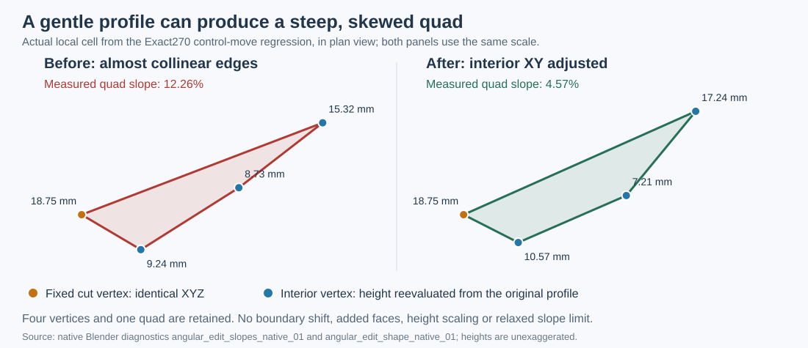

`ProfiledSlopeCorrection` measures both physical and angular longitudinal
slopes before changing anything. An already qualified mesh is returned as the
same object. Otherwise the existing fixed-rim planar correction is tried with
minimum/target corner sines `(0.15, 0.20)`, then `(0.30, 0.40)`, each bounded
to 500 iterations. It preserves every boundary XYZ and all face indices,
recomputes moved heights from the original field, then measures the same slope,
ratio and elevation guards again. A fixed boundary that itself exceeds the
limits is still rejected. The captured native repair needs one accepted XY
step and lowers the offending slope to 4.5688%; it adds no faces.

The [native original](../../experiments/streets/python_v1/angular_edit_slopes_native_01/diagnostic_checks.json)
and [scoped repair](../../experiments/streets/python_v1/angular_edit_shape_native_01/diagnostic_checks.json)
retain exact source and cell diagnostics. The
[integrated Blender edit](../../experiments/streets/python_v1/angular_selective_edit_10_dev58_02/case_checks.json)
also passes vertex/width publication, local/full buffer and furniture identity,
restoration and cold reconstruction. The
[complete numerical regression](../../experiments/streets/python_v1/suite_dev58_01/suite_checks.json)
now passes all 904 tests in 100 modules on unchanged dev58 source. The broader
native resolution/editing, saved-gallery and release gates remain pending.

## Local physical angular tiles (dev57, under validation)

`AngularIslandTiles` owns local island sampling, coupled crosscuts, direct quad
maps and the returned pavement/grass interface. It receives the existing
island builder's frame, spacing, cell limit and physical error budget; it does
not retain a BuildContext or replace any source Section. `AngularRoadTiles`
adapts the same idea to a pavement body, keeping its existing first/last cut
profiles and choosing every internal crown cut on an **existing** crown/grass
vertex. Its exterior curb chords may acquire cut points, but the shared grass
edge partition is never subdivided unilaterally.

For a local cut of physical width $w$, adjacent curb/seam edge length $e$ and
nominal spacing $h$, the even profile interval count is based on

$$
N=2\left\lceil\frac{\max\left(2,\left\lceil w/\min(h,6e)\right\rceil\right)}{2}\right\rceil.
$$

The factor six reserves room below the unchanged maximum edge ratio eight;
it is a construction heuristic, not a guarantee of final mesh quality. Each
cut has at most 64 intervals, both neighboring tiles use the same coordinates
and semantic keys, and every mapped quad still passes the independent positive
Jacobian/shape guards. The complete assembled feature retains the original
cell limit, source boundary, crown envelope, 3% longitudinal bound and overlap
checks. Additional rows near narrow tips do not propagate through the wide
body.

An island tip's internal point is evaluated on the actual two curbs at its own
advanced angular station, rather than retaining the radius from the old cut:

$$
s_m=s_{\mathrm{cut}}\pm d\sigma,\qquad
M=\tfrac12\big(C_{\mathrm{upper}}(s_m)+C_{\mathrm{lower}}(s_m)\big).
$$

Here $d$ is the finite tip span and $\sigma$ the bounded shear choice. The
physical tip-to-curb chords keep their independently checked approximation
budget. Source simplification and any subsequent body sampling are separately
reserved from that same budget. The final report records a conservative
complete bound; it does not silently spend the same error allowance twice.

Local maps reuse cached direct quad patterns. A small invalid Coons seed may
try a fixed-boundary harmonic initialization with at most 512 vertices, followed
by the existing bounded shape correction. This seed solves only for internal
XY; no source point moves, and positivity is checked afterwards. Island welding
uses named rim/cut/tile addresses, never rounded world coordinates. If a
qualified angular map fails its world-space ratio, `ProfiledQuadCorrection`
may move only interior XY, reevaluate its own profile field and retain all
physical boundary XYZ. It must still pass the original ratio, crown and slope
limits.

The old whole-feature construction runs first. The extended grading operates
on a call-local copy only after that construction fails; valid earlier results
are intended to retain their existing mesh buffers. Native preservation and
the broader regression still need to prove that intention on dev57. The
[40-test integrated run](../../experiments/streets/python_v1/angular_tiles_core_dev57_01/tile_checks.json)
now passes on frozen source, including the independent physical grass edge and
curve-error audit, both coordinate precisions, the actual width-edit regression
and the R4 case. The original batch stopped at its memory reserve; a selective
continuation captured the native Exact270 slope failure addressed above. Numerical
success is not substituted for publication, reopening or release qualification.

## Source-anchored sampling of retained angular Section ranges (dev56)

Let $S_p$ be the samples of the original prepared Section path $p$ on its
complete physical interval $[0,L_p]$. For a retained interval $[a,b]$, use

$$
S_{p,[a,b]}=\{a\}\cup\{s\in S_p:a<s<b\}\cup\{b\}.
$$

`AngularMemberBoundary` evaluates each retained station on the original path
and its own physical offset, reversing the resulting trace only for the
declared traversal. It does not resample the shortened range as a new global
grid. When $a$ or $b$ changes, all unaffected stations and source coordinates
therefore stay exact. Exact control knots remain required samples; Smooth
offsets use the original continuous curvature-based chord bound. The source
phase has a 200,000-sample allocation limit. `Path.samples(max_samples=...)`
checks each planned allocation, including cumulative Exact segment counts;
unbudgeted existing calls retain the same sample values and operation order.

The [37-test check](../../experiments/streets/python_v1/angular_sampling_core_dev56_01/sampling_checks.json)
covers physical source points, restriction locality, compulsory Exact controls,
preallocation rejection and the three Smooth changing-width islands with
float32 controls. Generation alone does not establish arbitrary-edit support:
the native +0.1 m width edit on the 180-degree Smooth island and the R4 island
case still fail. Three Exact islands also remain incomplete. Cartesian local
tiles and graded shared crosscuts are external experiments; their failed
complete-construction checks are retained, not counted as supported geometry.

## Angular certificates for finite dimensional transitions (dev55, in progress)

`AngularMemberRoute` keeps each prepared path and explicit two-port incidence.
At a width/offset change it retains the existing `SectionTransition`, whose
trimmed source pieces and actual quintic curbs are collected by
`AngularMemberBoundary`. The Bundle claims the original transition owner only
after its complete replacement pavement is constructed successfully. This
suppresses duplicate seam meshes without deleting their source records or queries.

Let a degree-$n$ curb have Bernstein controls $P_i$, angular origin $O$, and
derivative controls $V_j=n(P_{j+1}-P_j)$. Its angular derivative has the sign of

$$
\frac{d\theta}{dt}=
\frac{(C(t)-O)\times C'(t)}{\lVert C(t)-O\rVert^2}.
$$

The numerator is degree $2n-1$, with Bernstein coefficients

$$
D_k=\sum_{i+j=k}
\frac{\binom{n}{i}\binom{n-1}{j}}{\binom{2n-1}{k}}
\big((P_i-O)\times V_j\big).
$$

Apply the declared traversal sign and a floating-point reserve. Positive
coefficient bounds prove the entire curb advances angularly; bounded de Casteljau
subdivision tightens an inconclusive hull. A failing proof rejects this chart.
Piecewise Exact transitions certify every original polynomial piece; no control
points, radius or source cross-section are changed. Independent physical mesh,
world-space edge ratio, slope, crown and overlap guards remain mandatory.

Width-changing curbs introduce irregular sample lengths. The new protected
polyline sampler retains mandatory Exact corners and semantic changes, and checks
the complete old/new station partitions against its error budget. A width-aware
separator-row experiment did not resolve complete mesh construction and is not
in the runtime; it remains saved with its failed evidence for further analysis.
Source sampling and subsequent boundary
approximation each have explicit portions of the original curve tolerance.
These are construction tools, not a proof that the complete mesh is supported.

The same explicit join can acquire slightly different normals from float32
source coordinates. Angular transition collection now uses the route's existing
bounded curb reconciliation (at most ten micrometres, also bounded by 1% of
curve tolerance). It records the maximum actual join discrepancy and includes
it in subsequent boundary error accounting. It never moves authored coordinates
or joins separate sources without their declared incidence. The
[before](../../experiments/streets/python_v1/angular_dimensional_float32_before_01/float32_checks.json)
and [after](../../experiments/streets/python_v1/angular_dimensional_float32_after_01/float32_checks.json)
tests preserve the two original Exact failures and the repaired six-case result.

The [twelve-case before diagnostic](../../experiments/streets/python_v1/angular_dimensions_before_01/dimension_probe.json)
and [partial dev55 check](../../experiments/streets/python_v1/angular_dimensions_after_03/dimension_checks.json)
show the remaining distinction: several complete overlap surfaces now generate,
but island and some Smooth layouts still fail. The
[actual failed island atlas](../../experiments/streets/python_v1/angular_dimensions_capture_01/island_atlas.png)
locates narrow-end cells that exceed the world shape limit. This picture is
diagnostic, not accepted output. All twelve constructions, independent analytical
curve accuracy, editing/ownership/furniture and native regression must pass
before this branch is qualified.

## Exact invalid-corner rejection (dev54)

The expensive fixed-rim descent tries bounded displacements of the internal
vertices and halves a rejected displacement. For an ordered quad corner, define

$$
\mathbf{a}_i = \mathbf{p}_{i+1} - \mathbf{p}_i,
\qquad
\mathbf{b}_i = \mathbf{p}_{i+2} - \mathbf{p}_{i+1},
\qquad
J_i = a_{i,x}b_{i,y} - a_{i,y}b_{i,x}.
$$

Indices wrap around the quad. The existing complete energy evaluation rejects
a proposal if any $J_i \leq 10^{-10}$. Dev54 remembers just the face/corner index
that failed on an earlier proposal. At the next evaluation it reads that
corner's current connectivity and current coordinates and recomputes the same
two differences, two products and subtraction. If it still fails the unchanged
guard, there is no need to gather and test every other face. A failed witness
is sufficient for rejection; a passing witness is never sufficient for acceptance.
The complete evaluation and original line-search comparison still follow it.

This is an exact necessary-condition shortcut, with no approximate Jacobian,
cached coordinate, weaker tolerance, altered energy reduction or gradient.
The workspace lives for one descent and retains one index pair. It does not
create a network-wide cache or scale memory with the number of editing steps.
An invalid evaluation may leave its scratch buffers from an earlier trial;
only a finite evaluation supplies buffers for the next accepted-state gradient.
The current and trial workspaces remain separate.

The [integrated check](../../experiments/streets/python_v1/integrated_quad_witness_dev54_01/integrated_witness_checks.json)
compares 600 adversarial energy evaluations with immutable dev53, verifies six
captured actual Canal descents bit-for-bit and runs nine workspace tests.
The tests include changed coordinates, changed face connectivity and adjacent
floating-point values on each side of the positivity threshold. The preceding
[native candidate comparison](../../experiments/streets/python_v1/canal_quad_witness_dev53_01/witness_update_comparison.json)
measures the full Update, exact restoration and local/full identity. The separate
[integrated production comparison](../../experiments/streets/python_v1/canal_quad_witness_dev54_01/witness_update_comparison.json)
also passes eight interleaved measurements with bit-for-bit identical meshes;
the median whole Update falls from 8.5162 s to 7.4205 s. The
[independent qualification audit](../../experiments/streets/python_v1/dev54_witness_receipt_audit_01.json)
also verifies all 885 regression tests, exact rebuilding/quality of the 86-fixture
gallery, fresh-process edits and reopening, source/script hashes and the 1 GiB
resident/private cap with the same reserve. The shortcut changes no source path
or published geometry in that gallery. Further geometry branches and costly
complex Updates remain unfinished.

## Source-preserving angular Section routes (dev53)

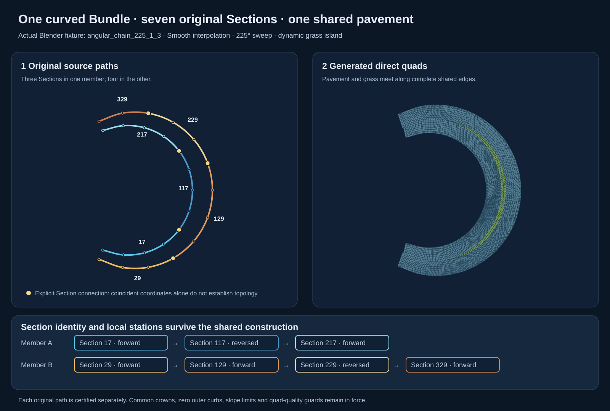

The drawing reads the saved Blender fixture `angular_chain_225_1_3`: seven
original Sections generate 2,939 pavement and 226 grass quads. Gold points mark
explicit Section connections; the two reversed storage directions are listed
below the paths. The drawing exporter verifies unchanged saved mesh buffers and
source records. The formulas remain editable LaTeX text below.

`AngularMemberRoute` extends the angular union construction to members made of
several explicitly connected Sections. It derives a metric route from the
already prepared `Path` objects. It does not concatenate controls and fit a new
cubic: each Section keeps its original persistent ID, interpolation, polynomial,
width, offset and local station space. Different members may have different
numbers of Sections and different break locations. Source storage may be
reversed independently for every Section.

For piece $j$, let $L_j$ be its metric length, $S_j=\sum_{i<j}L_i$ its route
start station and $\epsilon_j$ be $+1$ for forward traversal or $-1$ for reverse
traversal. At route station $s\in[S_j,S_j+L_j]$, the original local station is

$$
\tau_j(s)=
\begin{cases}
s-S_j, & \epsilon_j=+1,\\
L_j-(s-S_j), & \epsilon_j=-1.
\end{cases}
$$

The route frame reads the original path directly:

$$
C(s)=C_j(\tau_j(s)),\qquad
T(s)=\epsilon_j T_j(\tau_j(s)),\qquad
N(s)=\epsilon_j N_j(\tau_j(s)).
$$

With oriented offset $o=\epsilon_j o_j$ and common width $w$, its physical
curbs are

$$
R_\pm(s)=C(s)+\left(o\pm\frac{w}{2}\right)N(s).
$$

Every pair of consecutive Sections must have an explicit two-port Connection
or equivalent two-port incidence. Coincident coordinates alone are insufficient.
Their endpoint copies, directed tangents, full offset cross-sections and resolved
profiles must agree. Smooth paths use the common endpoint tangents already
prepared by `PathProvider`. Collinear Exact seams also qualify; an Exact bend at
the Section connection still needs a common miter provider. Width/offset/datum
changes need the dimensional transition construction and are not silently
flattened or bridged by this route.

Blender stores source coordinates as float32. Splitting a straight segment into
two collinear source pieces can therefore introduce a tiny difference between
their computed normals. The route measures the complete cross-section mismatch
at both curbs and permits reconciliation only below
$\min(10^{-5}\,\mathrm{m},\,0.01\,\varepsilon_{\mathrm{curve}})$, with directed
tangent mismatch also below $10^{-5}$. It keeps the previous piece's curb sample
at the join and removes the repeated next sample. This moves no source control;
the measured discrepancy and limit are recorded in pavement metadata. A native
test found discrepancies of 0.28 to 1.72 micrometres; millimetre-scale seam changes still
require their physical construction rather than this numerical reconciliation.

The angular frame uses the complete ordered source controls to choose its
coordinate centre, then certifies **each original path** continuously. Reversed
storage reverses the certificate direction, not the source polynomial. The
route's lower progress bound is the minimum of its per-piece bounds. Curbs are
sampled on the original pieces with the existing curve tolerance; repeated join
samples are removed only after cross-section agreement is established.
The Cartesian curb union, crown envelope, separator-tip construction, direct
quad patterns, drainage, slope checks and bounded query fields remain the same
as in the angular method below.

Pavement metadata records every source Section and its directed route interval.
Furniture retains its original Section/local-station reference and queries the
actual shared surface. Existing dependency tasks already include every member
Section, path, profile and explicit site: editing a middle Section invalidates
the Bundle geometry and dependent placements while unrelated streets remain
reusable. Publication still occurs only when the user presses **Update**.

The new fixture family uses three Sections in one member and four in the other,
with two middle Sections stored backwards. It spans 180/225/270 degrees, Exact
and Smooth interpolation, continuous overlap and one separator island. Higher
resolutions, translated datums, unequal widths between members, source edits,
released-buffer queries and local/full restoration are checked separately.
Qualification status and source fingerprints are recorded in the acceptance
document. An internal multi-arm junction selects the established junction-aware
provider; the route branch does not reinterpret it as an area-free Section seam.

### Island-tip accuracy and short boundary fragments

A small source edit can move a curb bend close to an island tip. A fixed reserve
for earlier sampling can then reject a valid tip even when the complete curve
error is below the configured limit. The builder now receives a source-error
bound from its caller. Exact offset segments add zero sampling error; Smooth
curbs reserve $0.1\varepsilon_{\mathrm{curve}}$. The measured route reconciliation,
region-union welding and input simplification bounds are added separately:

$$
\varepsilon_{\mathrm{boundary}}=
\varepsilon_{\mathrm{sample}}+
\varepsilon_{\mathrm{join}}+
\varepsilon_{\mathrm{union}}+
\varepsilon_{\mathrm{simplify}}.
$$

The established tip selection is tried first. Only after it fails may the
builder spend the remaining budget:

$$
\varepsilon_{\mathrm{tip}}\le
\varepsilon_{\mathrm{curve}}-
\varepsilon_{\mathrm{boundary}}-
\varepsilon_{\mathrm{numeric}}.
$$

The numerical reserve is $10^{-8}$ metres. Original polyline vertices and both
cap endpoints are checked against each proposed tip chord. Between these
vertices the reference is linear, so this bounds the entire polyline portion,
not just a few interior probe points. Regular body sampling similarly compares
both station partitions; its error is piecewise linear between those stations.
For Smooth bodies its budget is the smaller of $0.8\varepsilon_{\mathrm{curve}}$
and the remaining budget above.

If a very short, almost-collinear Exact rim fragment prevents acceptable quads,
a final body option simplifies by at most $0.1\varepsilon_{\mathrm{curve}}$ before
resampling the preserved segments. This is 0.5 mm at the default 5 mm tolerance.
The original source path stays unchanged. The resulting body and tip occupy
different curve portions, giving the complete bound

$$
\varepsilon_{\mathrm{complete}}\le
\varepsilon_{\mathrm{boundary}}+
\max\!\left(\varepsilon_{\mathrm{tip}},\varepsilon_{\mathrm{body}}\right)
\le\varepsilon_{\mathrm{curve}}.
$$

The first direct-quad atlas is also retained when it qualifies. A failed atlas
may use another bounded four-sided pattern over the same fixed rim. Every
accepted option still passes the convexity, edge-ratio, overlap and allocation
checks. The pavement and grass consume one shared interface, so a body sampling
change cannot create a crack or a partial shared edge. Regression tests reproduce
Blender's float32 vertex and width edits and inspect the generated grass boundary
against the original island loop in both directions.

## Local curvature certificate for Smooth seams (dev50)

For a quintic curb $C(t)$, let $V=C'(t)$ and $A=C''(t)$.
The scalar numerator $N(t)=\det(V(t),A(t))$ has degree seven, while
$V$ has degree four. Its curvature is

$$
\kappa(t)=\frac{|N(t)|}{\lVert V(t)\rVert^3}.
$$

The established construction first bounds this on the whole parameter interval,
using a positive speed projection onto the average endpoint direction.
For a sharp bend, a small projected speed can produce a loose upper bound even
when the actual curve has ample radius. A 60 m, 150-degree Smooth seam failed
this test although its source paths and retained carriageway offsets are valid.

After every primary Smooth transition candidate fails, dev50 retries the same
finite source trims and unchanged quintic controls with a local proof. On an
interval $I$, de Casteljau subdivision gives restricted Bernstein controls
$v_i^I$ for $V$ and $n_i^I$ for $N$, retaining derivatives in the original
parameter units. With midpoint velocity direction $e_I$, the convex hull
property supplies

$$
m_I=\min_i(v_i^I\cdot e_I)-\varepsilon_V,
\qquad
M_I=\max_i|n_i^I|+\varepsilon_N,
\qquad
\kappa(t)\leq\frac{M_I}{m_I^3}\quad(t\in I,\ m_I>0).
$$

The numerical margins are 128 machine epsilons times the corresponding original
control scale, with a unit lower scale. An interval is accepted only if this
bound respects the original requested radius. Otherwise it splits in half;
depth is limited to seven, at most 128 leaves. Exhaustion rejects the candidate.
The original global positive-projection check still proves forward progress.
No curvature samples replace the interval certificate, no controls move, and
the minimum radius is never reduced. All orientation, quad quality, sampling,
profile and whole-surface slope guards still apply afterwards.

The [test-only experiment](../../experiments/streets/python_v1/smooth_curvature_probe_01/smooth_fitting_probe.json)
first demonstrated both mirrored 60 m cases, with 960 transition quads and a
maximum dense curb interpolation error of 1.698 mm, below 5 mm. Production
tests check rigid transforms, reversed source directions, resolutions 1/2/4,
zero display exaggeration, strict radius rejection, complete entrance profiles,
source-relative furniture and exact local/full/restored output. A separate
simple 120-degree curb has a global curvature bound of 1.9795 per metre while
its densely measured maximum is about 0.12642; the local proof certifies a 2 m
radius but still rejects a 10 m request.

This only resolves the false curvature rejection. The 30 m Smooth example
fails earlier because its source offset path cannot be certified; mixed
Exact/Smooth seams need a separate construction policy. The full native and
broad qualification is recorded independently in the acceptance document.

The saved native audit exposes a second issue: the new outer road has one
overly thin cell at ratio 8.055. Its sampler uses the entire source path's
curvature bound, including the high-curvature portion consumed by the seam.
`Path.visible_curvature_bound` restricts each original cubic's derivative
polynomials to the actual retained source interval. Eight subintervals per
original cubic use the same Bernstein numerator/speed proof and roundoff margins.
The inverse station endpoints receive a conservative parameter margin. If a
local speed bound fails, the original whole-source bound remains authoritative.

The resulting visible bound $K_I$ is the minimum of two independently valid
bounds: the original global bound and the restricted bound. The sampler retains
its original offset-curve formulas, physical edge spacing and 5 mm error budget;
only the curvature input changes. No source controls or analytical curbs move.
This policy is enabled only for roads adjacent to the new Smooth seam fallback,
so previously qualified row layouts stay exact. In the
[source-pinned experiment](../../experiments/streets/python_v1/visible_curvature_probe_01/visible_curvature_probe.json),
the outer road drops from 376 to 206 longitudinal intervals and its maximum
edge ratio improves to 4.396. Production tests independently query both visible
offset curbs densely and require the same approximation tolerance.

Dev51 makes this row policy an explicit shared value: `RoadSampling(first,
last, local_curvature)`. Pavement construction uses it directly and stores
`local_curvature_sampling=True` only on the new fallback roads. Downstream
Bundle rims reconstruct `RoadSampling` from the retained road metadata, so
they reproduce the same stations after geometry buffers have been released.
Source interval ownership, centerlines and dimensions do not change. The
before/after boundary checks compare actual pavement edge chains with the
common Bundle helper; reversed source orientations and buffer release are
covered by the permanent regression. This closes a sampling-contract mismatch,
not all remaining sharp Bundle construction branches.

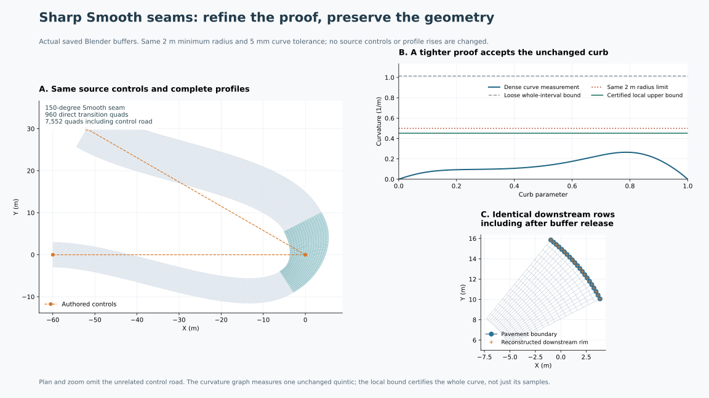

This drawing uses the [actual saved Blender buffers and certified curb controls](../../experiments/streets/python_v1/smooth_certificate_export_01/figure_export_checks.json).
Panel A shows the unchanged authored controls and complete incoming profiles.
Panel B compares the loose global bound, 1.01323 per metre, with the production
two-interval bound, 0.452253, below the unchanged 0.5 limit. The dense curve
measurement is 0.265010; it illustrates the curve and does not replace its
certificate. Panel C shows actual coincident pavement and downstream rim
samples. The PNG was visually inspected; the SVG contains the drawing, while
all formulas remain selectable LaTeX in this document.

## Angular charts for curved Bundle unions (experimental)

This section first records the external prototype, separate from the qualified
dev51 runtime, which rejects the 12 reproduced curved-overlap cases.
The latest prototype constructs all 12 profiled surfaces, including six grass
islands, and passes the geometry audits described below. Provider, Update and
broader qualification remain open. Dev52's initial runtime integration is
described after the prototype evidence. The first drawing records the
earlier preparation/planar experiment; the second shows the new surfaces.

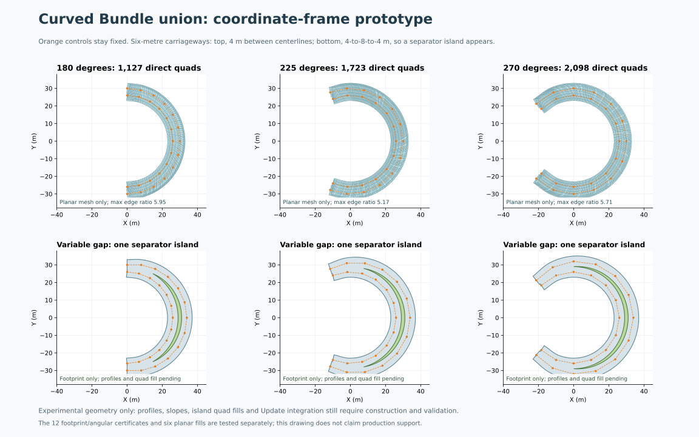

A common world axis cannot represent a Bundle that turns through more than
180 degrees as a monotone strip. An angular chart can, if both physical members
progress continuously around a common centre and stay clear of it. A small
least-squares calculation proposes the centre $C$ and a scale $R$ from the source
controls. This only chooses coordinates: the original paths, widths, cuts and
curbs remain authoritative and need not be circular.

Let $r=\lVert X-C\rVert$, let $\vartheta$ be angle relative to a midpoint branch
direction $\theta_0$, and let $\sigma\in\{-1,1\}$ describe traversal direction.
Use longitudinal coordinate $s$ and lateral coordinate $n$, both in metres:

$$
s=\sigma R\vartheta,
\qquad n=-\sigma(r-R).
$$

The inverse is

$$
X(s,n)=C+(R-\sigma n)
\begin{pmatrix}
\cos(\theta_0+\sigma s/R)\\
\sin(\theta_0+\sigma s/R)
\end{pmatrix},
\qquad
\det(X_s,X_n)=\frac{R-\sigma n}{R}>0.
$$

The last inequality requires positive radius. The angle interval must also
avoid the branch cut and remain shorter than a full turn. These are chart
eligibility conditions, not assumptions that change the source geometry.
The profile coordinate $u\in[0,1]$ remains separate from these chart coordinates.

For a Smooth source path $P$, a sufficient angular-progress condition for all
constant physical side offsets of reach $D$ is

$$
\sigma\det(P-C,P')>D\lVert P'\rVert.
$$

The original offset-regularity certificate still applies. Bernstein controls
bound the determinant polynomial from below and speed from above over every
complete original cubic. Exact physical curb segments instead have a constant
angular numerator; each segment is checked directly. The prototype also checks
the continuous separation of the two centreline paths before preparing a union.

The [12-case preparation](../../experiments/streets/python_v1/polar_bundle_frame_01/polar_frame_checks.json)
passes nested 180/225/270-degree inputs in both interpolation modes. The physical
footprint union retains source-segment provenance and complete original end
cuts, without trimming to a common angular rectangle. The 4 m centreline gap
between 6 m carriageways gives a merged pavement with no hole. A 4-to-8-to-4 m
gap gives one separator island. Coordinate round trips are below 2.1e-14 m;
this is not a licence to replace the source curbs with circular arcs.

For the [six constant-overlap planar fills](../../experiments/streets/python_v1/polar_bundle_quads_03/polar_quad_checks.json),
the physical boundary is sampled first, mapped into the chart, and filled with
an existing direct four-sided pattern. Interior points map back to world XY;
the actual physical rim points are copied verbatim into the output. Convexity,
overlap and the ratio-8 guard are checked in world coordinates, not just the
chart. Results use 863–2,098 quads and have maximum ratio below 6. No successful
case needs iterative shape relaxation. The four outer terminal corners stay
exact; the Smooth front approximation uses 3 mm plus the 0.5 mm source-curb
sampling budget, within the existing 5 mm accuracy contract.

### Dynamic crowns, finite end caps and island tips


This drawing uses the actual buffers from the
[12-case finite-cap experiment](../../experiments/streets/python_v1/polar_crown_patches_06/polar_crown_patch_checks.json).
All displayed cases use Smooth interpolation; the corresponding Exact cases
are in the same experiment. The first row merges overlapping carriageways.
The second generates a grass island as the centerline gap grows and shrinks.
The final row magnifies the actual one-quad tips, rather than an idealized
topology diagram. The PNG was visually inspected.

Radial interpolation must retain the original Cartesian curb chords. A linearly
interpolated radius as a function of angle would move a chord. Instead, for a
curb segment with endpoints $A,B$ and radial unit vector $e$, use

$$
\lambda=-\frac{\det(A-C,e)}{\det(B-A,e)},
\qquad Q=A+\lambda(B-A).
$$

The angular monotonicity certificate supplies a unique segment for each body
fibre. Only the height field extends the first/last curb segment beyond its
endpoint angle when reconciling a physical free end cut. The physical footprint
is never extended or trimmed by this extrapolation.

The four curb positions on a fibre determine the same dynamic crown/plateau
policy as the existing common-fibre provider. Let $n_+,n_-$ be the exterior
curbs and $p_+,p_-$ the two inner peaks, which coincide in an overlap. With
common datum $d$ and rise $H$, the physical height is

$$
h(s,n)=d+H\,\operatorname{clip}(1-\rho(s,n)^2,0,1),
$$

$$
\rho(s,n)=
\begin{cases}
\dfrac{n-p_+}{n_+-p_+}, & n\geq p_+,\\
0, & p_-\leq n\leq p_+,\\
\dfrac{n-p_-}{p_--n_-}, & n\leq p_-.
\end{cases}
$$

Thus grass occupies a plateau at $d+H$ where there is a gap. The plateau shrinks
to the shared crown where the pavement overlaps. Outer-curb vertices carry an
explicit zero-offset height from their source-segment ownership; proximity is
not used to infer these semantic constraints. Free-cut interiors retain the
derived shared profile instead of conflicting old half profiles.

A single long four-sided chart can have valid XY quads but steep interpolated
heights near a skew free end. The successful construction separates each road
half into a finite head cap, a body and a finite tail cap. Computational cuts
are selected from existing shared crown samples. The two halves may use
different cap lengths, but they retain identical complete edges on their
shared ridge. Boundary parity is adjusted only on unshared physical edges;
neighbours do not independently insert points on a computational cut.
The finite cap candidates use 0.7/1.4/2.1/2.8/4.2 m margins. Semantic curb,
cap and crown corners are tried first, followed by existing bounded chart
corrections/fallbacks. All final positivity and ratio checks use world XY.
These are internal decompositions, not extensions of the original footprint.

The first island-strip experiment propagated every independent curb station
across the grass. Nearly coincident stations produced edge ratios above 200;
further uniform refinement made them worse. The replacement uses independent
bounded-error rim sampling and unequal-rim quad connectivity. Each physical
zero-width tip terminates in **one quad**, followed by a four-sided body.
For a tip $T$, its two first curb samples $L,U$, and an interior sample $M$,
the final face is $[T,L,M,U]$. The interior sample has a small longitudinal
shift $\delta=\eta\ell$, with $\eta\in\{1/6,1/5,1/4\}$ and bounded tip lengths
$\ell\in\{0.35,0.5,0.7,0.9\}$ metres. This avoids three collinear profile
vertices. Physical curb samples and the tip stay fixed. Convexity, source-curve
accuracy and the world ratio-8 bound decide eligibility; no triangle faces are
created or merged. The grass body and pavement receive the same entire edge
partition before either interface is accepted.

The independent
[island audit](../../experiments/streets/python_v1/polar_island_boundary_audit_01/island_boundary_audit.json)
merges angular knots from the original and resulting boundaries. Within each
interval, both boundaries are straight segments. An affine correspondence
between their paired endpoints bounds the complete segment pair by its
endpoint maximum. This is a bidirectional whole-polyline bound, rather than
an inference from isolated vertex distances. Including the original analytical
sampling allowance, the six island boundaries stay within 2.839 mm and the
twelve pairs of exterior curbs stay within 3.469 mm of their intended curves.

The accepted test surfaces have 1,985–3,772 quads per Bundle including grass,
of which each island uses only 180–269. The highest physical slope is 6.573%,
below the unchanged 10% guard. A separate conservative whole-quad angular
direction-cone bound stays below 1.544%, against a 3% target. This measures
angular longitudinal directions; it is not yet a proof for actual Street-port
velocities at an attached junction. All outer curbs are exactly at zero and
every height stays at or below the common 8 cm crown. The complete physical
boundary is verified before being used as fixed drainage outlets, including
real free end cuts whose profiles must never be raised. Internal cracks cannot
be mistaken for physical outlets. The graph spill check then finds no remaining
interior basin without changing boundary profiles.

The [surface audit](../../experiments/streets/python_v1/polar_crown_surface_audit_02/crown_surface_audit.json)
also retains all four original exterior cap corners and validates float32
buffers at exaggerations 1/10. Actual Blender publication, provider integration,
other dimensions/orientations/profile families, real Street ports and ordinary
dependency/Update/furniture handling remain to be implemented or qualified for
this branch. No new input ID space or synthetic source Sections are required.

### Initial runtime integration in dev52

`AngularBundlePlan` is a guarded fallback after existing free-end axial and
finite plans. It currently accepts two complete single-Section members with
compatible shared crowns, authentic free ends and continuously certified angular
progress. `AngularCoordinates` chooses the frame, `RayCurb` retains Cartesian
chords, and `AngularCrown` reuses `AxialPlan.peaks`. Source ownership controls
zero-height curbs. Island and pavement builders share actual edge partitions;
generated vertex indices never become authored IDs.

The provider normalizes reversed source storage to each member's declared
traversal, retains actual IDs and offsets, and derives the shared rise from the
ordinary profile provider. Unequal widths, nonzero offsets, differing authored
rises with a common shared crown, translated datums and rigid transforms pass
the focused tests. The construction is no longer tied to six-metre roads or an
eight-centimetre crown.

Higher resolution exposed an atlas-selection problem: rebuilding a tiny skew
cap with a new boundary partition could invert its first cells. The accepted
runtime now qualifies the cap/body pattern at the base cell size, then uses
`UniformQuadSubdivision` with the requested resolution. Canonical vertex/edge
addresses make all child cells conforming, including reversed edge traversal.
Actual curbs and crown guides stay fixed. If child edge ratios exceed eight,
the existing `ProfiledQuadCorrection` moves only free internal coordinates and
reevaluates the authoritative height field. The complete source boundary,
height ceiling, slope, ratio and overlap guards follow. The complete angular
Bundle allocation is bounded at 100,000 cells; physical query buffers retain
their separate spatial/memory budgets.

`QuadHeightField` retains physical pavement and grass queries after publication
releases duplicate mesh buffers. Furniture still stores source Section/station/
side/offset, and the plan answers its resulting XY height on the actual output
quads. Outside queries return the datum. Display exaggeration is applied only
when returning/publishing the result. Scene/controller grouping is unchanged.

The [focused tests](../../experiments/streets/python_v1/angular_runtime_core_07/angular_runtime_checks.json)
pass local/full equality, exact restoration, unrelated-output reuse and furniture
updates, including a furniture-only edit after mesh release. The
[native check](../../experiments/streets/python_v1/angular_native_01/angular_native_checks.json)
passes all 12 actual Blender input edits, group/per-Street sources and runtime
reconstruction, while the previous 62 fixture buffers stay exact. The fresh
Update-operator/reopen checks and all-74-fixture publication audit pass on the
same runtime checkpoint, as does the 874-test full regression. The subsequent
standard-tool, fresh real-import and installed-copy qualification now pass as
recorded in the acceptance document. Multi-Section angular members, attached
Street ports and more general internal islands still require construction work.

## Source contracts and profiles

A Section owns a directed, editable centerline, width, lateral offset and rise.
End 0 is its first authored control and End 1 its last. An intersection refers
to those incidences explicitly. A Bundle stores laterally ordered member paths;
each traversal retains its Section ID and forward/reverse flag. Neither object
grouping nor incidental mesh indices determine membership or connectivity.

The public transverse profile coordinate is $u\in[0,1]$. Internally
$q=2u-1$ is convenient for left/right offsets. A full crown with rise $H$ is

$$z(q)=H(1-q^2)=4Hu(1-u).$$

The shared profile record uses peak parameter $p\in\{-1,0,1\}$:

$$z(q)=H\left[1-\left(\frac{q-p}{1+|p|}\right)^2\right].$$

$p=0$ is a full crown. $p=1$ rises from the left outer edge to the right inner
edge; $p=-1$ is its mirror. The inner edge has height $H$ and zero transverse
derivative. Bundle member 0 lies on the left in common traversal direction and
therefore rises right; member 1 rises left. Reversing an authored traversal
reverses the sign. Reorienting a Section at its End 1 does the same.

The Bundle rise is an explicit `profile_rise`, or the largest member rise when
that override is absent. Minimum datums must agree. This initial provider is
for flat ground; terrain/graded centerlines remain a later alignment provider.

## Bounded overlap checks

The numerical and published-mesh validators use the same convex-quad
separating-axis test. A spatial grid supplies candidate pairs; NumPy batches
the cell expansion, joins and projection arithmetic. No geometric check or
tolerance is relaxed to improve the timing.

For a quad's axis-aligned bounds $a,b$ and cell size $c$, the inclusive cell
range is

$$\ell=\left\lfloor a/c\right\rfloor,\qquad
  h=\left\lfloor b/c\right\rfloor.$$

Only changed faces are indexed, but every supplied face queries that index.
Thus changed/changed and changed/unchanged interactions, including newly
introduced ones, are checked. Unchanged/unchanged interactions need no repeat
check. A pair $i,j$ is accepted only in its first common cell,
$\max(\ell_i,\ell_j)$, so a pair spanning several cells is still tested once.
Changed/changed pairs additionally use their original face order to remove
the symmetric duplicate. A newly introduced collision cannot be hidden by a
stale dependency graph.

The narrow phase subtracts the first quad's origin before projecting both
quads onto all eight normalized edge normals. It reports an interior overlap
only when the depth on **every** axis exceeds the tolerance. Original argument
order and numerical/publication tolerances are retained. The grid changes
which arithmetic operations are batched, not the overlap decision.

Cell and pair workspaces contain at most 65,536 entries per batch; projection
batches contain at most 1,024 pairs. A dense cell streams its candidates rather
than allocating a dense all-pairs table. The index has explicit limits of
8,000,000 incidences and 4,096 cells per face. Exceeding these limits is a
reported spatial-budget failure, never a skipped test. The independently
written all-pairs test oracle and a frozen previous validator check the
candidate counts and decisions, including translated inputs and contacts
around the tolerance.

## Rounded intersections

The dependency graph retains every *potential* junction route, including
compatible Section continuations. A carriageway fingerprints the data it
actually reads: its source path/profile, each present mouth's station,
transverse partition, surface owner and transition kind, plus Bundle ownership
mode. A distant potential route with no mouth on that Section cannot alter its
mesh. If the mouth later reaches it, the new mouth record changes the signature.
This keeps broad dependency discovery while avoiding unrelated remeshing.
Furniture additionally depends on the complete Bundle plan when it queries a
composite height field; an unchanged member can change elevation when the
other member changes the merged crown.

`Path` evaluates Exact or optimized interpolating-cubic centerlines. Metric
stations use Gauss integration and a bounded adaptive lookup. Continuous
Bernstein curvature bounds guard the full offset width; output rows are
sampled separately so a dense lookup cannot accidentally become a dense mesh.

`IntersectionProvider` sorts outward approaches, solves the intersection of
offset contact curves for each prescribed radius, and retains the resulting
analytical circular curb. Complete profiles are placed at the mouth stations.
There is no deliberate flattening of the carriageway before the mouth.

### Preferred style radii and strict overrides

Each outgoing counterclockwise corner belongs to its first directed Section
end. `Intersection.radii` supplies its requested radius, and `radius_modes`
supplies the origin/policy at the same incidence. `STRICT` is the default for
authored records and legacy files. The normal Blosm adapter marks category-style
defaults `STYLE`, meaning preferred maxima. `with_corner_radius(end, value)`
creates a **strict** explicit override, preserving the other incidences' policies.
For example, overriding one corner does not disable fitting for its neighbors.

`CornerRadiusPolicy` first tries the unchanged requested radius $R_0$. A
failed contact solve, an incorrect circular sector, or insufficient remaining
approach for the complete-profile entrance permits style backoff.
Coincident approach directions, invalid input and other geometry errors remain
diagnostics. The trial radii are

$$
R_{\min}=\min\!\left(R_0,\max\!\left(0.5\,\mathrm{m},\frac{R_0}{4}\right)\right),
\qquad R_k=\max\!\left(R_{\min},0.8^kR_0\right).
$$

There are at most seven geometric reductions followed, if needed, by the floor:
at most nine contact solves including $R_0$. For a contact station $s_i$ on an
approach of length $L_i$, the entrance requests

$$m_i=\operatorname{mouthStation}\left(\max(0,s_i)+\min(0.25\,\mathrm m,0.05w_i)\right).$$

The ordinary rule requires $m_i<L_i-10^{-6}\,\mathrm m$. The existing genuine
free-end absorption policy can also accept $m_i=L_i$; a selection cut or another
occupied junction cannot be consumed that way. This test is performed on both
approaches before accepting a preferred-radius contact. Otherwise a numerically
valid circle near a route end could be selected, only for its entrance to fail,
despite a smaller permitted radius fitting correctly. Explicit strict radii
retain the final footprint diagnostic and are never reduced.

The first accepted candidate retains the actual circular radius and correct
sector. This is a bounded fitting
heuristic, **not** a search for the largest mathematically feasible radius.
It deliberately avoids a vanishing fillet. Surface construction can still fail
later; fitting never bypasses profile, slope, orientation, overlap or quad-quality
checks and does not trigger an unbounded search for a mesh that happens to pass.

The source radius is not overwritten. Output `fitted_corner_radii` metadata and
successful normal-import reports record the original radius, actual radius,
source incidence, policy and attempted values. Changing controls may change a
fitted radius on the next explicit **Update**; no continuous edit observer runs.
Older files lacking origin information remain strict, since their values cannot
reliably be classified as defaults or user overrides after the fact.

The `preferred_radius_short_T` fixture has an 8.5 m arm and preferred 10 m style
radii. Its two circular corners fit to 5.12 m while retaining the full incoming
profiles, zero-height curbs and highest-crown envelope. Extending the arm allows
larger fitted corners. Host and Blender checks compare incremental/full output,
restoration and rejection of an infeasible strict override. A valid circle
contact in the real six-arm fork is separately qualified. Complete native
network construction and manual Update are distinct gates, recorded in the
implementation-status document.

### Junction support near a selection boundary

Clipping a centerline to a rectangle can leave too little source length to
construct an otherwise ordinary rounded junction. `ClippedApproachSupport` is
an **initial import preparation** step, separate from mesh construction. It first
uses the ordinary contact solver and approved radius policy. Only an unresolved
contact or exhausted approach can request more source support. The normal
Blosm renderer supplies the retained `clipped_source_context`; no OSM filename
or source-specific coordinates select the construction branch.

Every cut is matched by directed Section end, original OSM way, original segment
node IDs and its exact source parameter. The original segment endpoints must
reproduce the clipped XY position within 1 mm. Added points lie on those
original intervals. A continuation beyond the first outside node must be unique
and on the same way, with the same category and tags. Another junction requires
its complete incidence plan. Bundle members require coordinated support; they
are never extended independently by this branch. Missing or ambiguous support
remains a diagnostic.

The initial length estimate uses the actual outward approach directions. A
strict radius uses its requested value. For a preferred style maximum, the
support estimate uses the smallest radius allowed by `CornerRadiusPolicy`:

$$
\bar R_i=
\begin{cases}
R_i,&\text{STRICT},\\
\min(R_i,\max(0.5\,\mathrm m,0.25R_i)),&\text{STYLE}.
\end{cases}
$$

This limits original-source recovery to making a valid rounded junction
possible. It does not change the stored preferred maximum. The actual contact
solver still tries that maximum first and selects the largest accepted candidate
on the recovered geometry. Extending a clipped tail merely to fit its aesthetic
maximum can introduce an unrelated overlap outside the selection rectangle;
dev28 avoids that unnecessary extension. It does not infer a new connection or
merge unrelated Streets. A strict radius that cannot fit safely stays diagnostic.

For
adjacent approaches with $0<\theta<\pi$, define

$$
h_i=\frac{w_i}{2}+|o_i|,\qquad R=\max(\bar R_i,\bar R_j),\qquad c=1.4\,\mathrm{m}.
$$

The requested support is at least $w_i+2\bar R_i+c$ and, for this pair, at least

$$
s_i=\frac{h_j+R+\cos\theta\,(h_i+R)}{\sin\theta}+c,\qquad
s_j=\frac{h_i+R+\cos\theta\,(h_j+R)}{\sin\theta}+c.
$$

Opposing/reflex pairs retain the dimensional baseline. The largest request
from neighboring pairs is used. This is a conservative straight-ray estimate,
**not** proof for a curved source. Each selected cut receives at most 40 m of
additional original polyline length, and only the known original segment plus
one unambiguous onward segment are available in this sparse-context branch.
The last interval may end at a bounded interpolated source point. The exact
contact construction is then repeated on the resulting certified paths. A
request is attempted at most once per cut, so preparation cannot keep expanding
the import. Failure to obtain a valid contact remains explicit.

Section and Street IDs, dimensions, profiles, existing controls and endpoint
incidences survive. The old rectangle-cut control becomes an ordinary interior
control if more source is appended or prepended. Added source intervals,
controls, physical lengths, original cut and output endpoint kind are retained
in the import report and controller's `st_py_source_support` JSON property.
The record identifies its phase as `INITIAL_IMPORT`; subsequent manual edits
can change the actual source geometry. Contact preparation does not assert
accepted pavement surfaces or complete import coverage.

`Section.selection_ends` distinguishes source cuts from true dead ends. The
flags survive JSON/Blender persistence and input object regrouping. A selection
cut cannot simultaneously belong to an explicit junction incidence.
`RouteTopology` propagates the terminal selection flag; `Route.terminal_free`
stays false there. Thus a finite context cut is not silently treated as a genuine
terminal cap. Only a proven original OSM endpoint can restore the free-end role.
Legacy records without this provenance retain their previous endpoint behavior;
fresh preparation is required to classify old rectangle cuts reliably.

Prepending controls changes the directed station origin. Furniture anchors are
therefore remapped through the old and new chord parameter coordinates. If
$t=\ell_{\mathrm{old}}^{-1}(s)$ is the parameter of the original metric station and
$A$ is the sum of added leading chord lengths, the new station is

$$
s_{\mathrm{new}}=\ell_{\mathrm{new}}(t+A).
$$

Here `Path.parameter` maps metric station to chord parameter and `Path.station`
integrates the new metric arc length. For appended support $A=0$. This retains
the same original source-segment coordinate rather than attaching furniture to
an unrelated new mesh index. Position, orientation and height are regenerated
from the resulting source and actual pavement surface by **Update**.

The original boundary-junction adapter also supplies full straight adjacent
controls with explicit `clip_start`/`clip_end` context trims. This preparation
honors those finite output limits and records the original context controls.
Curved metric context trims need a separate interpolation transport and remain
diagnostic. Later geometry checks retain full profiles, zero curbs, crown and
slope limits, positive quads and overlap validation. No projection onto terrain
or numerical height adjustment is introduced by source recovery.

The `clipped_original_support_T` gallery fixture restores a 2.5 m clipped arm
from authentic same-way support, including a curved outside continuation. Both
authored directions, Exact/Smooth straight recovery, strict radii, extension
limits, provenance errors, source endpoint classification and furniture remapping
have focused host checks. The curved Smooth fixture has native Update,
incremental/full and exact restoration checks; persistence qualification is
recorded in the implementation-status document when complete.

### Approaches across Section seams

A physical approach may be longer than the first Section attached to the
junction. `RouteTopology` follows **explicit two-ended incidences** through
compatible Sections; it never infers connectivity from proximity. A real site
with three or more arms stops the route. Source Section and Street records are
retained, including each traversal's direction.

`Route.build` checks width, oriented lateral offset, profile rise, minimum
datum, oriented half/full crown, endpoint position, tangent and cross-section
normal at each seam. A dimensional/profile change or an Exact bent seam needs
its own finite surface. The dimensional transition is described below; dev42
adds the piecewise common-miter provider for two Exact paths. Neither case is made
compatible by extending a tangent or silently changing the source dimensions.

Let route piece $i$ have length $L_i$, with cumulative start
$A_i=\sum_{j<i}L_j$. An outward mouth distance $d$ maps to local distance

$$\ell_i=\operatorname{clamp}(d-A_i,0,L_i).$$

For a forward traversal, its original Section station is $\ell_i$ at End 0;
for a reverse traversal it is $L_i-\ell_i$ at End 1. Every fully consumed piece
and the actual mouth piece receive a trim. Later pieces are untouched. Frame
evaluation uses the actual constituent centerlines, not a straight extension.

The carriageway provider combines the trims affecting each directed source
end. A fully consumed Section keeps its authored input and a `RoadSpan` with
the owning junction ID, and publishes no duplicate pavement. Two real junctions
claiming overlapping intervals require compound ownership; continuing a route
through an actual junction would incorrectly erase that topology.

The dependency graph includes the candidate continuation Sections and seams.
An edit to a continuation can therefore rebuild the affected junction, its
road and its furniture anchor while leaving unrelated roads unchanged. Saved
manifests retain those dependencies; reopening reconstructs the small derived
routes without replacing unchanged published objects.

### Absorbing a sub-cell remnant at a compatible seam

A junction mouth can fall just before a compatible Section seam. A regular
road grid then puts a full-width pair of rows in the tiny remaining length.
The source geometry is valid, but the cells are unnecessarily elongated.
The same issue can occur just before a genuinely free endpoint.

Let $s$ be the original outward mouth station, $b$ the next eligible boundary,
$w$ the width, $h$ the longitudinal target spacing and $n$ the number of
transverse intervals. For a short, nearly straight span the ordinary two-row
grid has approximate edge ratio

$$R\simeq\frac{w/n}{(b-s)/2}=\frac{2w}{n(b-s)}.$$

The mouth moves to $b$ only if

$$0\le b-s\le\min\!\left(\frac h2,\frac{w}{4n}\right).$$

The second limit is the length below which that grid would exceed ratio 8.
The eligible boundaries are explicit, compatible seams already crossed by
`Route.build`, and its final endpoint only when it is truly free. A dimensional
change, incompatible tangent/miter, occupied far junction or closed route is
not an eligible terminal boundary. Far-end incidence is included in the route
task dependencies, so adding a junction invalidates an earlier free-cap choice.

Only the mouth and its retained full profile move. The prescribed circle
contacts, centers, radii and sweeps remain unchanged; the existing curb lead
reaches the new mouth along the same source path. The original Sections and
their controls survive. The tiny remainder becomes junction-owned pavement,
and a fully consumed Section retains a `RoadSpan` record. At a compatible seam
the following Section starts with its complete profile at station zero.
The existing direct-quad construction fills the enlarged junction; no sliver
is deleted and no triangles are generated or merged.

The analytical regression covers both a terminal cap and a compatible seam,
checks the unchanged circles and complete profile, excludes a dimensional
continuation, and adds a far junction to verify invalidation. Extending the
free control beyond the limit restores a regular road span; incremental
geometry and exact restoration match fresh builds. On ordinary roads, an
anchor inset from its edge uses

$$q=\operatorname{clamp}\!\left(\sigma\left[1+\frac{2d}{w}\right],-1,1\right),
\qquad z=D+E\,z_{\mathrm{profile}}(q)+z_{\mathrm{anchor}},$$

where $\sigma=-1$ for left and $+1$ for right, $d$ is the edge-relative offset,
and $E$ is inspection exaggeration. Negative offsets follow the crown rather
than incorrectly using the edge height. Outside offsets retain the edge
height; composite owners and dimensional transitions use their surface query.


The drawing uses an analytical T-junction with an 18 mm remnant. The lower-left
panel deliberately uses different units on its axes. Its complete profile is
identical before and after alignment; all continuing road buffers are exact.
The same diagnostic also compares the real stored profile of road 339 with
junction 681: all **17 vertices** have **zero position/height error**.
See the [numerical receipt](../../experiments/streets/python_v1/mouth_alignment_01/mouth_checks.json).

### Finite dimensional/profile transitions between Sections

`transitions.SectionTransition` handles a two-ended incidence whose width,
oriented offset, rise or half/full crown changes. It is a distinct surface
product, not an invented multi-arm junction. A compatible incidence retains
its zero-area seam. Different minimum datums remain an explicit error.

Orient the first approach toward the seam and the second away from it. Let
$d_A,d_B$ be their finite trim distances. The initial desired total length is

$$D=\max\left(2\text{ m},\;4|w_A-w_B|+2|o_A+o_B|,\;
\frac{1.875\max_q|f_A(-q)-f_B(q)|}{0.03}\right).$$

The offset signs in this expression are the approaches' outward signs.
Each distance starts at $D/2$, capped at 40% of its own Section length and by
the actual neighboring junction mouths. For an approach attached at End 0,
a junction mouth at opposite-end source station $s$ leaves $s$ metres; for an
approach attached at End 1 it leaves $L-s$ metres. With
$g=\min(0.25\text{ m},0.05w)$, the resulting trim cap is

$$d_{\max}=\min\left(0.4L,\;\min_j\max(0,r_j-g)\right).$$

Only explicit opposite-end route incidences establish these constraints.
`TransitionClearance` reads physical footprint mouths, including mouths on a
continuing Section beyond a compatible seam. An unrelated nearby street does
not impose a cap. A consumed span reports that shared region ownership is
needed. The transition layout task explicitly depends on every candidate
physical footprint, so editing a junction arm can change a transition's trims
even when its two own source centerlines are unchanged. Candidate routes whose
actual footprint does not reach this Section impose no geometric restriction.

The bounded search tries total-length multipliers $1,1.5,2,3,4$, skipping
identical capped choices. This is a finite construction policy, not a promise
that every short source span can accommodate a transition. The ordinary mesh
overlap and ownership checks still apply to the complete constructed surfaces.

The left and right curbs $L(t),R(t)$ are quintic Hermite curves joining the
actual offset-path mouth endpoints. Their endpoint tangents follow the actual
offset derivatives and their endpoint second derivatives are zero. The
existing `WidthContinuation` certifies positive forward speed and the minimum
curvature radius using Bernstein bounds. A Connection uses the construction
radius 2 m; a two-ended intersection uses its prescribed radius.

With $v=(q+1)/2$, the interior is the ruled strip

$$X(t,q)=(1-v)L(t)+vR(t),\qquad -1\leq q\leq1.$$

The complete XY orientation check uses the two edge determinants
$\det(L'(t),R(t)-L(t))$ and $\det(R'(t),R(t)-L(t))$.
They are degree-nine Bernstein polynomials. Since the interior determinant is
affine in $v$, certifying both edge signs certifies the entire strip. A bounded
de Casteljau subdivision rejects unresolved or inverted charts; it does not
infer continuous validity solely from mesh samples.

For common datum $h_0$ and quintic smoothstep $S(t)=10t^3-15t^4+6t^5$,

$$H(t,q)=h_0+[1-S(t)]f_A(-q)+S(t)f_B(q).$$

Both complete mouth profiles are preserved. Because the blend is convex,

$$h_0\leq H(t,q)\leq h_0+\max(H_A,H_B).$$

The profile blend has zero longitudinal derivative at either mouth. Each
cross-section remains a concave quadratic in $q$, so the analytical strip has
no strict interior local minimum. The generated bilinear quads are independently
checked for positive corners, edge ratio at most 8, maximum physical slope at
most the larger of 3% and 1.1 times the largest incoming crossfall, and entrance
longitudinal slope at most 3%. The two outer curbs remain at the common datum
when both profiles have zero outer-edge height. A half-crown's inner edge
retains its appropriate plateau height.

The parameter grid is constructed directly from cached quad connectivity.
Both quintic curb sampling bounds and the physical row-spacing limit apply.
The ownership split

$$t_J=\frac{d_A}{d_A+d_B}$$

is a real mesh row. Each side is repartitioned around that row rather than
inserting an arbitrarily thin cell beside an existing sample. Each half has an
even number of intervals:

$$n_A=\max\!\left(2,2\left\lceil\frac{nt_J}{2}\right\rceil\right),\qquad
n_B=\max\!\left(2,2\left\lceil\frac{n(1-t_J)}{2}\right\rceil\right).$$

This coordinates its boundary parity with road spans and certified junction
curbs. For a mesh with quad faces $F$, interior edges $I$ and boundary edges $B$,

$$4F=2I+B,$$

so a conforming all-quad fill requires even $B$. An asymmetric transition with
an odd rim count can otherwise make an attached median impossible to fill
without changing one shared boundary. Rounding each half upward adds at most
one interval per half, keeps the intended curves and improves their certified
sampling accuracy. A Section's
separator rim includes its half of the transition up to $t_J$; the partner
continues from the identical row. Centerline contact proofs retain the whole
source span through that owned region. The current common-axis pavement-union
chart defers dimensional seams to this separated-rim branch; overlapping
dimensional-transition Bundles need an additional union construction.

`TransitionProduct` retains its compact quad-height query and analytic plan
after temporary publication buffers are released. A furniture anchor maps its
source distance to the corresponding side of $t_J$, uses the interpolated
physical curb for lateral placement and queries the actual quad surface for
height. Road, transition, separator and furniture tasks declare their semantic
dependencies. `connection:6` produces `seam_surface:6` and `seam_mesh:6`;
an intersection uses its separate `profile_transition`/`junction_mesh` keys.
No raw mesh vertex index becomes a persistent source identity.

### Footprints and surface parameterization

`IntersectionProvider.footprint` solves prescribed circular curbs and source
trims before choosing internal guides. `layout` then selects a compatible
surface parameterization. This separation permits compound planning to inspect
physical extents when a local guide family fails. A solved footprint alone is
not an accepted mesh or a completed intersection.

Each neighboring pair contributes a band between its outer curb $B(t)$ and
internal peak guide $G(t)$. With $v=0$ on the curb and $v=1$ on the guide,

$$X(t,v)=(1-v)B(t)+vG(t).$$

The guide blends a chord and cubic tangent controls. A broad curved variant is
preferred; a bounded list of less curved variants is available when geometry
guards reject it. A collapsed half-profile cap permits the fully tangent
variant. Guide selection changes internal coordinates, not physical curb radii.

Write $S(t)=6t^5-15t^4+10t^3$. For neighboring endpoint profiles $f_a,f_b$,
the base band height is

$$h_0(t,v)=[1-S(t)]f_a(q_a(v))+S(t)f_b(q_b(v)).$$

Here $q_a(v)=-1+(p_a+1)v$ and $q_b(v)=1+(p_b-1)v$. Corrections reproduce the
incoming physical tangent planes:

$$h(t,v)=h_0(t,v)+t(1-t)^2d_a(v)+t^2(t-1)d_b(v).$$

Each $d$ is the incoming profile gradient dotted with the patch's endpoint
longitudinal derivative. The gradient uses the actual offset derivative,
including Exact miter interpolation, rather than assuming a unit sweep normal.
The full entrance profiles remain identical to the adjoining carriageway rows.
Envelope checks reject heights outside the common minimum/highest-crown range.

The guides bound cyclic central blocks. For four oriented boundary curves
$C_0(u),C_1(u),D_0(v),D_1(v)$ and their bilinear corner interpolant $L$,

$$X(u,v)=(1-v)C_0(u)+vC_1(u)+(1-u)D_0(v)+uD_1(v)-L(u,v).$$

Central heights use the corresponding smooth transfinite extension, bounded
by the crown envelope. Explicit parametric seam keys weld neighboring blocks.
Every final face is a directly constructed quad. Convexity, winding, edge ratio,
overlap, entrance matching and sampled physical slopes are separate checks.
These checks do not yet constitute a universal drainage/smoothness proof.

## Compound footprint preparation

`CompoundPlanner` and `RegionUnion` prepare coordinated ownership before surface
construction. The default dispatcher publishes one qualified pavement per group,
owned by its lowest semantic junction ID, and separate grass for retained holes.
An accepted outline alone is never sufficient to publish a surface.

First, collect mouth stations against every original Section/directed end.
If two real sites claim intervals $[0,a]$ and $[b,L]$ with $a>b$, their footprints
need coordinated ownership. Connected components of these claims define the
candidate groups. Spatial proximity alone cannot combine unrelated streets.

`sample_footprint` retains every mouth profile vertex and the existing accurate
curb sampling. Its mouth labels use public $u\in[0,1]$; curb labels retain their
`BoundaryCurve` parameter. `RegionUnion` splits intersecting or collinear sample
segments, removes fragments inside another footprint and joins the remaining
oriented fragments into loops. A fragment retains its source junction, sampled
segment and endpoint fractions. Clockwise loops identify holes, permitting
future separator ownership without authoring an independent grass polygon.

The numerical weld distance is **0.1 micrometres**, separate from the **5 mm**
physical curve approximation target. A newly split vertex lies on its original
sampled chord; it does not imply a new analytical corner radius. Segment and
pair-test budgets are checked before dense intersection work. NumPy scratch
is batched in 128-segment/point groups. Self-intersections, backtracking and
point-only contacts receive explicit diagnostics.

In the retained Berlin numerical input, all three detected groups have combined
boundaries. The four-site divided crossing has one exterior and one retained
separator hole. See the [illustrated preparation diagnostic](../../experiments/streets/python_v1/footprints_02/compound_boundaries.svg).
The two-site synthetic fixture and a symmetric four-site divided crossing also
qualify boundary provenance and the hole's original circular-curb accuracy.

The subsequent sections describe the implemented direct quad decomposition,
boundary-profile constraints and measured compound surface qualification.
The default provider uses these components. A single radial chart is
insufficient: concave median heads can
leave its visibility kernel empty. The isolated radial prototypes are not used
by the backend. Neither unconstrained smoothing nor a valid boundary union is
a substitute for a qualified compound construction.

Keep these rejected shortcuts distinct from the working checkpoint: offsetting
all crest guides does not prevent core cusps; a single disk chart plus interior
relaxation does not qualify the full set of shapes/slopes; and a global annular
radial chart fails even the symmetric divided crossing because of concave
median heads. Use local blocks or a direct quad paving/decomposition step for
those areas, preserving the physical curves, incoming profile samples and
separate height constraints.
Blender's built-in Grid Fill supplies a four-sided grid between open edge
chains; its [implementation](https://github.com/blender/blender/blob/main/source/blender/bmesh/operators/bmo_fill_grid.cc)
does not supply a general compound-region mesher with holes. It remains a
possible local patch utility, rather than a replacement for that decomposition.

### Compound boundary heights and incoming tangent planes

`BoundaryConditions` prepares height conditions independently of the planar
mesh. Retained complete mouths carry
the exact original profile and physical tangent plane, in unexaggerated metres.
A mouth beyond a compatible seam refers to the actual continuing Section/end
and station. Its public source $u$ reverses when that Section is entered at
End 1. Fully consumed internal mouths impose no phantom height seam.

Each exterior curb chain connects two retained mouth endpoints. For chord
arclength $s\in[0,L]$, endpoint heights $h_a,h_b$ and inward slopes $k_a,k_b$,

$$h(s)=[1-S(s/L)]h_a+S(s/L)h_b,$$

$$k(s)=[1-S(s/L)]k_a+S(s/L)k_b,$$

$$\nabla h=h'(s)\,\mathbf t+k(s)\,\mathbf n,$$

where $\mathbf n$ points into the pavement. Low-to-low exterior curbs remain
exactly at the common datum. Two plateau ends retain their plateau height.
A separator-hole rim receives the common highest-crown ceiling and zero
gradient. Different minimum datums still require the future alignment provider.
The layer mesh must be reconciled against these conditions and independently
qualified; preparing the conditions does not establish surface smoothness.

The retained Berlin groups have **8, 6 and 4** complete exterior mouths. The
divided crossing's hole has height **0.08 m**, while exterior boundary heights
remain in **[0, 0.08 m]**. See the
[boundary-condition diagnostic](../../experiments/streets/python_v1/footprints_03/footprint_checks.json).
Partial clipped profiles receive a diagnostic; they cannot silently become
smaller input profiles.

### Direct layered quad chart

`LayeredQuadChart` now implements a planar block primitive, with a strict
visibility-kernel precondition. It preserves every input rim vertex, including
the existing profile partitions and circular-curb samples. It creates radial
layers and terminates fine angular sampling with the existing cached
`strip(1, 3, 1)` template: **eight vertices and four quads**. There is no
triangular face stage.

The geometry placement is important. Relative to the block's visibility
centre, let $a_0,a_1,a_2,a_3$ be the four fine outer samples and $b_0,b_3$ the
coarse inner endpoints on the first and last rays. Define

$$\mathbf n=\frac{\operatorname{right}(b_3-b_0)}{\|b_3-b_0\|},\qquad
c_0=\mathbf n\cdot b_0,\qquad
c_1=\min(\mathbf n\cdot a_1,\mathbf n\cdot a_2).$$

The branch requires $0<c_0<c_1$ and an angular span below $\pi$. For a bounded
choice $\lambda\in\{1/4,1/2,3/4\}$, put

$$c=(1-\lambda)c_0+\lambda c_1,\qquad
d_i=\frac{a_i}{\|a_i\|},\qquad
p=\frac{c\,d_1}{\mathbf n\cdot d_1},\qquad
q=\frac{c\,d_2}{\mathbf n\cdot d_2}.$$

The four cells are $(a_0,a_1,p,b_0)$, $(a_1,a_2,q,p)$,
$(a_2,a_3,b_3,q)$ and $(p,q,b_3,b_0)$. The first three are radial quads;
the fourth is a trapezoid between parallel lines. This avoids the inverted
cells produced by mapping a generic transition atlas onto a concave curb.
Unsupported transitions retain separate radial cells. Actual output still
passes the independent quad guards.

A bounded local quality pass keeps the physical rim fixed and decreases

$$E=\sum_{\text{quad corners}}
\frac{\|e_i\|^2+\|e_{i+1}\|^2}
{\operatorname{cross}(e_i,e_{i+1})}.$$

Every accepted position step retains positive corner Jacobians. Numerical
backtracking and iteration limits are explicit; this is a local quality step,
not a global intersection-height solve. Coordinates on the source rim are
copied exactly after conversion from the local numerical frame. The caller must
also qualify cell dimensions, overlap, topology and the eventual height field.

If the measured edge ratio still exceeds the limit by at most a factor of two,
`QuadEdgeRotations` tries a bounded local topology repair. Two neighboring quads
form a six-vertex boundary. Its other two opposite-vertex diagonals each define
two alternative **quad** cells; no triangular faces or new vertices are created.
NumPy evaluates the alternatives in batches. A replacement must be convex,
reduce that pair's worst edge ratio and not increase its shape energy:

$$Q_{\max}(\widetilde F)<Q_{\max}(F),\qquad
E(\widetilde F)\le E(F).$$

Nonconflicting face pairs are selected deterministically. At most 1,024 pairs
are considered per pass, with four passes and up to 100 fixed-rim relaxation
steps per pass. The best measured result is retained, so a later relaxation
iterate cannot worsen the returned maximum ratio. Vertex and face counts,
boundary segments, seam IDs and materials remain unchanged. Final quality,
topology, overlap and profiled-height checks remain mandatory. Larger grading
defects require another chart family rather than a longer repair loop.

### Four-sided fallback for elongated blocks

`CompoundQuadChart` first tries the layered chart and its bounded edge repair.
A remaining grading failure can select `FourSidedQuadChart` for that block.
It chooses four atlas corners on existing rim vertices, prioritizing convex
corners, compatible opposite-side parity, balanced opposite chord lengths and
well-shaped corner quadrilaterals. At most 36 candidate rim vertices define
the preliminary corner sets; at most 24 actual atlases are mapped. Pattern-cell
budgets are checked before allocation.

The four boundary chains use the transfinite map described above. Each original
rim sample is then copied exactly, and the output indices put the original rim
first in its original order. Shared computational cuts therefore retain their
existing point IDs. The atlas uses `PatternLibrary.quad`; uneven rim counts
terminate with direct 1:3 quad patterns inside the surface.

Two bounded local shape objectives are available. With
$\phi_c=(\|e_c\|^2+\|e_{c+1}\|^2)/J_c$ at a quad corner, they are

$$E_1=\sum_c\phi_c,\qquad E_2=\frac14\sum_c\phi_c^2.$$

The squared objective gives greater weight to the worst corners; its gradient
is the original corner gradient multiplied by $\phi_c/2$. The step cap and
positive-Jacobian backtracking remain in force. Each objective starts from the
same mapped atlas, allowing either to qualify a particular geometry. The
ordinary layered chart retains its original objective. A final atlas must have
maximum edge ratio at most 8 and minimum corner sine at least 0.03. Existing
surface-height, topology and overlap checks still apply after atlas selection.

### Call-local quality workspaces (dev44)

`quad_workspace.py` evaluates these same objectives in reusable NumPy arrays.
Two energy workspaces separate the accepted state from line-search proposals.
A rejected proposal may overwrite only the trial workspace; an accepted one
swaps their roles. Temporary arrays live for one chart improvement call, so
they do not enlarge the persistent pattern cache or retain completed meshes.

The gradient batches all four corner contributions into one scatter operation.
Its order remains corner, contribution, face, then coordinate, matching the
previous sequence of twelve scatter operations. Grouping sums by destination
vertex would change floating-point associativity and is deliberately avoided.
Likewise squared edges retain the previous addition/reduction order. This
changes allocation/scatter overhead, not the geometric method or its guards.
The fixed-rim set, local step cap, 16 backtracking trials, iteration budget,
energy-decrease criterion and positive-Jacobian threshold are unchanged.
See the [current qualification status](STREETS_PYTHON.md#current-development-increment-quad-quality-workspaces-dev44).

These branches use geometry and numerical quality, with no fixture-name or OSM
filename dispatch. The first profiled/native import qualification of this new
branch is recorded in the status document; planar prototypes alone do not
establish its full street-network coverage.

The [planar chart qualification](../../experiments/streets/python_v1/quad_charts_01/quad_chart_checks.json)
and [quad layout drawings](../../experiments/streets/python_v1/quad_charts_01/quad_charts.svg)
cover these geometric properties only. Concave compound regions with empty
visibility kernels and separator holes need a decomposition into local blocks.
They are not made eligible by filling a hole or moving prescribed curbs.

### Correcting the assembled chart without freezing computational cuts

The two per-block branches can still fail because they hold every partition
cut fixed. That cut is not a physical road feature. Once blocks share their
vertex indices in the assembled mesh, its internal vertices can move while
the physical curb and mouth vertices stay exact. Dev28 uses this distinction
only after the ordinary chart branches report a grading failure. Already
qualified charts retain their original coordinates and connectivity.

`QuadChartQualityError` retains a leaf's first positive candidate. Assembly
also retains any leaf whose four-sided atlas has already qualified. The global
repair therefore avoids reconstructing the same layered charts and discarding
an accepted atlas after a different block fails. Only final shape-quality
failures carry this candidate; invalid geometry or exhausted construction
budgets remain ordinary errors.

The fallback assembles positive layered cells, makes at most eight passes of
quad-edge rotations with squared shape relaxation, then applies
`QuadShapeCorrection`. For each face $f$, let $e_i$ be its four CCW edges,
$L_i=\|e_i\|$, and define

$$
r_f=\frac{\max_i L_i}{\min_i L_i},\qquad
s_{fi}=\frac{\operatorname{cross}(e_i,e_{i+1})}{L_iL_{i+1}}.
$$

Rather than minimizing only a proxy for overall shape, the final step targets
the actual quality violations:

$$
F=\sum_f[\max(0,r_f-7.75)]^2+
64\sum_{f,i}[\max(0,0.05-s_{fi})]^2.
$$

The publication limits remain $r_f\le8$ and $s_{fi}\ge0.03$ for this fallback.
The tighter targets provide numerical headroom. The analytic gradient includes
both the longest/shortest-edge ratio and corner-angle terms. It is checked
against independent central directional differences in the focused tests.

Each vertex step is preconditioned by its mean incident squared edge length
and degree, capped at one tenth of its local mean edge length. Physical-rim
steps are zero. There are at most 24 backtracking trials per iteration and
2,500 iterations, with earlier termination on success or a stalled search.
Every accepted trial has strictly positive quad corner Jacobians. The best
measured constraint result is retained; exhaustion does not authorize weaker
limits. The 50,000-cell chart budget is unchanged, including separator holes.

The correction adds no vertices or faces and generates no triangles. Edge
rotations may change the internal connectivity; the final coordinate descent
does not. Original mouth/curb coordinates, boundary references, seam indices
and materials survive. Per-block metadata describes the initial charts;
`assembled_quality_correction` records the final result. Heights are generated
after this planar correction from the original profile/curb conditions.
Independent topology, overlap, elevation-envelope, slope and Blender float32
publication checks still follow; positivity alone is not acceptance.

The captured six-arm test improves a maximum ratio of 41.45 to 7.76 with
7,172 quads and an exact physical rim. This is its planar evidence. The normal
Canal Street import and saved-buffer audit are separately recorded in
[the implementation status](STREETS_PYTHON.md#additional-real-input-preferred-radii-and-short-clipped-approaches).

## Compound construction

### Source-owned compound blocks and curb sampling

`CompoundPartitioner` now decomposes a combined junction footprint using its
source ownership. For each original Section whose endpoint trims overlap, it
joins the two boundary points where the neighboring junction owners change.
The cut must remain inside pavement and must not cross a separator hole. Cuts
may intersect one another; the planar graph splits them into shared edges.
Its face walk retains the pavement faces and excludes holes. Each retained
face must have a strict visibility kernel before it enters `LayeredQuadChart`.
This resolves the empty global kernel without filling or flattening a median.

These are computational seams, not new incoming profiles. The eventual height
field must pass across them using only the external profile/curb conditions.
Both sides share exactly the same point IDs in reverse order. A parity pass
chooses odd/even cut interval counts so every block has an even rim. If a
physical loop itself is odd, an owned curb edge is refined; an independent
road's transverse profile partition remains unchanged. Explicit seam keys
weld the blocks, and the checks require the correct Euler characteristic,
two incident faces per internal edge, and one per physical rim edge.

Clipping sampled footprints can leave 2–14 mm curb fragments beside much
larger edges. These are incidental polygon samples rather than physical
features. `AnalyticalBoundarySampler` keeps the original finite curb curves,
refines each ownership contact on those curves, and redistributes samples
along each retained curve interval. It preserves every incoming profile
vertex. Each resulting chord retains the source curve's parameter interval,
so profile conditions and later diagnostics can still refer to the original
geometry. Contact solves are local and bounded; unavailable branches produce
a diagnostic. In particular, a shallow crossing can move *along* a curb by
more than its old chord's normal error. The check therefore measures distance
to the original sampled curve, rather than freezes that polygonal contact.

Each retained curb uses its own curvature and speed bounds, instead of copying
the sampling count of the longest neighboring curb. If curvature is bounded by
$K$, the parameter speed by $V$, the requested physical spacing is $\ell$ and
the error target is $\varepsilon$, a parameter step satisfies

$$\Delta t\le\frac{1}{V}\min\left(\ell,
\sqrt{\frac{8\varepsilon}{K}},\frac{\pi}{2K}\right).$$

Zero-curvature terms are omitted. The circular portion has $K=1/R$; smooth
offset leads use the certified bound $K=\kappa_{\max}/(1-|d|\kappa_{\max})$.
Composite leads/arcs use a uniform distance parameter under the combined bounds,
avoiding microscopic edges beside incidental lead/arc contacts. Exact-polyline
corners remain mandatory samples. Each curb run has even interval parity;
numerical duplicates closer than 0.1 micrometres are removed only internally.
Finite-circle intersections, including coincident arcs, use analytical contact
branches before the bounded local Newton fallback.

A standalone indented junction can also use this boundary construction.
`VisibilitySplitter` introduces visible diagonals between existing rim vertices
until each block has a strict visibility kernel. These are computational cuts
with no invented Section ID or imposed profile. Candidate and cut budgets are
explicit. Obtaining a kernel does not guarantee good cell grading; the final
quality guard still rejects unsuitable blocks.

The mesh is generated directly from quad templates after this sampling step.
In the retained real input the three compound regions use **3,290, 1,718 and
755 quads**, including the divided crossing's **244-quad** separator fill.
Their maximum edge ratios are **7.35, 6.63 and 7.07**. Dense chord checks measure
at most **4.14 mm** deviation from the analytical curves, below the 5 mm target.
These are historical dev10 planar qualification results. The subsequent compound
surface builder is described below and is now connected to default providers;
dev11's revised sampler can change the counts while retaining the same curves.
See the [compound drawings](../../experiments/streets/python_v1/compound_charts_03/compound_quad_charts.svg)
and [qualification receipt](../../experiments/streets/python_v1/compound_charts_03/compound_chart_checks.json).

### Nearly straight curb width transitions

An unequal-width, nearly straight connection does not generally admit one
small-radius turning circle. Within the configured angle threshold (4.5° by
default), `WidthContinuation` instead joins those curbs with a quintic Bézier
curve. Turning corners retain their prescribed circular fillets.

Let $P_0,P_5$ be the curb endpoints, $a,b$ their unit travel tangents, and
$L=(P_5-P_0)\cdot(a+b)/\|a+b\|>0$. The six controls are

$$P_0,\quad P_0+La/5,\quad P_0+2La/5,\quad
P_5-2Lb/5,\quad P_5-Lb/5,\quad P_5.$$

This preserves endpoint tangents and gives zero endpoint second derivatives.
For derivative Bernstein controls $D_i$ and second derivative controls $E_j$,
the cross-product polynomial has controls

$$C_k=\sum_{i+j=k}\frac{\binom4i\binom3j}{\binom7k}
\operatorname{cross}(D_i,E_j).$$

With $v=(a+b)/\|a+b\|$ and $m=\min_i(D_i\cdot v)>0$, convex-hull bounds give

$$|\kappa(t)|\le\frac{\max_k|C_k|}{m^3}.$$

The constructor rejects a bound above $1/R_{\min}$; it does not silently shrink
the requested radius. Sampling bounds both physical edge length and chord
error using the derivative bounds $V=\max_i\|D_i\|$ and $M=\max_j\|E_j\|$:

$$n\ge\max\left(1,\left\lceil V/\ell\right\rceil,
\left\lceil\sqrt{M/(8\varepsilon)}\right\rceil\right).$$

Here $\ell$ is the requested spacing and $\varepsilon$ the curve error target.
All **75** physical junction footprints now solve in the retained OSM input.
This does not establish that every junction surface, Section seam or connected
network is qualified.

### Bounded compound height field and local refinement

`CompoundSurfaceBuilder` is a numerical construction primitive used by default
compound ownership and by the standalone fallback. Its input boundary
conditions are the complete external profiles and curbs described above.

For each edge $e$, project a query point $x$ to its closest point $p_e$ on the
retained chord. Evaluate the prescribed boundary height $h_e$ and gradient
$g_e$ there, and let $s_e=g_e\cdot(x-p_e)$. Limit the local Taylor prediction
with the available elevation room:

$$r_e=\begin{cases}H-h_e,&s_e\ge0,\\h_e-D,&s_e<0,\end{cases}
\qquad
f_e=h_e+r_e\tanh(s_e/r_e).$$

Here $D$ is the common minimum datum and $H$ is the highest incoming crown.
When $r_e=0$, use $f_e=h_e$. Every prediction lies in $[D,H]$. Blend them with
nonnegative length-weighted inverse-distance weights:

$$w_e=\frac{\ell_e}{\|x-p_e\|^4},\qquad
h(x)=\frac{\sum_e w_e f_e}{\sum_e w_e}.$$

The implementation scales these weights before division near the boundary.
At a consistent boundary point the limiting value is the prescribed height;
locally admissible jets have the original first derivative. The constructor
also assigns every sampled boundary height exactly. The weighted mean remains
inside the same elevation envelope. Closest-point projection changes and
bounded Taylor branches can create internal derivative seams, so this is not
a certificate of global C1 smoothness.

Boundary rules are fitted once into compact polynomial arrays, with independent
sample checks and a bounded degree fallback. Query rows are batched against
the edge arrays, targeting an 8 MiB scratch budget. The current cases have
sampled jet fit errors below $1.6\times10^{-11}$. NumPy supplies these array
operations; no SciPy runtime dependency or dense global surface solve is used.

The output is independently checked at a 3×3 grid in every bilinear quad.
Its measured slope limit is

$$G_{\mathrm{limit}}=\max(0.10,\;1.1G_{\mathrm{incoming}}).$$

This preserves authoritative input profiles that already exceed the ordinary
10% target. For example, an 8 cm full crown over a 2 m carriageway has edge
crossfall $4H/W=0.16$. A test cannot demand a smaller slope while preserving
that profile. The 10% allowance above the incoming slope accommodates sampled
mesh approximation; it does not authorize changing the supplied profile.

When a quad exceeds the limit, `QuadRefiner` refines its internal edges into
three intervals and selects cached direct quad atlases for it and its
neighbors. Physical boundary edges retain their original samples. Explicit
edge keys keep both sides conforming, with no triangle faces or T-junctions.
A bounded quality pass moves only internal vertices, then re-evaluates the
same height field there. Cell, iteration and refinement budgets are explicit.

In the difficult retained two-site region, refining two cells adds **28 quads**:
755 becomes **783**. Its maximum sampled slope drops from **23.27% to 17.46%**,
against the incoming **16%** crossfall. The maximum edge ratio remains **7.41**;
entrance midpoint longitudinal slopes are below **0.6%**. The other six
construction cases require no slope refinement and remain below **6.33%**.
All preserve the elevation envelope, profiles, hole boundaries and direct quads.
No isolated interior vertex minima deeper than 1 micrometre were detected in
these seven cases. The check also covers a common datum of **12.5 m**.
See the [surface drawings](../../experiments/streets/python_v1/compound_surfaces_03/compound_surfaces.svg)
and [surface primitive receipt](../../experiments/streets/python_v1/compound_surfaces_03/compound_surface_checks.json).
These checks do not establish complete imported-network coverage or a general
drainage solution.

## Other reusable direct quad patterns

`PatternLibrary` caches immutable unit coordinates and connectivity, independent
of world geometry, dimensions, profile heights and fixture IDs. Its LRU budget
is 8 MiB by default; large requests are checked before allocation.

- `grid` is the regular rectangular atlas.
- `strip` permits different compatible profile interval counts at its ends.
- `quad` retains independently sampled rims on all four sides. Refining one
  boundary interval into three uses four direct quad cells: two small interior
  points and two new boundary points replace one cell. It introduces neither
  triangle faces nor T-junctions, and does not propagate refinement across the
  whole surface.
- `triangle` names a **parameter domain**, not a face type. Three quad blocks
  meet around its centroid. This supplies a band that closes to one tip without
  collapsing an entire row of quads. A doubly closed band joins two such atlases.

Opposite boundary counts have compatible parity. Collapsed domains use counts
divisible by four; road longitudinal intervals are even. Pattern boundaries
retain ordered vertex IDs so adjacent generated parts can reuse whole segments.
No triangulate-then-merge pipeline is present.

## Separator footprint

`BundleProvider` currently implements the separated two-member branch:

1. Follow each ordered member's actual visible road span and extract its inner
   profile edge using exactly the road's longitudinal samples. Multi-Section
   members join at declared compatible Section seams, certified dimensional
   transitions, or uninterrupted inner-curb chains on accepted junction surfaces.
2. At an attached end, use explicit endpoint incidence and the inner profile
   peak to select the actual pavement rim. Supported caps include opposite ends
   of a declared crossroad, two members at one declared merge junction, and an
   all-curb path on a compound boundary. A cap cannot pass through another
   incoming mouth. Existing XYZ samples define the grass rim.
3. Place the grass atlas corners on existing curved samples, halfway along the
   corner rims. The straight member/mouth connection has a 180-degree boundary
   angle and is unsuitable as a regular grid corner. Moving the atlas corner
   changes no physical outline or sample.
4. Extend the member side rims with the retained corner shoulders. The middle
   cap rims and both extended side rims give a four-sided boundary. A free end
   can adopt compatible samples because no other pavement owns that edge.
5. Map a direct quad atlas using the four-sided transfinite formula above.
   Assign every saved boundary XYZ exactly afterward. All adjacent pavement
   and grass edges therefore share complete segments, not approximate matches.

The separated branch supports curved members, varying separation, unequal
widths and reversed authored directions. It does not assume straight parallel
roads. Cubic control-hull subdivision proves member centerline separation
independently of the rendered rows. A crossing, contact or unresolved proof is
reported; an inconclusive numerical test is never silently accepted.

When a compound consumes middle portions of Bundle members, split them into
paired visible runs using the saved original Section station ranges. Each run
uses the corresponding compound cap. The compound owns central hole grass;
the Bundle owns only its exterior runs. Corresponding endpoint events must have
either a common surface owner or an explicit connecting crossroad; otherwise
the current run branch reports that another region policy is needed. Separation
is proved on the visible, exactly restricted cubic segments: a shared declared
merge endpoint inside the removed junction region is not a visible crossing.
Original centerlines and source IDs remain intact and editable.

### Continuing a median past an outside turnoff

A junction on only one Bundle member does not necessarily interrupt its grass
separator. An outside turnoff leaves an inner curb joining the two consecutive
member mouths. In contrast, a road entering the median inserts another mouth
between those inner profile peaks and genuinely cuts the separator.

`CompoundBundleBuilder` now defers an owned terminal until the next visible
Section. For two ports on the same accepted surface, it requests the unique
boundary arc $\Gamma$ connecting their inner peaks with only curb-labelled
edges. The conditions are

$$\Gamma\subseteq\partial P,\qquad
\Gamma\cap\operatorname{interior}(\text{another mouth})=\varnothing.$$

If that arc exists, its actual XYZ samples extend the member rim. Both endpoint
matches must be within $10^{-7}$ m. A standalone corner-band surface supplies
its existing analytic band boundary; a compound surface supplies its stored
boundary chain. Temporary pavement buffers can be released without losing
either query. There is no new footprint fit, height solve or nearest-road
inference. Missing or ambiguous curb chains raise `CurbChainUnavailable`, which
selects a real visibility break; other geometry or ownership errors still fail.

A fully consumed intermediate Section may be skipped only when its one surface
owner agrees with the pending terminal. The next actual port still determines
whether a valid curb chain exists. The two members' resulting runs retain their
authored traversal order. Their ends are then capped by the existing explicit
crossroad/common-owner rules and filled with the same direct quad atlas and
physical plateau extension as ordinary separated medians.

The analytical regression is an 80 m corridor with centerlines 16 m apart and
5.4 m carriageways. An outward turnoff on either member must preserve all
$80(16-5.4)=848\text{ m}^2$ of median at the 8 cm plateau. A crossroad must
instead produce two connected grass components and leave its carriageway clear.
These checks distinguish continuation from incorrectly bridging a real crossing.

### Visible cap ports beyond consumed Section seams

The original intersection endpoint and its derived pavement mouth need not
belong to the same Section. An outward approach follows compatible, explicit
Section seams. For a mouth at route distance $d$, let

$$T(d)=\bigl((i_0,e_0,s_0),\ldots,(i_k,e_k,s_k)\bigr)$$

be the ordered `Route.trims(d)` entries. The visible port is keyed by
$\operatorname{End}(i_k,e_k)$ and lies at Section station $s_k$. That key
identifies the directed source end facing the junction; the actual pavement
vertex is the derived station, not a moved authored endpoint. Earlier Sections
in $T(d)$ can be completely consumed by the junction.

In the real Bundle 15 case:

| Role | Original identity or derived value |
| --- | --- |
| Physical junction | 181 |
| Original junction endpoint | Section 91, end 1 |
| Intermediate seam | Connection 107 |
| Visible port key | Section 169, end 1 |
| Mouth's outward route distance | 24.4329 m |
| Mouth's station in Section 169 | 12.7136 m of its 13.6317 m |

Looking only for Section 169 in the original intersection incidence ring
incorrectly declares the cap unattached. `SeparatorPortIndex` instead maps
visible port keys to the actual junction layout and approach index. It is built
once after pavement ownership is ready; mouths removed inside a compound union
are excluded. Resolving a cap is an identity lookup, without a nearest-point
search. Ambiguous candidates are rejected rather than guessed.

Each port also carries its junction-layout and surface-owner digests. A Bundle
uses the signature restricted to its boundary Sections. An unrelated junction
can therefore update the shared index without rebuilding that Bundle's mesh.
The lookup is reconstructed from source data after reopening and retains no
temporary Blender mesh buffers. The accepted physical corners, profile values,
source IDs and source vertices are unchanged.

### Interior crossing Streets and unequal member ends

`bundle_regions.py` carries the original-incidence policy forward from the GN
checkpoint's `CrossingSeparatorRegionPlanner` and `CrossingFreeRegionPlanner`.
It uses the Python input contract, without retaining a second GN-specific
network model. An interior Street is eligible for this branch only when its
complete Section inventory forms one unbranched chain between explicit ports
on the two different lateral members. Intermediate two-port Section seams are
allowed. An isolated interior road, an incomplete Street or a branching chain
requires another explicit construction branch.

The crossing keeps its own full crown and pavement owner. Its mouth interrupts
both median curbs. The visible member runs on each side of the crossing are
capped by the actual crossing pavement boundary, leaving the carriageway open.
The declaration does not turn the crossing into a half-profile Bundle member.

Unequal end events need more than pairing the two run lists by index. Suppose
member A continues from its crossing junction to a genuine free end, while
member B finishes at the crossing. At B's original junction, the planner checks
whether exactly one third Street C remains after removing B and the crossing
port. C must be unowned by any Bundle, complete, unbranched and terminate at a
genuine free end. A derived second region can then be bounded by A's remaining
run and C. This policy works at either Bundle end and in either authored
Section direction. It never extends B, invents a free endpoint at an attached
port, or changes C's membership/profile. The provenance records C's original
Street, directed Section sequence, crossing and Bundle end.

Each run also records the selected physical side $q\in\{-1,+1\}$ in its
Section's authored direction. If $C(s)$ is the centerline, $n(s)$ the Section's
normal, $o$ the offset and $w$ the width, its actual rim is

$$R(s)=C(s)+\left(o+\frac{q w}{2}\right)n(s).$$

The outward coordinate at an attached endpoint is $q_o=q$ for endpoint 0 and
$q_o=-q$ for endpoint 1; the boundary query uses $u_o=(q_o+1)/2$. This selects an
outer pavement edge explicitly, independently of the profile's peak. The
distinction matters for C: a full crown has its peak at $q=0$, whereas its
physical edges remain at the datum. Its zero edge must not be replaced with
the Bundle plateau. A half-profile member's inner edge still reaches its
specified crown. Stored XYZ curb samples, rather than a new height fit, join
these two conditions across the crossing cap.

The existing plateau extension reconciles the resulting mixed-height rim under
the Bundle's elevation ceiling. Each paired region separately certifies its
visible centerlines and checks the original datum/crown envelope. Every rim
sample and direct quad rule remains unchanged. Global pavement/grass overlap
validation still runs after assembly; an eligible topology is not by itself a
geometry acceptance result.

Dependency planning includes every Section of a potential third Street and its
attached seam/layout inputs before geometry evaluation. A later width or
centerline edit therefore invalidates the derived region without converting
that Street into a member. The Blender fixture
`bundle_crossing_free_continuation` demonstrates this with Street 5's independent
12 cm full crown, an 8 cm Bundle plateau, source-relative furniture and an
unrelated road whose object identity must survive a local Update.

The [actual Bundle 13 drawing](../../experiments/streets/python_v1/interior_region_02/interior_region.svg)
shows its complete separator and a close view of the crossing. The original
17-Section diagnostic scope generates 26,597 total quads, including 5,888
grass quads across the two regions. These counts describe the retained scope,
not the complete OSM scene. The new continuation does not yet establish a
universal few-thousand-quad density target for every long Bundle.


## Separator height without a parameter-space bump

A parameter-space blend can be badly distorted near curved atlas corners.
The current height extension therefore uses **physical XY distances**. Let the
fixed boundary sample heights be $g_i\in[0,H]$, with positions $b_i$. Normalize
them by the inverse quintic:

$$a_i=S^{-1}(g_i/H).$$

Choose the smallest boundary-consistent Lipschitz rate, with a tiny numerical
margin:

$$K\geq\max_{i\ne j}\frac{|a_i-a_j|}{\|b_i-b_j\|}.$$

The bounded upper extension is

$$a(x)=\min\left(1,\min_i[a_i+K\|x-b_i\|]\right),\qquad h(x)=H S(a(x)).$$

This retains the boundary heights and reaches the exact plateau away from
lowered end caps. Samples already at the plateau cannot lower the envelope and
are omitted from its evaluation. Bounding boxes avoid calculations far from
active caps. NumPy batches have at most 128 query rows, keeping scratch memory
bounded as output resolution increases. No SciPy solve is required.

The continuous field's Lipschitz bound is $1.875HK$, because the maximum quintic
derivative is $1.875$. Its envelope can contain seams where the active boundary
sample changes; it is not a claim of global $C^1$ regularity. Smoothstep makes
the zero/plateau cutoff derivatives vanish. The final bilinear quad surface has
its own measured slopes, which can exceed the continuous-field bound due to
finite sampling and element shape. Prescribed rim values are assigned exactly.

Inspection exaggeration is applied after physical heights are defined; all
reported `physical_slopes` remove it. The current divided fixture's independent
3×3-per-quad maximum is below 7.2%, compared with 22.7% for the superseded
parameter-space blend. The exterior pavement curbs and incoming profiles are
unchanged. These figures qualify this fixture, not every possible Bundle.

## Alternative separator charts with a fixed physical boundary

A four-sided transfinite map can invert on a long, curved median even though
the saved boundary is a valid simple polygon. It can also produce positive
but excessively stretched quads. For each quad's edge vectors $e_k$, the
provider checks

$$r_f=\frac{\max_k\|e_k\|}{\min_k\|e_k\|},\qquad\max_f r_f\le8.$$

A failed Coons positivity or grading check selects the alternative chart.
`FixedRimSeparator` keeps the
complete XYZ boundary and tries the existing direct layered and four-sided
charts. If one whole chart is unsuitable, `PartitionedSeparatorChart` reuses
the planar partition infrastructure with computational cuts carrying no Source
Section identity. No triangle mesh is constructed as an intermediate step.

The first cuts establish strict visibility kernels. Long visible blocks then
receive transverse cuts to avoid radial meshes with many thousands of nearly
parallel rays. `SeparatorStripCuts` uses the principal axis of the boundary's
centered covariance matrix to propose slice stations, at spacing no larger than
the chosen longitudinal subdivision $\max(12\text{ m},24s)$. Only slices with
two boundary intersections propose a cut. Its endpoints must be existing
physical vertices; a complete chord-visibility test rejects crossings, boundary
touches and overlap with a physical edge. Nonoverlapping axial ranges prevent
successive transverse cuts from crossing. A final visibility decomposition
qualifies every remaining local block. The search has explicit cut, strip,
graph-node and cell budgets.

The partition's parity solver selects common subdivision counts on internal
cuts. Neighboring blocks use identical seam vertices, welded by those declared
keys. The outer boundary keeps every original sample and edge. Local charts
must pass their normal positive-quad and edge-ratio guards. A single physical
plateau-height field is evaluated after assembling all blocks, so internal cuts
introduce no independent height prescription. All saved outer XYZ values are
assigned exactly afterward. Failed decompositions retain an explicit error;
the fallback does not publish a partially filled median.

The current grass policy uses spacing $s$ for boundary/structural planning and
$2s$ for the interior layered charts. On the captured real Bundle 8 separator,
this reduces **9,879 to 4,081 grass quads**, retaining all **898 boundary
vertices** and an edge ratio below **7.50**. The boundary encloses about
2,245 m² over a 264 m bounding-box span; its carriageway meshes are additional.
Seventeen computational cuts produce eighteen local blocks. In this local
comparison the sampled physical height error against the analytic plateau
field improves from **7.00 to 5.91 mm**, and measured maximum mesh slope from
**3.45% to 3.27%**. These sampled height errors are diagnostics, not a global
height-error certificate. The XY boundary and its existing curve-approximation
contract are unchanged. See the
[density experiment](../../experiments/streets/python_v1/separator_density_01/density_checks.json).
The current `berlin_19` import and fresh-process reopening/Update checks qualify
this branch on that complete input. Broader inputs still need qualification.

The same branch resolves Bundle 13's long prefix without changing its physical
outline. Its former Coons map had 8,437 quads and maximum edge ratio 17.94.
The partitioned alternative uses 3,794 quads, reaches ratio 7.30 and retains
all 868 XYZ boundary vertices exactly. Its area differs by less than
$4\times10^{-12}\text{ m}^2$ in the diagnostic. The measured 3×3-per-face
maximum physical slope changes from 9.33% to 7.84%; this is a mesh measurement,
not a claim that the underlying continuous field has changed. The unchanged
2,094-quad continuation brings the combined separator to 5,888 quads, down
from 10,531. See the [fixed-boundary comparison](../../experiments/streets/python_v1/interior_prefix_chart_01/chart_checks.json).
If every alternative exceeds its quality/allocation limits, construction stays
diagnostic; the provider cannot silently publish a stretched Coons map merely
because its cells are convex. Severe sample imbalances and general contact-tip
grading still require further branches.


The drawing shows the locally qualified separator primitive. Its 4,081 quads
cover the same saved boundary as the denser trial; whole-network publication
still depends on the remaining construction gates.

## Common-fibre pavement union and dynamic separator islands

`bundle_plan` runs before mesh providers. A free Bundle with aligned end caps
and monotone physical boundaries can use `AxialPlan`; a separated or unsupported
chart continues through the existing boundary/cap provider. This is a choice of
calculation branch, not a change to Street/Section/Bundle identity. It does not
assume straight, parallel member interiors.

The chart axis follows the common initial travel direction. A quadratic minimum
test verifies that each smooth cubic's axial derivative remains positive
continuously. The existing curvature certificate keeps the offset-derivative
scale positive. Exact offset boundaries are piecewise linear. The four physical
boundaries are sampled in double precision and simplified with bounded error;
authored controls are protected in this planning representation so a contact at
a control cannot disappear during simplification. They are not forced into
nearly coincident output rows.

In a common fibre, let $A_o,A_i$ be the left member's outer/inner ordinates and
$B_i,B_o$ the right member's inner/outer ordinates, with increasing ordinate
toward the chart's left. Then

$$J=\max(A_i,B_o),\qquad K=\min(A_o,B_i),\qquad g=J-K,$$

$$U=\max(A_o,B_i),\qquad L=\min(A_i,B_o).$$

These are the actual physical intervals, including offsets. Source-centerline
order alone cannot classify their overlap: a large offset can move carriageway
A beyond B without either source centerline crossing. The common planner also
owns that reordered, separated case so it can put grass in the real gap and
orient the resolved half crowns correctly.

Pairwise crossings of the piecewise linear boundary representations supply
event stations. The outer-envelope owner can change; therefore a narrow member
contained in a wider one does not incorrectly own the union's outer edge.
Positive gap intervals become separator islands; negative intervals become
shared pavement. Isolated zero contacts split positive grass components
deliberately. Zero-length surfaces are never emitted.

For $g>0$, the plateau endpoints are $a=J$ and $b=K$. When $g\leq0$,
the plateau disappears. Define the overlap fraction and common crown peak by

$$\tau=\operatorname{clamp}\left(\frac{-g}{\min(A_o-A_i,B_i-B_o)},0,1\right),$$

$$a=b=[1-S(\tau)]\frac{J+K}{2}+S(\tau)\frac{U+L}{2}.$$

The blend is continuous at first overlap. At full containment it gives a full
crown over the wider member's footprint. The shared fibre height is

$$h(y)=\begin{cases}
H\left[1-\left(\frac{y-a}{U-a}\right)^2\right],&y\geq a,\\
H,&b<y<a,\\
H\left[1-\left(\frac{y-b}{b-L}\right)^2\right],&y\leq b.
\end{cases}$$

Heights are bounded by the common datum and rise; both transverse derivatives
vanish at a crown/plateau join. Outside the union footprint, furniture's height
query clamps to the common ground datum. This is the resolved Bundle surface,
not two independently overlapping half crowns.

The two pavement halves use four-sided direct quad atlases with independently
sampled outer and peak rims. Interior coordinates are remapped in the physical
fibre chart, rather than linearly blending points at mismatched axial positions.
This keeps interior vertices between the actual curved boundaries. Explicit
parametric keys join the peak rims wherever pavement overlaps. Grass islands
use the same peak-rim samples and the collapsed-band quad templates. Output
contains no triangle-first polygon filling or duplicate member pavement.

For an entire gap narrower than `min(1 mm, curve_tolerance / 10)`, the planner
uses merged pavement instead of a long microscopic grass strip. With the
default 5 mm curve target this threshold is 0.5 mm. Exterior boundaries remain
unchanged and all source pavement remains pavement. This specific policy is
recorded in `submillimetre_gap_filled`; it does not justify arbitrary removal of
narrow but visible islands elsewhere.

Smooth peak rows are sampled independently of lookup knots and checked against
the planning curves before publication. Cubic offset sampling, simplification
and peak resampling share the physical approximation budget. Exact boundary
corners remain mandatory. Boundary allocations and refinement depth are capped;
large requests produce a diagnostic instead of allocating an unbounded array.

The original free-end chart requires aligned caps. The attached extension below
uses actual junction-mouth sections with the same alignment requirement. Dev35
adds finite strips for skew caps, described below and still under qualification.
Neither branch silently clips away a source mouth. An unavailable chart can
try the separated provider, whose convexity/overlap checks remain authoritative;
unsupported unions cannot be reported as a successful separated surface.
Near-contact event classification still needs broader analytical/independent
qualification; the current sampled boundary representation is not claimed to
solve every sub-tolerance tangency.

When this branch owns pavement, member `road` tasks return `RoadSpan` records
instead of meshes. Furniture and future attached features retain their Section
IDs and physical stations. They query the shared Bundle height. The Update
publisher retires old road/grass objects when switching to a union and restores
them when switching back. Save/reopen reconstruction retains unchanged output
identity; changes after reopening can rebuild the union deterministically.

### Attached mouths and rounded separator caps

`bundle_ends.AttachedAxialPlan` extends the common-fibre construction to two
complete members with aligned end mouths and positive end gaps. Dev34 supports
compatible Section chains as well as a single Section per member.
The provider declares each attached mouth-layout dependency before constructing
the body. Its limits come from those actual layouts, preserving their fitted or
strict radii. For the original path $P(s)$ and visible interval $[a,b]$, a
`PathRange` is the metric view

$$\widetilde P(t)=P(a+t),\qquad 0\le t\le b-a.$$

No new spline is interpolated through trimmed controls. Tangents, samples and
original interior knots are evaluated on the original polynomial. The axial
monotonicity proof conservatively uses its original segment coefficients.
Original Section identities and source control records remain unchanged.

The body's transverse interval count equals the existing mouth count. Its
cross-section edges therefore match the junction's whole edges. Existing
rounded separator caps are reused; declared cross-section keys weld the caps to
the grass body without a proximity-based topology decision. The assembled grass
must pass edge-incidence and Euler-characteristic checks as well as the normal
height, slope, quality and overlap checks. Optional width-aware strips are
accepted only if their coordinated pavement layout also qualifies.

This owner also handles a positive central gap between curved members. If $g$
becomes positive everywhere, the same calculation yields two pavement
components and one continuous separator. If the middle overlaps while both ends
remain separated, it yields connected pavement and two separator islands.
This selection depends on current geometry, not edit history. Straight separated
members retain their established separated branch.

Member `RoadSpan` records retain their junction, compound and transition spans.
A furniture query in a junction-owned range uses the junction field; one in the
Bundle body uses the common dynamic profile. The published checkpoint tests
both, plus a partner-dependent anchor and an unaffected remote road.
Numerical coverage includes Exact/Smooth interpolation, resolutions 1–4,
reversed member direction, translated datum, vertex/width/radius changes,
incremental/full equality and restoration. Native save/reopen checks are linked
from the status document. Finite skew-mouth strips are being qualified below;
dimensional transitions inside a union, internal physical junctions and general
interior regions still require further branches.

### Section chains and junction-consumed end Sections

For a member's ordered traversals, each adjacent exit/entry pair must share an
explicit two-ended incidence. Coincident controls alone do not establish a
seam. A physical junction inside a member requires the separate region-ownership
branch. Existing compatible-seam path tangents and normal frames remain
authoritative; the union does not interpolate a new path through all controls.

The two original member endpoints select the outer junction layouts. Each
layout already maps its trim through every touched Section. These constraints
give a local visible interval for every original Section $i$:

$$R_i=[a_i,b_i]\subseteq[0,L_i],\qquad
  \widetilde P_i(t)=P_i(a_i+t),\quad 0\le t\le b_i-a_i.$$

A directed End 0 trim raises $a_i$; an End 1 trim lowers $b_i$. Reversed
traversals swap which source end receives the head/tail constraint. Nonempty
intervals must form one contiguous member range. Their original polynomials and
IDs form the derived visible member; intervals consumed by a junction contribute
no duplicate body pavement. Original Bundle membership and source records remain
unchanged, including the consumed Sections.

The visible member's first and last directed ends resolve through
`SeparatorPortIndex` to the original junction approach. This reuses its rounded
cap even when the mouth is on a later Section. Cap/body welding and whole mouth
edge matching keep the existing declared partitions. A consumed Section retains
its `RoadSpan` junction-owned interval, so a furniture station on it queries the
junction surface. Source station checks use the path evaluator's 10 nm numerical
tolerance; a genuinely out-of-range station still fails.

The two inspection cases split each original member into three Sections:

| Member | Persistent source order | Ordinary chain | Short end Sections |
| --- | --- | --- | --- |
| Upper | 1, 11, 12 | all three contribute visible body | 1 and 12 are junction-owned; 11 supplies the body |
| Lower | 2, 21, 22 | all three contribute visible body | 2 and 22 are junction-owned; 21 supplies the body |

Both cases keep the same four rounded T-junctions, overlapping pavement, two
separator islands and remote comparison road. Tests exercise Exact/Smooth
interpolation, reversed middle-Section orientation, resolutions 1–4, translated
datum, zero exaggeration, position/width/radius edits, full-build equivalence and
cache release. Native publication/reopening are separate qualification gates.

## Common-fibre Bundle cell grading

Dev29 adds two corrections to the existing common-fibre branch. They preserve
the source centerlines, physical curb polylines, dynamic profile field and
separator ownership. Already qualified layouts retain their previous branch.

### Profiled pavement with fixed semantic guides

`ProfiledQuadCorrection` first makes a temporary planar copy and applies the
bounded edge-ratio/angle correction described above. All count-one physical
boundary edges and the supplied crown/plateau guides are fixed. It changes
neither the face connectivity nor the number of vertices. If $p_i'$ is an
accepted interior XY position, the published height is evaluated again:

$$z_i'=h_{\mathrm{Bundle}}(p_i').$$

Keeping the old height after moving XY would deform the intended profile and
make furniture queries disagree with pavement. Fixed vertices instead retain
their original XYZ exactly. The complete result must still satisfy its original
datum/ceiling envelope and measured physical-slope limit; a planar improvement
alone is insufficient. The focused tests cover the four formerly stretched
pavement fixtures, common-datum translation, zero exaggeration, actual-field
height agreement, incremental/full equivalence, restoration and attached anchors.

### Direct capped separator strips

The previous dense cap template could propagate a long boundary's sample count
across a narrow island, producing thousands of small or stretched cells.
`CappedFibreStrips` instead joins successive axial cross-sections with cached
direct quad strips. Let $x$ be station in the common axial frame, $h$ the target
cell spacing and $w(x)$ the gap between its fixed upper and lower curbs. The
ordinary transverse count is even and width-dependent:

$$n(x)=\min\!\left(n_{\max},
  \max\!\left(2,2\left\lceil\frac{w(x)}{2h}\right\rceil\right)\right).$$

Free end caps retain their existing transverse sampling. The first positive
cross-section at a collapsed tip uses two transverse intervals. A single quad
joins the tip to that cross-section; no triangles are constructed or merged.
The next two original intervals are each split into thirds to distribute the
rapid transition out of the tip. Explicit row keys weld neighboring strips.

A small interior axial displacement makes the one-quad cap convex. With
$v\in[0,1]$ across the gap, its form is

$$x'=x+\delta(x)\,[1-|2v-1|].$$

Near a starting tip, the unweighted displacement is
$\min((x-x_{\mathrm{tip}})/7.8,0.28h)$; near an ending tip it has the opposite
sign. It fades with gap width through
$\max(0,1-[w(x)/(0.6h)]^2)$ and with finite longitudinal end weights. The
transverse coordinate is then interpolated between the original curb
polylines at $x'$. At $v=0$ or $1$, the displacement is zero and the original
world-space curb interpolation is used directly, avoiding a local-frame round
trip. Thus internal grading does not move the intended boundary.

Additional longitudinal samples subdivide existing curb segments. They are
returned to the pavement builder before either surface is assembled, so grass
and pavement share complete edges rather than T-junctions. Original island
descriptors remain unchanged, permitting deterministic mesh reconstruction after
the publication cache is released. Original source records are never edited.

Every candidate must have positive quad corners and maximum edge ratio at most
8. A true zero-gap cusp fixes its own physical angle; no positive lower angle
bound independent of input can hold there. The builder records its minimum
corner sine separately. Other corners must have sine at least
$\min(0.03,s_{\mathrm{physical\ tip}})$, so they are never sharper than the
unavoidable cusp. In the isolated-contact regression, the physical tip sine is
about 0.00924 while every ordinary corner exceeds 0.036. Up to two bounded
threefold row refinements may be attempted, under a 50,000-cell budget;
unqualified construction reports an error instead of weakening the ratio bound.
The complete backend additionally checks surface overlaps and publication.

The focused numerical regression changes the separator from 3,212 to 494 quads,
with ratio 7.7966 and unchanged outline/plateau. It tests both interpolation
modes, resolutions 1–4, datum translation and coordinated pavement seams.
Native scene generation, saved-buffer auditing and reopening are separate gates
recorded in the status document.

### Finite strips for skew Bundle mouths

An Exact-polyline entrance needs a distinction between profile and radius
coordinates. Its miter vector $n(s)$ preserves the prescribed offset curb
$B(s)=P(s)+d\,n(s)$, but $n(s)$ need not have unit length. A circular contact
must instead use the actual curb tangent:

$$\widehat n_B(s)=\operatorname{right}
  \left(\frac{B'(s)}{\lVert B'(s)\rVert}\right),\qquad
  O(s)=B(s)\pm r\,\widehat n_B(s).$$

The two curbs' center loci must coincide. `CircularCurbContact` solves their
two station parameters with bounded Newton steps and a finite line search.
It is used when the original Exact contact fails its radius or tangency check;
accepted existing contacts retain their calculation. The radius and final
sector check remain unchanged. Normalizing the road's own miter vector would
alter its physical boundary and is not this correction.

`bundle_caps.FiniteAxialPlan` is a dev35 construction qualified on the current
fixtures; its general limitations remain below. It
addresses monotone members whose actual end sections do not lie on a common
axial plane. A small centerline edit can create this configuration. Clipping
both members directly to their common axial interval would discard part of the
prescribed entrance; moving the entrance would change the junction footprint.
Instead, each member receives a finite strip at each end, between its actual
mouth and an internal body plane. The lateral boundaries remain the original
sampled curb curves. The four strips and the existing common-fibre body are
assembled with declared transverse seam indices.

Let $u,v\in[0,1]$ be the strip's longitudinal and transverse parameters and
$q=2v-1$. The two prescribed lateral partitions supply axial coordinates
$x_0(u),x_1(u)$, giving

$$x(u,v)=(1-v)x_0(u)+v x_1(u).$$

The uncorrected transverse coordinate interpolates the two original lateral
curves, $Y_0(x,v)=(1-v)y_0(x)+v y_1(x)$. Let the actual mouth be
$(x_f(v),y_f(v))$, and let $x_b$ be the internal plane. Define

$$t=\frac{x-x_f(v)}{x_b-x_f(v)},\qquad
D(v)=y_f(v)-Y_0(x_f(v),v),$$

$$E(v)=\left[m_f(v)-\partial_xY_0(x_f(v),v)\right]
       \left[x_b-x_f(v)\right].$$

Here $m_f$ is the source offset path's entrance slope in the axial frame.
A cubic Hermite correction reconciles the entrance with the body chart:

$$y=Y_0(x,v)+(1-3t^2+2t^3)D(v)
                   +(t-2t^2+t^3)E(v).$$

At the actual mouth it matches position and the estimated source tangent;
at the internal plane the correction and its longitudinal derivative vanish.
Both corrections are zero on the lateral curbs. Implementation assigns all four
boundary rows explicitly, so numerical evaluation cannot move the prescribed
rim. A finite quad mesh still needs measured slope and seam checks; this
continuous interpolation does not establish derivative continuity of every
bilinear face.

The profile remains longitudinally constant in the strip:

$$z(u,v)=D_0+e\,C(2v-1),$$

where $D_0$ is the common datum, $C$ the oriented incoming crown and $e$ the
inspection exaggeration. The XY blend therefore introduces no new height
extremum. Physical slopes can nevertheless become too steep if the XY chart
compresses; positive quads, edge ratio at most 8 and the existing incoming-profile
slope limit are checked before acceptance. No slope or quality limit is relaxed.

Internal planes are selected from eight bounded spacing multiples. Each
candidate must leave a positive body, preserve member order, join separated
body ends and pass pavement self-overlap checks. The choice changes only
computational subdivision, never the actual mouth, original controls or strict
corner radius. Each strip is limited to 4,096 quads and the combined pavement
to 50,000 quads. Existing rounded separator caps connect to the body through
these strips' inner rims. Grass also retains the edge-incidence and
island-topology checks.

A compound junction may crop or consume an original mouth. Such a mouth is not
a complete profile boundary available to this strip construction. The Bundle
therefore retains its existing compound-region owner, which derives the visible
curb runs from the accepted compound boundary. A finite strip cannot recreate
a consumed port or overlap the compound's pavement.

Furniture inside a strip queries its actual bilinear quad surface through
`QuadHeightField`; the compact query survives release of publication buffers.
The body retains its existing common-profile query. Source stations and
Section identities remain unchanged. Compatible Section chains use the same
visible-route construction as the aligned branch.

This is not a general chart for nonmonotone members. Compatible dimensions,
common datum/profile rise, ordered members and sufficiently separated body
ends remain prerequisites. Native publication, fine-resolution and update
qualification status is recorded separately in the implementation document.

On the dev35 Berlin import, an independent first-row bilinear-gradient audit
measures longitudinal entrance slopes of 0.00318% and 0.01487% for its two
finite-strip Bundles. That audit uses the actual source offset tangents and the
saved float32 meshes. Dev36 adds an explicit per-strip production guard,
described below; its current qualification status is recorded in the status
document.

### Whole-edge entrance-longitudinal slope guard

`entrance_slopes.EntranceSlopeGuard` checks the physical profile field before
inspection exaggeration or datum translation. It operates on the actual first
row of finite-strip quads and does not move their vertices. The guard's 3%
limit is independent of the larger permitted total gradient, which includes
the transverse crown slope. It also applies when display exaggeration is zero.
Directions use the same one-sided numerical source jets as strip construction.
The analytic bound applies to their affine velocity field; numerical tangent
evaluation and saved-float32 publication remain separately audited.

For an entrance edge of a positive bilinear quad, let $g_0,g_1$ be the two
physical corner gradients and $D_0,D_1>0$ their XY Jacobian determinants. Along
the edge, the gradient is

$$g(t)=\frac{(1-t)D_0g_0+tD_1g_1}{(1-t)D_0+tD_1},\qquad 0\le t\le1.$$

It is therefore a convex combination of the two corner gradients. The actual
source offset path at the fixed entrance station has position

$$X(s,q)=P(s)+\left(o+\frac{wq}{2}\right)N(s),$$

so its longitudinal velocity is affine in the transverse profile coordinate:

$$W(q)=P'(s)+\left(o+\frac{wq}{2}\right)N'(s).$$

The two endpoint velocities supply unit directions $u_0,u_1$. Every normalized
intermediate velocity lies in their smaller angular cone. Opposing directions
or undefined tangents are rejected. Define its unit bisector $a$, perpendicular
$b$, and half-angle $\alpha$:

$$a=\frac{u_0+u_1}{\|u_0+u_1\|},\qquad b=\operatorname{right}(a),\qquad
\cos\alpha=u_0\cdot a,\qquad \sin\alpha=|\operatorname{cross}(u_0,a)|.$$

For each corner gradient, put $h_i=|g_i\cdot a|$ and $k_i=|g_i\cdot b|$.
Its maximum absolute projection over the direction cone is

$$B_i=\begin{cases}
\sqrt{h_i^2+k_i^2}, & k_i\cos\alpha\le h_i\sin\alpha,\\
h_i\cos\alpha+k_i\sin\alpha, & \text{otherwise}.
\end{cases}$$

Combining this with the convex-gradient relation gives the conservative bound

$$|g(t)\cdot\widehat W(t)|\le\max(B_0,B_1)\le0.03+10^{-8}.$$

The bound covers the complete mesh entrance edge. Testing only each corner's
own velocity direction can miss an interior maximum: a constant gradient
$(0.04,0)$ projects to 2% onto directions at plus/minus 60 degrees, but to 4%
onto their midpoint direction. The regression tests include this case and a
different first-row ramp whose mouths, crown ceiling and total slope all pass.

Only faces incident to the prescribed entrance are evaluated. The calculation
uses small NumPy arrays and no global surface optimization or extra geometry
sampling. The existing finite set of internal cut-plane candidates remains
available if a strip fails. Invalid construction is rejected before publication;
the guard does not lower a profile, flatten the street or alter a corner radius.
Published metadata stores the limit, maximum bound and four individual strip
bounds. These small values survive release of temporary geometry buffers.
The individual keys use `member/end` in Bundle traversal order: `0/0` is the
first member's start and `1/1` is the second member's end.

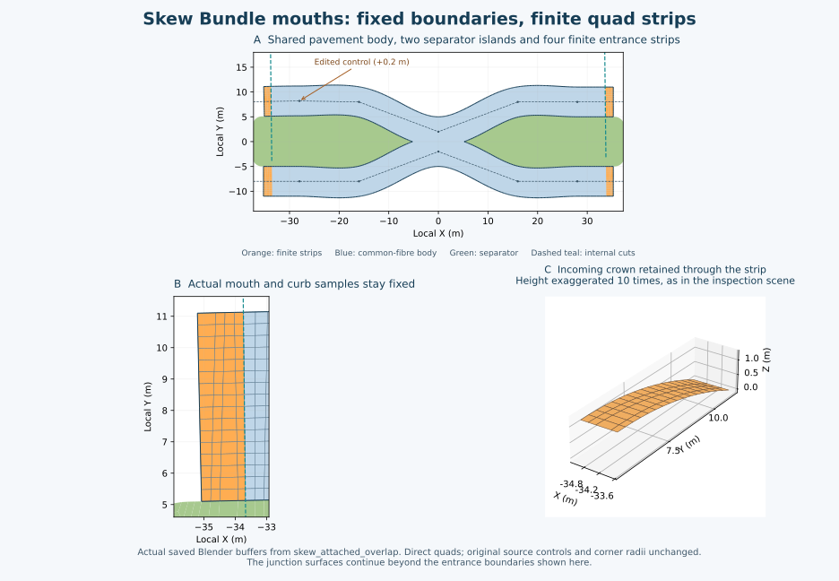

The drawing uses checkpoint-34 float32 Blender buffers. The overview omits the
neighboring junction surfaces to show the strips clearly; their rounded curbs
are retained in the complete Blender scene. The detail shows the actual quad
layout and the three-dimensional view uses the saved tenfold inspection
exaggeration. All equations remain text above.

### Width-changing Sections inside an overlapping Bundle

Dev37 connects the existing certified `SectionTransition` construction to the
Bundle union. Previously the separated branch consumed those curved rims, but
the union could only concatenate compatible constant-width Section offsets.
The new `MemberBoundary` collector retains original Section IDs and polynomials.
It restricts each source path to the transition mouth and inserts that
transition's **actual quintic curb**, with the declared traversal orientation.
It does not interpolate replacement centerline controls or jump between widths
at the source seam.

Let the source offset curb be

$$B_\sigma(s)=C(s)+\left(o+\sigma\frac{w}{2}\right)N(s),
\qquad \sigma\in\{-1,1\}.$$

At a dimensional seam, the collector replaces the consumed tails of the two
adjacent offset curves with $Q_\sigma(t)$, the `WidthContinuation` quintic
already solved by `SectionTransition`. The concatenation is checked at both
ends. Consecutive sources must have an explicit two-ended Connection or Section
seam; coincident positions alone cannot establish membership or ownership.
The orientation map selects the correct curb and reverses $t$ when necessary.

The same common-axis chart is used for the concatenated physical curbs. For
axis $a$, a transition is accepted only after certifying

$$\frac{dQ_\sigma}{dt}\cdot a>0$$

in its traversal direction. Its degree-four Bernstein derivative controls
bound this expression over the full interval. If their hull is inconclusive,
bounded subdivision tightens it; sampled positive derivatives are insufficient.
The proof has a 4,096-subdivision budget and depth limit 16. Failure chooses
another available construction branch or reports the unresolved chart; it
does not flatten or discard the transition.

The quintic sampling uses its existing second-derivative bound $M$:

$$\max_t\|Q(t)-Q_{\rm linear}(t)\|
\le \frac{M\,\Delta t^2}{8}.$$

Lookup sampling reserves one tenth of the configured curve tolerance. Original
path sampling and simplification also have bounded budgets. The subsequent
mesh-row selection checks both exterior curbs and both crest curves, reserving
the remainder of the tolerance for their polygonal approximation. At the
default 5 mm tolerance the concatenated source boundary and final outline stay
within that budget. The intended analytical curves remain authoritative.

For this branch, pavement rows are coordinated along the physical fibres.
If $y_o(x)$ is an exterior curb and $y_p(x)$ the corresponding crest, a regular
strip between consecutive rows $x_0<x_1$ has map

$$x(u)=(1-u)x_0+ux_1,$$

$$y(u,v)=(1-v)\big[(1-u)y_o(x_0)+uy_o(x_1)\big]
          +v\big[(1-u)y_p(x_0)+uy_p(x_1)\big].$$

With consistently ordered curbs and crest, all four corner Jacobians have the
same positive sign after orienting the faces. A sharp Exact-polyline bend
cannot invert an interior cell by assigning different axial positions to the
outer and crest boundary indices. This addressed an inverted-cell case at
resolution 2 after rotating and translating the sources.

The row chooser first tries a bounded uniform partition. If an Exact bend
would require excessive global refinement, it retains the necessary corner
cuts and samples between them. Numerically coincident computational cuts are
coalesced within $10^{-8}$ m; no physical curb is moved. At fine resolutions,
width-adaptive direct quad strips can reduce transverse counts away from
prescribed mouth partitions. Existing immutable `grid` and `strip` patterns
provide all connectivity. Final convexity, ratio 8, overlap and crown checks
remain mandatory, and the pavement allocation limit is 50,000 cells.

The profile field and gap-event construction are the common-fibre rules above.
Thus a 6 m carriageway changing to 10 m can close the separator continuously;
an overlapping end becomes merged pavement, rather than two coplanar surfaces.
A later narrowing can reopen the separator. Rounded junction caps remain owned
by their junctions. Finite skew-end strips now read each terminal Section's
own width, offset and oriented profile; they do not reuse the first Section's
dimensions at the opposite end.

The dependency graph records

```text
source paths + profiles + Section-transition layouts
    -> Bundle plan -> merged pavement / separator
Section-transition layout -> retained transition query
retained transition query + Bundle ownership -> optional separate pavement
```

When the Bundle plan owns a transition, that transition's separate pavement
output is suppressed. Its source-relative query remains available: furniture
keeps its original Section ID and station, uses the transition's horizontal
mapping and the merged Bundle height field. Changing a width updates this
closure. When ownership returns to the separated branch, pavement can be
reconstructed from the certified plan even after Blender has released its old
numerical mesh buffers. Cached committed products are not mutated to do this.
Publication depends only on the transition digest and its ownership flag, so
an unrelated Bundle shape edit does not republish an unchanged separate seam.

The combined inspection adds `dimensional_bundle`, `bent_dimensional_bundle`
and `attached_dimensional_bundle`. The numerical checks also exercise staggered
seams, one-sided width changes, offsets, reversed authored Sections, resolutions
1–4, translated datums, zero exaggeration, skew end profiles, ownership changes
after buffer release, incremental/full equivalence and exact restoration.
These qualify the monotone chart, not every dimensional transition or internal
physical junction configuration. Dev37 did not handle a skew separated end
opposite merged pavement. The next section describes the dev38 construction
for that captured case; more general merged terminal shapes remain open.


The drawing uses the actual saved float32 buffers from checkpoint 37. Orange
dashes show authored input polylines; their selected mode is Smooth. The quad
grids, closing medians and rounded junction caps are the generated surfaces.
Counts next to the drawings exclude the unrelated regression control road.

### One-sided strips opposite an aligned merged free end

Dev38 extends the finite-strip construction to a captured 5 cm source edit.
In `one_sided_free_cap`, the upper control at local $x=-30$ moves from
$y=4$ to $y=4.05$. The separated entrance becomes skew, while both members'
opposite terminal directions remain parallel and their wider pavement overlaps.
The four-strip construction was unsuitable: two independent profile strips at
that overlapping end would duplicate pavement.

`MergedFreeCapPlan` selects the original overlapping **free** end as the chart
reference, adds two finite strips at the separated end, and lets the common
Bundle surface continue to the merged terminal. It reuses `FiniteAxialPlan`,
its immutable quad patterns, numerical height queries and all existing quality
and slope guards. Authored centerlines, widths, offsets, profiles and endpoint
identities remain unchanged. Junction-owned or compound-consumed mouths cannot
be restored by this free-end selector.

For each member's terminal forward unit tangent $t_i$, the candidate chart axis
is

$$a=\frac{t_0+t_1}{\|t_0+t_1\|}.$$

The selector checks that both tangents agree with $a$ within its numerical
direction tolerance, and that all four actual terminal curb endpoints $P_j$
lie in one perpendicular plane:

$$\max_j(P_j\cdot a)-\min_j(P_j\cdot a)\le10^{-6}\;\mathrm m.$$

This tests existing physical geometry; it does not rotate or scale a road to
make it align. The endpoint must have no declared junction/Connection incidence,
the lateral member order must remain consistent, and the inner curbs must touch
or overlap there. Continuous centerline-separation and monotone-curb proofs
still apply over the visible source paths.

When the merged free end is the forward end, the body planes are

$$x_{\rm first}=\max_j x_j^{\rm start}+m\,\delta,
\qquad x_{\rm last}=\min_j x_j^{\rm end},$$

where $\delta$ is nominal cell spacing and $m$ is the existing bounded strip
margin candidate. If the merged end is the start, the construction is reversed:
only the last plane receives an inward margin. Thus the computational cut lies
at the separated end; the merged end retains its actual terminal plane to the
numerical alignment tolerance. No gap or overlapping strip pair is introduced
at that merged end. The captured case uses two finite strips instead of four.

The common-fibre height field reconciles the overlapping pavement at the free
end. At the separated end each finite strip retains its complete original
profile, zero exterior curb and whole-edge entrance-longitudinal bound of 3%.
The separator consists of its common-fibre body and the separated-end cap.
Declared seam keys weld those pieces; the absent merged-end separator cap is
not generated. The tests check manifold edge incidence, disk Euler count and
the absence of exposed edges on the internal pavement cut plane.

This branch uses coordinated rows for both constant-width and width-changing
members. Near a sharp Exact bend, forcing all outer and inner curve knots into
the row partition can create very short longitudinal cells in a wide median.
Instead, a bounded sampler measures the exterior/crest interpolation error.
For each lookup function $f$ and current row partition $R$, it measures

$$E(x)=\max_f\left|f(x)-\operatorname{linear}_R[f](x)\right|.$$

If an interval cannot meet the same error budget with an adequately graded
uniform partition, it splits at the reference coordinate of the largest error
and checks both children. Length-only budget failures split at the midpoint.
Search is limited to 1,024 interval checks, depth 16 and 65,536 row coordinates.
An accepted leaf satisfies the existing curve-error check. A small harmless
Exact kink therefore need not force microscopic rows; necessary sharp features
still cause a cut. This changes sampling, not the intended analytical curves.
The already qualified dimensional-junction charts retain their established
fixed-corner partition; their Exact-mode parity is checked separately.

If the initial collapsed separator atlas cannot accept the chosen row count,
the direct capped-fibre pattern is tried. It still must meet positive-quad,
ratio, angle and allocation guards. No triangular mesh is produced. Cached
cap queries survive publication-buffer release, so nearby furniture and later
Updates keep their source-relative references and reconstruct the same surface.

The gallery's new case has 3,904 pavement and 240 separator quads; its unrelated
control road is additional. Numerical checks cover both common traversal
directions, reversed authored Sections, Exact/Smooth modes, displaced controls,
constant and changing widths, resolutions 1–4, datum 37, zero display
exaggeration, rotated coordinates, complete end profiles, local/full equality,
remote-output identity and exact restoration after buffer release.

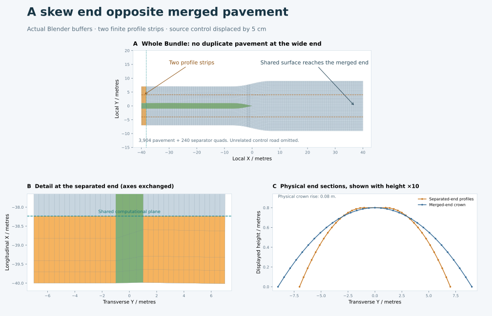

This does not solve arbitrary merged terminal shapes. In particular, a merged
end whose members have different terminal directions, or a configuration that
needs merged patches at both skew ends, still needs a more general end-cap
owner. The complete goal remains active.

## Nonparallel merged free terminal cuts

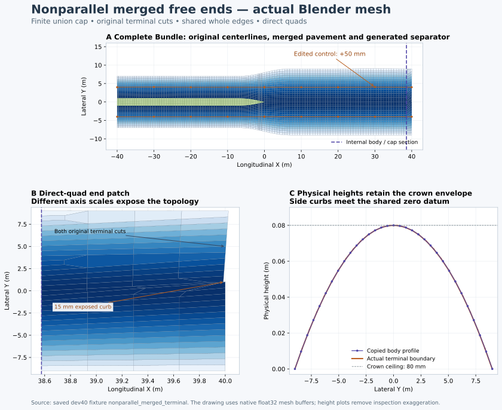

The drawing uses saved Blender float32 buffers from the 46-fixture dev40
gallery. Panel B uses different X/Y scales to expose the quad topology; panel C
removes display exaggeration. The complete Bundle uses **4,150 paving quads**
and **262 grass quads**. Its finite union end patch contains **118 quads**.

`bundle_terminal_caps.SkewMergedCapPlan` adds the missing finite union at a
genuine free end. The established aligned-end and separated-mouth branches are
tried first. The new branch is selected from the physical member boundaries;
it does not use fixture names, object names or source filenames.

The motivating edit moves a control by 5 cm while keeping both terminal
centerline endpoints unchanged. The terminal normals consequently differ.
Each carriageway retains its original normal cross-section cut. Where their
pavements overlap, the exterior union contains pieces of both cuts and can
expose a short piece of an inner curb. In the captured example that curb is
15 mm long. Projecting both cuts onto one common plane would remove this
physical feature and change the required footprint.

### Keep the exact union and an internal body section

Let $\mathbf a$ be the common axial chart direction and $\mathbf n$ its left
normal. The chart origin is $\mathbf o$, giving coordinates

$$x=(\mathbf p-\mathbf o)\cdot\mathbf a,
\qquad y=(\mathbf p-\mathbf o)\cdot\mathbf n.$$

The sum of the two directed member chords supplies an initial axis. Existing
continuous axial/offset checks still have to certify the member curves. A
computational cross-section $x=c$ separates the common-fibre body from its
finite terminal patch. It is not a new authored endpoint. If the terminal is at
the high-$x$ end, its physical footprint is

$$\Omega_{\mathrm{cap}}=
  (\Omega_A\cup\Omega_B)\cap\{\mathbf p:x(\mathbf p)\ge c\}.$$

The low-$x$ end uses $x\le c$ instead. Each member tail follows its original
sampled upper/lower curb, its actual terminal cut and the internal section.
`RegionUnion` finds the exterior loop with the existing bounded segment
arrangement. No triangle mesh is involved. A disconnected tail, an unresolved
contact, a junction-owned terminal or insufficient overlapping body is
diagnosed rather than silently clipped into a simpler shape.

The retained body section contains **all** existing cross-row vertices and
their XYZ values. The cap copies those whole edges. Its outer corners are the
actual outer-curb/terminal-cut contacts, so the four chart sides have physical
meaning: one outer curb, the exterior end-cut chain, the other outer curb, and
the fixed body section. An exposed inner-curb segment belongs to the end-cut
chain and remains present.

### Construct quads without triangulation

The immutable `PatternLibrary.quad` atlas supports different compatible counts
on opposite sides. Its local 1:3 blocks terminate extra intervals inside the
patch. Cut/curb corners are retained subject to the bounded small-feature
sampling rule below. The long straight terminal
segments can receive different sample partitions to keep the interior spokes
on the correct side of a reflex corner. This changes sampling and connectivity,
not the terminal cuts, curb curves or source controls.

For a fixed candidate, write the four sampled sides as $B(u)$, $R(v)$, $T(u)$
and $L(v)$ with compatible corner positions $P_{00}$, $P_{10}$, $P_{11}$ and
$P_{01}$. The initial physical mapping is the Coons map

$$\begin{aligned}
C(u,v)={}&(1-v)B(u)+vT(u)+(1-u)L(v)+uR(v)\\
&-\big[(1-u)(1-v)P_{00}+u(1-v)P_{10}
       +uvP_{11}+(1-u)vP_{01}\big].
\end{aligned}$$

Boundary vertices are then copied exactly from their declared side samples.
Outer-curb row resampling has a separate checked approximation budget; all
original polyline stations and new row stations participate in the check.
The underlying curb approximation uses only part of the 5 mm physical budget.

The initial map must have positive quad corners. A bounded fixed-rim correction
can move internal XY vertices to meet the existing edge-ratio limit of 8 and
corner-sine limit of 0.03. It does not move either a physical boundary or the
body seam, and does not insert/merge triangular faces. Candidate row counts and
terminal partitions are finite; each atlas has a 10,000-cell budget and each
correction a 1,000-iteration budget. A failed candidate cannot bypass its guards.

### Stable small edits: bounded boundary sampling and local grading

Dev41 addresses very small tangent changes at an overlapping free end. The
physical exterior can acquire a submillimetre step. Requiring every corner of
that sampled step, while retaining ordinary-sized neighboring cells, can make
the quad-shape requirements infeasible. The intended source curves remain the
reference; the previous polygon is not a second authoritative shape.

Let the physical curve tolerance be $\varepsilon$ (5 mm by default). The smooth
member curb collector uses at most $0.1\varepsilon$ for sampling and another
$0.1\varepsilon$ for polyline simplification. A terminal chain containing an
edge no longer than $0.8\varepsilon$ may be simplified by chords whose continuous
polyline deviation is bounded by $0.8\varepsilon$. The conservative total is

$$d_H(\Gamma_{\mathrm{source}},\Gamma_{\mathrm{front}})
 \le 0.1\varepsilon+0.1\varepsilon+0.8\varepsilon
 =\varepsilon.$$

Here $d_H$ denotes the Hausdorff distance. This is an error budget, not a claim
that every construction reaches that error. Both outer terminal corners remain
exact, as does the entire internal body profile. The source centerlines, widths,
normal terminal cuts and profile rises are never edited. The visible 15 mm
feature in the preceding drawing remains present.

Retained short edges need **local** boundary grading. Uniformly applying their
small spacing to the whole end cut adds many unnecessary intervals and can
invert the atlas. Instead, a segment of length $L$ with nominal spacing $h$
and endpoint cell-size bounds $a,b$ uses weights

$$w_i=\min\!\left(1,\frac{a}{h}2^i,
                         \frac{b}{h}2^{n-1-i}\right),
\qquad
\ell_i=\frac{Lw_i}{\sum_{j=0}^{n-1}w_j}.$$

The interval count $n$ increases within a fixed allocation limit until
$\max_i\ell_i\le h$. An endpoint beside a short neighboring segment of length
$s$ uses $a=\min(h,16s)$, or the analogous $b$. Adjacent cell lengths grow by at
most a factor of two. The partition remains on the same straight segment;
there is no boundary displacement from this grading.

A small reflex step can still make the initial Coons cell concave. For a graded
candidate only, a bounded geometric initialization moves incident **interior**
vertices to the inner half-plane of their physical boundary edge. For edge
$A\to B$, unit inward normal $\mathbf n$, and candidate interior vertex $P$,
the projection is

$$P'=P+\max\!\left(0,\frac{\lVert B-A\rVert}{4}
                         -(P-A)\cdot\mathbf n\right)\mathbf n.$$

At most eight passes are attempted. The complete rim stays fixed; the resulting
map must pass convexity before the existing shape correction runs. Normal
overlap, edge-ratio, corner-sine, crown and physical-slope guards then apply.
This initialization is a candidate construction, not a proof or an exception to
those checks. Failed candidates remain rejected.

The development sweep checks both interpolation modes and both signs of
0.1 mm, 1 mm, 5 mm, 10 mm, 20 mm, 50 mm, 200 mm and 1 m control moves. Its
[32 cases pass](../../experiments/streets/python_v1/terminal_move_matrix_03/move_checks.json).
Permanent tests independently measure the simplified boundary's distance,
preserved endpoints, cell grading, allocation limits and complete body joins.
Native and broad dev41 qualification are recorded separately in the
[acceptance record](STREETS_PYTHON_ACCEPTANCE.md).

The same end construction also works at both ends of a qualified monotone
Bundle. The [two-end numerical check](../../experiments/streets/python_v1/two_merged_ends_02/two_end_checks.json)
uses nonparallel merged terminals, width changes and a closed central separator
island in both interpolation modes. It keeps 4,214 paving and 188 grass quads,
with whole body-section joins at both caps. Paving around that one island is
an annulus, so its expected Euler characteristic is $V-E+F=1-1=0$, rather than
the disk value one. This check keeps internal dimensional seams straight.
The captured Exact-mode bent dimensional seam remains a separate limitation;
it must not be described as covered by this two-end result.

### Continue the dynamic crown and keep zero outer curbs

The height evaluator extends the existing common-fibre dynamic crown using the
**original** member curb functions over the cap. It uses the same peak blending
and common rise already described above. Inspection height is

$$z_{\mathrm{display}}=z_{\mathrm{datum}}
                 +E\,h(x,y),\qquad 0\le h(x,y)\le H.$$

Here $E$ is exaggeration and $H$ is the shared Bundle rise. Heights are evaluated
again after internal XY correction. The original exterior side curbs are set
exactly to the common datum. The full body-section XYZ values are copied back
unchanged. Terminal profile cuts retain their bounded crown heights; they are
not treated as zero-height side curbs.

Physical heights are evaluated separately with $E=1$ when measuring slopes.
Setting display exaggeration to zero therefore does not hide a physical slope
failure. The existing whole-edge `EntranceSlopeGuard` checks the complete
cap/body section in the axial direction against 3%, while the overall cap slope
uses the existing incoming-profile-based limit. These checks are on the actual
bilinear quad mesh, including the corner gradients.

### Ownership, queries and Update

The Bundle remains the single paving owner; its member Sections publish no
duplicate overlapping road faces. Explicit terminal/body seam keys weld all
cross-row vertices and whole edges. The generated separator uses the same body
and separated-end boundaries. It need not extend into a terminal region whose
carriageways already overlap.

The cap registers a `QuadHeightField` for source-relative furniture. Numerical
publication buffers may be released while those compact query arrays remain.
A forced rebuild reconstructs the same mesh. Returning an edited tangent to
the aligned configuration selects the established aligned branch again; the
choice depends on current inputs rather than edit history.

Five focused tests pass: both displacement signs and interpolation
modes, authored/common traversal reversal, resolutions 1–4, translated datum,
zero display height, rigid transforms, incremental/full equality, exact
restoration, retained remote ownership and cache release. The combined native
gallery, saved-buffer comparison and fresh reopening now pass separately.
An independent native cap check confirms **32 whole internal body edges**,
zero height error on both outer curbs, **0.190 mm** maximum sampled curb error,
the preserved **15 mm** exposed curb, and a **0.103%** whole-edge longitudinal
bound at the body join. The current broad run passes **805 tests in 85 modules**;
its native-verifier-only follow-up is documented in the verification record.
Arbitrary nonmonotone charts and internal physical junctions inside
overlapping members are not established by this terminal construction.

## Higher-valence and two-ended Bundle examples


The drawing uses the saved float32 meshes from the combined 49-fixture gallery.
Pavement color shows physical height after removing inspection exaggeration;
orange lines are the original input centerlines. The top views crop the road
stubs, while all XY axes retain equal metric scale.

`six_way` and `seven_way` use the existing cyclic corner/core construction and
its existing conforming-chart fallback. There is no fixture-specific solver.
Unequal widths and crown rises are retained at every approach. Their native
intersection meshes contain 2,016 and 1,958 quads. The
[independent saved-mesh audit](../../experiments/streets/python_v1/extended_gallery_audit_01/extended_gallery_checks.json)
derives circle centers from the authored straight approach directions and
widths, compares those curves with the actual exterior edges, and checks the
full incoming crown formula independently. Maximum sampled curve errors are
4.811 / 4.920 mm, with 96 / 112 exactly shared mouth edges. The seven-arm native
partition differs from the earlier double-precision probe after Blender input
coordinates are quantized; both retain the same intended curves and accuracy.

`two_merged_terminals` uses the same common-fibre body with a finite union cap at
each free end. Both caps keep 32 whole internal body edges. The paving is one
connected annulus around a generated separator island; it has two boundary
loops and Euler characteristic zero. Its Bundle uses 4,214 paving plus 188
grass quads. The separate control road is omitted from the drawing. Native
position/width edits, local/full equality, restoration and fresh reopening pass
for all three cases. This dev41 two-end example keeps the internal seams
straight. Dev42 separately exercises the originally captured bent Exact seams.

## Exact bent dimensional seams: piecewise common-miter construction

Dev42 integrates this construction in
[`exact_transitions.py`](../way/street_network/python_backend/exact_transitions.py),
[`SectionTransition`](../way/street_network/python_backend/transitions.py) and
[`Bundle boundary consumers`](../way/street_network/python_backend/bundle_boundaries.py).
The [focused Blender checks](../../experiments/streets/python_v1/exact_native_focus_01/exact_native_checks.json)
pass the original failing Connections 2 and 6 and an ordinary dimensional seam
with extra authored controls inside both trims. All 818 numerical regressions
and the [51-fixture native gallery/reopen checks](../../experiments/streets/python_v1/reopen_47/reopen_checks.json)
pass. This branch does not smooth the centerline.

Let $\mathbf d_0,\mathbf d_1$ be the unit directions along the traversal into
and out of the seam, and let $R$ rotate a vector to its right normal. Their
common miter frame is

$$\mathbf m=\frac{R(\mathbf d_0)+R(\mathbf d_1)}
                    {1+\mathbf d_0\cdot\mathbf d_1}.$$

The same near-reversal and miter-reach restrictions as Exact paths apply. At
both outer cuts it keeps the original path frame and full profile. Every source
control strictly inside the trim becomes a mandatory piece boundary. At each
interior bend the normal uses $\mathbf m$ above; the outer normals are copied
from the source frames. On each resulting interval, the source centerline $P$
and frame $N$ interpolate linearly between their control values. Only redundant
affine position/normal controls may be removed. The ownership seam remains a
mandatory row even when it is collinear. Declared coincident endpoint copies
are reconciled only within the existing $10^{-5}$ m incidence tolerance.

Let $t\in[0,1]$ run across both source intervals, with seam parameter
$t_j=d_0/(d_0+d_1)$ from their positive metric trim distances. Width $W$ and
oriented offset $O$ use the existing quintic blend

$$S(t)=10t^3-15t^4+6t^5.$$

With cross-profile coordinate $u\in[0,1]$ and internal $q=2u-1$, the surface is

$$X(t,q)=P(t)+N(t)\left[O(t)+\frac{qW(t)}{2}\right].$$

For zero offset its centerline $q=0$ is exactly the original polyline. Each
curb is a degree-six polynomial on each source piece: a linear frame multiplies
the quintic distance field. If $d_k$ are the restricted degree-five Bernstein
distance controls and $r$ is a piece's local parameter, the degree-six controls
are

$$C_k=P_0+\frac{k}{6}(P_1-P_0)
       +\frac{6-k}{6}N_0d_k+\frac{k}{6}N_1d_{k-1},
       \qquad k=0,\ldots,6,$$

omitting terms with out-of-range $d$ indices. De Casteljau subdivision restricts
the distance controls at every mandatory knot, so adjacent pieces share the
same seam position.
Endpoint profile positions are copied back exactly; derivative controls are
recomputed after those copies.

The ruled-map Jacobian is affine across the width. On each piece, the two curb
Jacobian polynomials have degree eleven. Bounded Bernstein subdivision proves
their positive orientation over the complete intervals. Derivative hulls bound
metric spacing and chord error; each piece has an even number of intervals.
The sample counts are checked against the allocation budget before arrays are
created. Both curbs use the union of these identical mandatory knots. The
existing direct quad grid then supplies connectivity. Complete mouth rows are
copied from the approach frames again at publication precision, avoiding tiny
rounding differences between separately owned mesh parts.

For common datum $z_0$, physical height retains the existing profile blend:

$$z(t,q)=z_0+[1-S(t)]h_0(-q)+S(t)h_1(q).$$

Thus zero-height exterior curbs stay at $z_0$, and the surface stays below the
highest incoming crown. Unchanged mesh guards measure physical gradients and
the 3% entrance longitudinal limit before display exaggeration is applied.
Each Bundle consumer checks axial monotonicity piece by piece, with derivatives
converted from the local piece parameter to global $t$.

For the captured half-crown profiles, both seams produce 384 positive quads,
maximum edge ratio 1.780 and maximum measured physical slope 2.584%. Dense
centerline comparison measures at most $1.45\times10^{-14}$ m error; complete
mouth profiles agree within $3.67\times10^{-15}$ m. These are numerical
prototype results. The production branch now passes seven maintained tests,
including extra controls, reversed authoring, translated datums, resolutions
1/2/4, zero display exaggeration, whole-Bundle ownership and Update/full/cache
identity. The native ordinary seam has 448 quads, exact whole-edge mouth joins
and at most $4.88\times10^{-8}$ m distance from the authored centerline.
The dev42 wider angle probe rejects four 150-degree inputs. The bounded dev43
fallback below resolves those Exact inputs; mixed Exact/Smooth bent seams remain
unfinished. These are separate construction and qualification branches.

### Bounded sharp Exact seam fitting

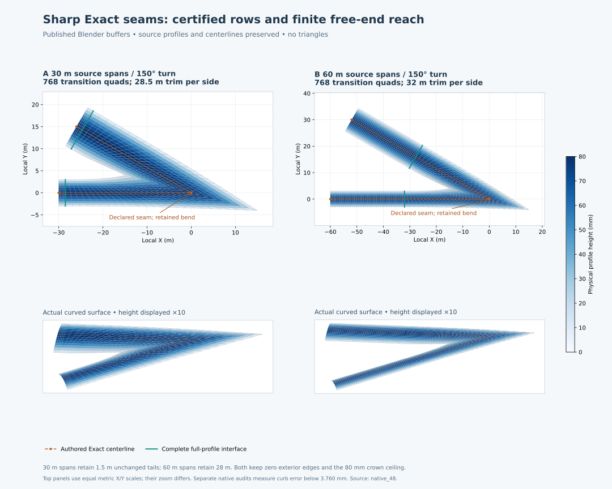

This drawing uses the actual published float32 buffers from checkpoint 48.
Both examples join 6 m and 10 m Sections. Dashed orange lines are the authored
Exact centerlines; teal rows are their complete profile interfaces. Color shows
physical height, while the lower projections exaggerate height ten times.
The top panels use equal metric X/Y scales at different zoom levels. The
unrelated control Street 99 is omitted. These are dimensional seams on an
Exact polyline, not replacements for the rounded multiarm-junction examples.

[`ExactTransitionFitter`](../way/street_network/python_backend/transition_fitting.py)
runs only after all five established transition attempts fail. It does not
replace accepted old meshes. The 150-degree cases have a positive analytical
chart at longer trims, but the original rows are too closely spaced in the
stretched miter direction: simply adding subdivisions across the width does
not resolve both cell shape and physical slopes. The new fallback instead
tries certified, paired longitudinal rows and explicit available source reach.

For a polynomial curb restricted to one candidate interval, let its degree-$d$
Bernstein controls be $B_0,\ldots,B_d$. The line segment between its endpoints,
elevated to that same degree, has controls

$$L_k=\left(1-\frac{k}{d}\right)B_0+\frac{k}{d}B_d.$$

The convex-hull property bounds the deviation at the same parameter by

$$\|C(r)-L(r)\|\le E,\qquad
E=\max_{0\le k\le d}\|B_k-L_k\|+\delta,\qquad r\in[0,1].$$

The implementation adds the arithmetic allowance
$\delta=64\epsilon_{\rm machine}\max(1,\max|B^{\rm original}|)$, using the
original piece controls to include translation scale. De Casteljau restriction
provides each interval's controls. Both curbs must pass the configured curve
tolerance, currently 5 mm; a dense independent check of the published float32
mesh remains a separate native audit.

Each mandatory source piece receives an even number of uniform intervals,
shared by both curbs. A second-derivative estimate seeds the row search. Its
control-hull certificate can be more conservative, so the seed can grow before
the bounded search. Every final candidate is certified again. Counts near the
requested Resolution, including coarser certified alternatives, are tried
without dropping real bends or the ownership seam. The total face allocation
is bounded before constructing arrays, with at most 64 candidate meshes.
Continuous positive Jacobians, actual quad convexity/overlap, edge ratio 8,
physical profile slopes and the 3% entrance longitudinal guard still apply.

Redundant collinear controls must not squeeze the miter interpolation into an
arbitrarily short source interval. In this fallback, frame vectors interpolate
between real bends and the unchanged outer frames. Position stays on the exact
polyline. Affine position/frame controls can then be removed together, while
the declared seam remains mandatory. A maintained test inserts controls 15 m
and 1 mm before the seam and recovers the same physical mesh within
$10^{-10}$ m. This does not remove or straighten genuine small bends.

The original trim limits are tried first. A farther trim is available only if
the opposite end has explicit free-terminal ownership: no incident junction or
Connection, no selection cut, no Bundle membership, and no occupied-footprint
constraint. For source length $\ell$ and width $w$, its upper distance is

$$d_{\max}=\min\left(0.95\ell,\;\ell-\min(0.25,0.05w)\right).$$

This retains a positive full-profile tail. Actual chosen trims, original
limits, extended endpoints and certified sampling error are persisted in mesh
metadata. Source positions, dimensions, identities and profile rises are not
rewritten. Existing dependency edges include incident sites and partner
Sections, so changing end ownership invalidates the affected construction.

For 30 m source spans the 150-degree example uses 28.5 m on each side and
retains a 1.5 m full-profile tail; for 60 m spans it uses 32 m. Both transitions
have 768 direct quads. Focused Blender tests independently measure at most
3.760 mm curb error and verify complete profile joins, height/slope guards,
vertex/width Update, furniture movement and restoration. These are Exact-mode
examples. Their Smooth versions still encounter separate offset-regularity or
finite-reach limits; coarser Exact sampling is not a solution to those inputs.

## Width changes owned by a physical intersection

An isolated dimensional transition is appropriate when there is room between
it and the next intersection. It is inappropriate to require a second taper
inside a surface already owned by that intersection. Dev39 adds
`JunctionTransitions`, which extends a physical approach across an explicitly
connected width/offset seam when the ordinary construction has no usable span.

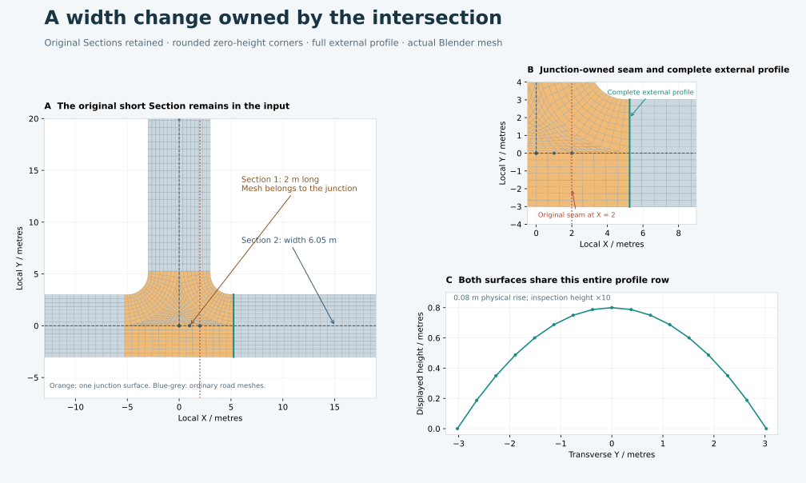

The drawing uses the saved `junction_owned_width_seam` fixture. Section 1 is
only 2 m long and has width 6 m. Section 2 continues the same Street with width
6.05 m. The red dashed line is their original incidence. The orange mesh owns
that incidence and the short inner Section. The teal row lies farther along
Section 2 and retains its complete 6.05 m profile. Source controls, Section IDs
and the Connection survive; no synthetic Section replaces them. Displayed
heights are exaggerated ten times, while the physical crown rise is 0.08 m.

### Choosing the external dimensions

The ordinary compatible route remains the first choice. The new branch runs
only after a finite corner/entrance failure, or when a successful mouth leaves
no room for the existing mandatory clearance before a dimensional seam.
It follows explicit two-ended incidence and the same Street. It crosses one
dimensional change at a time, retaining compatible following Sections. The
original dev39 branch covers width/offset changes; dev45 extends this to crown
rise as described below. Different datums, half-profile kinds, Streets or
interpolation modes still need separate policies.
There are at most eight expansion rounds.

Let the next dimensional seam be at outward route station $S$. Its dimensions
on the two sides are $(w_0,o_0)$ and $(w_1,o_1)$, where offsets use the common
outward direction. A finite lead is selected from

$$L=\max\left(2,\;4|w_1-w_0|+2|o_1-o_0|\right),$$

$$s_{\min}=S+\frac{L}{2}+\min(0.25,\;0.05w_1).$$

Lengths are in metres. The contact solver uses the terminal Section's actual
width and outward offset. Its original centerline polynomials still determine
the approach frames. The existing Bernstein offset-regularity certificate is
also checked at that width over the consumed cubic pieces. Source endpoint
positions, tangent directions and Exact miter normals must agree across the
declared seam.

The entrance station respects both the rounded-corner contacts and the finite
lead:

$$s_{\rm mouth}\ge
\max\left(s_{\min},\;s_{\rm contacts}+\min(0.25,0.05w_1)\right).$$

The established mouth-station rule may extend this to a nearby compatible seam
or genuine free end to avoid a sub-cell remnant. It cannot pass a physical
junction or selection cut. Full source support must remain available. Circular
corner fitting, strict-versus-style radius policy and normal footprint/mesh
qualification then run unchanged. The approach keeps its original root incidence
for identity, with a separate reference to the Section supplying its external
dimensions and profile.

### Publishing one surface and preserving dependencies

`Route.trims` maps the chosen entrance back to every original Section touched
by the intersection. A consumed Section therefore has a source-owned station
interval but no duplicate carriageway mesh. The continuing Section supplies the
ordinary external road from the new entrance onward. Every absorbed dimensional
incidence must lie strictly inside the sampled physical junction rim, and both
of its source Sections must occur in that junction's explicit trims.

The two-ended Connection layout records `absorbed_by`. Its transition product
and pavement output are `None`: an isolated quintic taper is not generated and
then clipped. Such a hypothetical taper is not an additional exterior-boundary
constraint. Once the intersection owns this interval, its rounded curbs and
complete external profiles define the physical surface. The normal positive-quad,
height, slope and nonoverlap guards still decide whether it can be published.

All candidate paths, oriented profiles and explicit seam records are already
declared dependencies of the approach task. Physical footprint planning uses
those source-derived inputs, without depending on a transition layout that
would itself depend on the footprint. This avoids a dependency cycle. The
Connection retains its identity when editing moves the seam farther from the
intersection and an isolated taper becomes appropriate again.

Furniture retains its original Section, station, side and offset. Consumed
source intervals point to the junction surface query, including after numerical
publication buffers are released. Outside the intersection, an independently
owned taper continues to use its own surface query. No continuous observer is
installed; all changes are reconciled by **Update**.

The tests cover Exact/Smooth modes, reversed source directions, resolutions,
rigid transforms, full-profile ports, junction-owned furniture, width changes,
switching between isolated and absorbed transition ownership, local/full equality,
remote-output locality and restoration after buffer release. Profile-kind/datum or
Street changes that cannot use this branch preserve the last successful manifest.
These checks qualify this ownership rule, not arbitrary compound transitions.
Multiple physical junctions claiming one dimensional seam still require a
shared compound owner; that case is diagnosed rather than assigned arbitrarily.

### Crown-rise changes owned by the junction (dev45)

A crown-rise change entirely inside the junction is reconciled by its surface.
The continuing Section supplies the full external profile. The short inner
Section and Connection remain editable source records, with no duplicate taper
or carriageway under the junction. This applies to the same profile family,
common datum, Street and interpolation mode, including a rise-only change.

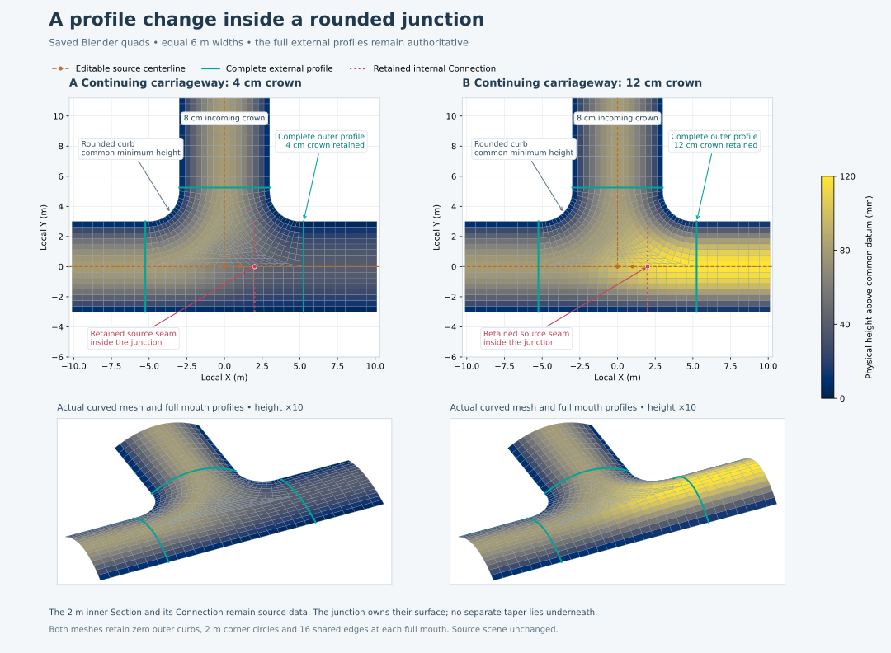

The drawing uses saved Blender mesh buffers. Orange marks the original
centerlines; the pink Connection stays inside the junction. Teal rows retain
the complete external profiles. Color shows physical height; the lower views
display height at ten times its physical scale. Only the displayed road lengths
are cropped. The source scene is unchanged.

For a rise change from $H_0$ to $H_1$, the finite lead rule becomes

$$L=\max\left(2,\;4|w_1-w_0|+2|o_1-o_0|,
\;\frac{15|H_1-H_0|}{8\cdot0.03}\right).$$

The factor $15/8$ is the maximum derivative of quintic smoothstep. This lead
reserves room rather than proving a surface bound; normal contact, height,
slope, positive-quad and overlap guards still decide publication. The earlier
$s_{\min}$ formula is unchanged. Each added piece updates the terminal
dimensions and oriented profile used by the outer mouth. Complete exposed
profiles define the highest-crown ceiling; exterior rounded curbs stay at the
common datum. Fully consumed inner profiles impose no phantom height seam.

`junction_owned_lower_crown` and `junction_owned_higher_crown` have equal 6 m
Section widths, a 2 m inner Section and an external 4 cm or 12 cm crown. Other
incoming crowns are 8 cm. Tests also vary width, use a flat continuing road,
reverse sources and translate the datum. Moving the seam outside the junction
restores an isolated profile transition. Source-relative anchors query the
surface owning their original Section station. See the
[current evidence](STREETS_PYTHON_ACCEPTANCE.md#dev45-crown-rise-ownership-qualified-development-checkpoint).

An independent published-buffer audit confirms all 16 complete edges at each
mouth, exact shared edge positions and zero-height exterior curbs. It bounds
each full curb chord against the intended circle and tangent segments. Distance
to a fixed curve is 1-Lipschitz: for chord length $\ell$ and $n=256$ uniform
subintervals,

$$d_{\max}\le\max_j d(x_j,C)+\frac{\ell}{2n}.$$

Every chord point lies within $\ell/(2n)$ of a sample. The measured deviation
is at most 3.237 mm; adding the conservative sampling margin gives 3.682 mm,
below the unchanged 5 mm tolerance. This is a complete chord-to-curve bound,
including chords crossing tangent/arc joins. See the
[native audit](../../experiments/streets/python_v1/absorbed_profile_drawing_02/absorbed_profile_meshes.json).

### Exposed profiles determine the height ceiling (dev47)

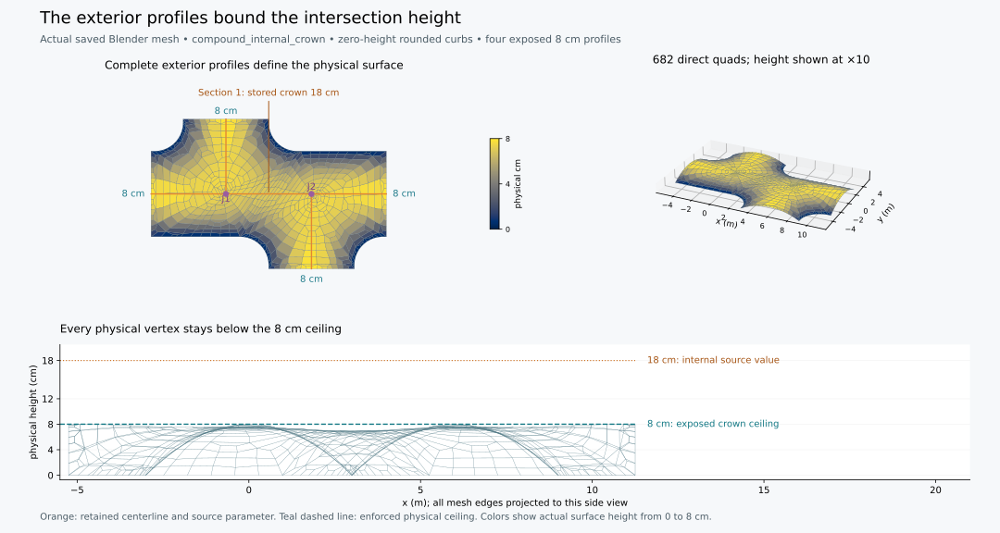

The drawing reads saved Blender buffers from `compound_internal_crown`:
682 directly generated intersection quads. The plan retains both original
junction sites and the orange source centerline. The lower view projects all
actual mesh edges; the dotted 18 cm line labels the stored internal source
value. The dashed 8 cm line is the enforced exposed-profile ceiling. The
axonometric view displays height at ten times its physical scale.

Let $\mathcal E$ contain the physical approach incidences whose mouth intervals
occur on the compound boundary. Both the exterior and separator-hole loops are
examined; a logical approach consumed entirely inside the pavement contributes
no boundary profile. For common datum $D$ and authored profile rises $h_e$,

$$H_{\max}=D+\max_{e\in\mathcal E}h_e.$$

The maximum is over exposed entrances. All related source approaches still
obey the existing common-minimum input contract; the change does not make
different-level source data compatible. Layout records outside this physical
compound affect neither validation nor height limits. The same exposed ceiling
also supplies a closed separator's plateau boundary condition.

The previous lookup examined every approach in supplied layouts. For two close
junctions it could include a fully consumed 18 cm internal crown even though all
four exposed crowns were 8 cm. It could also include unrelated metadata supplied
by a caller. The corrected lookup follows actual boundary mouth tokens and
retains source profile values for future source edits. Tests vary the consumed
rise through 0, 4, 18 and 50 cm: the unchanged physical intersection stays
bounded by its 8 cm entrances. Unrelated high crowns and a remote 37 m datum do
not affect boundary conditions; a different datum on a related consumed source
still receives the common-minimum diagnostic.

The new `compound_internal_crown` Blender fixture demonstrates the same case.
Editing its entirely internal rise and pressing Update preserves the mesh and
furniture poses; editing an exposed rise or centerline updates the surface.
Conservative dependency invalidation may rebuild the affected compound and
furniture objects, while their semantic IDs survive and unaffected road objects
retain their identity. Full current-source release checks are recorded in the
[implementation status](STREETS_PYTHON.md).

The [independent saved-buffer audit](../../experiments/streets/python_v1/compound_ports_saved_dev47_01/compound_saved_mesh_checks.json)
confirms 64 exact shared entrance edges, zero curb heights and a maximum
physical height below 0.08 m for this fixture. Its maximum whole-bilinear-quad
gradient is 7.253%, entrance longitudinal slope is below 0.150%, and graph
depression fill is zero. Complete curb-chord error is bounded by 4.937 mm
against independently constructed circles and tangents, under the 5 mm limit.
The same audit checks all three new compound fixtures and confirms disjoint
world bounds for all 58 fixtures, with a minimum separation of 10 m.

## Remaining construction branches

The complete goal still requires extending ownership beyond the qualified
finite strips, compatible Section chains and monotone dimensional transitions,
including further profile-family changes or multiply claimed junction-consumed dimensional
transitions, internal physical junctions,
general compound caps and interior
Street separator islands, nonmonotone/skew local charts, and stronger near-contact
and cell-grading qualification. These must become
explicit owners of nonoverlapping pavement/grass regions. Treating pavement
overlap as a permanent input error would contradict the intended design.

### Next review: complete ports for a compound dimensional seam

The [eight-case diagnostic](../../experiments/streets/python_v1/compound_seam_candidate_01/compound_seam_candidate_checks.json)
uses two T-junctions 6 m apart, with their connecting Street split at 3 m.
Section widths are 6 m and 6.05/6.4 m; the second crown is 8/12 cm, in both
Exact and Smooth modes. Baseline and test-only shared-owner candidates stop
at `Compound clipping retained a partial incoming profile` in `sampling.py`.
The failure occurs during compound surface construction, before the proposed
seam-ownership rule can resolve the case. No candidate change is in runtime.

This needs physical entrance planning for the whole compound, before its quad
fill. A possible next experiment is to derive the real exterior approaches
from the original incidences and fully consumed source spans, then construct
a boundary with complete exterior mouths. The existing circular-contact solver
already accepts approaches with different origins, but this compound use has
not been qualified. Original Sections, Connections and both logical junctions
must remain present; only derived geometry may change.

The review must coordinate the derived boundary with source-station trims,
furniture ownership and update signatures. Preserving original consumed spans
while replacing exterior mouths is essential: changing only the drawn boundary
would leave road gaps or duplicate link pavement. Compound layout signatures
must include the relevant members' geometry, while unrelated compounds retain
their existing outputs. Rounded corners, complete incoming profiles, common
minimum, highest-crown ceiling, slopes and direct quads remain required. This
is the geometry/architecture review flagged for Astra. The numerical experiment
below first established the case; dev46 implements the production increment
described after it. General compound/Bundle policies remain unfinished.

#### External complete-port experiment

The [source-pinned test script](../../experiments/streets/python_v1/probe_compound_exterior_ports.py)
is outside the addon. It leaves the qualified dev45 Python source unchanged.
Its [completed bounded run](../../experiments/streets/python_v1/compound_exterior_ports_03/compound_exterior_ports_checks.json)
passes the eight previous width/rise/Exact-Smooth cases, four source-direction
reversals, three rotated/translated common-datum cases at resolutions 1/2/4,
and an incremental Update check.

For this two-junction case, the experiment retains the original compound's
logical members and consumed Section claims, but removes their internal
approaches from the *physical exterior*. It cyclically orders the four genuine
external approaches and applies the existing circular-contact solver to their
different origins. All four strict radii remain 2 m. The two original endpoint
weld checks still run during raw footprint preparation; only the separate
derived compound helper omits the assumption that all physical approaches
share one origin.

The complete exterior profiles determine new mouth cuts. Original consumed
source trims survive alongside those cuts, so the two internal Sections remain
fully compound-owned. Existing analytical sampling, direct quad construction,
height/slope/shape guards and whole-network overlap validation run unchanged.
Computational fill cuts use the existing visibility policy; the original
logical junction and Connection IDs remain in the product provenance.

At resolution 1 the Exact example has 725 compound quads and the Smooth example
721. Each shares 64 complete boundary edges with its four external roads;
all exterior curb heights are zero and physical height stays in [0, 0.08 m].
The wholly consumed internal Section's 0.12 m rise imposes no phantom internal
profile boundary. Transformed tests use datum 37 m. The maximum edge ratio
across these tested cases is below 7.18, against the unchanged limit of 8.
The worker peaks at 73,129,984 bytes resident.

Changing an exterior Section's width and crown after releasing cached mesh
buffers produces exact incremental/full mesh agreement, retains the remote
road product and restores the original meshes and furniture poses exactly.
An earlier test run incorrectly tried to read an intentionally released,
unchanged road buffer during its interface audit; the corrected test audits
complete interfaces on the full result and compares every available rebuilt
incremental mesh against it. No runtime guard was changed for that correction.

This experiment does **not** establish a general compound policy. Its derived
outline uses new circular contacts between exterior approaches rather than
preserving the union of the two previous local outlines. That physical choice,
consumed-source support, heterogeneous radii/profiles, Bundles, more general
incidence, local dependency signatures and Blender publication/persistence need
review before integration. The test-only AST reuse and monkey patches are not
an implementation to ship. The installed-copy-qualified addon remains dev45;
the newer development scene and production construction are described next.

#### Production complete-port planning (dev46)

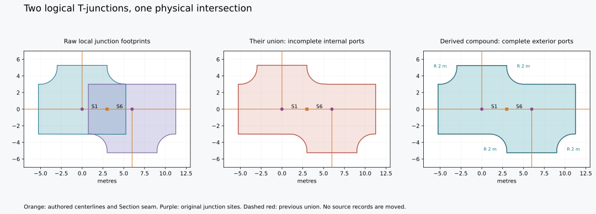

The plan comparison uses the retained prototype's actual footprint buffers.
Orange shows unchanged centerlines and their Section seam, purple shows the
two logical junctions. The new outline eliminates exposed pieces of consumed
internal profiles; its four rounded corners retain the requested 2 m radius.
The dashed red outline is the previous invalid union. The source remains two
logical sites, although one physical pavement surface reconciles their crowns.

`CompoundPortPlanner` runs after original span-based compound grouping. A valid
existing union is returned unchanged. For an incomplete boundary with an
explicit dimensional Connection claimed by multiple members, it identifies the
real exterior incidences by removing fully compound-owned Section claims.
`ExteriorSpecification` carries each original outgoing incidence's radius and
strict/style mode; it does not create a new source Intersection or rename any
source records. Heterogeneous radii are supported by the focused tests.

`IntersectionProvider.curved_boundary` is the shared contact/entrance builder.
Local `_footprint` still validates all endpoint copies at the original junction.
Only the independently established physical compound accepts multiple origins.
Its analytical circular contacts, finite source extents, profile sampling and
normal quality/height/slope/overlap checks are the same production code used by
the other intersections. No AST copying or monkey patches are in runtime.

Each internal source trim retains the greatest consumed interval for its
directed end; the newly solved complete exterior cuts replace only exterior
mouths. Both logical sites refer to that same physical layout. Boundary height
conditions come from physical footprint approaches, rather than assuming one
physical footprint per logical junction. Original member IDs and consumed
Section IDs remain in surface provenance. Visibility-based computational cuts
fill this new simple exterior, while the original source claims remain stored.

The support guard samples complete consumed centerlines with a bounded
curvature-controlled chord error. It tests segment/boundary crossings as well
as endpoints: a narrow concave gap between two samples cannot be skipped.
Clearance includes both source and boundary approximation tolerances. The
sample budget is 20,000; small blocks bound the segment-comparison workspace.
This guard certifies retained centerlines, not preservation of every internal
Section's old full profile inside the intersection. Complete exposed profiles
remain authoritative; internally consumed profiles are smoothly reconciled.

A seam depends on the physical plan only for its relevant owner assignments,
in addition to its declared local geometry. A derived layout depends on all
raw member footprints in its compound. Thus an exterior width/rise edit updates
both sites, their physical pavement and source-relative anchors, while a change
in an unrelated compound leaves this seam/layout/surface identity intact.

The [57-fixture development scene](../../experiments/streets/python_v1/native_51/python_streets_checkpoint.blend)
adds `compound_owned_width_seam` and `compound_owned_profile_seam`. Each has
4,401 total quads and a 721-quad shared intersection. Native checks pass
explicit Update, width/rise edits, free-end movement, local/full equality,
remote-object retention, cold cache reconstruction and exact mesh/furniture
restoration. The [independent buffer comparison](../../experiments/streets/python_v1/gallery_quality_50/import_quality_checks.json)
preserves every one of the preceding 306 mesh parts exactly.
[Fresh-process reopening/editing](../../experiments/streets/python_v1/reopen_51/reopen_checks.json)
passes all 57, and the [complete current-source suite](../../experiments/streets/python_v1/suite_52/suite_checks.json)
passes 840 tests in 91 modules.

An [independent saved-buffer audit](../../experiments/streets/python_v1/compound_ports_saved_03/compound_saved_mesh_checks.json)
imports no runtime contact or surface builder. For both new meshes it finds
16 whole shared edges per external road, zero exterior curb heights, physical
height at or below 0.08 m, a maximum full bilinear-quad gradient of 9.362%,
entrance longitudinal slope below 0.169% and zero graph depression fill. The
four 2 m circles and their tangent lines are constructed independently from
the source geometry. Sampling each complete curb chord at 4,097 points and
adding its Lipschitz margin bounds error by 4.937 mm under the 5 mm tolerance.
An earlier 1,025-point reference gave a conservative 5.039 mm upper bound;
only the test reference was refined. The generated mesh and tolerance did not
change. Further real-network and installed-package checks remain release work.

This first production increment is for simple exteriors with full profiles.
It leaves half-profile and separator-hole compound policies on their existing
branches. More general exterior incidence, profile-family changes and Bundle
unions remain required construction work; the new branch is not proof of
universal compound support.

### Refined compound quads and boundary drainage

Dev33 adds a repair for a different failure: an initially qualified planar chart
can acquire stretched quads when a few cells are refined to resolve its height
field. Increasing subdivision everywhere is unnecessary. The repair keeps the
refined connectivity, moves internal XY with `QuadShapeCorrection`, samples the
authoritative field again, and restores all boundary XYZ exactly. It runs only
when the existing final edge-ratio guard fails; previously qualified charts
retain their construction.

Planar improvement alone can steepen the sampled surface. The existing height
projection then bounds all four bilinear-corner gradients while preserving the
datum, highest incoming crown, and complete entrance profiles. A height
projection can also introduce a small basin. `BoundaryDrainage` measures the
minimum graph spill elevation needed to connect every interior vertex to a fixed
boundary outlet. For the current vertex heights $z$, boundary set $B$ and edge
paths $\gamma$ from vertex $v$ to $B$, this elevation is

$$F(v)=\min_{\gamma:v\leadsto B}\;\max_{u\in\gamma}z(u).$$

It is computed by a heap flood starting at every fixed boundary vertex. A newly
visited vertex has filled height equal to the larger of its original height
and its parent's spill height. Thus it has a nonascending edge path to an outlet,
fixed boundary heights do not change, and filling cannot exceed the current
global crown ceiling. Components without any fixed outlet are rejected.

Only vertices that need filling receive additional lower bounds. With persistent
floors $L_v$, the slope projector applies the height box

$$L_v\le z'_v\le H,\qquad z'_b=z_b\quad(b\in B),$$

along with the original gradient-norm constraints. Floors only increase between
rounds. Up to eight bounded repair rounds reconcile these conditions, and the
final graph fill must be at most one micrometre. The existing isolated-minimum,
entrance longitudinal-slope, crown, positive-quad and overlap guards remain in
force. Infeasible or unconverged repairs are diagnosed; they are not published.

After a successful repair, `QuadHeightField` queries the resulting bilinear
surface. Furniture therefore uses the adjusted pavement height, including after
publication releases the numerical mesh buffers. Regrading adds no vertices,
changes no faces and preserves the analytical corner footprint and boundary
samples. The host-Python Nashville diagnostic changes four stretched cells from
a maximum edge ratio of 14.11 to 7.67, retaining all 1,138 quads and every boundary
vertex. Its additional depression fill is about 0.153 mm. Native Blender's
numerical path gives a maximum saved-buffer ratio of 7.865 and needs no
additional spill fill after projection. Native publication and
full-network gates are recorded separately in the status document.

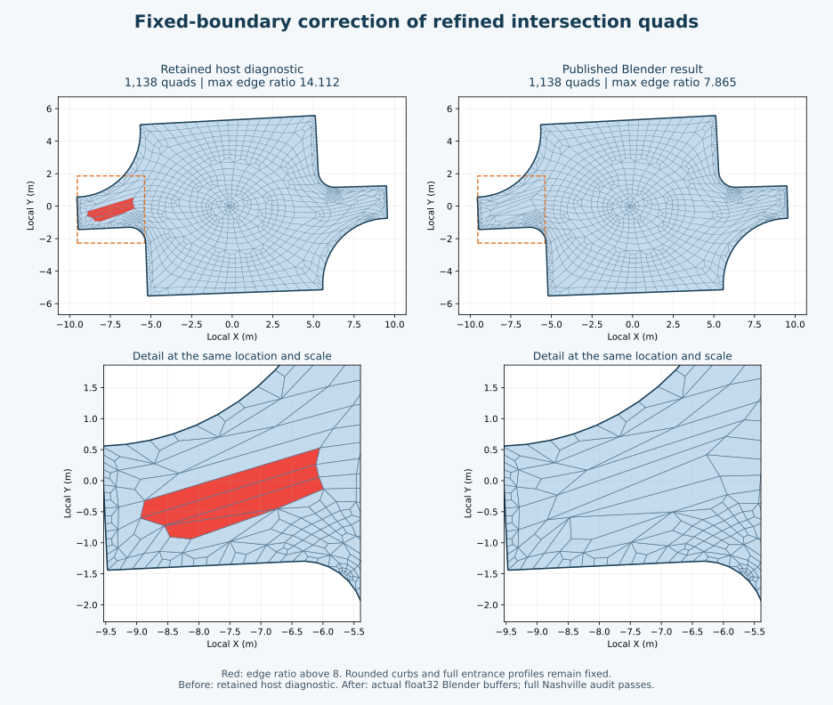

The illustration uses actual retained diagnostic and Blender output buffers
from the Nashville OSM sample. Red marks cells above the unchanged ratio limit.
The different numerical environments give slightly different internal layouts;
each repair preserves its own original boundary exactly.

The real OSM trial now completes its short approaches, compounds, half/full
profiles, dimensional seams and visible cap ports, generating both components.
The dev24 audit found 32 cells above edge ratio 8 on the 18 mm remnant of
road 339 before its compatible seam with Section 334. Dev25 aligns that mouth
to the seam. The source Section survives; its complete remaining pavement is
junction-owned. The current published-buffer audit verifies **399,459 convex
quads**, **no cells above ratio 8**, and a maximum ratio of **7.9654**.
Only junction 681 and the former separate road 339 mesh change; the other
**331** mesh buffers are exact. General contact-tip grading, broader input
families and update-cost reduction remain release work.
The goal remains active until the remaining construction and qualification
gates are satisfied.

## Fixed-chart height constraints and attachment queries

The site-439 SciPy oracle in the status document demonstrates that adjusting
interior heights on its existing 420 quads can meet the slope limit while
retaining every boundary height and the crown ceiling. The runtime now attempts
a bounded NumPy projection when the initial analytical surface exceeds its
slope limit. Already qualified analytical surfaces keep their original branch.
The complete `berlin_22` import now passes, including this former height gate.
This does not qualify every possible profiled intersection.

For a fixed convex XY quad, its bilinear height gradient at corner $c$ is a
linear function of the vertex heights, $g_c=A_c z$. With fixed boundary values
removed from the unknown vector, this becomes $g_c=A_f z_f+b_c$. A closest-height
construction can use the convex constraints

$$\min_z\frac12\|z-z_0\|^2,\qquad
z_i=h_i\;\text{on the boundary},\qquad D\le z_i\le H,\qquad
\|g_c\|_2\le G_{\mathrm{limit}}.$$

Here $z_0$ is the current bounded analytical field, and the slope limit remains
the incoming-profile limit defined above. Boundary heights are constants, not
penalty terms that could drift.

There is a useful whole-quad bound. Let $D_c>0$ be the XY Jacobian determinant
at a corner and $N_c(u,v)$ the four nonnegative bilinear shape weights. The
gradient numerator and Jacobian determinant are affine in $(u,v)$, giving

$$\nabla h(u,v)=
\frac{\sum_c N_c(u,v)D_c\,g_c}{\sum_c N_c(u,v)D_c}.$$

Thus every gradient is a convex combination of the corner gradients. Bounding
the four corner norms bounds the entire bilinear face. The existing independent
3×3 measurement remains a useful audit. This does not imply derivative
continuity between neighboring faces or prove drainage quality; entrance
longitudinal slopes and depressions still need separate checks.

A local Euclidean projection onto one gradient constraint can be calculated
without a global dense solver. Put $C=A_fA_f^T$. For a violating gradient $g$,
choose $\mu\ge0$ so that

$$g_\mu=(I+\mu C)^{-1}g,\qquad \|g_\mu\|_2=G_{\mathrm{limit}},$$

$$z_f^{\mathrm{new}}=z_f-\mu A_f^Tg_\mu.$$

`SlopeProjection` implements these 2×2 projections. Rank-zero fixed violations
and infeasible rank-one fixed components receive diagnostics. Rank-two rows use
a bounded safeguarded scalar root solve. Deterministic face colors prevent
concurrent updates to a free vertex; Dykstra corrections combine the gradient
constraints with the height box. Boundary vertices are excluded from every
correction. Cell, estimated-memory, color, root and iteration budgets are
explicit. The saved SciPy reference is a test input, not a runtime dependency.

The site-439 NumPy comparison matches the oracle heights within 1 nanometre and
reaches the same slope limit on the unchanged 420 quads. Local construction took
about 0.14 seconds. The surface builder additionally rejects newly introduced
interior vertex minima and excessive entrance longitudinal slopes before using
the result. Failed projection can still try the original bounded refinement
branch, retaining diagnostic context.

`QuadHeightField` supplies attachment queries on the adjusted bilinear mesh.
It retains compact physical XY/height/connectivity arrays and a bounded spatial
grid, independently of the temporary published mesh. Analytical inversion of
the containing quad returns its height without constructing triangular faces.
The owner excludes separator-hole interiors from pavement queries and supplies
their plateau height explicitly. Physical query data is copied before inspection
exaggeration is applied; release of publication buffers therefore leaves the
attachment surface valid. The query is reconstructed from source inputs after
reopening. Persistence and complete imported-network tests remain separate
qualification gates.

## Internal Section routes in close junctions (dev48)

A connecting Street can have several authored Sections even when its whole
physical surface lies inside a compound intersection. Splitting that Street
must not introduce another exposed entrance or duplicate computational seam.
The implementation preserves the logical Sections, their profiles, original
stations and furniture anchors. It changes only derived ownership and mesh
partitioning. See `compound_coverage.py`, `junction_transitions.py`,
`compound_ports.py` and `partition.py` in the Python backend.

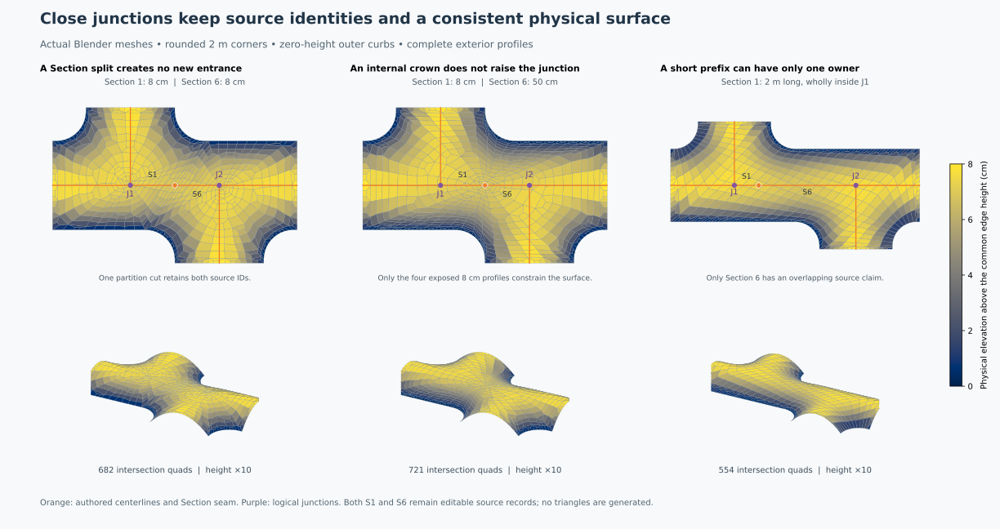

These are the actual saved meshes from checkpoint 55, independently audited
from Blender's stored buffers. The plan views show every generated quad; the
lower views exaggerate the physical elevation by ten. Their intersection parts
contain 682, 721 and 554 quads respectively. Every exposed crown is 8 cm above
the common zero-height outer curb.

### Full ownership is distinct from overlap

For a Section of length $L$, an original mouth at station $s$ claims the
source interval $[0,s]$ when approached from End 0, or $[s,L]$ from End 1.
For compound member set $J$, collect those intervals from the original raw
layouts. Complete ownership requires

$$\bigcup_{j\in J} I_{j,S}=[0,L_S].$$

The implementation sorts and merges these intervals with its existing
$10^{-7}$ m station tolerance. The overlap claims used to establish a compound
are retained separately: they are not rewritten to pretend every internal
Section was shared by two junctions. In `compound_short_prefix`, Section 1 is
wholly covered by J1 alone; only Section 6 has a shared overlap claim. Both
Sections nevertheless belong to the internal connecting route.

Complete interval coverage is necessary but not sufficient to remove an
entrance. The explicit endpoint topology must trace the whole route to another
actual member junction. A free terminal keeps its exposed profile. A longer
route leaving and re-entering the compound cannot be consumed merely because
its endpoints refer to members. Before replacing a physical rim, the existing
bounded segment/curve containment check certifies the complete source
centerlines against that rim, including concave gaps.

### A height-transition reserve may be provisional only internally

An ordinary displaced entrance still reserves space for width, offset and
profile-rise changes. For consecutive compatible Sections, define

$$d_g=\max\left(2,\;4|\Delta w|+2|\Delta o|\right),\qquad
d_p=\max\left(d_g,\;\frac{1.875|\Delta H|}{0.03}\right).$$

All dimensions in this expression are metres. With preceding source length
$L_{\mathrm{prefix}}$ and continuing width $w$, the ordinary minimum mouth
station is

$$s_{\min}=L_{\mathrm{prefix}}+\frac{d_p}{2}
             +\min(0.25,\;0.05w).$$

The factor 1.875 is the maximum derivative of the quintic blend used by the
transition policy. The 0.03 denominator is its physical longitudinal slope
limit. These are planning reserves; the independent mesh slope checks still
run on the final surface.

If the ordinary extension cannot fit, a second raw-contact attempt may use
$d_g$ in place of $d_p$. It carries a typed `DeferredProfileReserve`, including
the actual terminal junction, original Section IDs and the ordinary reserve.
It is eligible only for a complete, compatible full-crown route ending at
another physical junction. Different Streets, interpolation modes, minimum
datums or profile families cannot be hidden by this branch.

This provisional contact is accepted only after the ownership plan proves
that both junctions belong to the same actual compound, every original source
interval on the route is covered, and its centerlines are strictly inside the
single physical exterior. Otherwise preparation fails before publication; the
last successful scene and dependency manifest remain intact. A standalone
entrance or short free road never receives this exception.

The internal crown is retained as authored data, but it does not become an
exposed height constraint. The final surface is reconciled from the complete
external carriageway profiles, zero-height curbs and the highest exposed crown
ceiling. Thus an internal 50 cm crown does not raise the four exterior 8 cm
profiles or create a bump above them.

### Several source Sections can share one computational cut

When a compatible Street is split into Sections, two original shared claims
can identify the same pair of boundary ownership changes. Generating both cuts
would duplicate a geometric partition. `BoundaryOwnershipCuts` combines them
only when both their unordered owner pair and their exact unordered boundary
references agree. Nearby cuts are not merged by a distance threshold.

The cut keeps its canonical `section_id` and all original IDs in
`source_sections`; the compound keeps all original overlap claims. A later
partition guard checks the complete alias lists, so a Section still cannot
belong to two distinct computational cuts. This is source-aware partitioning
before direct quad construction; it does not create or merge triangles.

### Verification status

The [integrated focused regression](../../experiments/streets/python_v1/compound_routes_production_03/focused_checks.json)
passes 26 tests, including the new width/rise, source-direction, rigid-transform,
full-coverage, cut-provenance and failed-Update cases. The preceding external
[34-case prototype](../../experiments/streets/python_v1/deferred_reserve_candidate_01/deferred_reserve_checks.json)
and [safeguard experiment](../../experiments/streets/python_v1/deferred_reserve_safeguards_01/safeguards_checks.json)
remain separate evidence; neither modified the qualified dev47 source. Native
scene qualification passes all 61 fixtures, and the independent
[saved-buffer audit](../../experiments/streets/python_v1/compound_routes_saved_dev48_03/compound_saved_mesh_checks.json)
passes all six close-junction examples. The
[baseline comparison](../../experiments/streets/python_v1/publication_delta_dev48_01/publication_delta_checks.json)
keeps 323 prior mesh parts exact and proves one sub-micrometre interior Z repair
described below. Broader dev48 qualification is recorded in the
[acceptance document](STREETS_PYTHON_ACCEPTANCE.md) as it completes.

### Publication precision is part of the slope check

Blender stores mesh positions as float32. A numerical surface at exactly its
slope limit can exceed that limit slightly after publication, even when the
height ceiling and incoming profiles remain correct. The first independent
saved-buffer audit of `compound_short_prefix` measured 0.10000038 against the
0.10 physical slope limit; this was not accepted by increasing its tolerance.

`PublicationSlopeGuard` checks the actual rounded coordinates. For datum $D$
and inspection exaggeration $e>0$, its test buffer is

$$\widehat{x}=\operatorname{float32}(x),\quad
  \widehat{y}=\operatorname{float32}(y),\quad
  \widehat{z}=D+\frac{\operatorname{float32}(D+e(z-D))-D}{e}.$$

It leaves an already compliant surface untouched. On an actual violation,
compare the original and rounded bilinear corner-gradient vectors, and let
$\delta$ be their maximum difference in Euclidean norm. The fixed-chart height
projection uses the stricter internal target

$$M_{\mathrm{target}}=M-\max(10^{-6},4\delta).$$

The original exterior XYZ, all XY coordinates and quad connectivity remain
fixed. Bounded drainage/projection rounds retain the original height envelope
and recheck the rounded buffer, incoming joins and absence of depressions.
The attachment query is rebuilt from these corrected physical heights.
Exaggeration zero skips this physical inspection check. The regression also
checks exaggerations 1 and 10 at datums 0 and 37 m. A precision configuration
that cannot satisfy the unchanged boundary conditions fails explicitly instead
of silently accepting a steeper surface.

## Arithmetic-preserving quad work reduction (dev49)

Fixed-rim quality descent uses the same shape energy and derivatives as dev48.
Each corner contributes to three vertex gradients, in a defined order: corner,
contribution, face. `QuadGradient` retains that stream and accumulates its X
and Y columns separately with weighted `bincount`. Native-sized integer targets
are prepared once per chart; every evaluation overwrites the complete gradient,
including unreferenced vertices. No geometric stopping condition or line-search
step changes. The independent derivative tests remain, and a differential test
compares binary64 results with the original ordered scatter.

`FourSidedQuadChart.corners` still considers the same preliminary sets, with at
most 36 selected boundary positions and therefore

$$\binom{36}{4}=58\,905$$

possible sets before filtering. It streams 1,024 sets at a time instead of
allocating and testing each set in a Python loop. Boundary corner angles are
computed once, using the original scalar `atan2` arithmetic. Opposite-side
parity, convexity, angular limits, scores and their eight-decimal rounding all
stay identical; only the existing maximum number of sorted candidate atlases
is subsequently mapped. Tests compare every candidate and score against the
retained scalar oracle for different chunk sizes and transformed boundaries.

These changes leave analytical curbs, sampling, profile heights, topology
selection and physical validation policies intact. The paired experiment in
the [acceptance record](STREETS_PYTHON_ACCEPTANCE.md#measured-optimization-candidates-not-yet-integrated)
measures the complete source edit/Update path. The dev49 production qualification
is separate from that experiment and must establish the same invariants using
the actual production classes. The publication guard also honors the provider's
`project_heights=False` setting: a required rounding correction raises a clear
error when that numerical provider is disabled.

## Mixed Exact/Smooth dimensional seams (dev69)

The previous provider rejected every bent dimensional seam with one Exact and
one Smooth source. MixedTransitionGeometry and MixedTransitionFitter add a
finite construction for that case. They keep the source controls, interpolation
choice, identities, dimensions and complete profiles at the two outer cuts.
This is a transition between Section dimensions, not a flattening of a road
before an intersection.

### Source pieces and transverse frames

Each Exact path contributes its actual straight pieces. Each Smooth path
contributes restricted pieces of the accepted cubic centerline. Let
$C_k(\tau)$ be one such piece, with local parameter $\tau\in[0,1]$.
Mandatory knots retain source-piece boundaries and the ownership seam.
The global parameter $t$ assigns each piece a span proportional to its physical
length; inside a Smooth piece it follows the original cubic parameter, rather
than claiming to be exact arc length.

Interior transverse frames are constructed polynomials. They need not be unit
normals throughout the changing-width transition. Their outer values are the
actual incoming frames; both sides share a common miter frame at the seam.
For unit forward tangents $v_A,v_B$, that frame is

$$
N_J=\frac{R(v_A)+R(v_B)}{1+v_A\cdot v_B},
\qquad R(x,y)=(y,-x).
$$

Near reversals and excessive miter reach are rejected. Exact normal fields
interpolate linearly between compulsory frames. Smooth normal fields use
cubic Hermite controls derived from the source tangent and curvature:

$$
\left[
N_0,\quad N_0+\frac{\Delta p}{3}N'_0,\quad
N_1-\frac{\Delta p}{3}N'_1,\quad N_1
\right].
$$

Changing a seam endpoint frame also shifts its adjacent Hermite handle by the
same amount. Outer cuts remain unchanged. The polynomial control hull bounds
the frame reach; it must stay within the existing miter policy.

### Direct polynomial curbs

Use the established smoothstep

$$
S(t)=10t^3-15t^4+6t^5.
$$

For transverse coordinate $q\in[-1,1]$, widths $w_A,w_B$ and outward offsets
$o_A,o_B$, define

$$
D_q(t)=(1-S(t))\left(-o_A+\frac{q w_A}{2}\right)
       +S(t)\left(o_B+\frac{q w_B}{2}\right).
$$

The sign reversal on the first mouth follows its direction into the seam.
On piece $k$, with global interval $[a_k,b_k]$, the planar map is

$$
X_k(\tau,q)=C_k(\tau)+N_k(\tau)
 D_q\!\left(a_k+(b_k-a_k)\tau\right).
$$

Both curbs are obtained directly at $q=-1$ and $q=1$. Bernstein products and
degree elevation represent them exactly as degree-six or degree-eight
polynomials. No triangle mesh or triangle-to-quad conversion is involved.
With zero offsets, the middle of each transverse row lies on the actual
source centerline curve. These changing-width interior frames are derived
geometry, not edits to that centerline.

### Heights, sampling and acceptance

Let $P_A,P_B$ be the incoming profile rises above their common datum $d$.
The physical surface height is

$$
z(t,q)=d+(1-S(t))P_A(-q)+S(t)P_B(q).
$$

This convex blend stays between the common minimum and the highest incoming
crown. At both outer cuts the complete source profile is copied explicitly.
Exaggeration is applied only after physical checks.

The ruled planar map is affine in $q$. The existing Bernstein orientation
proof checks both curbs over every full parameter interval. The control-hull
chord-error sampler preserves mandatory knots and even row parity.
PatternLibrary supplies direct quads with a bounded cell count.

Every accepted candidate retains the ordinary convexity, edge-ratio, physical
slope and chart-direction entrance checks. It additionally passes the
complete-edge EntranceSlopeGuard using the actual incoming source offset
velocities. The resulting source-direction longitudinal bound must be at most
3%, including intermediate points of each bilinear entrance edge.

Trim search respects neighboring junction clearance and explicit free-terminal
incidence. It has a finite candidate budget. A short or sharp layout that fails
these guards remains an unresolved construction case; a rejection is not proof
that every valid mixed seam is supported. The equal-profile endpoint-frame
dispatch below now covers a bounded set of previously bypassed bent joins.
Transitions spanning multiple route pieces remain separate work.

### Metric furniture stations inside a mixed transition

The interval length assigned to each polynomial piece is proportional to its
arc length, but the piece itself still uses its original source parameter.
Consequently a linear fraction of distance is not the correct evaluation
parameter on a Smooth source.

For a placement at metric station $s$ on its original Section, let
$p=\ell^{-1}(s)$ be the native source parameter obtained from the path's
arc-length inverse. The stored source piece has oriented parameter endpoints
$p_0,p_1$ and transition interval $[a_k,b_k]$. Use

$$
\tau=\frac{p-p_0}{p_1-p_0},\qquad
t=a_k+(b_k-a_k)\tau.
$$

Oriented endpoints also handle reversed source storage. At a shared piece
endpoint the adjacent expressions agree. Only roundoff-sized endpoint
excursions are clamped; the ordinary source-span ownership check remains in
force. Curbs, transverse direction, surface height and furniture heading are
then evaluated at this $t$. The conversion does not alter the surface mesh or
add dense curve sampling. Existing non-mixed transition arithmetic is retained.

With nonzero offsets, $q=0$ denotes the displaced profile centre rather than
the source centerline. Define

$$
o(t)=(1-S(t))(-o_A)+S(t)o_B,\qquad
h(t)=\frac{(1-S(t))w_A+S(t)w_B}{2}.
$$

The source centerline is recovered at $q=-o(t)/h(t)$. This distinction is used
by the independent native anchor check for the unequal-rise/offset example;
its complete source curve and the displaced pavement profile remain separate
quantities.

### Equal profiles still require compatible endpoint frames

Let $a,b$ be unit source directions pointing out of a two-ended Section seam.
The shared Smooth tangent is

$$
c=\frac{a-b}{\lVert a-b\rVert}.
$$

The first resolved outward direction is $u_A=a$ for an Exact source and
$u_A=c$ for a Smooth source. The second is $u_B=b$ for Exact and $u_B=-c$ for
Smooth. With one mode of each kind, equal dimensions still need a finite join
when

$$
\lVert u_A+u_B\rVert>10^{-5}.
$$

This predicts PathProvider's actual endpoint frames using only the source
controls; no numerical path is built merely to declare dependency tasks.
Both task declaration and layout evaluation use the same predicate.
Collinear mixed seams keep their area-free contract. Existing same-mode
dispatch is retained, including the explicit-miter requirement for a bent
same-profile all-Exact seam.

The existing mixed polynomial fitter then owns finite trims, both complete
mouth profiles and their source-relative queries. When the oriented profiles
match, $P_A(-q)=P_B(q)$, so the height formula is constant in $t$; no flattening
or artificial change of crown is introduced. All ordinary orientation,
sampling, quad-ratio, physical-slope and complete-edge entrance checks remain.

Bundle surface ownership is independent of this local frame test. Separated
carriageways retain their individual roads and seam surfaces plus a separator.
Where carriageways overlap, the Bundle's combined pavement owns these local
surfaces, and its separator vanishes in the overlap. The original Section and
Street records retain their identities in either branch.
