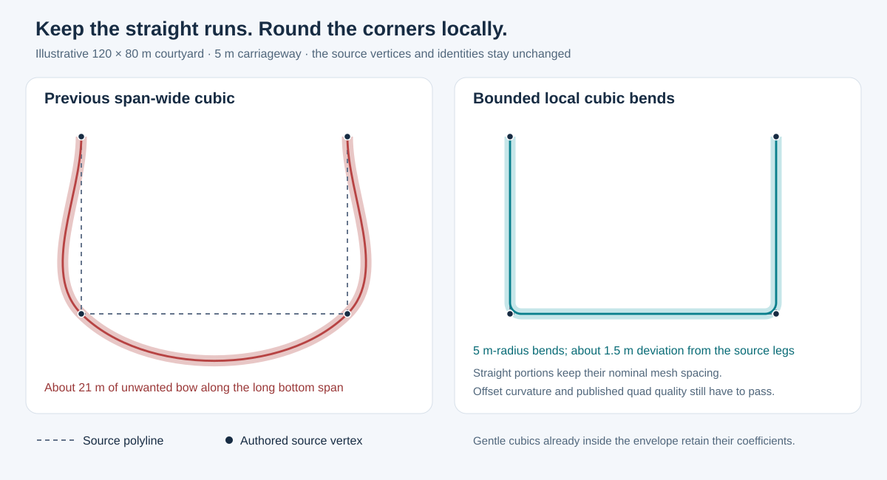

# Local smoothing of sparse street centerlines

Implemented on `buildings_gn` in `C:/dev/workspace/blosm`, runtime
`0.1.0.dev75`. This extends the qualified dev72 Python backend; its previous
saved scenes and qualification records remain historical references.

## Shared corner across Section seams (dev75)

The second courtyard screenshot exposed a remaining defect in dev74. Each of
the three two-control Sections still passed through its shared sharp corner.
Matching only their endpoint directions required a reverse bend on each side:
the centerline left its source straight, bulged out, then returned to the corner.
A small deviation bound limited the size of that bulge without fixing its shape.

Sparse Smooth continuations now receive **one rounded centerline bend across
the explicit seam**, divided between the two original Sections. The generated
seam is at the middle of the bend, rather than at the sharp source vertex.
Source vertices, Section/Street IDs and incidences remain unchanged. This is
the same geometric interpretation used for an interior rounded control vertex.
The user can still move the source vertex and press Update.

The decision is symmetric and source-based. With adjacent segment lengths
$L_0,L_1$ and signed turn $\theta$, the endpoint-handle bow estimate is

$$
b=\frac{4}{27}\max(L_0,L_1)\sin\frac{|\theta|}{2}.
$$

When $b$ exceeds the alignment envelope, both sides use the same local bend.
This repair currently applies to two-ended Smooth continuations of complete
profiles outside Bundles. Dimensional transitions retain responsibility for
their width and profile joins; a small width edit preserves the shared rounded
centerline. Exact, mixed Exact/Smooth and Bundle constructions keep their
existing policies. Gentle continuations remain unchanged.

Use the larger incoming pavement reach $r$ and the larger incoming full width
for the common envelope $e$. With $f=\tan(|\theta|/2)$, the common radius is

$$
R=\min\left(2r,\;\frac{0.99e}{1-\cos(|\theta|/2)},\;
\frac{0.4\min(L_0,L_1)}{f}\right),\qquad d=Rf.
$$

The radius must remain at least $1.5r$. Both paths reserve the same fixed
setback $d$; neither can shrink its half independently. Interior bends and any
other endpoint transition share the remaining finite-length budget. An
infeasible arrangement reports an error and retains the previously published
mesh.

The tangent points are $\mathbf A=\mathbf B-d\mathbf u$ and
$\mathbf C=\mathbf B+d\mathbf v$. Cubic arc controls are built as described
below. Turns up to 90 degrees use one cubic, split at its midpoint by exact
de Casteljau subdivision. Larger supported turns use two symmetric cubic
pieces. The resulting halves share the same position, tangent and physical
curvature at their seam. Straight portions remain straight, and the bend
turns consistently toward the outgoing source segment. This does not claim
curvature continuity between a straight run and the circular-style bend.

Both halves still pass the finite source-envelope proof and independent
continuous offset-curvature certificate. Their published surfaces retain the
existing profile, crown, slope, convex-quad, edge-ratio and overlap guards.
Dependency records include both source Sections, their explicit seam and any
Bundle membership affecting dispatch. Moving a neighboring control or changing
a width therefore invalidates the related geometry through the manual Update
workflow.

The new regression explicitly checks signed curvature, a single-Section versus
split-Section courtyard, mixed storage directions and source order, signed
30/60/90/120/150-degree bends, width edits, local/full mesh equality and retained
remote outputs. Matching endpoint directions alone is no longer the acceptance
criterion for this case.

## Problem and policy

The original interpolating cubic assigns a handle of one third of the entire
source chord at each end. On sparsely mapped corners this can bow a long
straight run by many metres. Increasing mesh resolution follows that same
unwanted curve more closely.

Smooth mode now has a source-deviation envelope. Its initial default is

$$
e_{\max}=\max(4\varepsilon,\;w_*),
$$

where $w_*$ is the Section's full carriageway width, enlarged to include the
other complete profile at an explicit two-Section width transition, and
$\varepsilon$ is the curve approximation tolerance. This is a centerline alignment envelope, not
the existing 5 mm mesh approximation tolerance. The width-based default is
currently a construction policy, rather than a new source attribute or UI
property. A half-width envelope was tried first but excluded previously
accepted sharp profile seams. The complete-transition-width default retains those cases;
it does not relax the independent physical slope, crown or quad-quality limits.

An existing interpolating cubic that is certified inside this envelope keeps
its exact coefficients. Otherwise, the Section uses local tangent cubic
transitions and straight source runs. This also covers long two-control
Sections with endpoint tangents supplied by neighboring Sections; the shared
endpoint directions remain exact. Already bounded gentle curves keep their
previous construction.

For the localized construction, a corner vertex defines the turn, but the
rounded centerline generally cuts across it. Source vertices, Section IDs,
Street IDs and incidence records are unchanged. Exact polyline mode keeps its
existing vertex-interpolating construction.

## Local cubic construction

Let incoming and outgoing unit directions be $\mathbf u,\mathbf v$, and let
$\theta\in(-\pi,\pi)$ be their signed turn. A radius $R$ gives equal tangent
setbacks

$$
d=R\tan\frac{|\theta|}{2},\qquad
\mathbf A=\mathbf B-d\mathbf u,\qquad
\mathbf C=\mathbf B+d\mathbf v.
$$

The initial preferred radius is $2r$, where
$r=|\mathrm{offset}|+w/2$ is the full pavement reach. Its minimum is $1.5r$;
the existing independent continuous offset-curvature certificate must still
pass. Adjacent bends share at most 90% of their finite source segment length.
Only radius allowance above the minimum can be reduced to fit this budget.
There is no silent return to an excessively bowed curve or unsafe radius.

Each arc-sized turn is represented by cubic Bézier pieces spanning at most
90 degrees. For a piece with turn $\phi$, its tangent handle length is

$$
h=\frac{4R}{3}\tan\frac{|\phi|}{4}.
$$

The four controls are

$$
(\mathbf P_0,\;\mathbf P_0+h\mathbf t_0,\;
\mathbf P_3-h\mathbf t_1,\;\mathbf P_3).
$$

These are cubic approximations, not exact circular arcs. Their actual
curvature and their distance from the finite source legs are certified.
Straight pieces connect the local bend neighborhoods. A cubic's parameter
span is $3h$, giving unit endpoint parameter derivatives that match adjoining
straight pieces. Physical station remains the integrated metric arc length.
The internal evaluation knots are derived data, rather than source vertex IDs.

Prescribed seam endpoint directions are retained using finite endpoint cubic
transitions when necessary. Tiny differences between almost collinear source
directions receive a short transition instead of consuming a road-width-sized
length near the junction.

### Local mesh sampling

For each nominal row interval, collect the largest certified curvature $k$ of
every polynomial piece it intersects. At pavement reach $r$, the offset-curve
curvature is bounded by $k/(1-rk)$ and its physical speed relative to centerline
station by $1+rk$. The retained centerline-station step is therefore at most

$$
\Delta s\leq\frac{1}{1+rk}\min\left(
\sqrt{\frac{8\varepsilon(1-rk)}{k}},\;
\frac{\pi(1-rk)}{2k}\right).
$$

Zero-curvature intervals retain nominal spacing. Each nominal interval is
subdivided as a whole, rather than adding isolated samples at every tangent
point. This avoids arbitrarily short leftover rows beside line/curve joins.
The existing transverse profile partition and direct-quad construction remain.

## Independent guards

- A bounded de Casteljau subdivision proves that Bézier hulls stay within the
  deviation envelope of their finite source segment. A local turn uses its
  two adjoining finite segments.
- The existing Bernstein velocity/acceleration certificate bounds curvature
  continuously and requires $r\kappa<0.98$.
- For derived local pieces, the positive-speed threshold scales with their
  parameter span. A safe microscopic turn is not rejected merely because its
  unnormalized polynomial derivative is small.
- Localized paths refine nominal mesh-row intervals only where they intersect
  a curved polynomial piece. Each interval uses the largest certified bound
  of all pieces it meets. The existing retained-curvature option additionally
  excludes peaks hidden under an intersection or seam. Long straight runs retain nominal spacing; tiny
  leftover cells are avoided by subdividing whole nominal intervals.
- Existing sampling accuracy, convex direct-quad, edge-ratio, inter-part
  overlap, profile, elevation and transactional publication checks remain.
- Near reversals, insufficient finite length and infeasible envelopes produce
  diagnostics. An unsuccessful Update retains the previous successful mesh.
- There is no OSM filename or fixture-ID dispatch in the runtime.

## Checks and inspection

The permanent tests are in
[test_python_street_local_smoothing.py](../tests/test_python_street_local_smoothing.py).
They cover a sparse courtyard, actual short/long source configurations,
rotation and reversal, tangent continuity, metric station inversion, finite
offset safety, Exact mode, local/full Update equality, furniture dependencies,
unchanged remote output and restoration.

Development receipts and newly generated Blender scenes are kept outside the
addon repository in
`C:/dev/workspace/streets_dev/experiments/streets/python_local_smoothing` and
`C:/dev/workspace/tmp/streets_python_local_smoothing`.

### Current dev75 inspection files and results

Reviewed 27 October 2026 on `buildings_gn`, runtime `0.1.0.dev75`:

- [Focused inspection scene](../../streets_dev/experiments/streets/python_shared_rounds/shared_rounds_inspection.blend):
  the complete Berlin network, with `Street 595` selected and the viewport
  centered on the repaired lower-right courtyard corner.
- [Actual generated corner](../../streets_dev/experiments/streets/python_shared_rounds/corner_after.png)
  and [complete courtyard view](../../streets_dev/experiments/streets/python_shared_rounds/courtyard_after.png).
  These views use the actual saved float32 mesh buffers, without regenerating
  or fitting a substitute surface for the drawing. The close-up was visually
  inspected after the repair.
- Street 595's two turns use 2 m centerline radii. The three original source
  Sections remain 337, 359 and 431. Their previously negative signed curvature
  at these positive turns is removed; the old endpoint bulges reached about
  $-0.167\,\mathrm{m}^{-1}$. Both generated seam points move inside their
  corresponding source corner, and both Section halves join exactly.
- [Normal-pipeline import](../../streets_dev/experiments/streets/python_shared_rounds/berlin/python_street_import.blend):
  complete Berlin network, 361,698 quads, 59.29 seconds of generation plus
  0.47 seconds of OSM preparation. Fresh Nashville and Canal Street imports
  remain complete, with 262,509 and 21,818 quads respectively. These are single
  one-thread measurements, rather than a controlled performance comparison.
- All three [saved-mesh checks](../../streets_dev/experiments/streets/python_shared_rounds/qualification.json)
  pass the actual float32 convex-quad, ratio, overlap and crown-envelope guards.
- [Native editing/restoration](../../streets_dev/experiments/streets/python_shared_rounds/berlin_edit/native_checks.json):
  actual Edit Mode vertex movement, width changes, manual Update and exact
  restoration pass, with 320 unrelated mesh objects retained. The width edit
  keeps the shared rounded centerline and uses the dimensional transition.
- [Current combined gallery](../../streets_dev/experiments/streets/python_shared_rounds/gallery/python_streets_gallery.blend):
  all 112 fixtures match the qualified dev72 source, mesh and furniture records
  exactly; 726,698 direct quads. The independently loaded saved gallery passes
  quality checks. No GN modifiers are used.
- [Focused regression](../../streets_dev/experiments/streets/python_shared_rounds/regression_final/checks.json):
  89 tests pass, including all 13 local/shared-bend tests, the affected profile
  seams, route, source-support, editing and Bundle checks. The
  [source-curve audit](../../streets_dev/experiments/streets/python_shared_rounds/curve_audit.json)
  records the changed real-network paths. This increment does not claim a new complete
  suite or installed ZIP qualification; the historical dev72 ZIP is unchanged.

Native workers use a 0.75 GiB memory cap and retain the 1 GiB system reserve;
numerical checks use 0.25 GiB. Rendering the complete loaded network exceeded
the first renderer's private-memory cap. The successful inspection setup and
render run separately, with only the three copied actual road buffers loaded
for rendering. The full editable network remains in the inspection `.blend`.
The terminated render attempt and successful resource receipts are retained.

### Previous dev74 inspection files and results

Reviewed 26 October 2026 on `buildings_gn`, runtime `0.1.0.dev74`:

- [Karl-Marx-Allee](../../streets_dev/experiments/streets/python_local_smoothing/berlin_dev74/python_street_import.blend):
  complete two-component import, 364,683 quads, 61.77 seconds of generation
  plus 0.46 seconds of OSM preparation, one numerical thread. These are single
  measurements, not a controlled performance comparison.
- In this inspection scene, the courtyard shown in the reported screenshot is **Street 595**, comprising
  Sections **337, 359 and 431**. Its middle Section's sampled centerline
  deviation drops from 21.12 m to 0.87 m; the outer Sections drop from 8.23 /
  8.64 m to about 0.87 m. The three source polylines and all their IDs remain.
- [Street 595 editing/restoration scene](../../streets_dev/experiments/streets/python_local_smoothing/berlin_edit_final_02/local_smoothing_editable.blend):
  actual Edit Mode movement of both coincident endpoint copies, the Update
  operator, Section width editing, exact restoration and 320 retained remote
  mesh objects pass. Select `Street 595` and frame the selection for inspection.
- [Complete 112-fixture gallery](../../streets_dev/experiments/streets/python_local_smoothing/gallery_dev74/python_streets_gallery.blend):
  all source/mesh/furniture records match the qualified dev72 reference exactly;
  726,698 direct quads, nonoverlapping fixture layout and no GN modifiers.
- Fresh normal-pipeline imports and actual saved-mesh quality checks also pass
  for Canal Street and Nashville. No OSM filename chooses a runtime branch.
- The final [73-test regression](../../streets_dev/experiments/streets/python_local_smoothing/regression_final/checks.json)
  passes the new ten smoothing tests and the affected core, junction, mixed,
  height-correction, Smooth seam, source-support and editing groups. It includes
  all groups that failed during the initial wider experiment.
- The [final native checks](../../streets_dev/experiments/streets/python_local_smoothing/qualification_dev74_final.json)
  reconcile all three real imports, their quality checks, the two native
  courtyard editing checks, gallery generation and gallery quality.

An early 991-test full run used the stricter preliminary policy and exposed
compatibility failures and obsolete diagnostic/curvature assumptions. Those
records and the superseded verifier attempts are retained. The current result
is the passing focused regression plus native qualification and exact gallery
comparison; it is not a claim of a new uninterrupted full-suite or installed-ZIP
qualification. The qualified dev72 ZIP remains unchanged.

Restart Blender or reload the addon after changing runtime code. Re-import
the OSM extract to inspect the new construction, or press Update in an existing
Python network after loading the new runtime. A runtime-version change rebuilds
saved outputs. The older dev72 ZIP and gallery do not contain this change.
