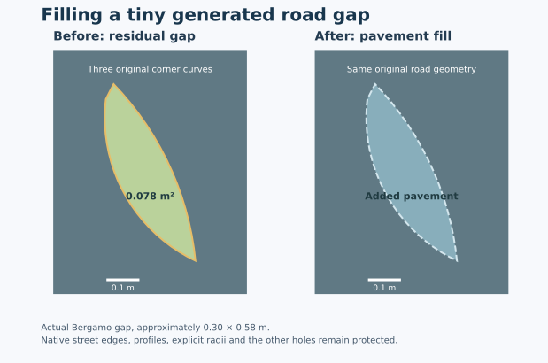

# Tiny residual gaps between overlapping road corners

The user approved filling tiny residual holes with pavement on 17 November
2026. A real Bergamo example leaves a 0.07806 m² gap only approximately
0.30 × 0.58 m across. Keeping that gap while constructing a smooth convex
boundary with the existing 0.5 m minimum auxiliary radius is incompatible.
Filling this generated gap preserves the existing original corner radii.

The lighter fill and dashed old outline illustrate the construction. The final
surface uses the normal carriageway material.

## Scope

`way/street_network/python_backend/residual_road_gaps.py` adds a typed
`ResidualRoadGapFill` physical area. The source-cycle pipeline invokes it after
native-bank/parent-chain preparation and before retained-circle reconciliation.
It adds pavement in the exact old gap polygon; it does not alter the original
road area operands. Every surviving loop, span and source point remains the
same object. The usual later source sampling and mesh construction still run.

Only complete convex clockwise inner loops bounded entirely by validated
original `cycle_corner` circular curb pieces can qualify. The branch refuses:

- Native `cycle_strip` or `cycle_port` banks, incoming mouths or other labels.
- Generated fillets, unidentified parent curves or changed native authority.
- Explicit `STRICT` corners, half-profile inner plateaus and any participating
  Bundle member or interior Section, including displaced source-walk prefixes.
- Mixed curvature directions, nonconvex loops or noncircular boundary pieces.
- Gaps that fail the analytical size bounds below, or exceed finite work limits.

The policy therefore does not remove small separators merely because they are
small. A real native-bank or Bundle boundary remains protected by its source
ancestry. An ordinary gap that does not qualify follows the existing path and
must satisfy all existing construction gates.

## Analytical size certificate

Let the qualifying original parent disks have centres `Cⱼ` and radii `rⱼ`.
The complete convex curved hole is inside their common intersection. For a
unit direction `n`, that intersection is contained in the interval

$$
L(n)=\max_j(C_j\cdot n-r_j),\qquad
U(n)=\min_j(C_j\cdot n+r_j).
$$

Thus `W(n) = U(n) − L(n)` is a conservative width upper bound for the
**analytical** curved hole, not just its chord approximation. For every original
polygon edge direction, the implementation also evaluates its perpendicular.
One pair must satisfy, with `Rₘᵢₙ = 0.5 m` from the existing radius policy:

$$
0<W(n),\quad 0<W(n^\perp),\qquad
\min\{W(n),W(n^\perp)\}<2R_{\min},
$$

$$
W(n)W(n^\perp)<\pi R_{\min}^{2}.
$$

The sampled hole area must also be below `πRₘᵢₙ²`. All sampled vertices must
lie inside all declared disks within the existing `10⁻⁸ m` circular tolerance.
The original source-circle parameter maps must certify clockwise traversal
inside their actual finite circular intervals.

For this convex, same-sign circular family, a smooth closed boundary whose
curvature radius is everywhere at least `Rₘᵢₙ` has width at least `2Rₘᵢₙ`.
The certificate identifies small gaps incompatible with that existing
rounding constraint. It does not claim that no other curve family could fit.
There is no additional radius reduction or guessed island-size setting.

## Construction and guards

Each accepted exact old hole polygon becomes a CCW physical source operand.
Its perimeter is labelled internal. Adding that complete polygon to the old
physical area removes exactly its inner boundary component. Production keeps
all other boundary components by identity, avoiding a numerical redistribution
of unrelated source contacts. Independent tests re-union all old operands plus
the additions and compare the resulting topology and areas.

The finite limits are 512 vertices per candidate hole, 16 accepted holes per
group and the unchanged 20,000 total source-segment allowance. Invalid work
requests and exceeded accepted-fill budgets fail explicitly. Native claims,
mouths, complete source-width checks, round corners, actual height/profile
conditions, quad grading, UVs and publication slope/drainage checks remain
required. The final prepared-owner guard checks the new typed areas against
other physical owners and publishes its proof only after passing.

`SOURCE_RESIDUAL_GAP_POLICY` participates in PLAN, projected layout/surface and
transition signatures. A local construction signature records the exact removed
loop geometry; global neighbor-exclusion counters do not change that signature.
Product metadata exposes `residual_road_gap_reconciliation`, including removed
gap area, analytical bounds, original parents and final neighbor status.

## Verification

`tests/test_python_street_residual_road_gaps.py` regenerates a three-corner
fixture entirely from source Sections. Tests cover independent physical union,
unchanged surviving boundaries/source controls, rotated/reversed storage,
protected large holes, explicit radii, native banks, Bundle membership, inner
plateaus and finite work requests. No artifact pickle is required for these
tests. The ownership tests separately cover update/dependency invalidation.

The saved real Bergamo geometry passes the independent union and fresh complete
2 mm source-width certificate: exactly one 0.07806 m² gap disappears, while the
other three holes, original outer loop and all incoming profiles remain
identical. This is local physical-preparation evidence; normal mesh tasks and
whole-city native/progressive acceptance are tracked in
[the import qualification report](STREETS_BEIJING_BERGAMO_FIXES.md).
