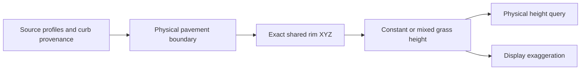

# Source curb heights and enclosed grass surfaces

The physical boundary of a street surface carries both height and inward
crossfall information. Closing a boundary loop does not determine its height.
An ordinary road block can have zero-height curbs, while a dual carriageway can
have a raised median and caps that reconcile different source profiles.

The source-provenance boundary rules are currently opt-in and under
qualification. The shared grass surface/query implementation is in place. A
correct pavement boundary is a prerequisite: transferring its heights faithfully
does not establish that the upstream source conditions are correct.

## Boundary information

The original incoming full profile and tangent plane remain authoritative.
Exposed source strip sides, actual source parameter domains and original corner
provenance supply the other curb conditions. A composite corner created by
clipping several original corners must reconcile between surviving source
anchors; a hidden consumed profile cannot impose a phantom seam.

[`source_curb_conditions.py`](../way/street_network/python_backend/source_curb_conditions.py)
resolves explicit source descriptors and normalized-carrier span ledgers.
[`BoundaryConditions.build`](../way/street_network/python_backend/conditions.py)
accepts an explicit numerical context for this path. Missing provenance or an
incompatible boundary remains an explicit failure. Original curve geometry,
source IDs and profile objects are retained.

The opt-in rules still have unresolved derived-join and source-body cases. The
[current qualification report](STREETS_BEIJING_BERGAMO_FIXES.md) records those
separately from planar mesh, slope, drainage and incoming-profile checks.
The separate [source-body guide API](STREETS_SOURCE_BODY_HEIGHTS.md) now prepares
bounded original-profile seeds and existing affine rows for accepted charts;
the surface and Product constructors expose an explicit opt-in path. Ordinary
runtime ownership Tasks retain the unchanged disabled default.

## Grass heights from the shared pavement rim

[`hole_surfaces.build`](../way/street_network/python_backend/hole_surfaces.py)
receives the already constructed physical pavement mesh. It takes the exact
shared rim coordinates and heights, reversing the hole's orientation for the
grass disk. It rejects mismatched boundary order, omitted boundary vertices,
nonmanifold charts, invalid elevations and exhausted cell budgets.

When all rim heights equal $h$, the entire grass surface keeps that height.
Thus a zero-curb block stays at zero and a genuine 0.08 m plateau stays at
0.08 m. The implementation does not create a crown mound inside a zero-curb
block. XY, quads, shared boundary vertices, material and authored UVs stay fixed.
Constant queries store the scalar height without duplicating a quad index.

A varying rim uses the existing bounded
[`plateau_extension`](../way/street_network/python_backend/profiles.py), followed
by the established
[`fixed_grass_heights.reconcile`](../way/street_network/python_backend/fixed_grass_heights.py).
The extension's upper target is the actual highest rim height. Let $d$ be the
common physical datum, $H$ the highest rim height, and

$$
S(t)=6t^5-15t^4+10t^3.
$$

For boundary samples $(x_i,h_i)$, the extension finds normalized values $v_i$
such that

$$
S(v_i)=\frac{h_i-d}{H-d}.
$$

It derives a sufficient Euclidean Lipschitz rate $L$ from those samples and uses
the upper distance extension

$$
v(x)=\min\left(1,\min_i\left[v_i+L\lVert x-x_i\rVert\right]\right),
\qquad z(x)=d+(H-d)S(v(x)).
$$

The exact original rim Z values are restored before reconciliation. The existing
solver holds that rim, XY and quads fixed; it retains the ten-percent grass
slope limit, drainage checks, stored-coordinate quality limit and bounded work
and memory. A boundary that cannot meet those constraints is rejected.

## Physical queries and display exaggeration

Prepared original strip and port curves also retain an explicit
[source-parameter ledger](STREETS_SOURCE_CURB_PARAMETERS.md). It preserves the
original Section, bank orientation and station/offset coordinates through real
Route seams without adding mesh vertices. This is the ancestry needed for
interpreting non-unit Exact frames and finite junction transitions; storing
the ledger alone does not make a sharp Exact boundary a smooth height jet or
enable the source-curb policy globally.

`CompoundProduct` stores one physical query per hole. A query inside grass uses
that actual field; a missing field raises an error rather than returning the
intersection's crown ceiling. Constant fields need no geometry copy. Mixed
fields use the existing bounded bilinear quad query and keep their data after
the published mesh buffers are released.

Display exaggeration is applied once around the common datum:

$$
z_{\mathrm{display}}=d+E(z_{\mathrm{physical}}-d).
$$

This includes $E=0$: the original physical field remains available even though
the displayed relief disappears. Stored-coordinate checks use the same display
convention. A dedicated hole-height policy token participates in the projected
surface fingerprint so an older query product cannot be silently reused.

## Verification and remaining gates

Maintained tests are self-contained source fixtures:

- [Hole surface and query tests](../tests/test_python_street_hole_surfaces.py)
  cover zero blocks, true plateaus, mixed boundaries, exact shared rims, physical
  and stored limits, UV/topology preservation, cell-budget errors, cache epochs,
  and zero/tenfold exaggeration. A complete source-cycle Product checks the
  zero-height hole and its query after mesh release.
- [Height and query regressions](../tests/test_python_street_height_projection.py)
  retain the established physical projection, drainage and attachment-query
  requirements.
- [Source curb-condition tests](../tests/test_python_street_source_curb_conditions.py)
  verify source sides, domain mappings, incoming-profile preservation, source
  provenance and composite corner rules.

Actual-city qualification additionally requires source-labelled boundary
heights/jets, appropriate body-profile behavior, complete ground coverage,
stored mesh/seam/UV checks and progressive publication/cancellation checks.
Development captures and reports remain under `artifacts/streets`; they are
evidence rather than implementation or recovery dependencies.
