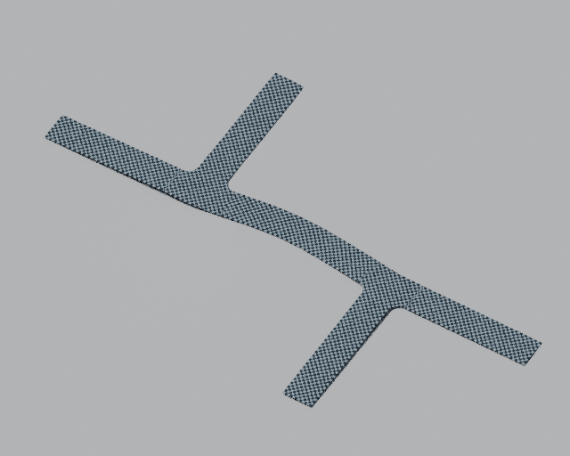

# Python street UV mapping

For the production PBR and diffuse-only asphalt library, see
[street asphalt materials](STREETS_ASPHALT.md).

The Python street backend generates `UVMap` on every published surface mesh.
UVs are stored on **face corners**, so adjacent charts may use different UVs
at a shared geometric vertex without splitting the pavement geometry.
The mesh positions and quad connectivity are unchanged by UV generation.



Actual Cycles CPU preview of the inspection scene. Each checker square is
0.5 m; the complete repeated image is 1 m. Chart boundaries remain visible in
this diagnostic material so their changes of direction and phase can be assessed.

## Coordinate convention

UV coordinates use **physical metres**, independent of Blender scene units,
fixture placement, height exaggeration and pavement mesh resolution. They are
not normalized to a Section's length or width. Texture repetition belongs to
the material: for example, divide both coordinates by four for a 4 m tile.

- **Carriageway strips:** U is longitudinal station from the authored Section
  start. V is signed transverse distance from the source path, including the
  Section's lateral offset. Each strip's row coordinates follow its prepared
  path, including curved and trimmed approaches.
- **Junctions, transitions, Bundle unions and other surfaces:** the initial
  fallback is controller-local physical XY. This gives simple, predictable
  mapping for isotropic asphalt and preserves a shared scale across the
  component's patches. A Bundle member that remains a normal road strip uses
  the strip strategy; merged pavement uses the planar fallback.

Chart seams at Section boundaries and between a road strip and its junction
are deliberate. A single global road-direction unwrap, coordinated asphalt
phase across all Sections, and a distortion-minimizing junction atlas are not
part of this initial implementation. Curved strip charts preserve their
centreline station scale; inside and outside bend edges necessarily have
different physical lengths. Terrain placement retains the prepared chart;
steep or rough terrain can consequently stretch its projected texture.

Crossing footprints and future marking coordinates remain independent of
asphalt UVs. A pedestrian or cycle crossing should retain its own logical
placement and can have a crossing-local texture chart.

## Extension points

The numerical payload is `Mesh.uv_layers`, a dictionary of named arrays with
shape `(face_count, 4, 2)`. The dictionary supports additional UV sets without
changing mesh connectivity or adding object-level modifier inputs. UV arrays
must be finite and match the quad count.

The pure-NumPy strategies in
[uv.py](../way/street_network/python_backend/uv.py) separate coordinate
calculation from publication:

- `PlanarMapping` supplies a physical origin and rotation.
- `RoadMapping` consumes longitudinal and transverse coordinates.
- `apply_mapping` adds a named UV layer while preserving existing layers by
  default. A feature provider may supply its own chart before the common
  fallback runs.

`publication_uv_coordinates` checks the float32 representation Blender stores;
even finite numerical coordinates are rejected if their conversion overflows.
UV buffers are counted in `Mesh.nbytes` and released with published geometry.

Blender publication bulk-writes each UV set onto mesh face corners. Terrain
placement, transient mesh recovery and Update retain the supplied UV sets.
Material libraries use the stable name `UVMap`; alternative UV sets may be
selected explicitly with a material's UV Map node. Standard UVs are embedded
in the generated mesh and require no UV modifier or Python execution merely
to render or export a saved result.

UVs regenerate with the existing **Update** button. Changes to source
positions or width update the appropriate charts. Unchanged outputs retain
their object identity. No new edit handlers or viewport polling are added.

## Inspect and reproduce

The [inspection scene](../../artifacts/streets/uv_mapping/street_uv_mapping.blend)
contains a bent street between two junctions, a straight offset road, the six
existing intersection families, a curved Bundle and a dimensional transition.
Its packed checker image repeats as a 1 m tile with 0.5 m squares. Enable **Material Preview**
and inspect `UVMap` in the UV Editor. The checker is an inspection material,
not a new production asphalt material or a change to the street material
library. Existing materials remain compatible.

From the Blosm source directory, run:

```powershell
& 'C:\Program Files\Blender Foundation\Blender 5.2\blender.exe' `
  --background --factory-startup --python-exit-code 1 `
  --python tests/check_street_uv.py -- `
  --output C:/dev/workspace/artifacts/streets/uv_mapping --render
```

The direct-projection check requires the installed, reproducible
`assets/prochitecture_street_terrain.blend` library. Its generation command is
documented in the [terrain implementation guide](STREETS_TERRAIN.md).
Use the existing bounded Blender runner for memory-constrained validation;
keep all worker logs and generated scenes under `artifacts/streets`.

The native check exercises every published UV layer, physical coordinate
scale, nonzero road offset, no-op and cold Updates, source and width edits,
forced rebuild equivalence, restoration, height exaggeration, changed mesh
resolution, named UV layers and shared-vertex chart seams, both terrain
modes, terrain hydration, clearing the target, scene units, controller
transforms, saving and reopening. Its generated `checks.json` records the
actual successful run and is not a source dependency.

The optional preview uses **Cycles CPU**, 12 samples at 1000 × 800 pixels;
it does not require Workbench/Eevee GPU rendering in a headless process.
File-preview thumbnails are disabled in these test workers. To render an
already-generated gallery without repeating its lifecycle checks, run:

```powershell
& 'C:\Program Files\Blender Foundation\Blender 5.2\blender.exe' `
  --background --factory-startup --python-exit-code 1 `
  --python tests/render_street_uv.py -- `
  --scene C:/dev/workspace/artifacts/streets/uv_mapping/street_uv_mapping.blend `
  --output C:/dev/workspace/artifacts/streets/uv_mapping
```

The render-only worker reads the saved mesh and packed checker image. It does
not regenerate streets, register the addon or overwrite the qualified scene.

For a smaller preview, append `--samples 4 --width 640`. A bounded worker can
also use `--working-set-mib 128 --memory-gib 1 --reserve-mib 1024` to constrain
physical memory while keeping the 1 GiB system reserve. Such runs can page and
are validation evidence, not performance benchmarks.

## Verified scope, 5 November 2026

- Nine numerical UV tests, 16 existing geometry-core tests and eight existing
  terrain tests pass.
- [Geometry identity check](../tests/check_street_uv_geometry.py) compares this
  implementation with Git revision `e67035c`: all 22 fixtures, 78 meshes and
  101,608 quads retain exactly equal positions, connectivity and material roles.
  It also verifies that all candidate meshes carry `UVMap`. Reproduce with
  `python tests/check_street_uv_geometry.py --reference e67035c`; generated
  reference sources and reports remain under `artifacts/streets/uv_mapping`.
- The native ten-fixture gallery passes edits, no-op and cold recovery,
  width/resolution/exaggeration changes, both terrain modes, clearing terrain,
  physical scene units, named corner maps, saving and reopening. An additional
  discontinuous `FeaturePreview` UV map survives terrain placement, evaluated
  GN output, cache recovery, clearing terrain and scene reopening.
- The illustrated preview was rendered separately on the CPU at 640 × 512
  pixels with four samples, from the qualified saved scene.
- A normal Karl-Marx-Allee OSM import with profile-preserving placement on
  synthetic rolling terrain passes: 2/2 networks, all 328 surface meshes,
  361,698 quads, and no failed components. The UV check validates physical
  station/transverse or planar coordinates on every published face corner.
  [Imported scene](../../artifacts/streets/uv_mapping/berlin_profile/python_street_import.blend).
  This is an OSM integration example, not a dependence on this particular file
  and not a claim to use measured Berlin terrain.

Reproduce the real-network check with background Blender and
`--python tests/check_street_uv_import.py -- --osm <input.osm> --output <artifact-directory> --terrain-mode PROFILE`.
The input/output arguments are identical to the existing street import check.
The passing bounded run is `artifacts/streets/uv_mapping/berlin_run_05`;
its maximum sampled private allocation is recorded in `resources.json`.

The first optional headless Workbench preview crashed inside Blender; the
inspection renderer now uses Cycles CPU. Memory-guard interruptions are not
accepted as passing tests. Raw evidence for the final passing native run is
`artifacts/streets/uv_mapping/native_run_04` (128 MiB working set, 1 GiB
allocation cap, 768 MiB system reserve), and the preview evidence is in
`render_run_02`. The complete historical street test suite has not been rerun
for this addition.
