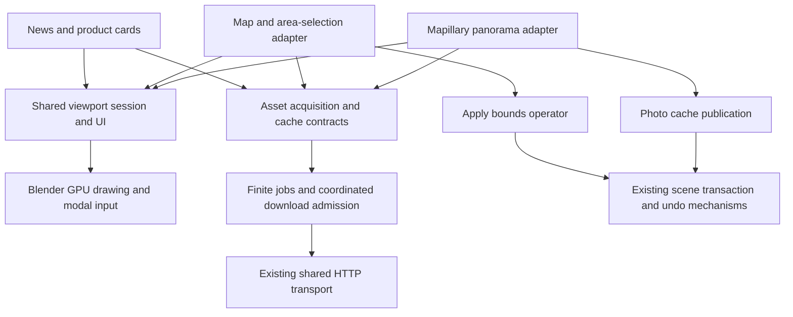

# Shared Blosm viewport framework proposal

Status: foundation and basic panorama viewer implemented, 13 November 2026.
See the [version 1 API and handoff](../viewport/README.md) for actual signatures,
supported behavior and limits. This document remains the broader design: map
selection, feeds, coordinated service admission and smooth transitions are future
work. In particular, transitions are explicitly excluded from the current task.

This document is the design and handoff reference for two work streams:

1. This Mapillary chat implements the shared foundation and panorama viewer.
2. A separate chat implements map-based area selection, and subsequently product
   news, advertisements and additional viewport controls using that foundation.

The inspected baseline is development branch `mapillary_import_release` at
`c2b9d375594b7c75aa1928041128524efdd2b5dc`, in
`C:/dev/workspace/mapillary_dev/blosm`. Its designated reference, local `release`,
was checked at `e5fe4ac8b0e3a66e56ac9019dd90f99a8b434702`; no reference commits
were missing. These identifiers record the inspection baseline, not a delivered
framework commit. The main checkout was not modified for this proposal.

## 1. Intended experience and scope

Blosm should be able to open an interactive surface inside a chosen 3D Viewport.
The surface can cover the viewport or combine a central canvas with toolbars,
status messages and side cards. It should resize with the editor and respect
Blender's UI scale. It is a native Blender interface with a webpage-like layout.
An embedded browser, HTML/CSS engine and JavaScript runtime are outside this plan.

Two requirements apply to the framework itself: it must accommodate future use
cases that are not yet known, and displayed content must adapt to changes in the
3D Viewport's usable size. The initial features are consumers of these
capabilities, not an exhaustive list built into the host.

The first uses are:

| Feature | Main canvas | Supporting interface |
| --- | --- | --- |
| Mapillary panorama | Perspective view into a spherical photograph, aligned with the scene | Opacity, loading state, attribution, close button; capture navigation later |
| Photo navigation | Smooth changes between panoramas or between ordinary photos in camera view | Shared transition timing, ready-before-motion loading and interruption behavior |
| Area selection | Pannable, zoomable geographic map with a selection rectangle | Coordinates, area information, Apply/Cancel, optional side cards |
| Product/news content | Image and text cards alongside another canvas | Links, dismiss controls, scrolling and refresh state |
| Future tools | A feature-specific 2D or scene-aligned surface | The same buttons, sliders, labels and lifecycle |

The existing [extent webpage](https://prochitecture.com/blender-osm/extent/)
offers map navigation, rectangle selection and coordinate copying. The Blender
version can apply the resulting coordinates directly to the existing Blosm
settings. It need not reproduce the page's implementation or every browser UI
capability.

The framework must provide consistent drawing, input and resource ownership.
Map projection, panorama optics, provider authentication, news content and scene
imports remain feature responsibilities. It must remain useful without an
internet connection when the required content is already cached.

Initial exclusions are a general GUI toolkit, arbitrary text editing, rich HTML,
video, scene geometry created solely for display, final-render compositing,
simultaneous interactive sessions in multiple viewports, and unrestricted camera
translation through a single panorama. Additional capabilities require concrete
use cases and tests. These are initial delivery exclusions, not permanent
restrictions on future adapters or renderers.

## 2. What already exists and what to reuse

| Existing implementation | Reuse and boundary |
| --- | --- |
| [Progressive core](../progressive/core.py) and [documentation](../progressive/README.md) | `Job`, `Request`, `Download`, `Drain`, cooperative checkpoints and bounded processing for finite loading tasks |
| [Blender import controller](../progressive/blender.py) | Existing scene-writing imports, pause rules, cancellation, grouped undo and aggregate results |
| [Shared HTTP transport](../downloads/transport.py) and [documentation](../downloads/README.md) | Helper process, request limits, retries, deadlines, origin cooldowns, online-access checks and redacted diagnostics |
| [Mapillary photo adapter](../mapillary/photo.py) and [image validation](../mapillary/photo_data.py) | Image identity, token handling, metadata retrieval, bounded photo validation, embedded EXIF normalization and packed-image reuse |
| [Mapillary pose conversion](../mapillary/pose.py) | Geographic orientation and pose provenance; no second independent interpretation of capture rotation in the UI |
| [Blosm application](../app/blender.py) and [geographic projection](../util/transverse_mercator.py) | Scene origin and geographic/scene conversions, including the application's optional projection implementation |
| [Existing GUI](../gui/__init__.py) | Geographic bounds properties and explicit Blender operators for committed changes |

There are four important constraints in this baseline:

* The import controller supports one active Blosm import. Its lifecycle is tied
  to scene writes, Object Mode, scene/view-layer ownership and undo. An open map
  or panorama must not occupy that controller merely to remain visible.
* A `Job` owns its transport and closes it on completion or cancellation. Two
  jobs cannot safely share a raw `DownloadTransport` instance.
* Download limits and origin cooldowns are per transport/helper, not global.
  Starting a separate helper for every panel would multiply concurrency and
  memory limits.
* `show_photo()` is not a general image-display helper. It sets the scene camera,
  render dimensions, camera background and viewport state. The panorama viewer
  needs image acquisition separated from that flat-photo activation path.

The current photo pending queue is also module-global and does not retain an
exact viewport region. The new viewer must bind requests to their owning session
instead of inheriting that behavior.

## 3. Architecture and dependency direction

Separate three lifetimes: a long-lived viewport session, finite asset-loading
tasks, and explicit scene changes.



The viewport package must not import Mapillary, map-provider or advertising
modules. Adapters may import the viewport package and existing shared services.
The import controller remains independent of the drawing implementation.

Suggested locations, created only as needed:

```text
viewport/
    __init__.py       public entry points and registration
    session.py        owner validation, lifecycle, modal event routing
    draw.py           primitives, clipping, GPU state and texture wrappers
    ui.py             simple layout, hit testing, controls and focus
    assets.py         image references, request tickets and cache ownership
    transition.py     reusable animation clock/state and interpolation contracts
mapillary/
    panorama.py       panorama surface, controls and Blender integration
    panorama_math.py  pure directional/UV transformations and tests
    photo.py          existing acquisition/cache and flat-photo compatibility
map_view/             future map navigation, providers and selection adapter
viewport_content/     future product/news feed and card adapter
```

These are responsibility boundaries, not a requirement to create empty modules.
For example, layout and controls can initially remain in one small `ui.py`.
Provider-specific shader code belongs with its adapter even when it uses shared
drawing helpers. Do not build a generic shader/plugin system for the first two
features.

Any eventual global download-admission mechanism belongs with shared downloads
or task scheduling, not inside Mapillary or the viewport renderer.

The host must have no switch statement enumerating panorama, map and advertising
modes. A new caller supplies a surface through the same public entry point.
Feature-specific requirements are declared through optional capabilities or
implemented inside the adapter. Avoid forcing an unknown future tool to have
geographic coordinates, a camera, a network connection or an import transaction.

## 4. Proposed public contract

### 4.1 Session and surface

The initial public interface should be deliberately small:

```python
# Design sketch; see viewport/README.md for the implemented version 1 contract.
session = viewport.open(context, surface)
session.invalidate()                 # Request redraw; do not draw synchronously.
session.request_close(reason="USER")
```

`open()` must bind the invoking window, screen, area, active `SpaceView3D` and
`WINDOW` region. Invoking from its sidebar resolves the main region of that same
area. It must not silently fall back to the first unrelated viewport. If no
supported viewport exists, fail with a concise operator message.

The framework creates the modal operator and owns the draw handlers. A surface
implements this conceptual interface:

```python
class Surface:
    def attach(self, session): ...
    def layout(self, frame): ...
    def handle(self, event): ...       # EventResult
    def tick(self, budget_seconds): ...
    def draw(self, frame, painter): ...
    def detach(self, reason): ...
```

`attach()` initializes a finite amount of state or requests work. `layout()`
computes rectangles from current dimensions. `handle()` changes interaction
state or requests an explicit action. `tick()` advances bounded preparation.
`draw()` only draws prepared state. `detach()` releases adapter-owned resources.
The host calls `detach()` at most once; other close operations are idempotent.

Do not retain a general Blender `context` object in the surface. The session
supplies validated owner information when needed. A `Frame` contains the region
rectangle, content rectangle, UI scale, theme values and, when requested by a
scene-aligned adapter, copies of the current view/projection matrices.

### 4.2 Data crossing the boundary

| Type | Required meaning |
| --- | --- |
| `Rect` | Region-local logical UI coordinates, bottom-left origin, nonnegative width/height |
| `InputEvent` | Normalized type, press/release, modifiers, pointer position and scroll/drag delta in the same coordinate system as layout |
| `EventResult` | `HANDLED`, `PASS_THROUGH`, or a close/action request; pointer capture is explicit session state |
| `ImageRef` | Image/texture identity, dimensions, color/alpha description, ownership category and attribution; never credentials |
| `AssetTicket` | Session identity, content generation, content key and request state |
| `ViewSnapshot` | Owned viewport properties and an explicit exit policy; temporary display settings are separate from navigation state |

Use named fields and documented units instead of positional tuples between
features. Shared types must not contain provider URLs or Mapillary metadata
unless they are explicitly opaque adapter-owned payloads.

The contract should be labelled version 1 after the first implementation. The
handoff must publish its actual signatures and examples. The future map adapter
must depend on those public entry points, not the internal modal operator.

### 4.3 Composition and extension points

The host owns one root surface. That surface composes child canvases, controls
and panels through the shared UI containers. Child components have stable local
identities, their own state and declared layout constraints. The parent owns
their attach/detach lifecycle. Children do not register extra modal operators,
draw handlers or independent polling timers.

Containers define a consistent ordering: layout children within their allocated
rectangles, draw background-to-foreground, hit-test foreground-to-background,
and dispose children exactly once. Captured input remains with the owning child
until release or cancellation. The host manages focus and capture through public
component identities rather than knowledge of a particular slider or map tool.

The provider-free handoff example must demonstrate a canvas, toolbar and optional
side card, including a resize that collapses the card. The same composition can
later host an inspector, measurement tool or other content without teaching the
session manager about those features.

Keep these extension points explicit:

| Extension | Contract and isolation |
| --- | --- |
| New surface/canvas | Implement the public lifecycle/input/drawing interface; no host feature registration switch |
| New control/container | Reuse layout, clipping, focus and capture; custom draw/event logic stays in the component |
| New renderer | Receive an allocated rectangle, render context and declared matrices; obey GPU-state and resource ownership rules |
| New data provider | Produce normalized asset references and errors through a finite task; own URLs, credentials and interpretation |
| New action | Invoke an explicit callable/operator with declared persistent effects; keep scene transactions outside draw callbacks |
| Optional capability | Declare scene-view access, depth-aware rendering or other requirements; detect support and provide a clear unavailable state |
| Transition/animation | Supply endpoints, timing, interpolation and completion actions; reuse the host's clock/redraw lifecycle without creating a timer per animation |

Capabilities should be additive, with safe defaults and documented ownership.
Use optional hooks when a surface has no loading or ticking work; do not require
empty busy loops. An offline data inspector should not need a geographic model
or transport. A custom canvas should not need to be represented as an image.

Start with normal Python composition and typed interfaces. A dynamic plugin
loader, arbitrary service locator, layout language and runtime discovery system
are not prerequisites for extensibility. Add such mechanisms only when actual
consumers need them. Version the public contracts, document changes and retain
compatibility adapters when practical. Independent features must not reach into
private host fields to work around a missing extension point.

First-version policies such as one active interactive session are implementation
limits. Isolate them in the session registry; do not make them assumptions in
every surface. Later support for multiple sessions or other presentation modes
must preserve explicit owner identities and resource budgets.

## 5. Viewport ownership, lifecycle and exit behavior

For the first release, allow one interactive framework session across the addon.
Starting another surface explicitly replaces the previous one. Keep ownership
represented per viewport so multiple independent sessions can be added later
without changing feature APIs. Passive cards within the active session are layers
of that session, not additional modal operators.

The session lifecycle is `STARTING -> OPEN -> CLOSING -> CLOSED`. Loading is a
content state within `OPEN`, not a reason to block input or occupy an import slot.
Track `missing`, `queued`, `loading`, `ready` and `failed` independently for each
asset or bounded group of map tiles.

Every draw, input event and asynchronous publication validates the owning editor.
Blender draw handlers are registered for a space type, so the callback must filter
for the exact owner; otherwise the surface could appear in every 3D Viewport.
Use runtime identities and membership checks, not names. Handle invalid RNA
references after deletion/undo without dereferencing them again.

Close the session when:

* The user presses Esc or its visible close control.
* Another framework surface replaces it.
* Its window, area, active space or region disappears or changes editor type.
* Its owning window changes scene or view layer, or an unsupported view mode is
  entered. For the initial scene-aligned panorama, entering Edit Mode closes it.
* Undo, Redo, file loading or addon unregistration begins.
* An essential feature target disappears, such as the viewed camera.

Renaming a camera does not close its viewer. If its transform changes, the
panorama adapter must deliberately refresh its capture transform or close with
an explanation; it must not continue with a stale transform. Opening a normal
second Blender window should not move or duplicate the existing surface.

Shutdown order:

1. Mark closing; refuse new input, actions and asset publication.
2. Invalidate the content generation and release pointer/keyboard capture.
3. Detach loading subscriptions; cancel tasks owned exclusively by this session.
4. Remove timers and draw handlers, including cleanup after partial startup.
5. Release session GPU/cache references and call adapter cleanup.
6. Apply the surface's exit policy to the still-valid owner: restore temporary
   display settings, retain or restore navigation state as specified below, and
   redraw.

Do not restore an old scene, selection or active object over intervening user
edits. Prefer not to change those properties at all. Separate temporary display
settings from navigation state in the snapshot and exit policy. On normal
panorama exit, retain the final viewing orientation rather than restoring the
pre-entry orientation. Leave a normal perspective viewport at the resulting view
with its current eye position and FOV so navigation can continue without a jump;
do not re-enter an old camera view
that would override the retained orientation. Remove panorama controls and
overlays and restore only temporary display/input settings.

A failed startup can roll back its partial view changes before the user has
entered the viewer, only while the original owner is still valid and unchanged.
Lifecycle teardown for Undo/Redo, file loading, scene switching
or owner removal must not apply an old snapshot to the incoming or restored
context. Other future surfaces can opt into a different explicit navigation
exit policy. A map-only overlay need not change the 3D view underneath it.
Never recreate a removed area or camera during cleanup.

The first version can reject quad view and unsupported local-camera/view-lock
configurations with a clear message. Supporting those requires explicit tests;
changing all quad-view regions is not an acceptable fallback.

## 6. Input and common controls

Use one event router, in this order: captured drag, focused control, topmost
visible hit-tested control, then the canvas adapter. Drawing and hit testing
must use the same rectangles, clipping and scale. An invisible or clipped card
cannot intercept clicks.

Pointer capture continues a drag outside its original widget until release.
Window focus loss cancels capture so a missed release cannot leave a slider or
selection rectangle stuck. UI controls consume their events before the map or
panorama receives them. Events for other editors and unrelated timers pass
through. Ordinary unclaimed Blender shortcuts pass through; commands that would
invalidate a controlled panorama view first close that session where necessary.

Esc always exits the surface. It does not cancel an unrelated progressive import.
For map selection it discards the uncommitted draft. A later nested tool can
define a separate gesture-cancel action without changing this top-level promise.

Implement only the controls needed by the first consumers:

* Button and close button, including hover/pressed/disabled states.
* Label and status/error banner with bounded text wrapping.
* Opacity slider with pointer and keyboard adjustment.
* Image rectangle with contain/cover/stretch behavior, clipping and attribution.
* Horizontal/vertical stack, padding, anchored toolbar and optional side panel.
* Link action with an explicit click, delegated to the feature's action handler.

Map selection later adds draggable handles and coordinate entry. Prefer Blender
operators/popovers for complex numeric or text entry before building a complete
text-field implementation. News cards later add scrolling and ellipsis/tooltips.
Keyboard focus order and visible focus feedback belong in the shared controls.

Keep a persistent visible exit affordance. At narrow widths collapse optional
cards before obscuring essential selection or panorama controls. Product cards
must not cover the rectangle handles or required provider attribution.

### 6.1 Responsive layout is a framework contract

Recompute layout when the owning region changes size, usable space changes after
opening/closing Blender sidebars or tool shelves, or UI/display scale changes.
The host must account for overlapping Blender regions rather than assuming the
entire area is available for content. Do not use fixed screen-resolution layouts.

The root receives the current available rectangle and scale. Components declare
minimum/preferred size, flexible space, anchors, padding, overflow and optional
visibility priority. Containers allocate rectangles; adapters decide what those
rectangles mean for their canvas. Prefer simple constraint-based rows/columns
before adding a general layout solver.

Support at least three adaptive arrangements, with thresholds expressed in
logical UI units and verified in tests rather than tied to one monitor:

| Available space | Expected behavior |
| --- | --- |
| Wide | Main canvas and optional side cards; full toolbar and labels |
| Compact | Collapse or move optional cards; wrap/shorten labels and group secondary actions |
| Very small | Retain close, loading/error state and essential actions; clip/scroll secondary content or show an expandable panel |

When even essential controls cannot fit, display a clear compact state with an
accessible exit instead of overlapping buttons or invisible click targets.
Images preserve aspect unless a component explicitly requests a crop/stretch
mode. Text wraps, truncates or scrolls according to a declared policy. Buttons
retain usable target sizes; shrinking the entire interface as one texture is
not responsive layout.

Maintain a `layout_revision` separate from content/request generations. Drawing
and hit testing consume the same completed layout snapshot. On a size/scale
change during a drag, cancel capture while retaining the last valid draft value,
then relayout; do not apply the old drag coordinates to the new layout. Retain
keyboard focus by component identity when that component remains visible.

Adapters preserve semantic state through resizing:

* Panorama: keep capture position, look direction and zoom state. Define the
  retained FOV axis (proposed default: vertical FOV), update the actual Blender
  projection accordingly, and derive texture rays from that same projection.
  Both photo and scene must remain aligned as aspect changes.
* Map: keep geographic center, zoom and selected geographic bounds; recompute
  the visible footprint and required tiles for the new canvas rectangle. Pixel
  positions of the selection handles are derived again from geographic state.
* Cards: reflow text/images, preserve item identity and a sensible scroll anchor,
  and avoid resetting the feed or re-fetching it merely because its width changed.

Coalesce resize-driven work. Layout can update immediately, while expensive tile
planning or image preparation runs in bounded ticks. A resize must not restart an
unchanged photo download. Map requests are reconciled against the new visible
tile set, retaining useful cached/in-flight work within the existing budgets.
Repeated resizing must not accumulate stale batches, handlers or textures.

## 7. Drawing, responsiveness and resource limits

Use Blender's `gpu` and `blf` APIs. A `POST_PIXEL` pass is suitable for the
interface and image canvas; use a separate `POST_VIEW` pass only when a feature
needs depth-aware scene annotations. Blender documents these drawing hooks and
image primitives in its [GPU API](https://docs.blender.org/api/5.2/gpu.html).

The current [extension manifest](../blender_manifest.toml) supports Blender 4.5
and later. Blender 5.2 is this chat's development target, not a new minimum
version. Validate shared code on 4.5 and 5.2, accounting for shader/API differences.
If a viewport capability cannot be supported on an otherwise supported version
or backend, gate that capability with a clear explanation while preserving addon
registration, ordinary imports and the existing flat-photo viewer. Do not raise
the addon's minimum Blender version as an incidental framework change.

The draw pass must not perform HTTP, parse metadata, decode images, load files,
create Blender IDs or push undo steps. Prepare geometry, text layout and shaders
outside the draw callback where supported by Blender's graphics context. Cache
GPU batches and texture references. First texture upload and shader compilation
can still be synchronous; measure them rather than assuming the GPU eliminates
startup pauses.

Restore every GPU state changed by a pass, including blend, depth, scissor and
line state where applicable, even after an exception. Clip each canvas/panel and
restore the previous clipping state. A draw failure schedules safe teardown; it
must not repeatedly emit an exception on every redraw.

Image color handling is shared functionality. Blender image textures can contain
scene-linear values and straight or premultiplied alpha; using an unsuitable
shader can double-convert color or create dark edges. Define `ImageRef` color and
alpha semantics, use Blender's appropriate display conversion, and validate with
color/alpha fixtures. A reference photograph should have a deliberate display
appearance, independent of unintended scene-lighting changes. See
[Blender GPU texture semantics](https://docs.blender.org/api/5.2/gpu.texture.html).

Bound all in-flight, session-owned and transient memory categories: compressed
response bytes, decoded pixels, pending records, temporary Blender images and
GPU textures. Account for shared resources without evicting user-owned data.
Persistent packed-photo cache growth is measured separately: preserving the
current cache behavior means there is no fixed bound on all retained photos
after viewing many unique images. A future user-visible cache policy can address
that growth; session cleanup must not silently delete those images. Compressed
JPEG size is not a useful estimate of total memory. For scale, an RGBA float
buffer alone is 16 bytes per pixel before other copies or GPU storage.

Proposed initial targets, to be measured rather than advertised as guarantees:

| Activity | Initial target/policy |
| --- | --- |
| Idle surface | No continuous redraw or full-rate polling when nothing is changing |
| Pointer input | No blocking work; request redraw after state changes |
| Shared UI draw overhead | Target below 2 ms on the documented test machine; record GPU/backend and viewport size |
| Preparation tick | About 4 ms cooperative work; record non-preemptible decode/upload outliers separately |
| Panorama motion | Target 30 fps or better with the initial preview on the test scene; report median and p95 frame times |
| Current photo safety bounds | Preserve the existing 32 MiB response, 8 MiPixel decode and 8192-pixel side limits until a separately measured change |
| Future tile/card caches | Explicit count, compressed-byte, decoded-byte and GPU-byte budgets before enabling them |

Use adaptive timers for loading or delayed actions and redraw only the owner.
Image decoding, packing and some Blender API calls cannot be interrupted by a
cooperative time budget. Never move `bpy`, `gpu` or `blf` calls to worker threads.
If bounded decoding still causes unacceptable delays, design a reusable helper
extension separately; the current HTTP helper does not perform image decoding.

## 8. Loading, caching, cancellation and undo

### 8.1 Three resource lifetimes

1. **Persistent photo data:** Mapillary images already stored and packed in
   Blender, identified by exact image ID. Keep the existing persistence behavior.
   Closing a surface releases its reference; it must not delete that image or
   remove its fake user. Saving/reopening continues to support cached viewing.
2. **Transient content:** map tiles, product images and feed records. Future
   bounded caches can evict unused entries. Do not pack these into `.blend`
   files or add fake users by default. The implementation should prefer owned
   GPU buffers where practical; any temporary Blender IDs need explicit lifetime
   and save/undo handling so they do not silently become saved scene content.
3. **Session graphics:** shaders, batches and texture references. Release owned
   resources on close. A texture obtained from a shared Blender image is not
   permission to delete the underlying image.

Cache keys include provider, stable resource identity, resolution/variant and
relevant content version. Signed URLs and tokens are not cache identities and
must not be stored in scene metadata or logs. Existing ID-only photo cache lookup
needs an explicit compatible extension if multiple resolutions are added.

### 8.2 Safe first implementation

Keep uncached Mapillary photo publication behind the existing finite
`PhotoImport`/import-controller transaction. Extract acquisition from display:
the task loads or reuses the image and returns an image reference; the still-live
surface chooses how to display it. Flat-photo activation remains a separate
consumer with regression coverage for current behavior.

Cached panoramas open immediately without occupying the import controller.
An uncached request waits while an existing Blosm job is active. Show that queued
state inside the viewer. The controller owns the actual loading/publication
transaction, not the lifetime of the visible panorama.

This requires handling results without automatically calling `show_photo()` or
reopening a closed viewer. Add only the narrowly reusable completion/reporting
hook needed by the refactor; preserve ordinary import result behavior.

Completion must not synchronously start another controller job from an adapter's
`finish()` callback. The current controller clears its active reference before
finishing all timer teardown, so reentrant startup could reuse a timer that is
about to be removed. Record the result and defer any next-job dispatch until the
previous controller has completely closed. Capture the exact owned task/controller
identity for cancellation, rather than looking up and stopping a later active job.
Publish the image reference to the surface after its scene-data transaction and
applicable undo checkpoint are complete; Global Undo being disabled retains the
existing controller behavior rather than requiring an unavailable checkpoint.

Every request carries `(session_id, generation, content_key)`. On a new panorama
or map extent, advance the generation. A result may update an explicitly allowed
cache, but can affect the visible surface only if all three values still match
and the target/owner are valid. Never restore focus or the active camera merely
because a network response arrived.

Closing a viewer cancels its owned queued request. An owned in-flight photo task
can be cancelled through its existing controller; do not cancel whatever
unrelated import happens to be active. A fully published cached photo is retained.

### 8.3 Future map and content loading

Before a map/card service starts independent downloads, coordinate its admission
with existing jobs. The simplest first policy is an exclusive network-work lease:
imports and viewport loading do not start independent transports concurrently;
cached display remains usable. Every competing addon import/tile/photo/content
network path must participate for that policy to be effective, including legacy
overlay code that currently makes direct HTTP calls rather than using the shared
transport. Admission precedes task construction when a constructor launches its
helper, as the current `PhotoImport` constructor does.

The area-selection chat must implement and test the lease before enabling such
services. Rechecking `is_busy()` once is insufficient because an import could
start afterward. Explicit user import requests take precedence over disposable
map/card work. A viewport task releases its lease on cancellation, failure and
completion. Cancelling an ephemeral map load must not discard the draft bounds.

If simultaneous services are subsequently required, replace serialization with a
shared admission/budget service. It must cap total requests and reserved bytes,
define provider cooldown sharing, prioritize foreground requests over cards,
and isolate cancellation. Do not claim the existing transport supplies these
cross-helper guarantees. Do not share a raw transport between independently
owned `Job` instances. Such a service needs its own documented contract/tests.

The transport currently provides whole-helper cancellation, not public
per-request cancellation. For pan/zoom changes, stop submitting obsolete tile
requests, drop stale results, and close only a helper exclusively owned by that
loading task when worthwhile. Never accumulate an unbounded queue for every
intermediate pointer position. Request visible tiles first and coalesce/debounce
changes; background cards remain lowest priority.

Keep credentials and provider-specific header scoping in adapters. Preserve
Blender online-access enforcement and existing redacted errors. In particular,
Mapillary OAuth belongs on Graph API requests, not signed photo CDN requests.

### 8.4 Scene changes and undo

Looking around, zooming, hovering and moving a draft selection rectangle are
session state. They do not increment an import revision or create undo steps.

Publishing a packed photo is a Blender-data change and retains existing undo
ownership. Applying selected bounds is one small undoable operator. Starting an
import uses the existing import controller. An initial panorama opacity control
can be session-local, initialized from the existing camera background's value
when available; persisting a changed value requires a deliberate commit at the
end of a gesture, not an undo checkpoint per pixel of dragging. That persistence
is optional for the first immersive viewer and must be documented in its UI.

Undo/Redo closes the session before stale Blender references can be used. Redo
must not restart network requests or silently recreate the viewer. Cancelled
scene imports retain their already completed results under the current rules.

Saving while the viewer is open must be supported. Runtime sessions, request
tickets and transient map/card content must not become persisted application
state. Packed photos already published remain normal saved Blender data. For the
first version, Blender may save the current viewport direction/zoom; reopening
shows an ordinary viewport at that saved view, without restarting the surface or
downloads. The runtime-only snapshot supports temporary-setting cleanup and
failed-startup rollback; normal panorama exit keeps the final view instead of
restoring its pre-entry orientation. Do not promise that saving stores the
pre-entry viewport. Tests must verify the transient-resource implementation
actually keeps its data out of saved files.

## 9. Coordinate systems and panorama integration

### 9.1 Shared units

| Space | Contract |
| --- | --- |
| UI layout/input | Region-local logical pixels, bottom-left origin; convert to/from actual region pixels once using current UI scale |
| Raster image | Explicit texture origin and orientation; adapters normalize any top-left image convention once |
| Geographic | Named WGS84 longitude/latitude in degrees; `GeoBounds(west, south, east, north)` |
| Web map | Continuous normalized Web Mercator coordinates; X eastward, Y southward; integer `(z, x, y)` tile indices are separate |
| Blender scene | Existing projected scene XYZ and origin conventions, through the application projection |
| Angular math | Radians internally, degrees only for displayed values or provider fields that specify degrees |

The current application projection methods take/return latitude before longitude,
while bounds are west/south/east/north. Use named conversion functions at this
boundary. Opening a map selector must not initialize or move the scene origin.

### 9.2 Panorama behavior

Detect the camera through the existing Mapillary properties and supported
spherical/equirectangular model metadata, not solely a filename or a 2:1 image
ratio. Preserve image ID and attribution. Reject unsupported or ambiguous image
layouts with a useful message rather than guessing a projection.

Enter a perspective viewport at the capture position. Dragging changes a separate
look orientation; the wheel changes viewing FOV. Do not rotate the imported
camera, change its lens, replace its `PANO` type, set the scene rendering camera
or change render resolution merely to look around. The original flat-photo
action can keep its existing behavior for non-panoramic images.

Esc and the close button remove the panorama and return ordinary Blender
navigation while keeping the final viewport orientation. The user continues
looking in the direction chosen inside the panorama. This changes the viewport
only; the imported camera's saved pose remains unchanged.

The panorama and the underlying 3D scene must share the same eye position,
view direction and projection. Rotating only the panorama texture would break
alignment when opacity is reduced. Derive sampling rays from the actual
viewport matrices, whose relationship is documented in
[RegionView3D](https://docs.blender.org/api/5.2/bpy.types.RegionView3D.html).

Conceptually, for each visible pixel:

```text
pixel + inverse viewport projection -> viewing ray
viewing ray + viewport orientation -> scene-world direction
scene-world direction + inverse capture orientation -> capture-local direction
capture-local direction + verified image-axis convention -> panorama UV
sample image at UV -> blend with the existing viewport using photo opacity
```

Use rotation without unintended object scale when transforming directions. The
adapter must explicitly define and test the panorama seam, pole handling,
horizontal wrap, vertical clamp and texture origin against Mapillary's
[Transform implementation](https://github.com/mapillary/mapillary-js/blob/main/src/geo/Transform.ts)
and [camera coordinate conventions](https://opensfm.org/docs/geometry.html).
Do not infer those signs solely from a generic sphere formula.

The existing pose code already converts angle-axis world-to-camera rotation to
the Blender orientation and accounts for original EXIF orientation. The photo
loader separately normalizes the downloaded file's embedded orientation. The
new sampling transform must reconcile these conventions exactly once. Use a
direction-labelled synthetic panorama and real landmarks to detect seam, mirror
and double-rotation errors before declaring alignment correct.

Initially the panorama uses the full viewport region, with floating controls.
If a later layout reserves a side panel, derive rays from the actual pixel
positions/projection of the Blender scene. Cropping the panorama to a smaller
rectangle does not by itself change the 3D viewport projection. A separate inset
scene viewport/offscreen render is additional work and outside the first version.

Keep translation fixed while looking around one capture. Navigation to another
capture can animate the change of eye position and image as specified below;
that visual interpolation does not reconstruct parallax from a single photograph.
Sequence and nearby-camera navigation use generation-safe loading and the same
transition service.

Known accuracy/resolution limits remain visible in documentation: camera height
is currently an assumed 2 m above terrain or Z=0; heading-only poses are
approximate; a 2048-wide panorama supplies only about 512 source pixels over a
90-degree horizontal angular interval. Higher-resolution downloads require
verified API availability, a variant-aware cache and new memory/latency tests.
They are not an implicit part of the first GPU viewer.

### 9.3 Smooth transitions between panoramas and ordinary photos

Smooth navigation is a planned extension for both panorama-to-panorama and
ordinary-photo-to-ordinary-photo viewing. Build the transition service in the
shared viewport package so timing, easing, loading coordination and animation
lifecycle are reusable. Mapillary supplies capture poses and image projections;
the shared service must not depend on Mapillary IDs, geographic coordinates or
one particular shader. Other future surfaces can use it for image changes,
panel motion or other bounded animations.

Implement two levels, with the first providing useful behavior without depth:

1. **Image blending and eased viewport motion:** prepare both endpoints, animate
   the virtual viewpoint where appropriate, and blend the images. This makes
   navigation visually continuous, but nearby objects can ghost or slide because
   the photographs were taken at different positions.
2. **Optional geometry-aware reprojection:** a later renderer can use available,
   verified depth/mesh information to reproject each image during the movement.
   Depth can improve parallax and occlusion, but is not guaranteed by the current
   image metadata. Existing Blender geometry is only useful where it accurately
   matches the photographs; it cannot reveal surfaces unseen in both images.

Do not promise the exact visual quality or internal technique of Google Street
View. Even Mapillary exposes data-dependent transition behavior with or without
motion/blending through its
[TransitionMode API](https://mapillary.github.io/mapillary-js/api/enums/viewer.TransitionMode/).
Large pose differences, low overlap or unsupported camera models should allow
an adapter to request a simple dissolve or an immediate switch instead of an
unreliable spatial effect.

#### Shared transition contract

An illustrative `TransitionSpec` describes source/target presentation state,
duration, easing, interpolation strategy and a completion action. A separate
`TransitionState` holds a monotonic start time, normalized progress, the active
generation and references to the required endpoints. These names are proposed;
the delivered API should keep semantic endpoints separate from GPU resources.

Advance progress by elapsed time, not number of redraws. A slow frame must not
extend the animation arbitrarily. Use eased position interpolation and normalized
quaternion interpolation for orientation, with consistent quaternion signs to
avoid a needless full turn. Blender provides
[quaternion interpolation](https://docs.blender.org/api/5.2/mathutils.html#mathutils.Quaternion.slerp).
FOV/projection interpolation must use declared angular/projection semantics, not
unrelated lens values from cameras with different sensor settings. A short
duration around 0.4 seconds is an initial tuning value, not a fixed public rule;
support zero duration as an immediate, reduced-motion path.

The host supplies animation ticks/redraws only while needed. No animation writes
keyframes or creates an undo step per frame. Interpolation changes ephemeral
viewport state; imported camera objects and their data remain untouched.

#### Loading and repeated navigation

Keep displaying the current image while the requested target is queued,
downloading, decoding or being uploaded. Start motion/blending only when its
image, pose and required GPU resources are usable. A failed target load leaves
the source view intact and shows a retryable inline error; it must not fade to
an empty frame or move to a location with no image.

Use a bounded state machine:

```text
STABLE -> PREPARING_TARGET -> TRANSITIONING -> STABLE
             |                    |
       failure: keep source    close: retain current virtual view
```

While preparing, a newer request replaces the pending target; obsolete results
cannot activate it. During an active animation, finish that short transition and
retain only the latest subsequently requested target. Do not build a queue for
every click, repeatedly snap to the original source, or load an unlimited series
of neighbours. Once the current transition settles, prepare the retained target.
This initial policy avoids retaining a third image merely to interrupt a blend;
continuous mid-transition retargeting can be a later bounded strategy.

Coalesce duplicate targets and keep the last persistently committed endpoint
separate from the currently displayed image. If a newer navigation request is
pending when a blend completes, keep its displayed result as the next visual
source without committing a superseded ordinary-photo endpoint. Apply the native
camera endpoint only when navigation settles on the current requested target.
Queued-request generations must not invalidate the already running visual blend;
they govern new loading/publication and the eventual persistent endpoint commit.

Pin only the two endpoint images/textures during the transition and account for
their combined decoded/GPU memory. Release the transition's old references after
settling, without deleting persistent packed photos. No speculative prefetch is
required initially. Later neighbour prefetch must use the same network admission
and explicit spare-memory budgets. Separate transition identity, target request
generation and layout revision so a resize does not restart the animation or
download unchanged endpoints.

#### Panorama endpoints

Preserve the user's world-space look direction and viewing FOV when moving to a
nearby panorama by default. Each photograph still uses its own capture orientation
for sampling; a difference in camera heading must not force the viewer to turn.
An explicit navigation action may choose a different destination look direction.

Interpolate the virtual eye between capture positions and keep the Blender scene
view synchronized with it. Sample and blend both panoramic images using their
respective orientations. Without depth this is an appearance transition, and
alignment with foreground scene geometry is only reliable at sufficiently
accurate endpoints, not guaranteed at intermediate virtual positions.

Keep photo opacity independent of transition progress. Where both image layers
cover a pixel, first blend A and B by transition weight, then composite that
result over the Blender scene using the user's opacity. This avoids dimming or
doubling opacity halfway through the transition. Projection/coverage masks need
explicit handling where an image does not cover the output pixel.

#### Ordinary-photo endpoints in camera-view mode

Use the same state machine and time interpolation. Endpoint views are determined
by each photo camera's pose, image aspect and supported intrinsics. The temporary
viewer interpolates viewpoint, orientation and the image-frame presentation,
while an overlay blends the photographs. Different aspect ratios require a
defined frame/mask interpolation; do not stretch a portrait image into a landscape
frame or introduce an undocumented crop. Unsupported fisheye/distortion models
retain their existing accuracy limitations and can use a simple dissolve.

The current native camera-background action alone is insufficient for these
intermediate views. Temporarily display the transition in the shared viewport
surface, suppressing any duplicate background display as needed, without editing
either camera's transform, lens or background opacity on every frame. The scene
render camera and render dimensions are not animated.

On successful completion, activate the destination through the existing
flat-photo endpoint action once, preserving its established camera-view and
image-frame behavior. That action performs the persistent camera/render-setting
changes at one deliberate undo boundary. Separate image-cache publication retains
its existing transaction semantics. Ensure the last overlay frame and the native
camera view match before removing the overlay, so this handoff does not pop.
Retain the source endpoint's persistent settings if the transition is cancelled
before completion; the temporary view can still remain at the current virtual
position/orientation when the overlay closes.

Both cached-image activation and newly downloaded-image completion must enter
this transition path; neither may call the old immediate display path first.
Literal Blender `CAMERA` mode is required at the settled ordinary-photo endpoint,
but the intermediate animation may use a temporary perspective viewport. Validate
the endpoint action before mutation and provide rollback for its owned changes
if it fails, preserving the last committed camera/render state and a usable view.

#### Input, exit and validation

Panorama look/zoom input may update the look state during movement. Resize updates
layout and projection while preserving elapsed progress and the endpoints. A
control that explicitly owns navigation must not fight an independently running
Blender camera-view command. Transition completion must validate the owner,
source/target references and generation again before committing an endpoint.

Esc/close removes the viewer immediately and retains the current virtual
viewport orientation, position and FOV, including halfway through a transition.
It does not jump to a capture or commit a destination camera just to finish an
animation. Undo/load/owner-removal teardown follows the existing rule of not
writing view state into the incoming context. Deleting an essential endpoint
stops its transition safely; renaming one does not invalidate its identity.

Test cached and delayed targets, target failure, rapid repeated navigation,
opposite headings/quaternion signs, nonzero roll, aspect changes, opacity,
resizing, low frame rates, close at several progress values, endpoint deletion,
and the final native-camera handoff. Also test memory with two large images and
repeated transitions, no per-frame undo records, and no source-camera mutation.
Panorama-to-ordinary-photo transitions are a possible later adapter combination;
they are not required to deliver the two same-type navigation paths above.

## 10. Area-selection adapter handoff

Implement the first map as an independent 2D canvas over the viewport. It should
work in an empty Blender scene. A future map draped over actual terrain is a
different scene-aligned feature, not a requirement for the replacement extent UI.

The future adapter owns:

* Provider URL construction, zoom limits, attribution, imagery selection and any
  provider-specific caching requirements. Start with one supported raster tile
  provider; vector labels and map styling are separate work.
* Pure screen/map/geographic transformations with inverse and round-trip tests.
* Map pan/zoom, tile visibility, bounded loading and stale-tile rejection.
* A private draft rectangle initialized from current Blosm settings.
* Rectangle creation, moving/resizing, dimensions and geographic validation.
* Optional news/card composition using the shared layout primitives.

Use a named `GeoBounds` result. On Apply, validate and write
`scene.blosm.minLon`, `minLat`, `maxLon`, `maxLat` through one undoable operator.
Apply does not automatically start an import or change the geographic origin.
Cancel/Esc leaves all four properties unchanged. Avoid changing a global Blosm
application instance merely to preview a map.

Existing settings may already contain reversed bounds or coordinates outside the
map's display domain. Preserve those original values and initialize an explicit
invalid-draft state with an explanation. Show a finite fallback map view, disable
Apply until corrected, and do not silently normalize or overwrite the settings
on opening. Choosing the fallback display is not committing new bounds.

Specify edge behavior before implementation. The existing Mapillary tile adapter
requires `west < east` and latitude inside approximately +/-85.05112878 degrees;
the GUI bounds have a different latitude range. Rendering limits, the selection
representation and selected import-provider validation are distinct rules. For
the first map version, reject dateline-crossing bounds with a clear message and
constrain navigation to the chosen map projection's display domain. Do not
silently turn a wrapped selection into a huge area or clamp the committed bounds.

Keep existing clipboard and extent-from-object actions available during rollout.
Coordinate entry can initially use a native Blender popup. Area readouts must
name their approximation or geographic calculation; raw Web Mercator pixel area
must not be reported as true ground area.

## 11. Product news and advertising adapter

The common renderer supplies cards, text, images, clipping and link controls.
The content adapter supplies a versioned feed schema, retrieval and refresh rules,
content ordering and the mapping from a click to a supported action.

A minimal feed record can contain `id`, `kind`, `title`, `body`, `image`,
`destination_url` and optional publication/expiry dates. The feed is content;
it does not supply Python, arbitrary operators or executable layout code.
Adapter validation handles field lengths, supported URLs and image limits before
records reach the drawing layer. A failed feed leaves the area selector usable.

Cards should be clearly labelled by purpose, dismissible or collapsible, and
lower priority than the user's map/photo request. Links open only on a deliberate
click. Content image caches are transient; unlike user-selected Mapillary photos,
they should not increase saved `.blend` files. Avoid downloading or decoding
offscreen card images without a bounded prefetch policy.

The other chat owns feed endpoint selection, editorial behavior and refresh
policy. The panorama implementation only needs a layout slot and reusable image/
text/button primitives; it need not fetch news or show advertisements.

## 12. Delivery stages and responsibilities

| Stage | Owner | Deliverable and exit condition |
| --- | --- | --- |
| A: shared foundation | This chat | Session ownership/cleanup, responsive input/layout/drawing, composition and extension contracts, image references, test surface and stable public imports |
| B: panorama | This chat | Acquisition/display separation, spherical sampling, look/FOV/opacity controls, cache reuse, exit preserving final orientation, temporary-setting cleanup and validation evidence |
| B2: smooth photo navigation | This chat, after the basic viewer | Shared transition service; panorama and ordinary-photo navigation; bounded endpoint preparation, image blending/viewport motion and native camera-view handoff |
| C: framework handoff | This chat | Committed dependency SHA, actual API README, small runnable adapter example, tests and explicit supported limits |
| D: map selection | Separate chat | Coordinated loading admission, map/tile adapter, draft selection and undoable Apply; reuse the delivered host |
| E: content cards | Separate chat | Feed adapter and card composition; reusable widgets added only where needed |

The first implementation should establish a reusable session with a small
synthetic image/control surface before integrating Mapillary. That provides a
provider-free example and catches lifecycle defects without network access.
It should remain a development/test example, not an addon startup demo.

Shared-code changes should have one designated owner during initial parallel
development. A dependent chat proposes a concrete API addition and its consumer
instead of copying the host or silently changing the shared contract. Once a
new helper is used by both consumers, document it as part of the public API.

Through stage C, this chat owns the shared viewport contract. Stage D assigns the
area-selection chat the new download-admission service and its required integration
with existing import entry points, as well as the map adapter. That work is not a
prerequisite for the serialized photo loading in stage B. Record the ownership
transition and dependency commits in the handoff; coordinate any concurrent
changes to the shared viewport package with its current owner.

### Handoff checklist for the other chat

1. Read this proposal, the delivered viewport README/example, and the shared
   progressive/download documentation.
2. Obtain the actual committed framework SHA from the implementation handoff.
   This document's baseline SHA does not contain a viewport framework.
3. Use that chat's own checkout, branch, recorded reference and isolated Blender
   profile. Do not reuse this chat's folder/branch or modify the main checkout.
4. Incorporate committed framework changes through its agreed reference or an
   explicitly agreed dependency merge. Do not copy uncommitted files between
   development folders or silently change the designated reference branch.
5. Run the delivered provider-free and panorama regression checks before adding
   map behavior. Preserve current flat-photo and import behavior.
6. Implement geographic and feed logic outside `viewport`; extend shared code
   only with provider-neutral functionality and contract tests.
7. Record the dependency commit, additions and any remaining integration limits
   in that chat's own documentation before requesting synchronization.

Suggested future-chat task brief:

> Implement the area-selection adapter using the committed Blosm viewport
> framework identified in the handoff. Read VIEWPORT_FRAMEWORK_PROPOSAL.md and
> the delivered API documentation first. Reuse session, drawing, controls and
> resource ownership; keep geographic/tile-provider logic in its adapter.
> Confirm the actual dependency commit before coding. Use this chat's isolated
> checkout/profile and preserve its designated reference. Deliver draft bounds
> with an undoable Apply action, cancellation without property changes, bounded
> coordinated loading and documented validation. Product/news cards are a
> subsequent adapter over the same interface.

## 13. Validation and acceptance criteria

The implementation must include repeatable synthetic fixtures; real Mapillary
photos supplement them when credentials are available. Keep source fixtures and
test generators in the repository, and generated images/scenes/logs/performance
reports under `C:/dev/workspace/artifacts`.

For this chat use `artifacts/mapillary_import/viewport_framework/` and its existing
isolated Blender profile. Future chats choose their own artifact subfolders and
profiles. Every Blender launch follows workspace `AGENTS.md`: factory startup,
disabled autoexec, all five per-process user-resource overrides and artifact-local
temporary output. Do not use the normal installed addon/profile for validation.

| Test group | Required coverage |
| --- | --- |
| Pure UI logic | Layout/hit-test agreement, clipping, scale conversion, capture/focus, disabled controls, request generations |
| Extensibility | Provider-free custom canvas and side component use only public APIs; optional capabilities work without geography/network dependencies; child lifecycle and event ordering remain correct |
| Smooth transitions | Panorama and ordinary-photo endpoints, time-based easing, source retained until target ready, latest pending request, two-image budgets, aspect/opacity correctness, exit mid-transition and no per-frame scene mutation |
| Responsive layout | Live width/height/aspect changes, narrow/wide layouts, Blender sidebars, UI/display scaling, resize during drag/loading, preserved panorama/map state and no hidden click targets |
| Session lifecycle | Repeated open/close, Esc/button, replacement, area/editor/window removal, scene/layer change, undo/redo, file load, disable, failed partial startup |
| Context preservation | Esc/button retain the final panorama viewing orientation in a normal perspective viewport; temporary display/input settings are cleaned up; camera pose, scene camera, render settings, selection, active object/collection and cursor remain unchanged |
| Exit policies | Failed startup rolls back partial changes; lifecycle teardown never overwrites an incoming/undo-restored context; no old camera-view restoration overrides the retained final orientation |
| Graphics | Alpha 0/0.5/1, reference colors, straight/premultiplied edges, clipping, resize, UI scales, GPU-state restoration and the supported graphics backend(s) |
| Panorama math | Cardinal directions, seam/poles, zero/nonzero pitch and roll, original and downloaded EXIF orientation, mirrored/unsupported layouts, object scaling, heading-only provenance |
| Scene alignment | Synthetic landmarks and a known capture transform; viewport/photo move together with FOV/look changes and opacity; projected geographic alignment |
| Loading | Cached/no-token path, delayed/out-of-order responses, latest request wins, close before result, failed/offline access, existing import busy, bounded memory and helper cleanup |
| Undo/data ownership | Packed photo publication and reopen, cancellation, intervening user edits, no undo per look movement, no deletion of retained images |
| Save while open | Save during loading and with visible transient content; reopen retains published photos but no transient tiles/cards, runtime sessions or restarted downloads; documented viewport-save behavior |
| Existing behavior | Flat-photo action, opacity/cache, progressive/blocking camera import and aggregate reports remain compatible |
| Version compatibility | Blender 4.5 minimum and 5.2 target; capability gating on unsupported versions/backends does not break addon registration or existing imports |
| Future map acceptance | Pixel/geographic round trips, tile boundaries, stale tiles, empty scene, Apply/Cancel, invalid initial settings, invalid/wrapped bounds and provider attribution |
| Future content acceptance | Missing/invalid feed, expired records, bounded images/text, link click, narrow layout, scrolling and no interference with map input |

Record startup time separately for cache lookup, network, decode/pack, GPU upload
and first usable frame. Measure look-around frame time, main-thread stalls,
Python/process memory, retained Blender images and helper count. Include repeated
open/close and rapid source changes to expose leaks. A memory plateau after cache
warmup is more useful than a single successful opening.

The panorama delivery is accepted when it provides immersive viewing and opacity
over an aligned Blender scene; retains current photo caching; exits reliably
while preserving the final viewport orientation; handles stale requests and
temporary-setting cleanup; and includes a provider-independent
example that the map-selection chat can run without Mapillary credentials.
Performance claims must cite the recorded machine, image resolution, scene size
and measured limits. Unsupported GPU backends or view configurations must remain
explicitly documented until tested.

## 14. Decisions to confirm during implementation

The architecture above does not depend on these choices, so they should not
block the shared foundation:

* Exact panorama mouse sensitivity, FOV range and horizon/roll policy.
* Whether immersive-view opacity is persisted after a completed gesture.
* Whether higher-resolution Mapillary retrieval is included after the initial
  preview is validated; it requires new cache and memory limits.
* First map provider and associated tile/attribution/cache policy.
* Exact card styling, feed endpoint and refresh cadence.
* Whether future work needs simultaneous map loading and scene importing;
  serialization is the initial coordination policy.

As implementation settles these choices, update the delivered API documentation
and this proposal's status. Preserve the distinction between measured behavior,
implemented contracts and future extensions.
